<div align="center">

# ELAB-Flow

**一套工具链 + 一条流程：不同芯片的工程，跑同一句 `elab build / flash / debug / monitor`。**

业务工程源码零改动 · 内核仅 Python 标准库 · 前端产物已入仓（运行时不需要 Node）

[](https://github.com/xkk6663/elab-flow/releases/latest)
[](https://github.com/xkk6663/elab-flow/actions/workflows/elab.yml)
[](README.md#快速开始)
[](README.md#快速开始)

[项目定位](#position) · [是什么](#what) · [功能](#features) · [怎么用](#quickstart) · [仓库结构](#repo) · [文档](#docs)

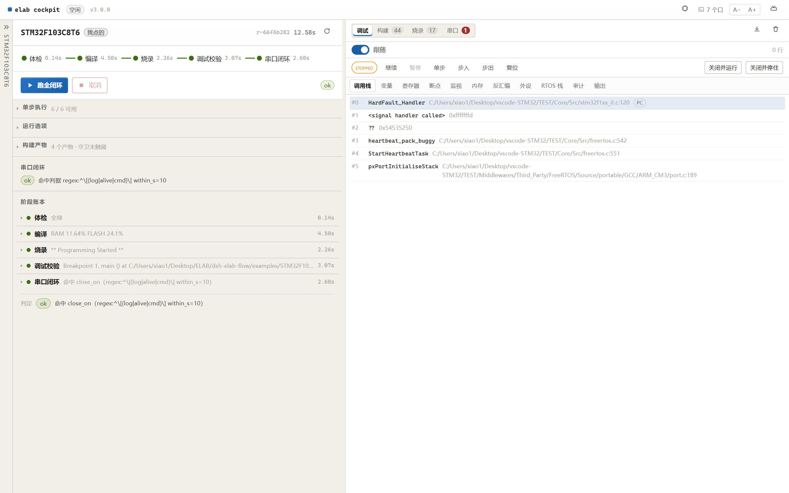

*实机（STM32F103C8T6 + AT-Link）：左工程轨 · 中阶段轨与证据轨 · 右调试工作区（HardFault 调用栈）*

</div>

---

<a id="position"></a>

## 项目定位

嵌入式项目里最重复的一段劳动：**每换一颗芯片，工程、工具链、烧录参数、验证脚本都要重搭一遍**。
CubeMX 一套、WorkBench 一套、Keil/IAR 又各一套，工具版本靠 PATH 运气，真机验证全靠手工。

ELAB-Flow 做的是 **"一套工具链和流程跑不同芯片"**，不是"一套代码跑不同平台"。
业务代码是器官，elab 是外骨骼：**外骨骼不改器官，只负责把器官接上流水线**。

| ELAB-Flow 做 | ELAB-Flow **不**做 |
|---|---|
| 同一句 `elab build -p X` 编译不同厂商、不同内核的芯片 | 代码级可移植层 / 运行时平台抽象 |
| 业务代码原地不动（构建前后文件树快照可断言 `untouched`） | 搬代码、重组目录、建 `apps/` `framework/` |
| 一份通用 `gcc.cmake`，差异只由芯片 YAML 驱动 | 每颗芯片各写一份工具链文件 |

**一个内核，三种入口** —— 同一份事件流、同一个串口会话、同一套步骤定义，区别只在"谁在看、屏幕多大"：

| 入口 | 启动方式 | 适合 |
|---|---|---|
| **CLI `elab`** | `./elab loop -p <name>`（Windows 用 `elab.cmd`） | 脚本 / CI / 无人值守 / agent 直接调用 |
| **独立驾驶舱** | 双击 `cockpit.cmd` 或 `python -m cockpit.server` → `http://127.0.0.1:8333/` | 桌面前盯全程：工程轨 / 阶段轨 / 证据轨三列全屏 |
| **DSH 右栏面板** | 安装插件 `dsh-elab-cockpit`，右栏开 elab tab | agent 在跑、你顺手看：窄栏阶梯 + 日志尾 + 串口页 |

<a id="what"></a>

## 这是什么

```text
工具层  packages/dsh-elab-cockpit      面板 / elab_* agent 工具 / 进程托管（可卸载）
   │  唯一缝隙：loopback HTTP ICD（/api/* 命令 + /events SSE）
业务层  services/elab/** + cockpit/server.py
   │  编排 / 编译 / 烧录 / 调试 / 串口；STEP_META、KERNEL_PLANS、SERIAL_META 是词汇唯一事实源
   │  只读协议：pack.yaml（elab.pkg），不 import 包内文件
业务层  cockpit/web/**                 零依赖驾驶舱 UI（React 产物已入仓）
数据层  packs/** + market/index.json   芯片参数 / 厂商指纹 / 平台坑位 / 社区市场索引
工程    projects/**、examples/**       工程接入 YAML 与实弹样例
```

- 四层依赖**严格单向**，反向依赖被 `packages/dsh-elab-cockpit/test/boundary.test.mjs` 拦截。
- 三个收敛点：主机路径 → [`elab.host.yaml`](elab.host.yaml)；芯片差异 → `packs/**/chips/*.yaml`；工程接入 → `projects/*.yaml`。
- 工具层不 import 内核源码、不复制业务逻辑：它 `spawn` 同一个 `python -m cockpit.server`，把 API 与 SSE 反代过来。内核加一步，面板与 agent 工具自动跟上。

<a id="features"></a>

## 有什么功能

### ① 自动接入工程：不重搭，只探测

给一个工程目录，驾驶舱「＋ 适配」或 `elab adapt <path>` 自动探测芯片、框架类型、构建入口与置信度；写入后生成 `projects/<name>.yaml`，**人工接管的文件绝不覆盖**。

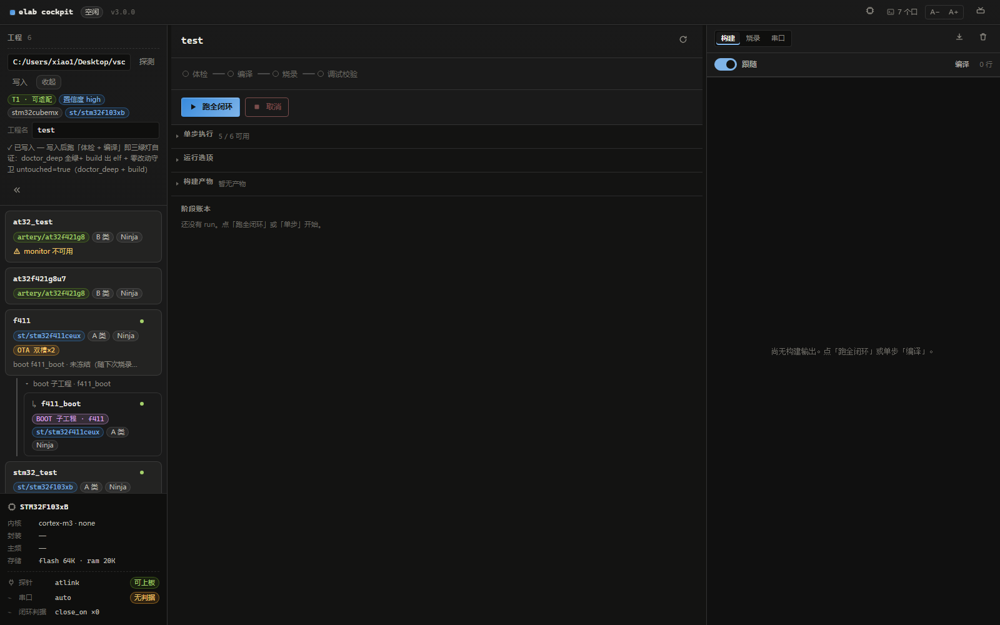

*`T1 可写 / 置信度 high`，写入后工程卡片自动出现并选中；只读探测在前，落盘在后*

### ② 一键闭环：编译 → 烧录 → 调试校验 → 串口判据

`elab loop -p <name>` 依次跑五个阶段，每步都留下可 grep 的证据行；也可只跑一步（`elab run --steps build`）。串口判据给出三态结论：`ok` / `failed` / `inconclusive`（能开但没收到约定关键字 = 未验证，不冒充成功）。

<div align="center">
<table>
<tr>
<td>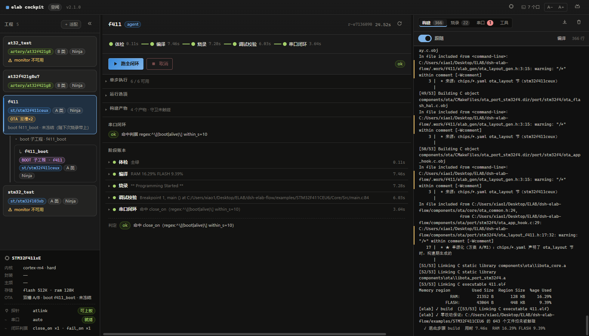<br><sub>五阶段全绿：RAM 16.29% · FLASH 9.39%，产物 / 零改动守卫同屏</sub></td>
<td>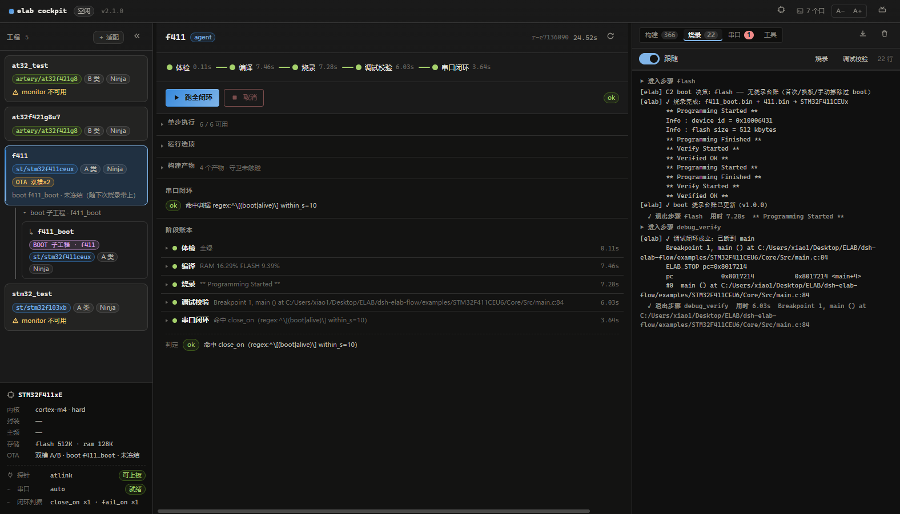<br><sub>烧录 + 校验：双镜像 <code>Verified OK</code>，断到 <code>main.c:84</code></sub></td>
</tr>
</table>
</div>

### ③ 调试工作区：从一次真实 HardFault 收网

会话式调试器：开始 / 继续 / 暂停 / 单步 / 步入 / 步出 / 复位 / 关闭，十一个页签（调用栈、变量、寄存器、断点、监视、内存、反汇编、外设、RTOS 栈、审计、输出）。断点与监视持久化到 `projects/<name>.debug.json`（`rev` 乐观锁），关闭会话固定 `monitor reset run`，不会把板子留在 halt。

<div align="center">
<table>
<tr>
<td>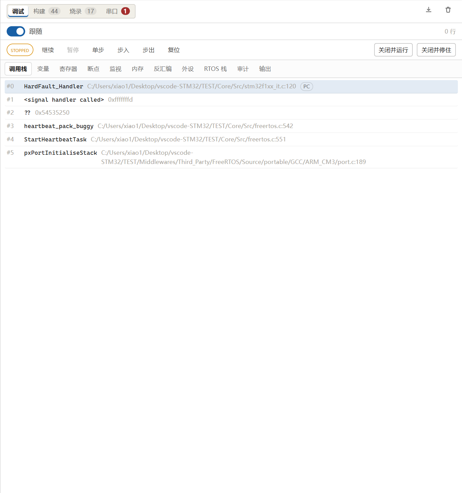<br><sub>调用栈直接指出 <code>#2 0x54535250</code> 非法地址 → <code>#3 heartbeat_pack_buggy</code></sub></td>
<td>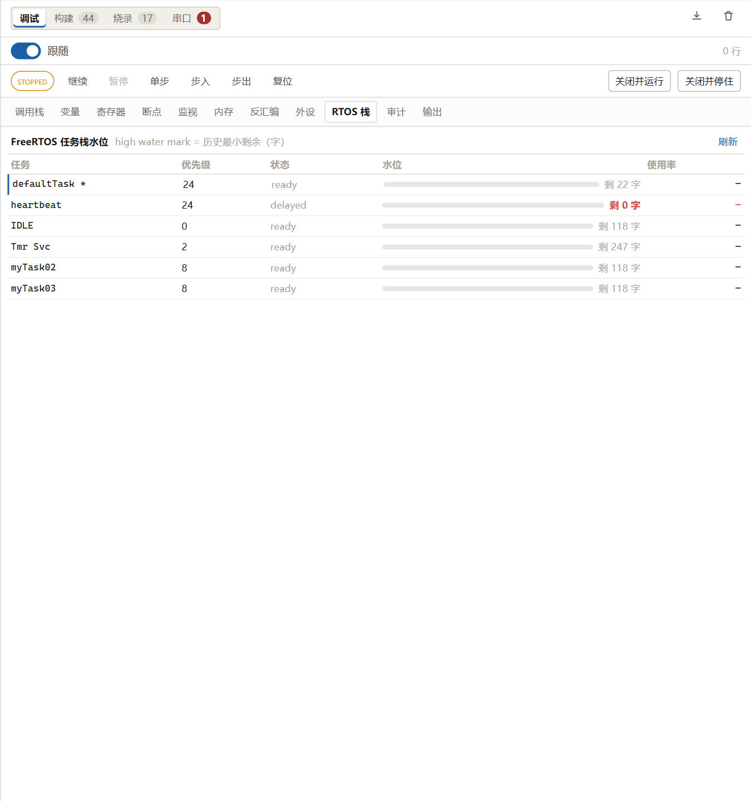<br><sub>RTOS 栈水位：<code>heartbeat</code> 任务剩 0 字（红色 critical）</sub></td>
</tr>
</table>
</div>

`P1` 监视求值 · `P2` CMSIS-SVD 外设字段解码 · `P3` FreeRTOS 任务枚举与栈高水位；能力自描述在 `capabilities.meta.debug.features`，面板按它显示页签。

### ④ 串口工作区：字节为真值，文本只是投影

每个字节批次都带 `seq / dir / t / len / gap`，方向过滤、搜索、换表示全在客户端做，切视图不丢游标。四个视图：**行 / 字节 / 终端 / 波形**；发送面板支持文本 / ASCII / GBK / HEX + 行尾，TX 与 RX 同构入面。

<div align="center">
<table>
<tr>
<td>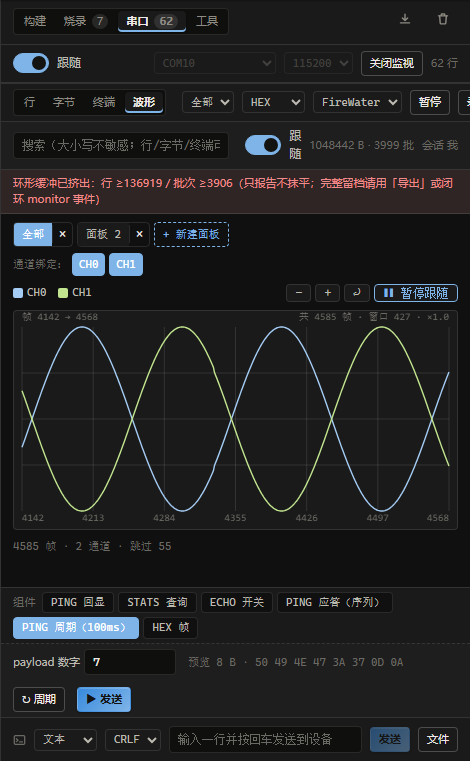<br><sub>波形页：FireWater 双通道正弦 · 多面板独立缩放 · 发送组件（PING 周期）</sub></td>
<td>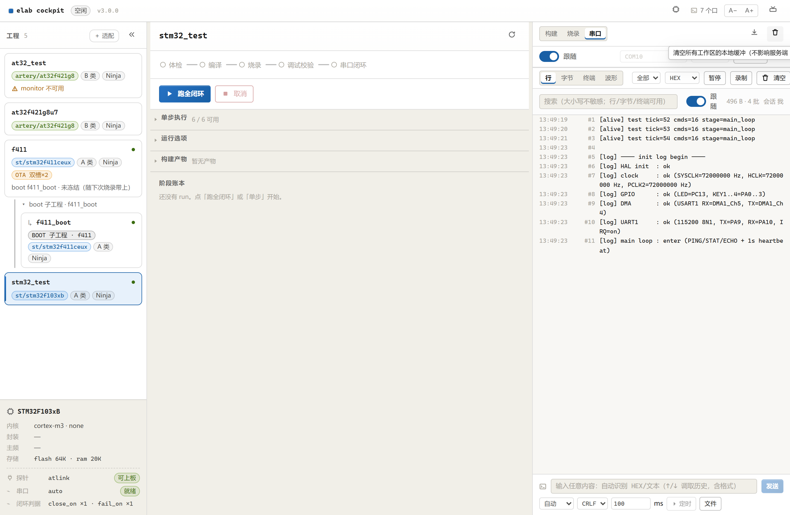<br><sub>行视图：<code>[alive] tick=…</code> 心跳与固件启动日志同屏</sub></td>
</tr>
</table>
</div>

- 解码器是**会话属性**：agent 用 `elab_serial_monitor` / `elab_serial_decode` 选定后，面板波形页标「agent 选定」，读的是内核帧环的同一份帧。
- 监视是"看"不是证据：实时流只活环形缓冲；可复核判定走闭环 `monitor`。串口监视与闭环 run **双向 409 互斥**，agent 会话带租约到期自动释放端口。

**帧协议增强（2026-11-05，STM32F103C8T6 实机）**：工程 profile 现在支持**位域**
（`bit_offset` / `bit_length` / `bit_order`）、**变长切帧**（`frame.length_field`）与
**多 ID 分发**（`frame.id_field` + `variants`）；`帧协议` 抽屉内置 4 份只读模板
（遥测 / MAVLink / Modbus RTU / DL/T 645），支持**未保存草稿预览**和**字段值反向组帧**
（成功后 HEX 直接填入发送框）。Agent 通过 `elab_frame_profile` 只写声明式 JSON，
写操作受 `allowAgentWrite` + `rev` 乐观锁保护。

<div align="center">
<table>
<tr>
<td>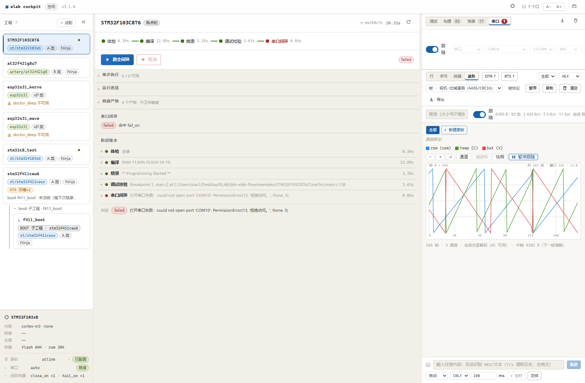<br><sub>位域遥测：<code>AA55</code> 头 + CRC16，同一字节拆 mode/flags</sub></td>
<td>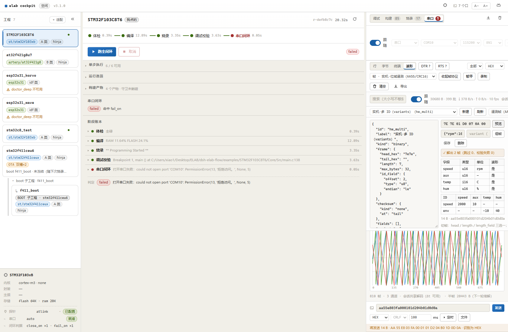<br><sub>多 ID：一个 profile 按 <code>id_field</code> 分发 speed/aux 与 temp/hum</sub></td>
</tr>
</table>
</div>


### ⑤ 适配包与社区市场：芯片知识只住在数据层

骨架仓本身零芯片。芯片参数、厂商指纹、平台坑位全部来自适配包；包之间互不依赖，改包后 `elab pkg index` 重生成索引，CI 用 `--check` 拦漂移。

<div align="center">
<table>
<tr>
<td>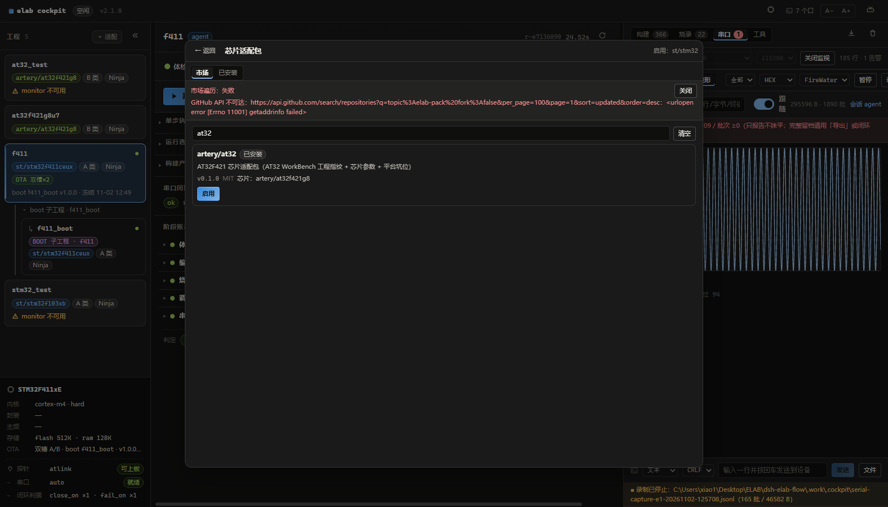<br><sub>市场搜索：<code>at32</code> 一键安装（来源 / 版本 / 芯片列表）</sub></td>
<td>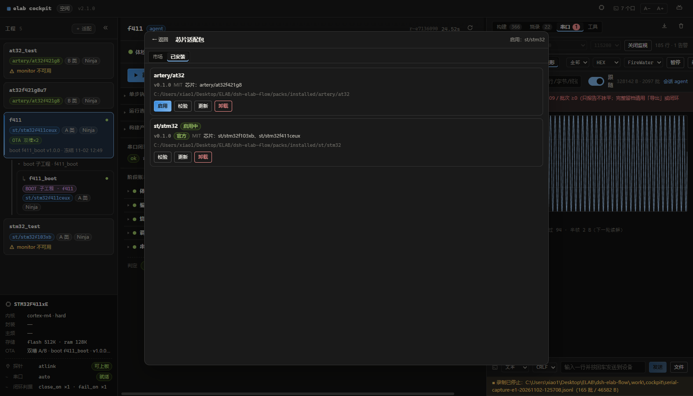<br><sub>已安装管理：启用 / 校验 / 更新 / 卸载，一次只启用一套</sub></td>
</tr>
</table>
</div>

内置 `st/stm32` 用 `elab pkg bootstrap`；其它厂商（如 `artery/at32`）走外置 GitHub 包仓 + 市场索引。贡献新芯片见 [market/CONTRIBUTING.md](market/CONTRIBUTING.md)。

### ⑥ DSH 面板：agent 在跑，你在旁边看

窄栏里是同一个闭环：阶梯进度、日志尾、FLASH/RAM 占位、构建/烧录/调试/串口四通道、串口四视图、调试工作区。插件首次打开自动下载内核归档并补齐工具链，宿主只需 Python ≥ 3.10。

<div align="center">
<table>
<tr>
<td>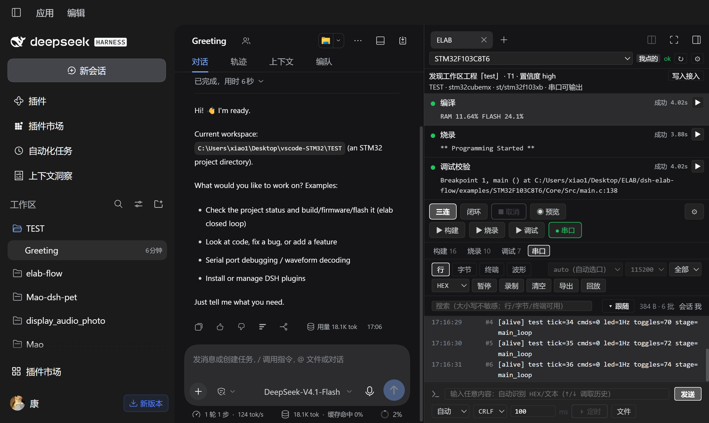<br><sub>DSH 右栏：对话与 ELAB 面板同屏；agent 发起 run 自动切到对应工程</sub></td>
<td>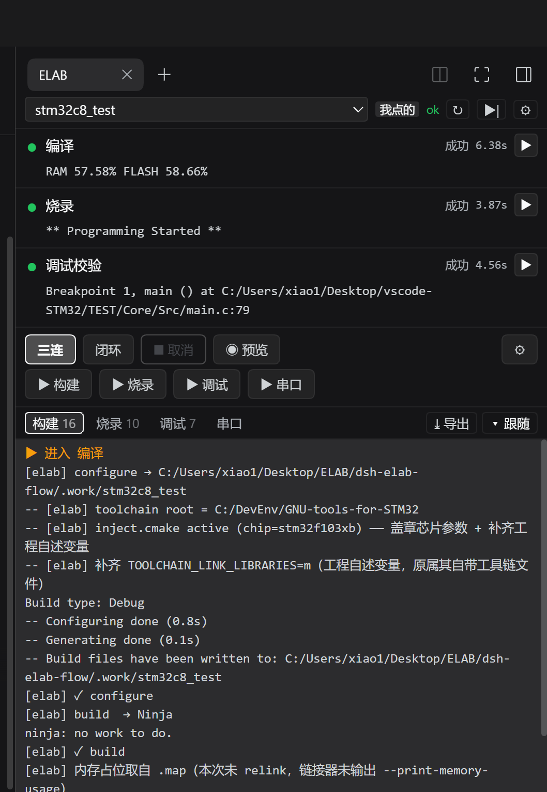<br><sub>三连全绿：编译（RAM/FLASH）→ 烧录 → 调试校验逐行落账</sub></td>
</tr>
</table>
</div>

安装：`dsh plugin --profile web add github:xkk6663/elab-flow#path:/packages/dsh-elab-cockpit`（或 `npm install dsh-elab-cockpit`），重载窗口后右栏出现 elab tab。DSH 里的 agent 调用教程见 [插件 README](packages/dsh-elab-cockpit/README.md#dsh-界面agent-调用教程跨工程生效)。

### ⑦ 多芯同流程：ESP32-S31 实机闭环（外带工具链 provider）

同一句 `elab loop -p esp32s31_korvo`，在 ESP32-S31 上跑完 **体检 → 编译 → 烧录 → 烧录校验 → 串口闭环**：
阶段轨五步全绿，串口判据命中 1Hz `[alive] tick=… toggles=…`，内存条显示 16 MB Flash / 512 KB RAM。

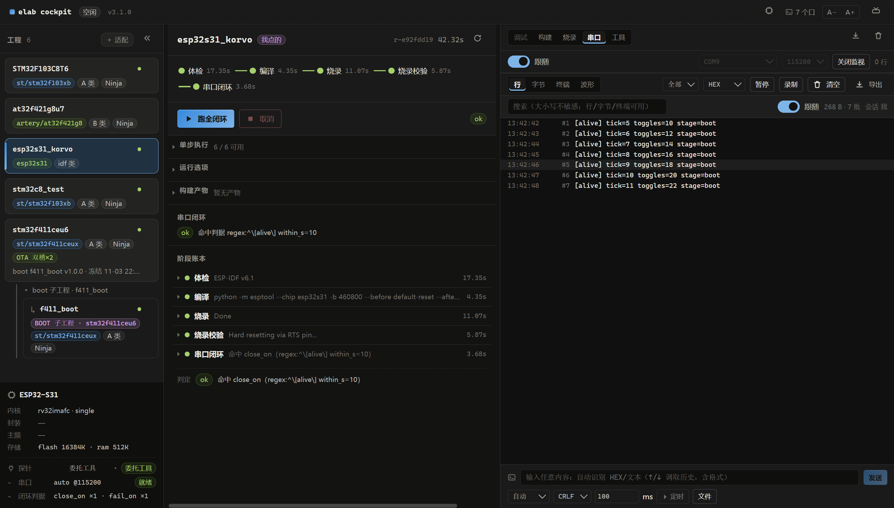

*ESP32-S31-Korvo（N16R16）实机：`esp32s31_korvo` 五阶段全绿；右列串口工作区收到 `[alive] tick=5…11 toggles=10…22`；左下角芯片信息为 RISC-V / Flash 16384 KB / RAM 512 KB*

**外带工具链（`provider: <name>@<range>`）**：内核不内置 ESP-IDF，也不认识 `idf.py`。
命令模板住在独立的声明式 provider 数据包，项目 YAML 只写绑定：

```yaml
# projects/esp32s31_korvo.yaml（节选）
pack: espressif/esp32            # 项目固定包：不受 packs/installed/active.json 影响
chip: esp32s31
provider: espressif/idf@>=1 <2   # 唯一绑定；不再写内联 tools
artifacts:
  flash_args: ${work_dir}/flasher_args.json
```

```yaml
# providers/official/espressif/idf/provider.yaml（节选）
name: espressif/idf
version: 1.0.0
requires:
  host:
    - { key: tools.idf.python, check: file }
    - { key: tools.idf.idf_path, check: dir }
steps:
  build:
    cmd: ["${env:IDF_PY}", "${env:IDF_PATH}/tools/idf.py", "-B", "build", "-DIDF_TARGET=${chip.target}", "build"]
    timeout_s: 1800
  flash:
    cmd: ["${env:IDF_PY}", "${env:IDF_PATH}/tools/idf.py", "-B", "build", "-p", "${serial_port}", "flash"]
  debug_verify:
    cmd: ["${env:IDF_PY}", "-m", "esptool", "--chip", "${chip.flash_chip}", "--port", "${serial_port}", "--baud", "460800", "verify-flash", "${json_args:${work_dir}/flasher_args.json#flash_files}"]
    timeout_s: 300
```

- **数据与执行分离**：芯片事实在 pack（`${chip.target}` / `${chip.flash_chip}`）、机器路径在 `elab.host.yaml`（`${host:tools.idf.*}`）、命令模板在 provider；三者都不写进内核。
- **预览与实跑同源**：`elab run --dry-run` 打印的就是执行器实际 materialize 出的 argv，没有第二套拼命令逻辑。
- **事件名不变**：委托只换执行者，事件仍是规范步骤名（`build` / `flash` / `debug_verify`），日志照常落在对应通道。
- **缺步骤不回退**：provider 未提供的步骤直接 `unavailable` 报错（例如 ESP-IDF 没有 `doctor_deep`），不会静默掉回原生链。
- **内核保留判断力**：`monitor` / `doctor_deep` 永不由 provider 提供，串口三态与 `serial/*` 事件仍在内核。
- **可显式混用**：项目可写 `steps.flash: tool:my_flash` 单步覆盖，但必须写明；`artifacts` 同名键也可覆盖 provider。
- **不需要探针**：外带 `flash` / `debug_verify` 由 provider 的 `requires.probe: false` 声明；`doctor` 跳过 ARM 工具链/链接脚本检查，只校验工具命令与主机前提。
- **可复现**：`elab provider install` 记录来源与 sha256，`elab.lock.yaml` 锁版本，`elab doctor --strict-lock` 可在 CI 升级为失败。
- **构建产物自描述**：`${json_args:FILE#KEY}` 把 `build/flasher_args.json#flash_files` 展开成 esptool 的偏移/产物对；委托构建成功后按 `artifacts.map` 回填 RAM/FLASH 占位（`memory_source=map`）。

安装与接入：

```bash
elab pkg install espressif/esp32        # 芯片包：芯片参数 / 厂商指纹
elab provider install espressif/idf     # 工具链 provider：命令模板，独立于芯片包
```

装完包会**自动跑一次环境自检**（`elab pkg install/bootstrap/update/activate` 之后都会，
等价于 `elab setup`）：芯片包、provider、工具链主机键、串口/探针逐项列出，缺什么直接给下一步命令。
自检**只读**——不下载工具链、不写 `elab.host.yaml`；provider 的 `toolchain.install` 命令原文只打印给人看。

```bash
elab setup                       # 复查当前启用的包（0=就绪 / 1=有缺失）
elab setup --pack espressif/esp32  # 指定包
elab setup -p my-project         # 连同工程的串口 / 探针一起查（自动用项目固定的 pack）
```

`elab adapt <path>` 识别 ESP-IDF 工程（根 `CMakeLists.txt` include `project.cmake`，芯片读 `sdkconfig` 的 `CONFIG_IDF_TARGET`）后直接生成
`provider: espressif/idf@>=1 <2`，不再写内联 `tools:`（`--no-provider` 才保留内联兜底）——
后续外部工程（如 `pet_companion`）直接复用这条接入路径。

新机器先装 ESP-IDF：用 **EIM（ESP-IDF Installation Manager）** 装好 v6.1，再把 `elab.host.yaml: tools.idf` 指向 EIM 的安装路径（激活脚本由 `env_from_cmd` 等价替代，不用手动 `export`）。`elab setup --pack espressif/esp32` 会把 provider 里声明的安装命令、文档链接和要回填的 `tools.idf.*` 键一起打印出来。完整步骤见 [ESP32 适配包 README](https://github.com/xkk6663/elab-pack-espressif-esp32#2-接入-elab-flow)。

### ⑧ CLI：一条命令跑完，也能被 CI 直接调用

终端每行按类型着色：编译进度、warning、烧录 `Verified OK`、串口心跳不会混成一片灰字。退出码即结论：`0` ok / `1` failed / `2` inconclusive。

<div align="center">
<table>
<tr>
<td>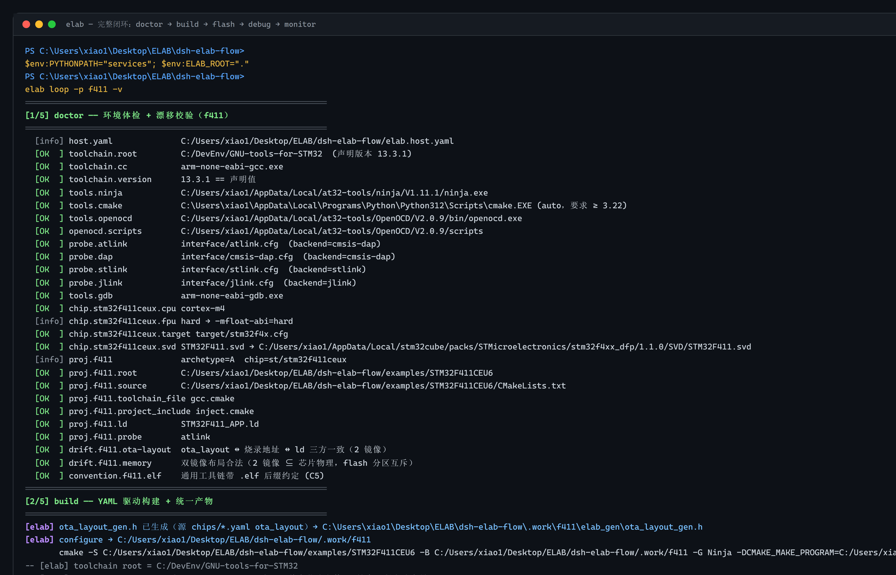<br><sub><code>elab loop -p f411 -v</code>：五阶段分色，doctor 全绿 + build 进度</sub></td>
<td>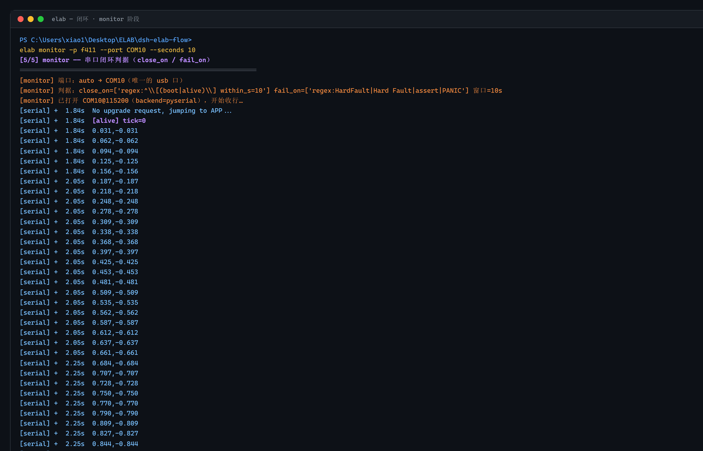<br><sub>monitor：波形行与心跳同屏，命中判据即退出</sub></td>
</tr>
</table>
</div>

### ⑨ OTA 双槽升级（F411CEU6 实弹样例）

`examples/STM32F411CEU6/`（APP 根 + `boot/`）是完整参考实现：boot / APP / 上位机 / 异常注入 / 双槽回滚全链路验证。

- **分区表唯一事实源**：适配包 `chips/*.yaml` 的 `ota_layout:`，构建期注入 `ota_layout_gen.h`，`doctor --deep` 三方对账。
- **坏固件自动回滚**：新固件写 INACTIVE 槽 → 试运行（trial 先记后跳）→ 耗尽打印 `=== ROLLBACK ===`；心跳正常则 `OTA_Confirm()` 晋级。
- **停等协议**：`AA [01|02] SEQ LEN DATA CRC32 EOF 55`，CRC 错 NAK 重传；每 1KB 记页，支持断点续传。
- **组合工程**：`ota_layout.boot_project: f411_boot` 让 `elab build -p f411` 级联构建；`elab flash` 按 boot bin 的 md5 指纹冻结台账。

### ⑩ 独立 WebUI：通用 agent 怎么调用

这一节不依赖 DSH 插件，适用于 Claude Code / Cursor / Codex 等任何能跑命令或发 HTTP 的 agent。
DSH 界面里的 agent 调用教程（开面板、话术、纪律）见 [插件 README](packages/dsh-elab-cockpit/README.md#dsh-界面agent-调用教程跨工程生效)。

#### 仓库拉下来，agent 就能直接 elab 吗？

能跑命令行，但**不是零配置**。克隆后先做三步，再让 agent 接手：

```bash
./elab pkg bootstrap                 # ① 内置芯片包 st/stm32（Windows 用 elab.cmd；装完自动做环境自检）
./elab doctor                        # ② 体检：工具链 / 探针 / 端口，缺什么会直说
./elab adapt ../my-project --write   # ③ 接入工程（先去掉 --write 看只读报告）
```

之后 agent 可以直接调用 CLI；想让人看到驾驶舱，再起 `cockpit.cmd`（或 `python -m cockpit.server`，需 `PYTHONPATH=services`）。

#### 两种调用方式，区别只有一个：进不进驾驶舱

| 方式 | agent 怎么调 | 用户看到什么 |
|---|---|---|
| **CLI** | `elab.cmd loop -p TEST -v`（或 `./elab build -p TEST`） | 终端分色输出 + 退出码（`0` ok / `1` failed / `2` inconclusive）；**不进 WebUI 实时面板** |
| **HTTP ICD** | `POST http://127.0.0.1:8333/api/run`，body `{"project":"TEST","actor":"agent"}` → `202` + runId | WebUI 三列实时亮：阶梯、四通道日志、串口四视图；发起方标 `agent`，可点取消 |

HTTP 配套端点（都在 `http://127.0.0.1:8333`）：

- `GET /api/runs`：活动 / 历史 run；`GET /api/plan?project=TEST`：只读预览 argv
- `GET /api/events?run=<id>`：SSE 实时流；不能长连接的 agent 用 `GET /api/run-events?run=<id>&from=0` 轮询
- `POST /api/cancel {"run":"<id>"}`；串口 `POST /api/serial/monitor`；调试 `POST /api/debug/session`
- 串口监视占用时，含烧录 / 调试的 run 返回 `409`（先关监视再跑）

#### 给通用 agent 的启动提示词

不装 DSH 插件时，把下面整段贴进工程的 `AGENTS.md` 或会话首条消息（Claude Code / Cursor / Codex 都适用），agent 就知道该怎么用：

```text
本工程用 elab-Flow 做固件闭环，仓库根是 <ELAB_ROOT>（Windows 用 <ELAB_ROOT>\elab.cmd，其它平台用 <ELAB_ROOT>/elab）。
- 先 `elab doctor` 判断工具链与探针；没有探针时只能 build / ci，不要反复重试烧录。
- 改代码后用 `elab build -p <工程>` 看 RAM / FLASH；要烧录或跑闭环用 `elab loop -p <工程> -v`。
- 需要我实时看驾驶舱时，不要用 CLI 跑长任务：先起 `cockpit.cmd`，再
  POST http://127.0.0.1:8333/api/run  {"project":"<工程>","actor":"agent"}，
  用 GET /api/events?run=<id>（或 /api/run-events）跟踪，取消用 POST /api/cancel {"run":"<id>"}。
- 单飞：同时只跑 1 个 run；串口监视占用时烧录 / 调试会 409，先关监视。
- 接入新工程优先 `elab adapt <目录>`（先只读），确认后再 `--write`；不要手改 projects/*.yaml。
- 你只读日志与串口计数；「LED 均匀闪烁」由我肉眼确认后回报（你只凭 tick / toggles 判活）。
```

#### 不灵时的三件事

- `elab` 找不到 → 用仓库根 `elab.cmd` / `./elab`，或 `PYTHONPATH=services python -m elab doctor`。
- WebUI 打不开 → `cockpit.cmd` 幂等，重复启动不会起第二个服务；确认顶栏有版本号与「串口后端就绪」。
- `/api/run` 返回 404 → 端口或路径写错；面板确实在跑再让 agent 发 HTTP，不要对着空端口重试。

#### 在 DSH 界面里用？（可选）

装插件后是另一套入口：右栏 ELAB 面板 + 25 个 `elab_*` 工具（写硬件 / 写盘受 `allowAgentWrite` 门控，默认关）。
完整调用教程见 [插件 README](packages/dsh-elab-cockpit/README.md#dsh-界面agent-调用教程跨工程生效)，这里只列工具面：

| 组 | 工具 |
|---|---|
| 看 | `elab_status` · `elab_guide`（使用契约）· `elab_preview`（只读 argv）· `elab_log` |
| 闭环 | `elab_build` · `elab_triple` · `elab_loop` · `elab_step` · `elab_cancel` |
| 工程与包 | `elab_adapt`（`write=false` 先看只读报告）· `elab_pkg` |
| 调试 | `elab_debug_open / control / inspect / breakpoint / wait / close` |
| 串口 | `elab_serial` · `_monitor` · `_read` · `_wait` · `_decode` · `_decoded` · `_capture` · `_widget` · `_frame_profile` |

<a id="quickstart"></a>

## 怎么用

```bash
git clone git@github.com:xkk6663/elab-flow.git
cd elab-flow

./elab pkg bootstrap      # ① 安装内置包 st/stm32（装完自动环境自检，缺什么会列出来）
./elab setup              # ② 随时复查：芯片包 / provider / 工具链 / 串口探针
./elab doctor             # ③ 环境体检，先全绿再往下
./elab adapt ./my-project --write   # ④ 接入自己的工程（可先不加 --write 看只读报告）
./elab loop -p my-project -v        # ⑤ 一键闭环：体检→编译→烧录→调试校验→串口
python -m cockpit.server            # ⑥ 驾驶舱 → http://127.0.0.1:8333/
```

- 要求：**Python ≥ 3.10（无第三方依赖）**；上板另需 CMake + Ninja + ARM GCC + OpenOCD。Windows 用 `elab.cmd`，桌面场景直接双击 `cockpit.cmd`（幂等，已在跑只开 UI）。
- 没有探针时 `doctor` / `build` / `ci` 照样可跑，`loop` 会在 flash 步失败。
- 门禁：`elab ci` 与 GitHub Actions 共用 `ci/matrix.yaml`；门禁绿却零产物 → 红。

> 已实测：AT32F421G8U7（WorkBench 工程，自动接入）、STM32F103C8T6、STM32F411CEU6（CubeMX + boot 组合工程 / OTA 双槽）、ESP32-S31-Korvo（外带 `espressif/idf` provider），业务工程文件树均为 `untouched`。

**工具链**（DSH 插件首次打开会按官方上游直链自动安装，仅 Windows x64；其它平台先探测本机 PATH）：

| 工具 | 版本 | 覆盖环境变量 |
|---|---|---|
| `arm-none-eabi-gcc` | 13.3.1 | `ELAB_ARM_GCC_ROOT` |
| CMake | 3.28.1 | `ELAB_CMAKE` |
| Ninja | 1.11.1 | `ELAB_NINJA` |
| OpenOCD | 0.12.0-3 | `ELAB_OPENOCD` / `ELAB_OPENOCD_SCRIPTS` |

**探针是数据不是代码**：`elab.host.yaml` 的 `probes.list` 内置 `atlink` / `dap` / `stlink` / `jlink`，工程接入文件只声明用哪个（默认取 `probes.default`）：

```yaml
# projects/<name>.yaml
debug:
  probe: stlink     # atlink | dap | stlink | jlink
```

`interface cfg` 属于探针、`target cfg` 属于芯片，两者正交 —— 同一个 CMSIS-DAP 换 target cfg 就能连不同厂商的芯片。新探针在 `probes.list` 加一条 `{backend, interface_cfg, transport, speed}` 即可。

<a id="repo"></a>

## 仓库结构

```text
services/elab/**          内核：闭环编排、编译/烧录/调试、串口字节面、OTA、适配包/provider 协议
cockpit/server.py         内核 HTTP 面 + 自描述（STEP_META / KERNEL_PLANS）
cockpit/web/**            独立驾驶舱 UI（产物已入仓）
packs/official|installed  芯片适配包（芯片参数/指纹；骨架仓不含芯片；installed/ 不入库）
providers/official|installed 工具链 provider（声明式命令模板；installed/ 不入库）
market/index.json         零服务器社区市场索引（packs + providers）
packages/dsh-elab-cockpit DSH 插件（面板 / 进程托管 / elab_* 工具）
projects/**               工程接入 YAML
examples/**               实弹样例（F411 OTA、STM32/AT32 工程、ESP32-S31 心跳）
tests/ · ci/              内核测试与本地/云端门禁
docs/**                   教程、设计约束、架构分析
```

- 市场与 npm 都直接取自本仓 `packages/dsh-elab-cockpit` 子目录，没有镜像/分发仓。
- 分层规则见 [AGENTS.md](AGENTS.md)；`packs/installed/` 是用户按需安装的落点，随仓只提交 `packs/official/**` 与 `market/index.json`。

<a id="docs"></a>

## 文档

| # | 教程 | 适合 |
|---|---|---|
| 01 | [芯片开发上手 · 独立 WebUI 全流程](docs/tutorials/01-芯片开发上手_独立WebUI.md) | 换新芯片 / 新板，先过心跳第一关 |
| 02 | [市场适配包贡献](docs/tutorials/02-市场适配包贡献.md) | 给新厂商做适配包并上市场 |
| 03 | [插件市场使用 · 独立 WebUI](docs/tutorials/03-插件市场使用_独立WebUI.md) | 零环境装插件 + 首启向导 |
| 04 | [调试工作区上手 · 真实 HardFault 排错](docs/tutorials/04-调试面板上手_STM32F103C8T6.md) | 断点 / 监视 / 外设 / RTOS 栈 |
| 05 | [DSH 插件上手 · 右栏闭环 + 调试页签](docs/tutorials/05-DSH插件上手_STM32F103C8T6.md) | DSH 主线 |
| 06 | [CLI 终端闭环 · 真机 5 阶段](docs/tutorials/06-CLI终端闭环上手.md) | 只想用命令行 |
| 07 | [串口面板使用](docs/tutorials/07-串口面板使用.md) | 发送 / 历史 / 定时 · 三链路 / 波形游标 |
| 08 | [串口压力测试报告 · STM32F411CEU6](docs/tutorials/08-串口压力测试报告_STM32F411CEU6.md) | 高吞吐与丢数判定 |

深度文档（架构 / 设计约束 C1–C36 / ICD / OTA）见 [docs/README.md](docs/README.md)，版本历史见 [CHANGELOG.md](CHANGELOG.md)。

## 已知限制

- `onhw-gate` 需 self-hosted 探针（云端编译门禁不受影响）；`profiles/*.yaml` 插件化装配与 `elab skill --adapt` 未实现。
- 常驻监视的实时流只活环形缓冲（重启即失）；要证据走闭环 `monitor` 或「录制」。
- 字节视图只渲染最近若干批（驾驶舱 300 / DSH 200）；波形共享解码最多看帧环 1024 帧，更早的用「导出 / 录制」留档。
- 录制产物是有界 JSONL（可回放），界面暂无回放器；双槽传输中拔电续传待复验。
