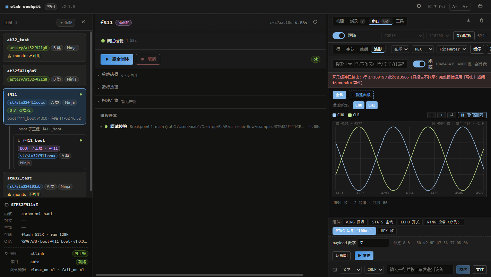

<div align="center">

# ELAB-Flow

**一套工具链 + 一套流程，驱动不同芯片的 编译 / 烧录 / 调试 / 串口闭环。**

业务工程源码**零改动** · Python **仅标准库** · 驾驶舱前端产物已入仓（运行时不需要 Node）

**本期新增**：串口工作区（行 / 字节 / 终端 / 波形四视图 + 发送面板 + 协议解码 + 录制导出 + **录制回放**）· **共享解码**（agent 选定 decoder，人与 agent 看同一份帧）· DSH 插件面板（每通道独立启动按钮 + 日志导出 + 适配漂移复探测）· `cockpit/profiles/*.yaml` 槽位装配 · 适配包 / 零服务器市场 —— 详见 [CHANGELOG](CHANGELOG.md)

[](https://github.com/xkk6663/elab-flow/releases/latest)
[](https://github.com/xkk6663/elab-flow/actions/workflows/elab.yml)
[](tests/)
[](README.md#这是什么)
[](README.md#三十秒上手)

[项目定位](#position) · [快速上手](#quickstart) · [使用流程](#flow) · [驾驶舱](#cockpit) · [Agent 工具](#agent-tools) · [串口工作区](#serial) · [适配包](#packs) · [OTA](#ota) · [实测证据](#evidence) · [文档索引](#docs)



*闭环驾驶舱：工程轨（boot 子工程嵌套）→ 阶段轨 → 证据轨*

</div>

---

<a id="这是什么"></a>

## 这是什么

嵌入式项目的常见困境：**每换一颗芯片，就要重搭一遍工程、重配一遍工具链、重写一遍构建脚本**。
CubeMX 一套、WorkBench 一套、Keil/IAR 又各一套 —— 工具链版本靠 PATH 运气，烧录参数散落在 IDE 里，
真机验证全靠手工。

ELAB-Flow 做的是 **"一套工具链和流程跑不同芯片"**，不是"一套代码跑不同平台"。

| ELAB-Flow 做 | ELAB-Flow **不**做 |
|---|---|
| ✅ 同一句 `elab build -p X` 编译不同厂商、不同内核的芯片 | ❌ 代码级可移植层 / 运行时平台抽象 |
| ✅ 业务代码原地不动（构建前后文件树快照可断言 `untouched`） | ❌ 搬代码、重组目录、建 `apps/` `framework/` |
| ✅ 一份通用 `gcc.cmake`，差异只由芯片 YAML 驱动 | ❌ 每颗芯片各写一份工具链文件 |

> **外骨骼原则**：业务代码是器官，elab 是外骨骼。外骨骼不改器官，只负责把器官接上流水线。

<a id="position"></a>

### 项目定位：一个内核，三种入口

内核只有一套（`services/elab/**` + `cockpit/server.py`），对外提供三种**同源**入口 ——
同一份事件流、同一个串口会话、同一套步骤与档位定义。区别只在"谁在看、屏幕多大"。

| 入口 | 怎么启动 | 适合谁 | 形态 |
|---|---|---|---|
| **CLI `elab`** | `./elab loop -p <name>`（Windows 用 `elab.cmd`） | 脚本 / CI / 无人值守 / agent 直接调用 | 一行命令 + 可 grep 的证据行 |
| **独立驾驶舱** | 双击 `cockpit.cmd`，或 `python -m cockpit.server` → `http://127.0.0.1:8333/` | 人坐在桌面前盯全程：工程轨 / 阶段轨 / 证据轨三列全屏 | Edge `--app` 独立窗口；已在跑则只开 UI |
| **DSH 右栏面板** | 在 DSH 安装 `packages/dsh-elab-cockpit`，右栏开 elab tab | agent 在跑、你顺手看：窄栏阶梯 + 日志尾 + 串口页 + 设置页 | 工具层插件：托管内核子进程，只走 loopback HTTP ICD |

- 三者**不各有一套实现**：DSH 面板不 import 内核源码、不复制业务逻辑；它 `spawn` 同一个
  `python -m cockpit.server`，把 `/elab/api/*` 与 `/elab/events` 反代过来
  （分层门禁 `packages/dsh-elab-cockpit/test/boundary.test.mjs` 会拦违规）。
- **步骤 / 档位 / 串口词汇的唯一事实源在内核**（`cockpit/server.py` 的
  `STEP_META` / `KERNEL_PLANS` / `SERIAL_META`）。工具层只渲染；内核加一步，面板与 agent 工具自动跟上。

### 两层结构

| 层 | 路径 | 职责 |
|---|---|---|
| **业务层（内核）** | `services/elab/**`、`cockpit/server.py` | 闭环编排、编译/烧录/调试、串口字节面、OTA、适配包协议；`STEP_META` / `KERNEL_PLANS` 是步骤与档位的唯一事实源 |
| **业务层（前端）** | `cockpit/web/**` | 零依赖驾驶舱 UI（React 产物已入仓，运行时只有 Python） |
| **数据层** | `packs/official/**`、`packs/installed/**`、`market/index.json` | 芯片参数 / 厂商指纹 / 平台坑位（芯片知识的唯一宿主）；零服务器社区市场索引 |
| **工具层** | `packages/dsh-elab-cockpit/**` | DSH 插件：右栏面板可视化、进程托管、`elab_*` agent 工具。与内核**只通过 loopback HTTP ICD 通信**，不 import 源码 |
| 工程 | `projects/**`、`examples/**` | 工程接入 YAML 与实弹样例 |

<a id="quickstart"></a>

## 三十秒上手

```bash
git clone git@github.com:xkk6663/elab-flow.git
cd elab-flow

./elab pkg bootstrap      # ① 安装内置包 st/stm32（生成平台 skill）
./elab doctor             # ② 环境体检，先全绿再往下
./elab loop -p at32_test  # ③ 一键闭环：体检→编译→烧录→断到 main→串口判据
python -m cockpit.server  # ④ 驾驶舱 → http://127.0.0.1:8333/
```

- 要求：**Python ≥ 3.10（无第三方依赖）**；上板另需 CMake + Ninja + ARM GCC + OpenOCD
- Windows：`elab.cmd`；桌面场景直接双击 `cockpit.cmd`（幂等，已在跑只开 UI）
- 没有探针时 `doctor` / `build` / `ci` 照样可跑（`loop` 会在 flash 步失败）
- **DSH 插件**：把 `packages/dsh-elab-cockpit` 的绝对路径交给 DSH 的 `plugin_manager install_bundle`
  （开发期可用 Junction 指向本仓），重载窗口后右栏出现 elab 面板

<a id="flow"></a>

## 使用流程

| 你在哪 | 走哪条路 | 入口 |
|---|---|---|
| 终端 / CI / 让 agent 自己跑 | **CLI**：命令即流程，失败即非零退出 | `elab <cmd>` |
| 桌面前要盯全程、切工程、看 OTA | **独立驾驶舱**：三列全屏 | `cockpit.cmd` |
| 在 DSH 里和 agent 一起干活 | **DSH 面板**：窄栏阶梯 + 日志尾 | 右栏 elab tab |

三条路跑的是同一份内核、同一份事件流，所以下面按**能做什么**串流程，而不是按入口重复三遍。

```text
安装适配包  →  接入工程  →  跑闭环 / 单步  →  看证据  →  串口调试  →  CI
   pkg            adapt          loop/run        Cockpit     serial      ci
```

1. **装芯片**：`elab pkg search <vendor/platform>` → `elab pkg install <vendor/platform>`
   （内置 `st/stm32` 用 `bootstrap`；不装包也能体检主机）。面板里对应工程条 ⚙ → 市场。
2. **接工程**：驾驶舱「＋ 适配」一键探测→写入；或
   `elab adapt <path> --write && elab adapt <path> --verify`；或手写 `projects/<name>.yaml`。
   人工接管的文件绝不覆盖。agent 走 `elab_adapt`（`write=false` 先看只读报告）。
3. **跑闭环**：`elab loop -p <name>`（doctor → build → flash → debug --verify → monitor），
   每步都留可 grep 的证据行；也可 `elab run -p <name> --steps build` 只跑一步。
   - **CLI**：上面两条命令。
   - **独立驾驶舱**：「▶ 跑全闭环」/ 阶段轨「单步执行」，见[下节 6 步表](#cockpit)。
   - **DSH 面板**：顶部三档 **编译 / 三连 / 闭环**；每个通道另有 **▶构建 / ▶烧录 / ▶调试 / ▶串口**。
   - **agent**：`elab_build` / `elab_triple` / `elab_loop` / `elab_step`（返回 run id，进度面板实时可见）。
4. **看证据**：驾驶舱阶段轨逐步点亮；内存占位取自 `.map`；产物 elf/hex/bin/map 可点开；
   「零改动守卫」显示未触碰文件数。agent 用 `elab_status`（现状）+ `elab_log`（日志尾）+
   `elab_preview`（只读 argv）。
5. **调串口**：见 [串口工作区](#serial)；agent 用 `elab_serial*` 一组（读 / 写 / 等 / 解码 / 录制）。
6. **进门禁**：`elab ci`（本地）与 GitHub Actions 共用同一份 `ci/matrix.yaml`；
   门禁绿却零产物 → 红。

<a id="cockpit"></a>

## 闭环驾驶舱

| 步骤 | 操作 | 你会看到 |
|---|---|---|
| ① 启动 | 双击 `cockpit.cmd` 或 `python -m cockpit.server` | Edge `--app` 独立窗口；已在跑则只开 UI（幂等） |
| ② 接入工程 | 工程轨「＋ 适配」→ 粘贴工程绝对路径 →「探测」→「写入」 | 只读探测报告（T1/T3、置信度、芯片、证据链）；新卡片自动出现并选中 |
| ③ 跑闭环 | 选中卡片 →「▶ 跑全闭环」 | 阶段带逐步点亮；不可用步骤自动排除（tooltip 说明原因） |
| ④ 只跑一步 | 阶段轨「单步执行」折叠条；各工作区顶栏有对应按钮 | 置灰按钮的 tooltip 直接给理由（如"monitor 不可用：固件无心跳判据"） |
| ⑤ 导航 | 右列恒为 **构建 \| 烧录 \| 串口 \| 工具**（工具页随 `tools:` 声明出现） | 每个工作区有自己的启动按钮与日志通道，日志互不串台 |
| ⑥ 预览 | 阶段轨「运行选项」→「预览」 | 只读打印将执行的每条命令（`--clean` 副作用显式标红），不 spawn、不写盘 |

### DSH 面板（窄栏版，agent 在跑时你在旁边看）

**安装（一次）**：把 `packages/dsh-elab-cockpit` 的绝对路径交给 DSH 的
`plugin_manager install_bundle`（开发期可用 Junction 指向本仓），重载窗口。

**用起来 5 步**：

1. **开面板**：右栏 elab tab（左栏 panellist 也有入口）。首次打开会自动托管内核子进程
   （`python -m cockpit.server`，随机端口，只绑 `127.0.0.1`）；内核过旧时面板会提示同步。
2. **看 agent 跑到哪**：阶梯逐行点亮（步骤 / 状态 / 耗时 / 单行 detail），日志尾跟着聚焦步骤滚动；
   agent 发起的 run 会**自动切到对应工程**，但只跟新 run —— 不会把你手动切换的视图反复拽回。
3. **自己动手**：顶部一行三档 **编译 / 三连 / 闭环** + 取消 / 预览 / ⚙；每个通道各有独立启动按钮
   **▶构建 / ▶烧录 / ▶调试 / ▶串口**，不必先跑全闭环才能单独用某一页。
4. **串口页**：行 / 字节 / 终端 / 波形四视图 + 发送面板，与独立驾驶舱**同一套工作区**；
   agent 选定 decoder 后波形页会标 **「agent 选定」**并展示同一份帧，见[共享解码](#serial-shared)。
5. **设置页**：工程条右上角 **⚙** 打开整幅设置视图（市场搜索安装 / 已装包启用管理 / 内核设置），
   不挤占主视图。

<a id="agent-tools"></a>

## Agent 工具（`elab_*`，共 17 个）

工具层向 agent 暴露的全部能力。**写硬件 / 写盘的都要 `allowAgentWrite`**（默认关）；
安装适配包时内核会冻结闭环（有 run 在跑则返回 409）。

| 组 | 工具 | 作用 |
|---|---|---|
| **看** | `elab_status` | 工程与步骤可用性（含不可用原因）+ 串口端口候选 / 当前会话 / 租约剩余 |
| | `elab_preview` | 只读命令预览（每步 argv 与 `--clean` 删除目标；不 spawn、不写盘） |
| | `elab_log` | 某个 run 的日志尾（默认 200 行，可按步骤过滤） |
| **闭环** | `elab_build` | `plan=basic`：只编译 |
| | `elab_triple` | `plan=triple`：编译 + 烧录 + 调试校验（需硬件） |
| | `elab_loop` | `plan=loop`：体检 → 编译 → 烧录 → 调试校验 → 串口闭环 |
| | `elab_step` | 按显式步骤执行（含 `tool:<name>`）；不可用**直接报错**，不静默剔除 |
| | `elab_cancel` | 取消当前 run（人 / agent 发起都可） |
| **工程与包** | `elab_adapt` | 探测（`write=false`）或写入接入 YAML（`write=true`） |
| | `elab_pkg` | `status / search / install / activate / remove / update / verify` |
| **串口** | `elab_serial` | 写串口（`utf8/ascii/gbk/hex` + 行尾） |
| | `elab_serial_monitor` | 会话 `open / close / decoder / clear / pause / resume`（带租约） |
| | `elab_serial_read` | 增量读原始字节批次（`seq / dir / t / len / gap`） |
| | `elab_serial_wait` | 等匹配内容出现 / 超时（“发命令后等 OK”这类时序断言） |
| | `elab_serial_decode` | 无状态解码（JustFloat / FireWater）；`apply=true` 同时落到会话 |
| | `elab_serial_decoded` | 增量读**会话共享解码帧**（与面板波形页同一份数据） |
| | `elab_serial_capture` | 开始 / 停止字节录制，返回证据文件路径与统计 |

内核自描述 `capabilities.meta` 会把步骤、档位与解码器清单带给面板和 agent ——
**工具层不写死业务枚举**，内核演进时自动跟随。

<a id="serial"></a>

## 串口工作区（本期核心）

### 数据面：字节为真值，文本只是投影

串口输出不再只是"按行文本"，而是 **带方向、带时间、可寻址的字节批次**：

| 字段 | 含义 |
|---|---|
| `seq` | 批次序号（清空后仍单调递增） |
| `dir` | `rx` / `tx` —— 你发送的内容也进入同一份数据面 |
| `t` / `t_us` | 墙钟时间 / 微秒时间戳 |
| `len` / `data_b64` | 原始字节（base64），**永远是字节** |
| `epoch` | 连接纪元：每次重开监视自增，旧游标不会静默看不到新数据 |
| `gap` | 环形缓冲挤出量（只报告、不抹平） |

四个视图都从同一份原始字节投影出来；方向过滤、搜索、换表示**全在客户端**做，
切视图不丢游标。

### 四个视图

| 视图 | 内容 | 适用 |
|---|---|---|
| **行** | 服务端切好的 RX 行 + 闭环 `serial` 通道事件（保持证据可见） | 快速扫日志 |
| **字节** | 逐批显示 `#seq TX/RX 时间 · N B`，可切 **HEX / ASCII / UTF-8 / GBK** | 抓帧、核对原始字节 |
| **终端** | 流式 ANSI：SGR 颜色、`\r` 覆写、`\b`、UTF-8/GBK 增量解码（跨批保持状态） | 彩色固件日志 |
| **波形** | **JustFloat / FireWater** 协议解码 → Canvas 多通道折线（半帧留待下一批续解） | 看传感器数值曲线 |

### 会话与发送

| 操作 | 行为 |
|---|---|
| **暂停 / 继续** | 只停"入环"，服务端仍在读口（不撑爆设备缓冲） |
| **录制** | 服务端把**原始字节**写成有界 JSONL（5 MiB 上限，到限即截断并报告），可回放 |
| **清空** | 清服务端与本地缓冲，序号保持单调 |
| **导出** | 导出当前过滤结果为 HEX + 元数据（浏览器下载） |
| **搜索 / 跟随** | 大小写不敏感（不做正则），行/字节/终端可用；跟随可暂停 |
| **端口 / 波特率** | 工具栏下拉手动选口（`auto` = USB 优先、排蓝牙、有歧义就报错）；选择跨刷新保留；监视运行中锁死（换口需先关监视） |
| **发送面板** | 文本 / ASCII / GBK / HEX + 行尾 无 / LF / CR / CRLF；HEX 严格校验；与监视同口写穿（TX 与 RX 同构入面） |

> 界面上：驾驶舱「串口」页与 DSH 面板「串口」页是**同一套工作区**（窄栏版布局对齐，
> 单条工具栏 + 搜索 subbar + 发送面板）。

<a id="serial-shared"></a>

### 共享解码：agent 与人的波形同源

decoder 不是客户端设置，而是**会话属性**：谁把它落到会话，谁的画面就同图。

| 谁 | 怎么做 | 结果 |
|---|---|---|
| agent 选解码 | `elab_serial_monitor`（`action=decoder`）或 `elab_serial_decode`（`apply=true`） | 面板波形页出现 **「共享解码 · agent 选定」** 徽标，画的是内核帧环里的那份帧 |
| agent 拿数据 | `elab_serial_decoded`（`after` 游标） | 结构化 `values` 数组 + `gap`（帧环挤出只报告、不抹平）——与面板读**同一个帧环** |
| 人切解码 | 波形页 decoder 下拉 | 徽标变 **「人选定」**，agent 下次读到的就是新解码 |

- 内核只解 **RX**（设备输出）；TX 是"我们写出去的"，不解码。
- 帧环 1024 帧；半帧跨批续解（半帧超过 64 KiB 丢弃并计入 `skipped`）；
  换 decoder / 清空时帧序号保持单调，旧游标不会静默失效。
- 没人落 decoder（`decode.decoder == ''`）时，面板回退到原本地解码路径，行为与之前一致。

### 纪律与互斥

- **监视是"看"，不是证据**：实时流只活环形缓冲；可复核的判定走闭环 `monitor` 步骤
  （close_on / fail_on / 静默超时 → `ok / failed / inconclusive`）。
- 串口监视（常驻）与闭环 run **双向 409 互斥**，端口不会被两个进程同时抢。
- agent 打开监视默认带 **`lease_s` 租约**，到期自动释放端口，避免把串口一直占死。

### 串口类 Agent 工具

全部 17 个工具见 [Agent 工具总表](#agent-tools)。串口这组：

| 工具 | 作用 |
|---|---|
| `elab_serial` | 写串口（`utf8/ascii/gbk/hex` + 行尾）；**写硬件**，需开启 `allowAgentWrite` |
| `elab_serial_monitor` | 常驻会话 `open / close / decoder / clear / pause / resume`（带租约） |
| `elab_serial_read` | 结构化读出批次（`seq / dir / t / len / gap`，只读） |
| `elab_serial_wait` | 等匹配内容出现 / 超时，返回命中批次（只读） |
| `elab_serial_decode` | 对指定字节跑 JustFloat / FireWater 解码，返回帧与通道数 |
| `elab_serial_decoded` | 增量读会话共享解码帧（与面板波形同源，见[共享解码](#serial-shared)） |
| `elab_serial_capture` | 开始 / 停止字节录制，返回证据文件路径与统计 |

串口端口候选、当前会话与租约剩余看 `elab_status`；内核自描述
`capabilities.meta.serial.decoders` 会把解码器清单带给面板与 agent，工具层不写死枚举。

**画面同步**：agent 发起的 run 会自动切到对应工程并实时接管事件流（SSE 从 seq 0 重放，
中途开始也不缺前序步骤）；只跟**新出现**的 run，不会把人手动切换的视图持续拽回。
串口工作区同时显示**会话归属**（我 / agent）与 **agent 租约倒计时**（每 500ms 随快照刷新）。

<a id="packs"></a>

## 适配包与社区市场

芯片参数、厂商指纹、平台坑位**全部来自适配包**（骨架仓本身零芯片）。

| 包 | 类型 | 来源 | 安装 |
|---|---|---|---|
| `st/stm32` | **内置** | 本仓 `packs/official/st/stm32` | `elab pkg bootstrap` |
| `artery/at32` | **外置（GitHub）** | [elab-pack-artery-at32](https://github.com/xkk6663/elab-pack-artery-at32) | `elab pkg search at32` → `elab pkg install artery/at32` |

市场索引在 [elab-pack-market](https://github.com/xkk6663/elab-pack-market)（零服务器：
一份 `index.json` + 作者仓库里的包本体），索引不可达时自动回退本仓 `market/index.json`。
包之间互不依赖；改包后必须 `elab pkg index` 重生成索引，CI 用 `--check` 拦漂移。

- 市场与安装语义：[market/README.md](market/README.md)（零服务器、一次只启用一套、本地可存多套）
- 贡献一颗新芯片：见 [market/CONTRIBUTING.md](market/CONTRIBUTING.md)（包结构、sha256、上架 PR、评审清单）
- 驾驶舱面板：工程条右上角 **⚙** → 整幅设置视图（市场搜索安装 / 已安装包启用管理 / 内核设置）；
  agent 用 `elab_pkg` 工具（可自行安装，安装期间闭环冻结）。

### 接入一颗新芯片 = 4 步

```bash
./elab pkg search <vendor/platform> && ./elab pkg install <vendor/platform>
./elab pkg install ./my-pack --from ./my-pack   # 或本地自测自己的包
$EDITOR projects/<name>.yaml                     # root / chip / archetype / toolchain_file / linker_script
./elab doctor -p <name> --deep && ./elab loop -p <name> && ./elab skill -p <name>
```

包内容 = `pack.yaml`（name/vendor/platform/version/license/requires + vendor_fingerprints）
+ `chips/<id>.yaml`（cpu/fpu/memory/openocd_target/verify/pitfalls）。不需要改 `services/` 任何代码。

<a id="ota"></a>

## OTA 双槽升级（F411CEU6 实弹样例）

`examples/STM32F411CEU6` + `examples/F411CEU6_BOOT` 是完整参考实现：
boot / APP / 上位机 / 驾驶舱可视化 / 异常注入 / 双槽回滚全链路实弹验证。

- **Flash 分布**：Bootloader 32KB @`0x08000000` · 状态页/偏移页各占独立扇区 · 槽 A 出厂 @`0x08010000` · 槽 B @`0x08040000`。
  分区表唯一事实源是适配包 `chips/*.yaml` 的 `ota_layout:`，构建期注入 `ota_layout_gen.h`，`doctor --deep` 三方对账。
- **坏固件自动回滚**：新固件写 INACTIVE 槽 → 试运行（每次上电先减 trial 并落盘，先记后跳）→
  trial 耗尽打印 `=== ROLLBACK ===` 回老槽；心跳正常则 `OTA_Confirm()` 晋级（幂等）。
- **停等协议**：帧 `AA [01|02] SEQ LEN DATA CRC32 EOF 55`，CRC 错 NAK 重传（MAX_RETRY=3）；
  元数据帧 `seq=0xFF` 下发预期 CRC；`0x15` 组件发现；每 1KB 记页支持断点续传。
- **组合工程**：chips yaml 一字段 `ota_layout.boot_project: f411_boot` → `elab build -p f411` 级联构建；
  `elab flash` 按 boot bin 的 **md5 指纹**冻结台账（字节级零触碰，`--reflash-boot` 强刷）。
- **入舱**：升级命令是项目 yaml 的 `tools:` 节，经 `tool:<name>` 派发并写事件流；
  工具页一键 `probe → trigger → transfer → verify → reset → listen`。

异常注入三件套（坏帧重传 / 传输中拔电续传 / CRC_FAIL 恢复）均实弹 PASS，
详见 [OTA 双槽回滚技术方案](examples/STM32F411CEU6/doc/OTA_双槽回滚技术方案.md)。

<a id="evidence"></a>

## 实测证据

| | AT32_TEST | STM32_TEST | at32f421g8u7 ★ | F411 + F411_BOOT ★ |
|---|---|---|---|---|
| 工程形态 | B 类（WorkBench） | A 类（CubeMX） | B 类（`elab adapt` 自动接入） | A 类 + 组合工程（boot 子工程） |
| 编译 | ✅ FLASH 7.39% | ✅ FLASH 57.65% | ✅ FLASH 17.99% | ✅ app+boot 级联 |
| 零改动守卫 | ✅ 153 文件 | ✅ 1145 文件 | ✅ 99 文件 | ✅ 643 文件 |
| 烧录 / 调试 | ✅ `Verified OK` · 断到 `main.c:78` | ⚠️ 未上板（无板） | ✅ `Verified OK` · 断到 `main.c:103` | ✅ 双镜像 + boot 冻结台账 |
| 串口 | — | — | ✅ `[alive]` 命中 | ✅ 心跳 + OTA 四工具全 PASS |

- **质量门**：内核单测 + 集成（真起服务、真编译）全绿；插件 94 项测试（含分层边界与样式门禁）全绿
- **云端**：GitHub Actions `ubuntu-latest` 三工程 `doctor --deep` + `build` 全绿；前端产物可复现零差异

```text
$ ./elab loop -p at32_test --clean
[1/4] doctor   ✓ 全绿
[2/4] build    ✓ FLASH 4840/65536 B (7.39%)  RAM 1576/16384 B (9.62%)  guard ✓ untouched=True
[3/4] flash    ✓ ** Programming Finished ** → ** Verified OK **
[4/4] debug    ✓ Breakpoint 1, main () at .../main.c:78
[elab] ✓✓ 闭环完成
```

<a id="constraints"></a>

## 设计约束（精选）

完整 **C1–C35** 见 [docs/设计约束.md](docs/设计约束.md)。

| # | 一句话 |
|---|---|
| C17 | 事件流**单写者**：只有 `elab run --emit-events` 写 |
| C24–C26 | SSE 合并只认进程输出；背压丢弃留痕；控制帧绝不丢 |
| C28/C31 | 手写留档、常驻监视输出都不进事件流（两条道互不污染） |
| C32/C34 | stdout 重定向 + GBK 会崩服务；驾驶舱端口 8333 避开 openocd 3333 |
| C33 | OTA 双镜像烧录：bin 项强制显式地址 |
| C35 | 组合工程：boot 自引用；冻结判据是 md5 指纹而非版本号 |
| N5 | 串口监视与闭环 run 双向 409 互斥，同一端口不能被两方同时占用 |

<a id="docs"></a>

## 文档索引

| 目标 | 入口 |
|---|---|
| 版本发布说明 | [CHANGELOG.md](CHANGELOG.md) |
| **需求逐项对照与后续改进**（驾驶舱 R1–R10 / 插件目标 / 串口 P1–P3.5 / 市场 R1–R4 + backlog） | [docs/需求对照与改进.md](docs/需求对照与改进.md) |
| 设计约束 C1–C35 | [docs/设计约束.md](docs/设计约束.md) |
| **串口监视与调试可视化迁移方案**（P1/P2/P3、数据面契约、Agent 工具） | [docs/技术迁移方案_串口监视与调试可视化.md](docs/技术迁移方案_串口监视与调试可视化.md) |
| **DSH 插件移植技术方案**（分层边界 / 面板 / ICD） | [docs/技术方案_dsh-elab-flow插件移植.md](docs/技术方案_dsh-elab-flow插件移植.md) |
| 事件契约 ICD（topic 全集 / SSE 帧格式 / 兼容承诺） | [docs/ICD_cockpit_events.md](docs/ICD_cockpit_events.md) |
| 驾驶舱方案与实现记录（决策 D / 约束 N / 串口判据） | [docs/技术方案_闭环驾驶舱.md](docs/技术方案_闭环驾驶舱.md) |
| OTA 双槽回滚技术方案 | [examples/STM32F411CEU6/doc/OTA_双槽回滚技术方案.md](examples/STM32F411CEU6/doc/OTA_双槽回滚技术方案.md) |
| 社区适配包市场与芯片适配包 | [docs/可行性研究_社区插件市场与芯片适配包.md](docs/可行性研究_社区插件市场与芯片适配包.md) |

## 已知限制

- 双槽路径的 `--throttle` 传输中拔电续传（单槽已实测 `offset=14336` 续传）待复验
- `onhw-gate` 需 self-hosted 探针（云端编译门禁不受影响）
- 驾驶舱 `profiles/*.yaml` 插件化装配、`elab skill --adapt` 未实现
- 常驻监视的实时流只活环形缓冲（重启即失）—— 它是"看"，要证据走闭环 `monitor` 或「录制」
- 字节视图只渲染最近若干批（驾驶舱 300 / DSH 面板 200）；波形页在**共享解码**模式下看内核
  帧环最近 1024 帧（未启用的本地兜底解码仍是 64 KiB 窗口）——更早的可用「导出」/「录制」留档
- 共享解码的"关闭"入口只在 agent 侧（`decoder` 传空串）；面板下拉只有具体的 decoder
- 录制产物是有界 JSONL（可回放），但界面尚无回放器

## 设计边界

- **对象是"工作链"，不是"代码"**：configure / build / flash / debug / monitor / CI / AI / 事件流
- **三个收敛点**：主机路径 → `elab.host.yaml`；芯片差异 → `packs/**/chips/*.yaml`；工程接入 → `projects/*.yaml`
- **两个技术支点**：`-DCMAKE_TOOLCHAIN_FILE` + `-DCMAKE_PROJECT_INCLUDE`；`openocd + gdb` CLI
- **验收标准**：同一句 `elab build/flash -p X` 对不同厂商、不同内核的工程同样成立，
  且业务工程文件树恒为 `untouched`
