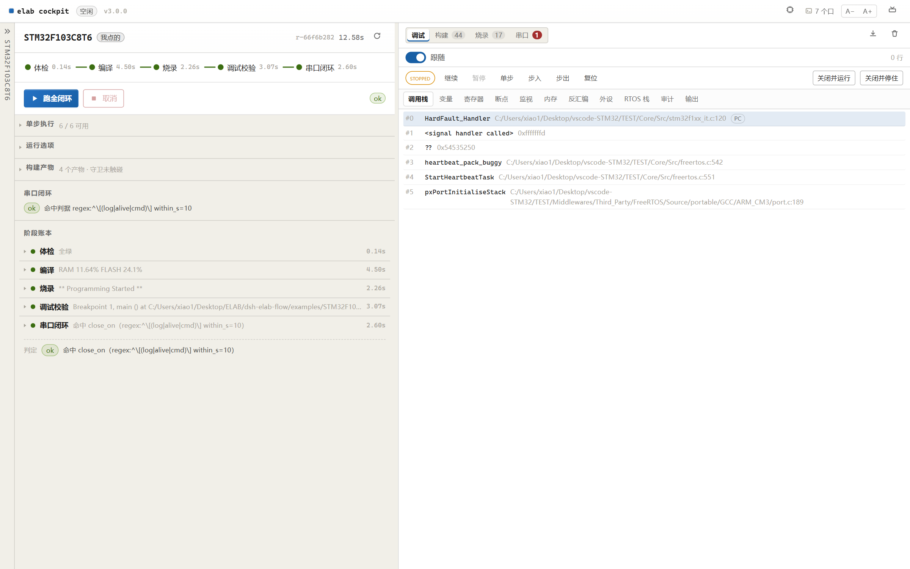
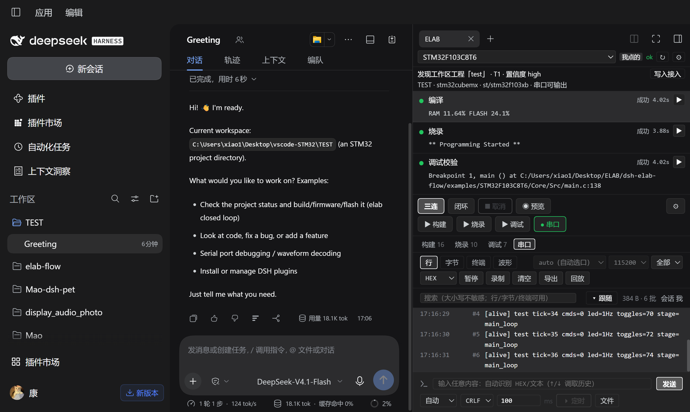
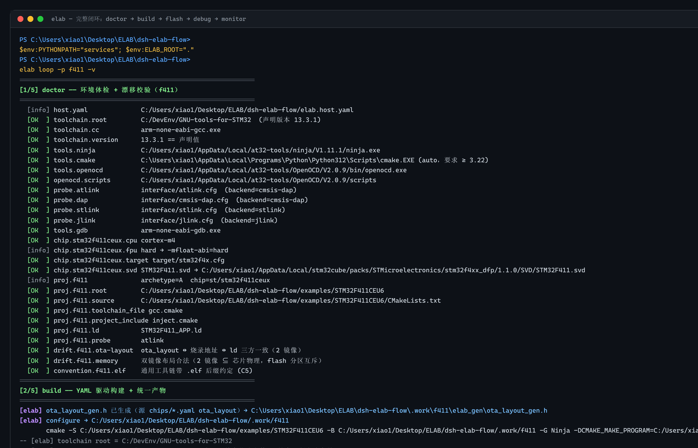

# 项目全览与架构解读（00 · 先读这一篇）

> 目标读者：第一次打开这个仓库的人；也适合"已经会用 `elab loop`，但说不清为什么这么分层"的人。
> 读完你能：① 一句话说清它治什么病、明确不做什么；② 把 11 组功能与入口一一对上；
> ③ 画出四层依赖图，并指出每一层的**事实源**；④ 要改某个行为时，知道该动哪个文件；
> ⑤ **说清 agent 到底能调什么**（15 个 `elab_*` 工具 + HTTP ICD + CLI 三层对照，见 §7）；
> ⑥ 按自己的角色挑到下一篇该读的教程。
>
> **核对口径**：2026-11-08，逐条对照源码（`services/elab/**`、`cockpit/server.py`、
> `packages/dsh-elab-cockpit/**`、`packs/**`、`providers/**`、`projects/**`）与
> `docs/design/**`、`docs/architecture/**`。文中的版本号、常量、文件名都标了出处，
> 升级后可以据此复核。本文**不含操作步骤**（那是 01–09 的事），只讲"这是什么、由什么组成、为什么这样切"。

---

## 目录

| 章 | 内容 |
|---|---|
| [0](#0) | 一句话版本：一个内核，三种入口 |
| [1](#1) | 它治什么病，明确不做什么 |
| [2](#2) | 功能全览：11 组能力 × 入口 × 事实源 |
| [3](#3) | 架构解读：四层单向、三个收敛点、一条时序 |
| [4](#4) | 目录地图：改什么去哪 |
| [5](#5) | 关键数据文件解剖（6 份 YAML/JSON） |
| [6](#6) | 步骤词汇 / 三档闭环 / 三态判据 |
| [7](#7) | **agent 可调用面全览：15 个工具 + CLI + HTTP** |
| [8](#8) | 学习路线：按角色选下一篇 |
| [9](#9) | 门禁与纪律 |
| [10](#10) | 九个常见误解 |
| [11](#11) | 延伸阅读 |

<a id="0"></a>

## 0. 一句话版本

**一套工具链 + 一条流程，让不同厂商、不同内核的芯片工程跑同一句 `elab build / flash / debug / monitor`。**

三个定语把边界钉死了（README「项目定位」）：

| 它**是** | 它**不是** |
|---|---|
| 同一句命令编译不同厂商、不同内核的芯片 | 代码级可移植层 / 运行时平台抽象 |
| 业务工程原地不动（构建前后文件树快照可断言 `untouched`） | 搬代码、重组目录、建 `apps/` `framework/` |
| 一份通用 `gcc.cmake`，差异只由芯片 YAML 驱动 | 每颗芯片各写一份工具链文件 |

打比方：**业务代码是器官，elab 是外骨骼**——外骨骼不改器官，只负责把器官接上流水线。

### 一个内核，三种入口

同一份事件流、同一个串口会话、同一套步骤定义，区别只在"谁在看、屏幕多大"：

| 入口 | 启动方式 | 适合 | 边界 |
|---|---|---|---|
| **CLI `elab`** | `./elab loop -p <name>`（Windows `elab.cmd`） | 脚本 / CI / 无人值守 / agent 直接调用 | 不进实时面板，只有终端分色 + 退出码 |
| **独立驾驶舱** | `cockpit.cmd` 或 `python -m cockpit.server` → `http://127.0.0.1:8333/` | 桌面前盯全程：工程轨 / 阶段轨 / 证据轨三列全屏 | 需要浏览器；端口固定 8333 |
| **DSH 右栏面板** | 安装插件 `dsh-elab-cockpit`，右栏开 elab tab | agent 在跑、你顺手看：窄栏阶梯 + 日志尾 + 串口页 | 窄，装不下三列；重工作区仍回驾驶舱 |

三者的关系不是"三个产品"，而是**一份内核 + 两张皮 + 一条命令行**。原因见 [§3.2](#32)。



*实机总览：左列工程轨，中列「▶ 跑全闭环」+ 构建产物 + 阶段账本，右列是证据轨（构建 / 烧录 / 串口 / 工具 / 调试）。本图来自教程 04 的同一次会话。*

<a id="1"></a>

## 1. 它治什么病，明确不做什么

嵌入式项目里最重复的一段劳动：**每换一颗芯片，工程、工具链、烧录参数、验证脚本都要重搭一遍。**
CubeMX 一套、WorkBench 一套、Keil/IAR 又各一套，工具版本靠 PATH 运气，真机验证全靠手工。

| 痛点（真实事故，见 `docs/design/设计约束.md`） | elab-Flow 的解法 | 你能验证的证据 |
|---|---|---|
| 一台机器并存四套 `arm-none-eabi-gcc`，谁生效靠 PATH 运气 | 工具链路径**只允许**写在 `elab.host.yaml`，且 `prepend_path: true` 显式前置 | `elab list` 打印选中的 gcc 与版本；`elab doctor` 校验 |
| "校验用的命令 ≠ 实际执行的命令"，红绿对不上 | `plan.py` 产出一份 `Plan`，`doctor` 与 `build` **共用** | `elab run --dry-run` 打印的就是执行器真正 materialize 的 argv |
| 手工点 IDE 烧录，烧没烧进去靠肉眼 | `flash` 后强制 `verify`（探针回读）+ 断到 `main` 取证 | 日志里 `Verified OK` 与 `main.c:NN` |
| 串口跑起来了但"算不算成功"没有判据 | 三态判据 `ok / failed / inconclusive` | 退出码 0 / 1 / 2，`inconclusive` 不冒充成功 |
| agent 跑完才报一句结果，人全程黑箱 | 事件流（JSONL + SSE），面板实时亮 | `POST /api/run` 后面板阶梯逐步点亮，发起方标 `agent` |
| 想给新厂商加支持必须改内核代码 | 芯片知识全部落在适配包（`packs/**`），内核只读 `pack.yaml` 协议 | 加包不改一行 Python（教程 02） |

**明确不做**：OS 抽象层、HAL 重写、把多个工程揉进一个 CMake 树、把 IDE 搬进浏览器、远程云编译（CI 只跑主机门禁与自托管上板门禁）。

<a id="2"></a>

## 2. 功能全览：11 组能力 × 入口 × 事实源

下表是全仓能力的**索引起点**。每一行都给出"从哪进、数据住哪、深入读哪篇"——
这也是判断"某个需求该不该改内核"的第一道筛子。

| # | 能力 | 你怎么进 | 事实源（数据在哪） | 深入 |
|---|---|---|---|---|
| ① | **自动接入工程**（探测→报告→写 YAML，绝不覆盖人工接管） | 驾驶舱「＋ 适配」/ `elab adapt <path>` | `projects/<name>.yaml` | [01](01-芯片开发上手_独立WebUI.md) §3 |
| ② | **三档闭环**（编译 / 三连 / 闭环，每步留证据） | 阶段轨按钮 / `elab loop` / `elab run --steps` | `services/elab/flow.py` | [01](01-芯片开发上手_独立WebUI.md)、[06](06-CLI终端闭环上手.md) |
| ③ | **调试工作区**（断点·单步·调用栈·变量·寄存器·内存·SVD 外设·RTOS 栈水位） | 面板右上角「调试工作区」入口 / `elab_debug` / `POST /api/debug/session` | `projects/<name>.debug.json`（`rev` 乐观锁） | [04](04-调试面板上手_STM32F103C8T6.md) |
| ④ | **串口工作台**（行 / 字节 / 终端 / 波形四视图，发送历史+定时+自动格式） | 右列串口工作区 / `elab_serial` | 会话属性存内核内存；历史落 console 日志 | [07](07-串口面板使用.md) |
| ⑤ | **帧协议 + Agent 自学习**（位域/变长/多ID/模板/反组帧/CRC 参数化） | 帧协议抽屉 / `elab_frame` / `elab_frame_learn` | `projects/<name>.frames.json` | [07](07-串口面板使用.md) §5.6–5.7 |
| ⑥ | **Modbus RTU 主站**（点表驱动轮询、单次读写、事务流水、DMA 诊断卡） | Modbus 页签 / `elab_modbus` | `projects/<name>.modbus.json` | [09](09-协议上手_Modbus.md) |
| ⑦ | **适配包 + 社区市场**（零服务器索引、sha256 强校验、一次只启用一套） | 顶栏芯片图标 / `elab pkg *` | `packs/**` + `market/index.json` | [02](02-市场适配包贡献.md)、[03](03-插件市场使用_独立WebUI.md) |
| ⑧ | **外带工具链 Provider**（ESP-IDF 等：命令模板是数据，不是代码） | `elab provider install` / 项目 `provider:` 绑定 | `providers/**/provider.yaml` | README §⑦、[Provider 架构](../design/技术方案_Provider工具链架构.md) |
| ⑨ | **DSH 插件面板 + 15 个 agent 工具** | 右栏 elab tab / `elab_*` 工具 | 只经 loopback HTTP ICD，无自有业务数据 | [05](05-DSH插件上手_STM32F103C8T6.md)、**本文 §7** |
| ⑩ | **OTA 双槽升级**（boot/APP 组合工程、坏固件自动回滚、停等协议断点续传） | `elab run -p f411 --steps tool:ota` | `examples/STM32F411CEU6/**` + chips 的 `ota_layout:` | `examples/STM32F411CEU6/README.md` |
| ⑪ | **CI 与门禁**（本地与云端共用一份矩阵定义） | `elab ci` / GitHub Actions | `ci/matrix.yaml` | `docs/design/ELAB_跨平台CI工作流架构设计.md` |

其中三组最值得先建立直觉，因为它们决定了整个架构的形状：

- **② 闭环是产品的原子**。不是"提供一堆命令让你拼"，而是"一条有判据的流水线"。
  五步 = 体检 → 编译 → 烧录 → 调试校验 → 串口闭环，每步都产出可 grep 的证据行。
- **⑤ 自学习协议**是"agent 原生"的体现：给一段没人告诉过它的抓包，它自己推出帧头、帧长、校验、ID、字段切分，
  落成 profile 后立刻直播解码；`learn` **只产草稿不写文件**，人复核后才落盘——**学习可证伪**。
- **⑧ Provider** 是把"芯片事实"和"工具链事实"拆开的临界点：换工具链只改项目里一行 `provider:`，
  内核不认识 `idf.py` 也不为任何厂商开分支。



*同一个后端、同一张 ICD，换一个宿主（DSH 右栏）就变成窄栏阶梯。细节见教程 05。*

<a id="3"></a>

## 3. 架构解读

### 3.1 四层单向依赖

```text
┌─ 工具层（可选，可卸载）packages/dsh-elab-cockpit ────────────────┐
│  面板（CockpitPane / SerialPane / StageLadder / DebugView / ModbusPane）│
│  agent 工具 elab_*（15 个混合门面）· 进程托管（拉起/健康检查/退出清理）│
└───────────────────────┬──────────────────────────────────────────┘
                        │ 唯一合法缝隙：loopback HTTP ICD
                        │   /api/*（命令）+ /api/events（SSE，运行事件）
┌───────────────────────┴──────────────────────────────────────────┐
│ 业务层  services/elab/**（内核） + cockpit/server.py（HTTP 面）    │
│  编排 / 编译 / 烧录 / 调试 / 串口 / 帧协议 / Modbus / OTA / 包与市场 │
│  自带 Web UI：cockpit/web/**（Vite+React 产物 dist/ 已入仓）       │
└───────────────────────┬──────────────────────────────────────────┘
                        │ 只读协议：pack.yaml / provider.yaml
                        │ 不 import 包内任何文件
┌───────────────────────┴──────────────────────────────────────────┐
│ 数据层  packs/**（芯片） providers/**（工具链） market/index.json  │
│        templates/frames/**（只读帧协议模板）                       │
└──────────────────────────────────────────────────────────────────┘
        ↑ 工程与固件（业务层的输入）：projects/*.yaml、examples/**、components/**
```

- **严格单向**：反向依赖（工具层 `import` 内核源码、内核 `import` 包内文件）会被
  `packages/dsh-elab-cockpit/test/boundary.test.mjs` 拦下。
- **唯一缝隙**是 HTTP：工具层和内核**不共享文件、不共享源码**，只通过 `/api/*` + SSE 说话。
  这条纪律的收益很直接——插件可以不随内核升级而改，内核也可以被 CLI 单独使用。
- 图里那句"产物已入仓"很关键：**运行时不需要 Node**，克隆下来只要有 Python 就能开驾驶舱。

### 3.2 每层职责与源码锚点

**业务层（内核，唯一事实源）** —— `services/elab/**`

| 模块 | 职责 |
|---|---|
| `run.py` | 事件驱动运行器：按步骤序列执行、写只追加 JSONL、支持取消；**CLI 与驾驶舱共用这一个入口** |
| `plan.py` | 把（项目 + 芯片 + 主机）三份数据编译成一份可执行 `Plan`；`doctor` 与 `build` 共用 |
| `flow.py` | **流程清单**：`STEP_META`（步骤标签 + 通道）与 `KERNEL_PLANS`（三档）——芯片无关 |
| `doctor.py` / `doctor --deep` | 环境体检；`--deep` 真跑 configure 取实际编译命令做证据 |
| `adapt.py` | 厂商指纹探测 → T1/T3 分级 → 生成 `projects/<name>.yaml`（只读探测在前，落盘在后） |
| `builder.py` | CMake/Ninja 构建、解析进度、从 `.map` 取 RAM/FLASH、零改动快照守卫 |
| `flash.py` | openocd 烧录 + gdb 校验（`-batch` 断到 `main` 判定）；组合工程 boot 台账（C1/C3） |
| `monitor.py` | 串口闭环判据：`close_on` / `fail_on` / 超时 → `ok / failed / inconclusive` |
| `serialport.py` `serialmon.py` `serialterm.py` `serialconsole.py` `serialtransport.py` | 端口枚举与选口、监视会话、发送与行尾/编码、console 留档、串口/TCP/UDP 传输 |
| `serialcodec.py` `serialframes.py` `framelearn.py` `logdecode.py` | 解码器（JustFloat/FireWater）、帧协议 profile、协议自学习、日志结构化诊断 |
| `debugsession.py` `gdbmi.py` `svd.py` `rtos.py` `debugstore.py` `debugsource.py` `debugdata.py` | 调试会话（openocd + gdb MI）、SVD 外设解码、FreeRTOS 任务与栈水位、断点/监视持久化、源码与反汇编 |
| `modbus.py` `modbusmaster.py` | Modbus RTU 编解码与主站引擎（点表轮询、合并、事务流水） |
| `pkg.py` `market.py` `provider.py` `lock.py` `setup.py` | 适配包安装/校验、零服务器市场索引、Provider 解析（`ResolvedToolchain`）、`elab.lock.yaml` 漂移、装包后环境自检 |
| `ota_layout.py` | 双槽布局唯一事实源 → 构建期生成 `ota_layout_gen.h` |
| `ci.py` `skillgen.py` `_yaml.py` `_winproc.py` | CI 矩阵执行、平台 skill 生成、零依赖 YAML 子集、Windows 进程/作业对象细节 |

**业务层的第二半：HTTP 面** —— `cockpit/server.py`（3813 行，零第三方依赖，只用 `http.server` + SSE）

- `DEFAULT_PORT = 8333`（刻意避开 openocd 的 gdb server 3333）、`SSE_HEARTBEAT_S = 15.0`、
  `PROC_BATCH_S = 0.10`（proc 行 100ms 合批，事件数降一到两个数量级）、`COCKPIT_VERSION = "4.0.0"`。
- **第一硬约束 K1**：长任务绝不在 HTTP 进程里跑。`server.py` 只做三件事——
  `spawn` 一个 `elab run --emit-events` 子进程、跟读只追加 JSONL 转发 SSE、转发取消。
  原因写在文件头：`builder._run()` 是 `subprocess.run(capture_output=True)`，塞进服务端线程会把 HTTP 拖死。
- 它同时是**业务词汇的宿主**：`STEP_META`/`KERNEL_PLANS` 从 `elab.flow` 引入，`SERIAL_META`（视图/编码/解码器/帧协议 schema）住在这里，
  统一经 `GET /api/capabilities` 的 `meta` 下发给两个前端。

**数据层** —— `packs/**`（芯片）、`providers/**`（工具链）、`market/index.json`（市场）、`templates/frames/**`（只读模板）

**工具层** —— `packages/dsh-elab-cockpit/**`，内部分四层（门禁定义）：

| 子层 | 目录 | 规则 |
|---|---|---|
| domain | `src/domain/**` | 纯函数状态归约，零 I/O、零宿主、零框架 |
| app | `src/app/**` | `ports.ts` + `cockpit-service.ts` 是唯一编排点 |
| adapters | `src/adapters/{kernel-http,kernel-process,dsh-tools,dsh-web,fs-store,env}` | **适配器之间不得互相 import**，组装只在入口 |
| 入口 | `src/main.ts`、`host-app.ts` | 组装根，禁止被 `src/**` 反向 import |

### 3.3 三个收敛点：一条路径、一个芯片、一个工程

全仓只有三处允许写"具体情况"，其余地方必须是通用的：

| 收敛点 | 文件 | 写什么 | 谁读 |
|---|---|---|---|
| **主机路径** | `elab.host.yaml` | 编译器/CMake/Ninja/OpenOCD 绝对路径、探针 `probes.list`、串口默认、SVD 搜索根、pack/provider 搜索根 | `config.py` 的 `Host` 视图 |
| **芯片差异** | `packs/**/chips/*.yaml` | 内核/FPU/编译宏/内存/OTA 布局/openocd target/SVD 文件名 | `plan.py`（通过 `Config.chips`） |
| **工程接入** | `projects/<name>.yaml` | root、chip、build、artifacts、flash images、debug、serial、monitor 判据、tools | `plan_for()` |

三者合起来被 `plan.py` 编译成一份 `Plan`，`doctor` 与 `build` **共用同一份**——这是"校验的命令 = 执行的命令"的机制保证。

还有三个"词表"也有唯一宿主，同样不许复制：

| 词表 | 宿主 | 消费者 |
|---|---|---|
| 步骤 id / 标签 / 通道 / 三档 | `services/elab/flow.py` | CLI 帮助、驾驶舱、插件面板 |
| 串口视图 / 编码 / 解码器 / 帧协议 schema | `cockpit/server.py` 的 `SERIAL_META` | 两个前端的串口工作区 |
| 运行事件 topic / 帧格式 | `docs/design/ICD_cockpit_events.md` + `services/elab/kernel/events.py` | 服务端、两个前端、测试 |

### 3.4 一次闭环怎么穿过四层

以「点一下 ▶ 跑全闭环」或 `elab_run(action="loop")` 为例：

```text
工具层  agent 调 elab_run(action="loop")            ← adapters/dsh-tools/run-ops.ts
   │    （契约在 domain/tools.ts，纯度由 boundary.test.mjs 守着）
   ▼
工具层  cockpit-service 发 POST /api/run            ← adapters/kernel-http/icd-client.ts
   │    {"project":"f411","actor":"agent"}
   ▼
HTTP    server.py 落 run/start，spawn                ← 父进程只管跟读，不执行
        `python -m elab run -p f411 --steps doctor,build,flash,debug_verify,monitor --emit-events`
   ▼
内核    run.py 逐步执行：doctor → build → flash → debug_verify → monitor
        ├── 每步写 .work/.cockpit/runs/<run>.jsonl   （run/step-enter、run/step-exit…）
        └── 子进程输出写 <run>.proc.jsonl            （proc/stdout、proc/stderr）
   ▼
HTTP    follower 线程按 seq 归并 → SSE                 ← 100ms 合批 + 15s 心跳
   ▼
前端    RunEventsPort 收流 → domain.run / pipeline 归约
        → 面板渲染：阶梯状态、实时日志、进度、RAM/FLASH 占用
```

串口链路是**并行且独立**于 run 的：

```text
面板 SerialPane ──POST /api/serial/monitor──▶ serialmon 读串口
                                            └▶ serialcodec / serialframes 切帧
       ◀──/api/serial/monitor[/bytes|/decoded] ── 行 / 字节 / 终端 / 波形 四视图
```

两条链路之间只有一条硬规则：**串口独占**。监视开着时，含烧录/调试的 run 返回 `409`；
反过来有 run 在跑也开不了监视。这是 DAP-Link 复合 USB 设备的物理限制（约束 N5），不是设计偏好。

### 3.5 自描述：为什么内核加一步，插件不用改代码

这是整个分层能成立的关键设计。内核在 `GET /api/capabilities` 里把"我是谁、我有哪些步骤、串口能干什么、
调试支持哪些页签"全部声明出来：

```jsonc
{
  "cockpit": { "version": "4.0.0", "sse_heartbeat_s": 15.0, "proc_batch_s": 0.1 },
  "meta": {
    "steps":   { "build": { "label": "编译", "channel": "build" }, "...": {} },
    "plans":   [ { "id": "loop", "title": "闭环", "steps": [...], "requires_hardware": false } ],
    "channels":["build", "flash", "debug", "serial"],
    "serial":  { "views": [...], "decoders": [...], "frames": { "schema": ... } },
    "debug":   { "features": { "callstack": true, "peripheral": true, "rtos": true } },
    "probes":  [ { "id": "atlink", "available": true } ]
  },
  "steps": { "all": ["doctor","doctor_deep","build","flash","debug_verify","monitor"],
             "onhw": ["flash","debug_verify","monitor"] }
}
```

于是：

- 内核**加一个步骤**只需要改 `flow.py`，面板与 CLI 自动多一行；
- 内核**改名**（"体检"→"环境体检"）不改任何前端；
- 插件发现 `capabilities.meta` **缺失** = 内核过旧，提示同步，而**不是在工具层写兼容分支**
  （写了就等于把旧内核的行为永久固化，见 AGENTS.md 规则 4）。

### 3.6 进程模型与四条硬边界

| 边界 | 内容 | 违反的后果 |
|---|---|---|
| **K1 独立进程** | 长任务只能由 `elab run` 子进程执行，HTTP 进程只跟读 | 塞进线程 → HTTP 卡死、SSE 推不出去 |
| **单飞** | 同一会话最多 1 个 run | 并发 build/flash 抢 `.work/` 与探针 |
| **串口独占** | 监视 vs 烧录/调试互斥（`409`） | 虚拟串口打不开、openocd 拿不到 SWD |
| **判据不外包** | `monitor` 与 `doctor_deep` 永不由 provider 提供 | 判定权被外包 → agent 无法信任结论 |

Windows 上还有一层实现细节：会**占硬件**的派生点（openocd / gdb / 固件运行进程）统一走
`services/elab/_winproc.py` 的 `spawn()`——加 `CREATE_NO_WINDOW` 不弹窗，并挂进
`KILL_ON_JOB_CLOSE` 作业对象，父进程怎么死都不留孤儿进程占着调试口。

### 3.7 数据包协议：芯片与工具链是两份数据

```text
packs/<vendor>/<pack>/pack.yaml + chips/<chip>.yaml   芯片事实：内核/内存/外设/OTA 布局/厂商指纹
providers/<vendor>/<name>/provider.yaml                工具链事实：各步骤命令模板/env/产物/主机前提
projects/<name>.yaml                                   绑定：pack + chip + provider + serial
services/elab/**                                       解析 → 执行 → 事件（不 import 包内文件）
```

- **绑定优先级**：项目 `steps.<step>: tool:<name>` 覆盖 → provider `steps` → 无 provider 时的原生链。
- **缺步骤不回退**：provider 没提供某步骤就报 `unavailable`，不静默掉回原生链（沉默的兜底会让"到底跑了什么"无法回答）。
- **`elab pkg index --check`** 拦索引漂移；包内容按**字节**算 sha256，所以外置包仓必须带 `.gitattributes`（`* -text`）。
- **一次只启用一套**适配包（`packs/installed/active.json`），但项目可用 `pack:` 固定自己的包——
  ESP32 工程因此不受"当前启用的是 st/stm32"影响。

<a id="4"></a>

## 4. 目录地图：改什么去哪

| 你想改的东西 | 去这里 | 不要写在哪 |
|---|---|---|
| 闭环行为、步骤顺序、失败判定 | `services/elab/**` | 插件、面板前端 |
| 步骤**名字 / 标签 / 通道 / 三档定义** | `services/elab/flow.py` 的 `STEP_META` / `KERNEL_PLANS` | 插件的内置默认（那只是内核过旧时的兑底） |
| 串口视图、解码器、帧协议 schema | `cockpit/server.py` 的 `SERIAL_META` | 两套前端各写一份 |
| 面板 UI、agent 工具、进程托管 | `packages/dsh-elab-cockpit/**` | 内核（分层违规） |
| 某颗芯片的参数 / 指纹 / OTA 布局 | `packs/**/chips/*.yaml` | `services/**`、`cockpit/**` |
| 某套工具链怎么调用 | `providers/**/provider.yaml` | 项目 YAML、芯片包、内核 |
| 本机工具装在哪 | `elab.host.yaml` | 任何其它文件（禁止拼绝对路径） |
| 某个工程怎么接进来 | `projects/<name>.yaml` | 手改内核默认值 |
| 帧协议 profile / Modbus 点表 / 断点与监视 | `projects/<name>.frames.json` / `.modbus.json` / `.debug.json` | 前端硬编码 |
| 固件与实弹样例 | `examples/**`、`components/**` | 仓库根散落 |
| 门槛（什么情况必须红） | `ci/matrix.yaml` + `tests/**` + `packages/dsh-elab-cockpit/test/**` | 临时脚本 |

完整目录（`README.md`「仓库结构」同款）：

```text
services/elab/**              内核：闭环编排、编译/烧录/调试、串口字节面、帧协议、Modbus、OTA、包与 provider
services/elab/flow.py         流程清单（STEP_META / KERNEL_PLANS）—— 芯片无关
cockpit/server.py             内核 HTTP 面 + 串口自描述（SERIAL_META）
cockpit/web/**                独立驾驶舱 UI（React 产物 dist/ 已入仓）
packages/dsh-elab-cockpit/**  DSH 插件：面板 / 进程托管 / elab_* 工具（唯一源码，市场与 npm 都取这里）
packs/official|installed      芯片适配包（installed/ 不入库）
providers/official|installed  工具链 provider（installed/ 不入库）
market/index.json             零服务器市场索引（packs + providers）
templates/frames/**           只读帧协议模板（遥测 / MAVLink / Modbus RTU / DL-T 645）
projects/**                   工程接入 YAML + 工程侧数据（frames/modbus/debug/widgets）
examples/**                   实弹固件（F411 OTA、F103、AT32、ESP32-S31、F411 Modbus）
components/**                 OTA 与串口可复用 C 组件
tests/ · ci/                  内核测试与本地/云端门禁（ci/matrix.yaml 是单一定义）
docs/**                       教程（tutorials/）、方案（design/）、架构（architecture/）、报告（reports/）
site/                         产品站点静态页与构建脚本
.work/                        本地构建与运行产物（不入库；run 事件在 .work/.cockpit/runs/）
```

<a id="5"></a>

## 5. 关键数据文件解剖

六份文件决定了 90% 的行为。看懂了，出问题就能直接定位到层。

**① `elab.host.yaml`（L0 主机层）** —— 唯一的"主机事实源"

```yaml
toolchains:
  arm-none-eabi: { root: C:/DevEnv/GNU-tools-for-STM32, version: "13.3.1", pin: true, prepend_path: true }
tools:
  cmake: { path: auto, min: "3.22", alt: C:/.../cmake-3.28.1 }
  openocd: { path: C:/.../openocd.exe, scripts: C:/.../scripts }
probes:                       # interface cfg 属于探针，target cfg 属于芯片 —— 两者正交
  default: atlink
  list:
    atlink: { backend: cmsis-dap, interface_cfg: interface/atlink.cfg, transport: swd, speed: 5000 }
    stlink: { backend: stlink,    interface_cfg: interface/stlink.cfg, transport: swd, speed: 4000 }
serial: { default: auto, baud: 115200 }
packs:     { roots: [${ELAB_ROOT}/packs/installed] }
providers: { roots: [${ELAB_ROOT}/providers/installed] }
```

同一台机器上并存几套 GCC 是常态；这份文件的职责就是**指名道姓地选一套**，并让 `elab list` 能回答"现在用的是哪套"。

**② `projects/<name>.yaml`（L4 工程层）** —— 只回答"怎么接进来"

```yaml
name: stm32f411ceu6
root: ${ELAB_ROOT}/examples/STM32F411CEU6
chip: st/stm32f411ceux
archetype: A
build:   { kind: cmake, generator: Ninja, work_dir: ${ELAB_ROOT}/.work/stm32f411ceu6, ... }
artifacts: { elf: ${work_dir}/411.elf, bin: ${work_dir}/411.bin, map: ${work_dir}/411.map }
flash:
  images:                       # 双镜像必须带显式地址（不然会向下擦掉 bootloader）
    - { path: ${ELAB_ROOT}/.work/f411_boot/f411_boot.bin, address: "0x08000000" }
    - { path: ${work_dir}/411.bin,                      address: "0x08010000" }
debug:   { probe: atlink }
serial:  { port: auto }
monitor:                        # 闭环判据：命中 close_on → ok；fail_on 优先；都没中 → inconclusive
  close_on: [{ kind: regex, pattern: "^\\[(boot|alive)\\]", within_s: 10 }]
  fail_on:  [{ kind: regex, pattern: "HardFault|Hard Fault|assert|PANIC" }]
```

注意它**没有**芯片参数（Flash 多大、FPU 有没有）——那些在 chips YAML。这就是"适配 ≠ 改造"：

**③ `packs/**/chips/<chip>.yaml`（L1 芯片层）** —— 芯片参数的唯一宿主

```yaml
id: stm32f411ceux
core:  { arch: arm, cpu: cortex-m4, fpu: hard, mfpu: fpv4-sp-d16 }
memory: { flash: { origin: 0x08000000, length: 0x80000 }, ram: { origin: 0x20000000, length: 0x20000 } }
ota_layout:
  boot: { addr: 0x08000000, size: 0x8000 }
  app:  { addr: 0x08010000, size: 0x70000 }
  slots: [ { addr: 0x08010000, size: 0x30000 }, { addr: 0x08040000, size: 0x40000 } ]
  boot_project: f411_boot        # 组合工程：build -p f411 自动级联构建 boot
debug: { openocd_target: target/stm32f4x.cfg, svd: STM32F411.svd }
```

`ota_layout` 是分区表的**唯一事实源**：构建期生成 `ota_layout_gen.h`，`doctor --deep` 再拿它和
"项目烧录地址"、"各镜像 ld 的 FLASH ORIGIN"三方对账。

**④ `projects/<name>.frames.json`** —— 帧协议 profile（位域 / 变长 / 多 ID / 校验 / 转义 / 字段模型）。
Agent 通过 `elab_frame` 只写声明式 JSON，写操作受 `allowAgentWrite` + `rev` 乐观锁保护。

**⑤ `projects/<name>.modbus.json`** —— 点表：点位 / 功能码 / 地址 / 类型 / 字序 / 换算 / 单位。
面板本身**不硬编码任何从站细节**，换个从站只是换一份点表。

**⑥ `elab.lock.yaml`** —— 已安装 packs/providers 的版本锁。`elab doctor --strict-lock` 在 CI 里把漂移升级为失败。

<a id="6"></a>

## 6. 步骤词汇 / 三档闭环 / 三态判据

### 6.1 六个规范步骤与四个通道

`services/elab/flow.py`（唯一事实源）：

| step id | 标签 | 面板通道 | 需要硬件 |
|---|---|---|---|
| `doctor` | 体检 | build | 否 |
| `doctor_deep` | 深度体检（真跑 configure 取实际命令） | build | 否 |
| `build` | 编译 | build | 否 |
| `flash` | 烧录 | flash | 是 |
| `debug_verify` | 调试校验（断到 `main`） | debug | 是 |
| `monitor` | 串口闭环（判据） | serial | 是 |

"通道"决定日志分流到面板哪一栏；项目还可以写 `step_labels:` 改文案而不动全局默认。

### 6.2 三档

| plan | 标题 | 步骤 | 典型用法 |
|---|---|---|---|
| `basic` | 编译 | `[build]` | 改完代码看 RAM/FLASH |
| `triple` | 三连 | `[build, flash, debug_verify]` | 有板子，验证能跑起来 |
| `loop` | 闭环 | `[doctor, build, flash, debug_verify, monitor]` | 一条命令出结论 |

### 6.3 三态判据（这是整个产品最该记住的一条）

`monitor` 不是"跑过就算"，而是三态：

| 结论 | 含义 | 退出码 |
|---|---|---|
| `ok` | 在窗口内命中 `close_on` 的任一条 | `0` |
| `failed` | 命中 `fail_on`（HardFault / assert / PANIC…） | `1` |
| `inconclusive` | 端口开了、但没收到约定关键字 | `2` |

**"没证据" ≠ "失败"，也绝不冒充"成功"**。CLI 的 `loop` 在 `inconclusive` 时打印
「闭环已执行，但串口未验证」而不是「✓✓ 闭环完成」，退出码同样是 `2`——脚本和 agent 因此没法把"没验证"当"通过"。



*`elab loop -p f411 -v`：doctor 全绿 + build 进度。终端只输出证据，不输出"气氛"。详见教程 06。*

<a id="7"></a>

## 7. agent 可调用面全览

> 一句话：**agent 能做的事 = 内核能通过 HTTP 做的事**。工具、HTTP、CLI 只是同一份能力的三种皮。
> 工具契约的唯一事实源是 `packages/dsh-elab-cockpit/src/domain/tools.ts`（`TOOL_CONTRACTS` 注册面 +
> `TOOL_GROUPS` 意图树 + `LEGACY_TOOLS` 迁移表）；HTTP 端点的唯一事实源是 `cockpit/server.py`。

### 7.1 三种调用面

| 面 | 形态 | 谁在用 | 特点 / 限制 |
|---|---|---|---|
| **`elab_*` 工具** | DSH 宿主注册的 15 个工具 | DSH 里的 agent | 参数是有限枚举（门面把意图收敛成动作）；写操作受 `allowAgentWrite` 门控；进度自动进 DSH 面板 |
| **HTTP ICD** | `POST/GET http://127.0.0.1:8333/api/*` + `/api/events`(SSE) | Claude Code / Cursor / Codex 等任意 agent、自研 harness | 与面板按钮**同源**；不装插件也能用；需要自己处理 SSE 或轮询 `/api/run-events` |
| **CLI** | `./elab <cmd>`（Windows `elab.cmd`） | 脚本 / CI / 想省事的 agent | **退出码即结论**（0 ok / 1 failed / 2 inconclusive）；不进实时面板 |

三层不是并列的三套实现：CLI 与驾驶舱共用 `elab.run`；工具与面板共用 `/api/*`。所以"某个能力只在某一层有"这种情况在设计上不成立。

### 7.2 十五个工具总表（7 门面 + 8 细粒度）

DSH 侧从 v4.0.0 起把原先 27 个平铺工具收敛为 **15 个混合入口**：7 个门面（按 `action` 分派）+
8 个高频细粒度工具（意图单一、参数少，给 agent 最短路径）。

| 工具 | 类别 | `kind` | 一句话 | 动作 |
|---|---|---|---|---|
| `elab_status` | 细粒度 | read | 工程列表 + 每步可用性 + 当前 run + 串口现状 | — |
| `elab_guide` | 细粒度 | read | 工具树全文（可按 `topic` 只取一组）+ 旧名迁移表 + 纪律 | — |
| `elab_log` | 细粒度 | read | 读 run 日志尾部 N 行，可按步骤过滤 | — |
| `elab_run` | **门面** | execute | 闭环执行 | `build` `triple` `loop` `step` `preview` `cancel` |
| `elab_serial` | **门面** | execute | 串口：监视 / 写 / 解码 / 共享解码帧 / 帧级统计 | `monitor` `write` `decode` `decoded` `stats` `read` `wait` |
| `elab_serial_read` | 细粒度 | read | 按游标读串口字节（rx/tx/all） | — |
| `elab_serial_wait` | 细粒度 | read | 等匹配正则的串口行（判心跳 / 等日志） | — |
| `elab_serial_capture` | 细粒度 | edit | 录制串口到文件（证据，可布防） | `start` `stop` `status` |
| `elab_serial_widget` | 细粒度 | edit | 工程级发送组件（定时 / 循环发） | `list` `preview` `run` `status` `cancel` `pause` `resume` `save` `delete` |
| `elab_debug` | **门面** | execute | 调试会话 | `open` `control` `inspect` `breakpoint` `wait` `close` |
| `elab_debug_inspect` | 细粒度 | read | 调试只读视图（栈 / 变量 / 寄存器 / 内存 / 反汇编 / 求值） | — |
| `elab_frame` | **门面** | edit | 帧协议 profile 管理 | `list` `get` `preview` `save` `delete` `encode` `templates` `import` |
| `elab_frame_learn` | **门面** | edit | 协议自学习 | `learn` `verify` `auto` `codegen` |
| `elab_pkg` | **门面** | edit | 芯片包管理与工程接入 | `status` `search` `install` `activate` `remove` `update` `verify` `adapt` |
| `elab_modbus` | **门面** | edit | Modbus RTU 主站（挂在已开串口会话上） | `meta` `status` `open` `close` `read` `write` `start` `stop` `transactions` `map` |

`elab_status` / `elab_guide` / `elab_log` / `elab_serial_read` / `elab_serial_wait` / `elab_debug_inspect`
是 6 个无 `action` 的独立只读工具；另外 9 个（7 门面 + `elab_serial_capture` + `elab_serial_widget`）
的动作枚举写死在契约里，非法动作在注册层就被拒绝（不是运行时才报错）。

### 7.3 概览组 —— 先看清现场再动手

| 工具 | 参数 | 返回什么 / 什么时候用 |
|---|---|---|
| `elab_status` | 无 | 工程列表（含**每步可用性与原因**）、当前 run 归属与步骤、cockpit 进程健康、串口候选口 / 当前监视会话 / 租约剩余。**任何写操作前先调它**拿工程名与端口 |
| `elab_guide` | `topic`（overview/run/serial/debug/frame/pkg，缺省全树） | 意图树：每个入口带**同义词**（"烧进去"→ flash）、**前置条件**、调用示例；还有旧名迁移表与纪律。不确定用哪个工具、接手新工程、沿用老脚本时先调它 |
| `elab_log` | `run`（缺省=当前活动 run）、`step`、`tail`（默认 200，上限 2000） | run 日志尾部纯文本；失败时先看它，再 `--steps <step> -v` 重跑单步 |

### 7.4 闭环组 —— `elab_run`

| action | 等价 CLI | 说明 |
|---|---|---|
| `build` | `elab build -p X` | 只编译，出 RAM/FLASH 与零改动守卫结论 |
| `triple` | `elab run --steps build,flash,debug_verify` | 三连：编译 + 烧录 + 断到 `main` |
| `loop` | `elab loop -p X` | 五步闭环（含 `monitor` 判据） |
| `step` | `elab run -p X --steps <...>` | 显式步骤组合，支持 `tool:ota` 这类项目声明工具 |
| `preview` | `elab run --dry-run` | **只读**预览将执行的 argv，什么都不跑 |
| `cancel` | `Ctrl-C` / `POST /api/cancel` | 取消 run（`reason` 会记入日志） |

写操作全部落 `POST /api/run`（与面板按钮同源）。**单飞**：同一会话至多 1 个 run，
人在跑就等结束或请用户取消，不要重试刷屏。

### 7.5 串口组 —— 看、写、等、录、按模板发

| 工具 | 关键动作 / 参数 | 说明 |
|---|---|---|
| `elab_serial` | `monitor`（`op=open/close/decoder/clear/pause/resume`，`lease_s` 默认 120） | 开/关监视与切换**共享解码器**；默认带租约，到期自动释放端口 |
| | `write`（`data` `format=auto/utf8/ascii/gbk/hex` `eol=none/lf/crlf`；`interval_ms`+`count` = 定时发送） | 需 `allowAgentWrite` |
| | `decode`（`hex`/`data_b64` + `profile` 草稿） | 无状态解一帧，不碰硬件，可解**未保存配置** |
| | `decoded`（`after` 游标，上限 1024 帧）、`stats`（`window_s` 1–60） | 会话级共享解码帧 / 帧率与错误分类 |
| `elab_serial_read` | `after` `direction=all/rx/tx` `limit` | 增量读原始字节，返回 `next_after` 游标 + text/hex 投影 |
| `elab_serial_wait` | `pattern`（必填，正则）`after` `timeout_ms`（默认 5000，上限 60000） | 等匹配行 → 用于"发命令后等 OK"这类时序断言；超时 `ok=false` |
| `elab_serial_capture` | `start`/`stop`/`status`；`trigger` 布防 + `pre_bytes` | 录原始字节到有界 JSONL（默认上限 5 MiB，到顶自动停并标 `truncated`）。触发条件支持按字节 pattern / 解码字段 / 第 N 帧，适合"等故障发生再录" |
| `elab_serial_widget` | `list` `preview` `run` `status` `cancel` `pause` `resume` `save` `delete` | 参数化发送组件（参数 + send/delay/wait 序列 + 周期）。配置在 `projects/<name>.widgets.json`，写操作带 `rev`；`run` 写硬件需 `allowAgentWrite` + `confirm` |

面板 UI 已下线组件入口，但**端点与工具保留给 agent**——这是有意为之：组件适合机器精确复现，不适合人手点。

### 7.6 调试组

| 工具 | 动作 | 说明 |
|---|---|---|
| `elab_debug` | `open`（`stop_at=main/reset/none`，`lease_s` 默认 600，60–1800） | 起 openocd + gdb 停在 `main`；需 `capabilities.meta.debug` 声明可用、探针在位且未被别的会话占用 |
| | `control`（`op=continue/pause/step_over/step_in/step_out/stepi/reset/restart/run_to`） | `reset` 需 `confirm=true`；`run_to` 给 `addr` |
| | `inspect`（`what=session/stack/variables/registers/breakpoints/memory/disasm/evaluate`） | 目标运行时返回 `debug-target-running` → 先 `pause` |
| | `breakpoint`（`op=list/add/update/toggle/remove`，`kind=func/addr`，可带 `condition`/`hardware`） | 窄栏无源码 gutter，用函数 / 地址断点 |
| | `wait`（`after_seq` `timeout_s` 默认 10，上限 60） | 等下一个 stop |
| | `close`（`resume` 默认 true = 复位并运行） | **不允许把板子留在 halt** |
| `elab_debug_inspect` | `what` + `frame`/`scope`/`var`/`thread`/`group`/`format`/`addr`/`count`/`expr` | `elab_debug action=inspect` 的快捷入口；纯只读 |

### 7.7 帧协议组

| 工具 | 动作 | 说明 |
|---|---|---|
| `elab_frame` | `list` `get` `preview` `save` `delete` `encode` `templates` `import` | agent **只写声明式 JSON**，不生成可执行解码器。`preview` 无硬件试解（支持未保存草稿）；`encode` 字段值→字节；`templates` 列 4 份只读模板；写操作需 `allowAgentWrite` + `rev` |
| `elab_frame_learn` | `learn` → `verify` → `auto` → `codegen` | **learn 只产草稿不落盘**（带置信度与证据链）；`verify` 做"解→重编→与线上字节比对"的 round-trip；`auto` 在一组 profile 里挑最像的（不并列不硬猜）；`codegen` 生成 `generated/<id>.h`（`write=true` 才落盘） |

样本来源三选一：`hex`/`b64` 单帧、`frames` 帧数组、`capture` 抓包文件（只取 `dir=rx`）。
完整链路是 `capture → learn → save → decoder=profile:<id>`。

### 7.8 包与工程组 —— `elab_pkg`

| action | 说明 |
|---|---|
| `status` | 已装 / 已启用 / 市场条目 |
| `search` | 搜社区市场（名称 / 厂商 / 平台） |
| `install` | 按包名安装（`source`/`sha256` 由内核解析；`official=true` 装本机官方源，离线可用）。**不受 `allowAgentWrite` 限制**——它只写 `packs/installed/`，不碰硬件与业务工程 |
| `activate` | 启用（**一次只启用一套**，其余保留在本地可切回） |
| `remove` `update` `verify` | 卸载 / 更新 / 结构与哈希校验 |
| `adapt` | 工程接入：`write=false` 只读探测给报告，`write=true` 落 `projects/<name>.yaml`（需 `allowAgentWrite`） |

内核同一时刻只允许一个包操作；有闭环在跑会返回 `409`。

### 7.9 Modbus 组 —— `elab_modbus`

挂在**已打开的串口会话上**（不新开端口、不复制读线程），面板 / 串口工作区 / agent 看的是同一份字节。

| action | 说明 |
|---|---|
| `meta` | 词汇表（功能码中文名、数据类型、限制、异常码） |
| `status` | 只读快照：引擎状态 + 寄存器值 + 增量事务流水（引擎没起来也回点表） |
| `open` / `close` | 打开主站（`probe` 默认顺手读一次设备 ID，吸收上电首帧抖动）/ 关闭 |
| `read` | 单次读 FC01/02/03/04（寄存器 ≤125，位 ≤2000） |
| `write` | 单次写 FC05/06/0F/10（**必须 `confirm=true` 且需 `allowAgentWrite`**，会真的动物理世界） |
| `start` / `stop` | 起停轮询：按点表分组，同功能码相邻地址自动合并成一条读 |
| `transactions` | 增量事务流水（`after` 游标），可按 `source` 区分 `agent` / `panel` |
| `map` | 不带参读点表；带 `map`+`rev` 保存（乐观锁） |

### 7.10 四道写门控（什么时候会被拒）

| 门控 | 语义 | 影响哪些操作 |
|---|---|---|
| `allowAgentWrite` | 插件配置，**默认关** | 写串口、发送组件、调试复位/断点写入、帧 profile 保存、工程适配落盘。安装芯片包与只读探测**不受限** |
| `confirm` | 单次显式确认 | Modbus 写（`confirm=true` 缺一不可）；调试 `reset` |
| `rev` | 乐观锁版本 | 帧 profile、发送组件、Modbus 点表保存——冲突时**重读再存**，不要硬覆盖 |
| `lease_s` | 会话租约 | 串口监视（默认 120s）、调试会话（默认 600s）到期自动释放端口 / 恢复运行 |

再加两条运行期纪律：**单飞**（至多 1 个 run）与**串口独占**（监视开着时烧录/调试返回 `409`）。

### 7.11 旧工具名怎么办

旧名已收进对应门面，`LEGACY_TOOLS` 是唯一的迁移表：

| 旧名 | 新入口 |
|---|---|
| `elab_build` / `elab_triple` / `elab_loop` / `elab_step` / `elab_preview` / `elab_cancel` | `elab_run` 的 `action=build/triple/loop/step/preview/cancel` |
| `elab_serial_monitor` / `elab_serial` / `elab_serial_decode` / `elab_serial_decoded` / `elab_serial_stats` | `elab_serial` 的 `action=monitor/write/decode/decoded/stats` |
| `elab_debug_open` / `_control` / `_breakpoint` / `_wait` / `_close` | `elab_debug` 的对应 `action` |
| `elab_frame_profile` | `elab_frame`（8 个动作）+ `elab_frame_learn`（4 个动作） |
| `elab_adapt` | `elab_pkg` 的 `action=adapt` |

需要过渡期时把插件配置 `toolMode: both` 打开，旧名会作为**带废弃提示**的别名一并注册。

### 7.12 推荐的 agent 调用顺序

```text
① elab_status                     看工程名 / 端口 / 当前 run（只读，永远先调）
② elab_guide topic=...            不确定入口时取意图树（只读，一次就够）
③ elab_run action=preview         先看将执行的 argv（只读，不落任何东西）
④ elab_run action=build|triple|loop   真跑；单飞，别并发
⑤ elab_log step=...               失败看日志尾部；需要更强证据用 step + doctor_deep
⑥ elab_serial action=monitor      看设备输出；读完记得 close（或等租约到期）
⑦ elab_serial_read / _wait        增量读 / 等关键字（判活两条硬指标：≈1.000s 间隔、toggles 严格 +2）
⑧ elab_serial_capture start       要留证据时录制（可布防：等故障发生再落盘）
```

遇到不认识的二进制协议时，额外一条支线：`elab_serial_capture → elab_frame_learn learn → verify → save → elab_serial monitor op=decoder`。

### 7.13 不装插件时：HTTP 与 CLI 速查

**HTTP（`http://127.0.0.1:8333`）**

| 用途 | 端点 |
|---|---|
| 能力自描述 / 工程 / 包 | `GET /api/capabilities`、`/api/projects`、`/api/packs` |
| 跑闭环 | `POST /api/run`（`{"project":"X","actor":"agent"}` → `202` + runId）、`POST /api/cancel` |
| 看进度 | `GET /api/events?run=<id>`（SSE）、`GET /api/run-events?run=<id>&from=0`（轮询兜底）、`GET /api/runs`、`/api/plan` |
| 串口 | `POST /api/serial/monitor`（open/close）、`GET /api/serial/monitor` 及其 `bytes` / `decoded` 子端点、`POST /api/serial`、`/api/serial/capture`、`/api/serial/decode` |
| 调试 | `POST /api/debug/session`、`/api/debug/control`、`/api/debug/breakpoints`、`GET /api/debug/{stack,variables,registers,memory,disasm,peripherals,rtos,audit}` |
| 帧协议 / Modbus | `/api/serial/frames` 及其 `preview` / `encode` / `learn` / `verify` / `auto` / `codegen` / `templates` 子路径、`/api/modbus/*` |
| 包 / 工程 | `POST /api/pkg/<action>`、`POST /api/adapt`、`POST /api/project`、`POST /api/pick-folder` |

**CLI（17 个子命令）**：`list` `doctor` `setup` `build` `flash` `debug` `loop` `monitor` `serial`
`run` `runs prune` `ci` `skill` `pkg` `provider` `lock` `adapt`。全部支持 `--json`（机器可读）；
判据类命令（`monitor` / `run` / `loop`）用三态退出码 `0 / 1 / 2`，其余为 `0 / 1`。

<a id="8"></a>

## 8. 学习路线：按角色选下一篇

| 你的情况 | 读这篇 | 读完能做到 |
|---|---|---|
| 手上是一块新板/新芯片 | [01 芯片开发上手](01-芯片开发上手_独立WebUI.md) | 启动 WebUI → 装包 → 适配 → 全闭环 → 看懂证据；**先过心跳第一关** |
| 只想用命令行 / 接 CI | [06 CLI 终端闭环](06-CLI终端闭环上手.md) | 一条 `elab loop` 跑完五阶段，读懂退出码 |
| 主战场是 DSH + agent | [05 DSH 插件上手](05-DSH插件上手_STM32F103C8T6.md) | 右栏四块、自动探测接入、三连、调试工作区 |
| 专治疑难 HardFault | [04 调试工作区](04-调试面板上手_STM32F103C8T6.md) | 断点 → 调用栈 → 寄存器 → 外设 → RTOS 栈水位 |
| 要读懂设备的串口输出 | [07 串口面板使用](07-串口面板使用.md) | 四视图、发送/历史/定时、断线重连、日志诊断、帧协议、**协议自学习** |
| 接工业设备 | [09 Modbus RTU 上手](09-协议上手_Modbus.md) | 点表轮询、单次读写、循环 DMA 接收、排错手册 |
| 想让别人的芯片被支持 | [02 市场适配包贡献](02-市场适配包贡献.md) | 包结构 → 探测填事实 → 本地上架 → 准入 7 条（无需硬件） |
| 想装第三方芯片包 | [03 插件市场使用](03-插件市场使用_独立WebUI.md) | 市场浏览/安装/启用/回闭环 |
| 关注高吞吐与丢包 | [08 串口压力测试报告](08-串口压力测试报告_STM32F411CEU6.md) | 丢包/挤出/时序判定方法 |
| 想改内核/插件本身 | 本文 §3、§4 + [`AGENTS.md`](../../AGENTS.md) | 知道改哪层不违规、跑哪些门禁 |

建议的阅读顺序（不是必须）：**00 → 01 → 06 → 07 → 04 → 05 → 02 → 03 → 09**。
00 建地图，01 走通一次，06 理解判据，07/04 学会"看"，05 换成 agent 视角，
02/03 学会扩生态，09 落到具体工业协议。

<a id="9"></a>

## 9. 门禁与纪律

| 门禁 | 位置 | 拦什么 |
|---|---|---|
| 分层守卫 | `packages/dsh-elab-cockpit/test/boundary.test.mjs` | 工具层 import 业务层；domain/app 不纯；适配器互引；组装根被回引 |
| 插件 CI | `.github/workflows/plugin.yml` | `npm test`、host+client `tsc --noEmit`、`npm run build` |
| 内核测试 | `tests/test_*.py`（40+ 支） | 计划/构建/烧录/串口/帧/Modbus/包/provider/flow 清单… |
| 事件契约 | `tests/it_cockpit_server.py` | SSE topic 白名单与服务端实际发出的事件集合比对 |
| 包索引漂移 | `elab pkg index --check` | `market/index.json` 与 `packs/**` 不一致 |
| CI 矩阵 | `ci/matrix.yaml`（本地 `elab ci` 与云端共用） | `host-gate`（云端可跑）+ `onhw-gate`（self-hosted 探针，可选） |

三条最容易被违反的纪律：

1. **业务逻辑只写业务层**。把闭环行为写进插件，换内核或不用插件时行为就不一致。
2. **芯片知识只写适配包**。写进内核 = 社区无法扩展，加芯片要改 Python。
3. **`packs/installed/`、`providers/installed/` 不入库**。随仓只提交官方源与 `market/index.json`。

关于许可证：自 **v4.0.0** 起为 **Apache-2.0**（附明确专利授权与变更声明要求）；
**v1.0.0 – v3.1.0 仍以 MIT 授权且永久有效**，变更不可追溯。二次分发请一并携带 `LICENSE` 与 `NOTICE`（§4(d)）。

<a id="10"></a>

## 10. 九个常见误解

| 误解 | 事实 |
|---|---|
| "它是一套跨平台代码框架（HAL 替代品）" | 不是。它不动业务代码，只把工程接上流水线；`guard.untouched` 会证明源目录一个字节没变 |
| "换了芯片就得改内核" | 不用。加一个芯片 YAML（必要时加 provider），内核零分支 |
| "插件里有第二套业务逻辑" | 没有。插件只经 loopback HTTP ICD 说话，业务逻辑在 `services/elab/**`，分层守卫会拦违规 |
| "两个界面是两套系统" | 两套皮、一个后端。它们各自消费同一张 HTTP 契约，**互不加载** |
| "面板显示的东西可能是前端猜的" | 不是。步骤标签、通道、调试页签、探针可用性都来自 `capabilities.meta`，前端只渲染 |
| "串口收到数据就算闭环通过" | 不算。必须命中 `close_on` 才是 `ok`；没收到的结论是 `inconclusive`，退出码 2 |
| "`--dry-run` 是跑一半" | 不是。本仓统一为**只读预览**，什么都不执行；想只跑前半段用 `--no-flash --no-debug --no-monitor` |
| "没板子什么都干不了" | 能跑 `doctor` / `build` / `ci` / 适配探测；串口面板还能用 TCP/UDP 回环练手 |
| "监视和烧录可以同时开" | 不行。物理上互斥（DAP-Link 复合设备），内核直接 `409`，不给你"看起来能跑"的假象 |

<a id="11"></a>

## 11. 延伸阅读

| 文档 | 为什么读它 |
|---|---|
| [`AGENTS.md`](../../AGENTS.md) | 仓库工作规则：层归属、Agent 边界、芯片闭环第一关（心跳 bring-up）、门禁 |
| [`docs/architecture/架构分析和项目仓库的依赖关系.md`](../architecture/架构分析和项目仓库的依赖关系.md) | 分层与仓库拓扑的深度版，含分发链路与发版 Playbook（**先读这篇**的原文） |
| [`docs/design/设计约束.md`](../design/设计约束.md) | C1–C36 硬约束，每条附「为什么」与事故来源——想知道"某个奇怪设计"的由来就查它 |
| [`docs/design/ICD_cockpit_events.md`](../design/ICD_cockpit_events.md) | 事件契约：topic 全集、SSE 帧格式、兼容承诺 |
| [`docs/design/技术方案_dsh-elab-flow插件移植.md`](../design/技术方案_dsh-elab-flow插件移植.md) | 工具层分层边界的原始设计依据（§16） |
| [`docs/design/技术方案_Provider工具链架构.md`](../design/技术方案_Provider工具链架构.md) | 默认链 / 外带链同构的 provider 契约与失败矩阵 |
| [`docs/design/技术方案_闭环驾驶舱.md`](../design/技术方案_闭环驾驶舱.md) | 驾驶舱方案与决策记录（决策 D、约束 N、串口判据） |
| [`.agents/skills/elab-agent/SKILL.md`](../../.agents/skills/elab-agent/SKILL.md) | 给 agent 的任务路由表：目标 → 命令/入口（含事实源与验收命令） |
| [`.agents/skills/elab-tools/SKILL.md`](../../.agents/skills/elab-tools/SKILL.md) | 任务 → CLI / HTTP / `elab_*` 三列对照索引 |
| [`CHANGELOG.md`](../../CHANGELOG.md) | 版本变更与"为什么改"的连续记录 |

---

> **读完这一篇之后**：如果手上有板子，直接去 [01 芯片开发上手](01-芯片开发上手_独立WebUI.md) 走一遍——
> 记住那条纪律：**串口心跳给 agent 看，LED 闪烁给人看，两方都确认才算第一关通过**（C36）。
