# 芯片开发上手：独立 WebUI 全闭环（STM32F411CEU6 实机实拍）

> 目标读者：第一次用 elab-Flow 的嵌入式开发者。
> 读完你能：启动独立 WebUI → 装芯片包 → 接入工程 → 跑通全闭环 → 看懂证据 → 用串口工作台验证设备输出（含多通道波形）。
>
> **拍摄口径**：全部截图来自同一次实机环境——STM32F411CEU6 + CMSIS-DAP（atlink）+ COM10@115200，深色主题，1600×1000。图中数字与当时服务端记录同源，未做任何修饰。
> 配套阅读：市场装包详见 [插件市场使用](03-插件市场使用_独立WebUI.md)；贡献自己的芯片包见 [市场适配包贡献](02-市场适配包贡献.md)。

---

## 0. 你将得到什么

一次闭环 = **体检 → 编译 → 烧录 → 调试校验 → 串口监视**，五步全部在一个三列界面里完成：

- **左列（工程轨）**：工程卡片 + 芯片事实（内核/存储/OTA/探针/串口），芯片事实来自当前启用的适配包；
- **中列（阶段轨）**：「▶ 跑全闭环」、单步执行、运行选项、构建产物、阶段账本——每一步的用时与结论都记账；
- **右列（证据轨）**：四个工作区（构建 / 烧录 / 串口 / 工具），日志、内存占用、串口波形都在这里。

最终效果预览（本教程第 8 章的实拍照）：agent 发起的 run 带 `agent` 标签全绿收官，右列串口「波形」视图同时渲染两条**相位差半个周期**的正弦曲线（FireWater 双通道）：

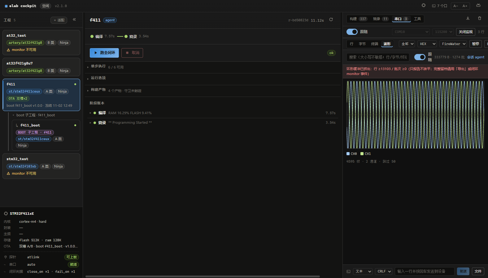

---

## 1. 启动独立 WebUI

**为什么**：WebUI 只是内核（`cockpit.server`）的一张脸——所有闭环能力都在内核里，界面与 CLI、agent 共用同一套 HTTP API，所以"界面上看到的"与"脚本跑出来的"永远是同一份事实。

步骤：

1. 在仓库根执行 `cockpit.cmd`（或 `python -m cockpit.server`，需 `PYTHONPATH=services`）；
2. 浏览器打开 `http://127.0.0.1:8333`——端口幂等，重复启动不会起第二个服务；
3. 确认顶栏出现版本号（图中 `v2.1.0`）与「串口后端就绪」。

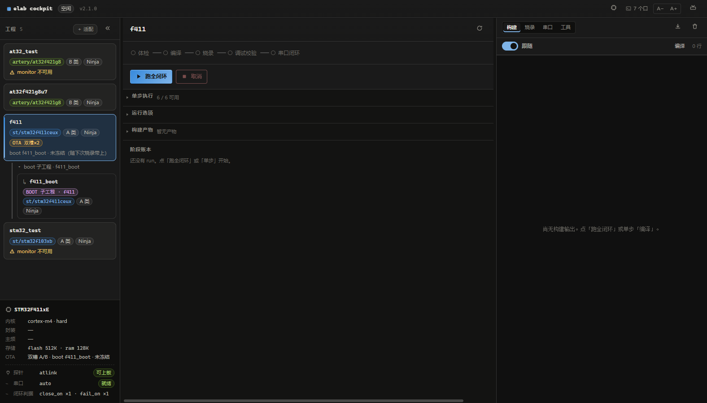

你应该看到：

| 位置 | 事实（与本图同源） |
|---|---|
| 左列 | 5 个工程卡；`f411` 卡标注 `st/stm32f411ceux` · A 类 · Ninja · OTA 双槽×2 · boot f411_boot v1.0.0 |
| 左下角 | 芯片事实：cortex-m4 · hard，flash 512K · ram 128K，探针 atlink「可上板」，串口 auto「就绪」 |
| 右列顶部 | 四个工作区页签：构建 / 烧录 / 串口 / 工具 |

**常见坑**：探针显示「不可上板」时，先查是否有残留的 `openocd` 进程占着调试口（见第 9 章）。

### 1.1 工具链与探针（默认装什么、怎么换）

WebUI / 插件不绑定任何一家的 IDE。首次打开自动补齐的是四件**通用开源工具**（版本与来源见
[manifest.json](../../packages/dsh-elab-cockpit/envpacks/manifest.json)）：

| 工具 | 版本 | 用途 |
|---|---|---|
| `arm-none-eabi-gcc` | 13.3.1 | 交叉编译（xpack） |
| CMake | 3.28.1 | 构建 |
| Ninja | 1.11.1 | 构建 |
| OpenOCD | 0.12.0-3 | 烧录 / 调试 |

已装好自己版本时会跳过自动安装；也可用 `ELAB_ARM_GCC_ROOT` / `ELAB_CMAKE` / `ELAB_NINJA` /
`ELAB_OPENOCD` / `ELAB_OPENOCD_SCRIPTS` 覆盖，不改仓库文件。

探针同样是**数据不是代码**：[elab.host.yaml](../../elab.host.yaml) 的 `probes.list` 已内置
`atlink` / `dap` / `stlink` / `jlink`，工程卡对应的 `projects/<name>.yaml` 只声明用哪个：

```yaml
debug:
  probe: stlink     # atlink | dap | stlink | jlink
```

- **ST-Link**：OpenOCD 原生 `interface/stlink.cfg`，一般免装厂商软件；
- **J-Link**：走 OpenOCD 的 `interface/jlink.cfg`，需先装 SEGGER J-Link 驱动（不是 SEGGER GDB Server）；
- **新适配工程**：默认探针取 `probes.default`，不再写死某个品牌。

---

## 2. 装一颗芯片

**为什么**：内核本身不认识任何芯片——芯片参数、厂商指纹、平台坑位全部住在**适配包**里（数据，不是代码）。没有包，工程轨就没有芯片事实可显示。

- **主路径（界面）**：顶栏芯片图标 → 市场搜索 / 已安装 → 启用，完整流程见 [插件市场使用](03-插件市场使用_独立WebUI.md)。本篇实拍的 `st/stm32`（官方内置包）与 `artery/at32`（社区包）都是这样装上的。
- **CLI 兜底**（无市场或离线时）：

```powershell
elab.cmd pkg bootstrap          # 安装内置官方包 st/stm32
elab.cmd pkg search stm32       # 搜市场索引
elab.cmd pkg install st/stm32   # 按名安装（哈希强校验）
elab.cmd pkg activate st/stm32  # 启用（一次只启用一套）
```

**常见坑**：装完包工程卡仍显示「—」，九成是忘了「启用」——安装 ≠ 启用。

---

## 3. 接入你的工程

**为什么**：「＋ 适配」是只读预检再写入的两段式——先探测出证据链给你看，你确认后才落 `projects/*.yaml`。探测本身不改任何文件，可以放心乱点。

步骤：

1. 点左列「＋ 适配」——内核会弹出**系统「选择文件夹」对话框**（和资源管理器里选目录一样），选中厂商工程根目录即可；
2. 选完自动填入路径并**立即只读探测**，内核按厂商指纹匹配，给出报告；
3. 确认无误后点「写入」，新工程卡出现在左列并自动选中（效果即第 1 章 A-01 中的 `f411` 卡；本仓已随带该工程，故不重复演示写入）。

> 浏览器沙箱拿不到本地目录的绝对路径，所以对话框由**同机运行的内核**代开
> （`POST /api/pick-folder`）；没有桌面会话或精简 Python 时，面板会自动回落为
> 手工输入框（也可随时点面板里的「浏览…」重开对话框）。

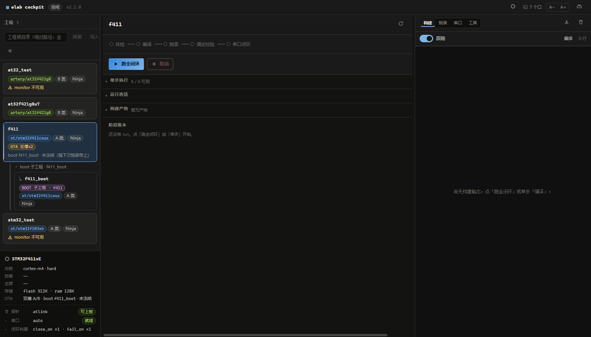

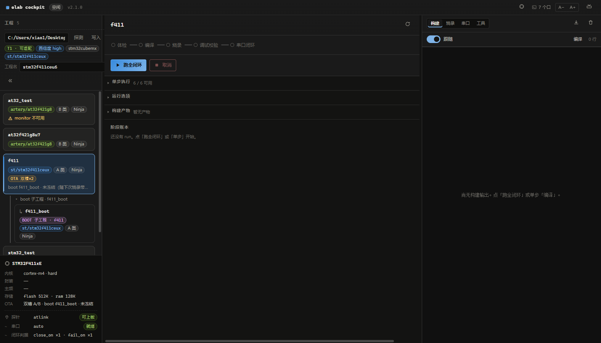

你应该看到（A-03）：

| 字段 | 值 |
|---|---|
| 结论 | **T1 · 可适配**（直接可用） |
| 置信度 | high |
| 工程指纹 | stm32cubemx |
| 识别芯片 | `st/stm32f411ceux` |
| 证据链 | 逐条列出命中的指纹与来源文件 |

**常见坑**：探测结论是 T3（需人工补全）时别硬写——先看证据链里缺了哪条，多半是工程目录里没有可识别的工程文件。

### 3.1 导入外部 STM32 工程（实机：`vscode-STM32/TEST`）

外部工程**不需要搬进仓库**：适配只写一份 `projects/<name>.yaml`，`root` 指向工程的绝对路径，
构建产物落在本仓 `.work/<name>`——业务工程一个字节都不改（构建日志里的「零改动守卫」会证明这一点）。

> 实机口径：2026-11-03，外部工程 `C:/Users/xiao1/Desktop/vscode-STM32/TEST`
> （CubeMX + CMake + FreeRTOS，芯片 `st/stm32f103xb`），板子 STM32F103C8T6，COM10@115200。

步骤：

1. 点左列「＋ 适配」——弹出系统「选择文件夹」对话框，选中：
   `C:/Users/xiao1/Desktop/vscode-STM32/TEST`（也可在面板里点「浏览…」重选）；
2. 选完自动只读探测：内核按厂商指纹匹配，报告 `T1 · 可适配 / 置信度 high / stm32cubemx / st/stm32f103xb`；
3. 「工程名」默认取目录名 `test`——**这就是卡片名**，可以现在改，也可以写入后再改名（见 3.2）；
4. 点「写入」：生成 `projects/test.yaml`，卡片出现在左列并自动选中。

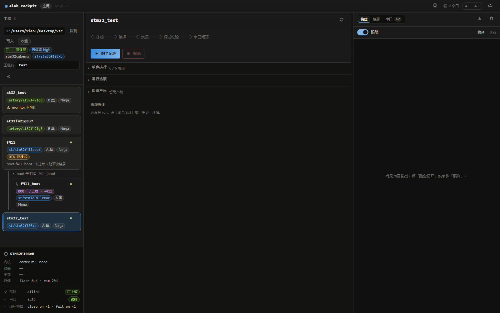

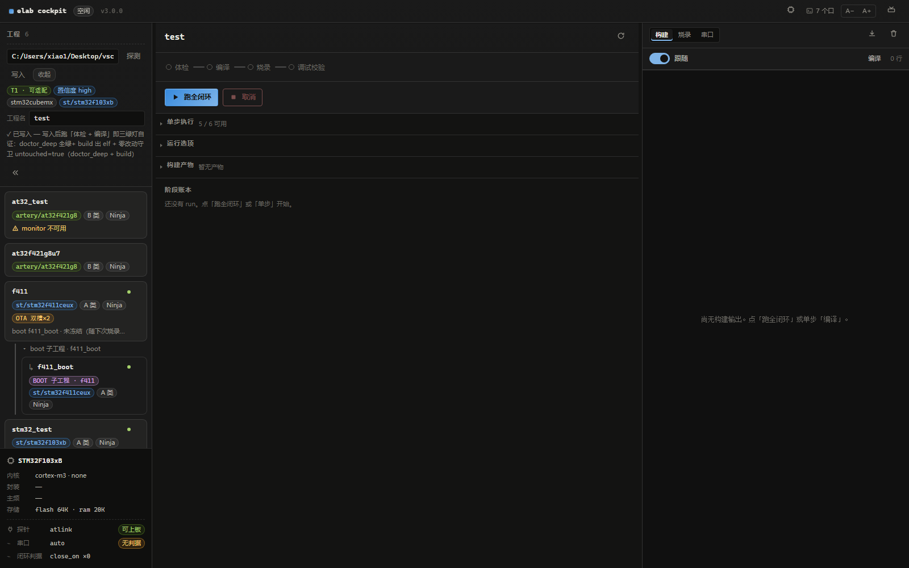

写入后先看卡片上的事实（B-04 里 `ext_test` 卡同款）：

| 卡片字段 | 实测值 | 含义 |
|---|---|---|
| 包 / 芯片 | `st/stm32f103xb` | 来自当前启用的适配包，不是前端猜的 |
| 类别 / 构建 | `A 类 · Ninja` | archetype 与构建系统 |
| 串口 | `auto` | 端口自动探测（本机解析到 COM10） |
| 闭环判据 | `monitor 不可用` | **本工程没有串口输出能力**，`close_on ×0`（原因与修复见 3.3） |

然后就能直接单步「编译」，不需要在驾驶舱外先跑一遍 CMake：

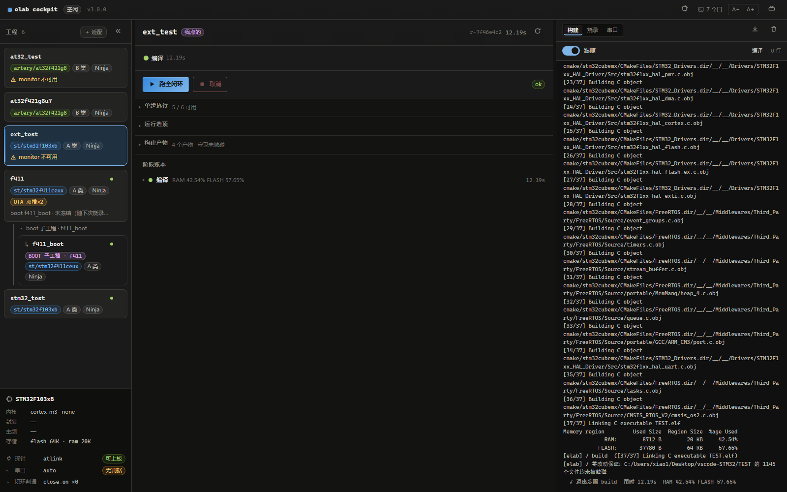

实测（B-05，与图同源）：

| 证据 | 值 |
|---|---|
| 编译 | `37/37`，`Linking C executable TEST.elf` |
| RAM | 8712 B / 20 KB = **42.54%** |
| FLASH | 37776 B / 64 KB = **57.65%** |
| 零改动保证 | `[elab] ✓ 零改动保证：C:/Users/xiao1/Desktop/vscode-STM32/TEST 的 1145 个文件均未被触碰` |
| 阶段账本 | `退出步骤 build 用时 12.19s` |

烧录同样可用（本机 `elab flash -p ext_test` 实测通过）。但**先别急着跑 monitor**：
`TEST` 工程里没有串口心跳，监视步骤只能判 inconclusive——这正是下一节要补的第一关。

### 3.2 管理左侧工程：改名 / 重新探测 / 移除

管理入口：鼠标移到卡片右上角，出现「⋯」（悬停才显示，避免界面噪声）：

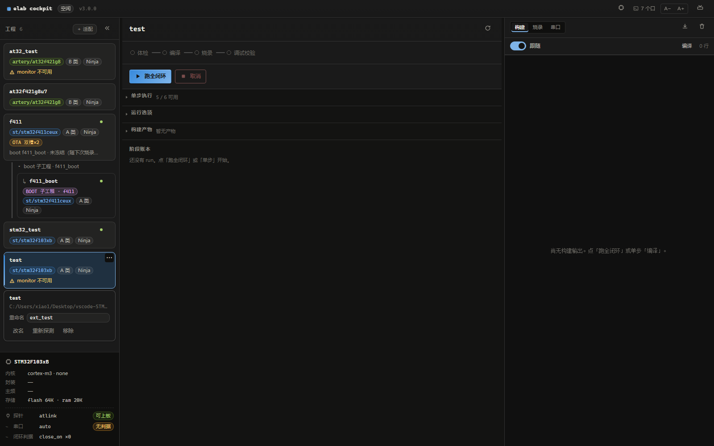

三项分别做什么：

| 菜单项 | 行为 | 边界 |
|---|---|---|
| **重命名** | 输入新名字 → 「改名」：改 `projects/<old>.yaml` 的**文件基名**、`name:` 行、按工程名派生的 `work_dir`；成功后自动选中新卡 | 业务工程零改动；`.work/<旧名>` 不迁移，首次编译会重建。被芯片 `ota_layout.boot_project` 引用的 boot 工程会被拒绝改名（会断裂跳转级联） |
| **重新探测** | 只读复检：`identical`（一致）/ `drift`（工程已变更，接入文件需重写）/ `missing` | 不改任何文件；工程加了源文件、补了串口输出后用它判断要不要重写 yaml |
| **移除** | 二次确认后删 `projects/<name>.yaml`，并自动留 `projects/<name>.yaml.bak` | 业务工程零改动；恢复时把 `.bak` 改回 `.yaml` 即可（`.bak` 已 gitignore） |

改名后的实机结果（`test` → `ext_test`，Toast 同步提示）：

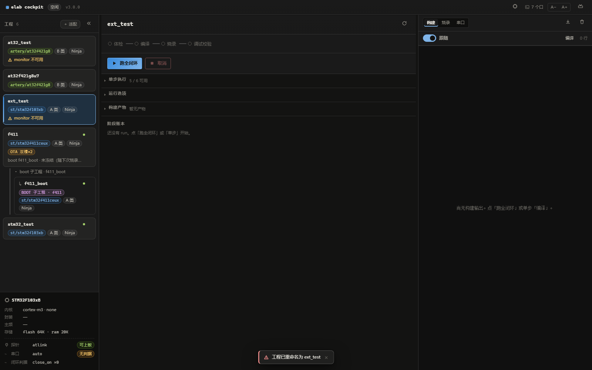

**「驾驶舱里的工程命名到底存在哪」**：

| 名字 | 存储位置 | 正确改法 |
|---|---|---|
| 卡片名（左侧显示） | `projects/<name>.yaml` 的 `name:` 字段 | 「⋯ → 重命名」（推荐）；手工改必须**同时**改文件名与 `name:` 行 |
| 固件名（产物/ELF） | yaml 的 `project_name: TEST` | 属于业务事实（可执行文件名、链接脚本），**不要**跟着卡片名改 |
| 卡片顺序 | 按 `name` 字母序 | 不提供手工排序 |

CLI 等价操作（无 UI 时的兜底）：

```powershell
elab.cmd adapt "C:/Users/xiao1/Desktop/vscode-STM32/TEST"          # 只读探测
elab.cmd adapt "C:/Users/xiao1/Desktop/vscode-STM32/TEST" --write  # 写入 projects/test.yaml
```

改名 / 移除目前只走 UI（内核接口 `POST /api/project`，`action=rename|remove`）。

**管理建议**：

- 一个外部工程只留一张卡；重名会被内核拒绝（`工程名已被占用`），顺手用「重新探测」确认是否 `identical`；
- 卡名用短名（如 `ext_test`），固件名保持原样（`TEST`），排障时不会混淆；
- 外部工程继续用你自己的 Git 管理；elab 只往 `.work/` 写产物（本仓 `.gitignore` 已覆盖）。

### 3.3 外部工程没有串口输出：补齐第一关再闭环

`TEST` 卡片显示 `monitor 不可用`，不是驾驶舱坏了，而是探测结论：

- 工程在 `Core/Src/freertos.c` 里只重写了 `fputc`（Keil/MDK 的常见写法）；
- 本工具链是 GCC + newlib/picolibc，`printf` 走 `_write → __io_putchar`，而 `__io_putchar` 只有 weak 声明；
- 实测烧录后串口 **8 秒 0 字节**，监视步骤没有判据。

修复就是在工程里补一个强定义（与 [F103 心跳样例](../../examples/STM32F103C8T6/Core/Src/main.c) 同一写法）：

```c
int __io_putchar(int ch)
{
  uint8_t byte = (uint8_t)ch;
  (void)HAL_UART_Transmit(&huart1, &byte, 1, 10);
  return ch;
}
```

然后按 [第一关](#第一关新芯片先验-1hz-心跳--板载-led推荐) 补 1Hz `[alive]` 心跳 + 板载 LED 同频；
改完回到「⋯ → 重新探测」，若显示 `drift`（工程能力变了、接入文件还是旧的），再点「写入」更新
`projects/ext_test.yaml`，`monitor.close_on` 就会随之生成，闭环才具备可判据。

> **实机复核（2026-11-03，`stm32c8_test`）**：补强定义 + 心跳任务后，
> `elab loop -p stm32c8_test --no-debug` 全绿：
> `[serial] +0.92s [alive] test tick=1 stage=main_loop`、`+1.84s tick=2`，
> `[monitor] ✓ 串口闭环：OK（命中 close_on）`。
> 注意该工程 `configTOTAL_HEAP_SIZE` 只有 3072 B，新增心跳任务要先提到 6144 B，
> 否则 `osThreadNew` 返回 NULL（编译/烧录都正常，只是串口没有 `[alive]`）。
>
> 另一个老工程常见坑：tickless idle 的 `PreSleepProcessing` / `PostSleepProcessing`
> 把 `RCC_SYSCLKSOURCE_HSI`（枚举值 0）当成 `RCC_ClkInitTypeDef*` 传给
> `HAL_RCC_ClockConfig()` → 每次空闲睡眠都 `HAL_ERROR(1)`，串口被
> `HAL_RCC_ClockConfig error: 1` 刷屏。修法是构造完整的 `RCC_ClkInitTypeDef`
> 并保存/恢复 PLL 配置，或先留空钩子（不切时钟）。

### 3.4 串口闭环的硬前提：工程里 USART1 已经初始化

**关键前提**：串口闭环/监视读的是**固件已经初始化好的 UART**。elab 只负责在主机侧打开 COM 口收发字节，
不会去配置芯片的时钟、GPIO 或波特率——串口能不能出数据，取决于工程固件自己。

| 项 | 本仓示例口径（STM32F103C8T6 / F411CEU6） |
|---|---|
| 外设 | USART1，115200 8N1 |
| 引脚 | **PA9 = TX，PA10 = RX**（USART1 默认复用脚） |
| 固件初始化 | 使能 USART1 + GPIOA 时钟 → PA9 复用推挽 / PA10 上拉输入 → `HAL_UART_Init`（或等价的 `usart_init`） |
| 收命令 | 需要 RX 时再开 `USART1_IRQn` 或 RX DMA；只发心跳可以不配 |
| 接线 | **交叉**：板子 PA9(TX) → USB-TTL 的 RX；PA10(RX) → USB-TTL 的 TX；两端共地 |

本仓示例工程（F103 / F411）与本次实拍的 `TEST` 工程都已在固件里完成这套初始化；
接入你自己的工程时，先按上表核对一遍再跑闭环。

对照实现：[usart.c](../../examples/STM32F103C8T6/Core/Src/usart.c)（`MX_USART1_UART_Init` + `HAL_UART_MspInit`，
注释里明确标了 `PA9 -> USART1_TX` / `PA10 -> USART1_RX`）。初始化成功的固件会在启动日志里自报：

```text
[log] UART1 : ok (115200 8N1, TX=PA9, RX=PA10, IRQ=on)
```

先看到这一行，再谈闭环判据。没有这一步，`monitor` 只能判 `inconclusive`（串口 0 字节）；
编译、烧录、调试校验不受影响。

---

## 第一关：新芯片先验 1Hz 心跳 + 板载 LED（推荐）

> 这一关先于 OTA / boot / 业务外设。新芯片接上后，不要一上来就跑完整业务工程；
> 先用最小固件证明 **时钟 → SysTick → GPIO → UART TX → 主循环** 这条最底层的链路是通的。
>
> **本关已固化为仓库规则**：`AGENTS.md`「芯片闭环第一关」+ [设计约束 C36](../design/设计约束.md)。
> 以后接任何芯片，agent 的第一件事都是跑通心跳并把 LED 跟随情况交给用户肉眼确认。

### 判定标准

- 串口每 **1 秒** 输出一条 `[alive]`，`tick` 递增（**给 agent 看的事实源**）；
- 同一条时间基驱动板载 LED：**每 500ms 翻转一次**，亮灭周期 1s，与心跳同频（**给人看**）；
- agent 侧心跳不乱拍 **且** 用户肉眼确认 LED 均匀亮灭 → 两方都收到信息，第一关通过。

### 最小固件要素

| 要素 | 要求 |
|---|---|
| 时钟 | 先不接复杂外设，HSI/HSE + PLL 到目标主频，日志打印实际 `SYSCLK/HCLK/PCLK2` |
| SysTick | `HAL_Init()` 提供 1ms 时基；心跳只读 `HAL_GetTick()`，**不用 `HAL_Delay`** |
| UART TX | 初始化完立刻打印 `[log]` 阶段日志；TX 引脚、波特率与接线一致 |
| GPIO LED | 板载 LED 或任选空闲 GPIO；注意**极性**（F103C8T6 的 PC13 是低电平点亮） |
| 主循环 | 非阻塞：命令处理、LED 翻转、心跳打印都在同一循环里按时间戳推进 |

### 同步实现（F103C8T6 实测）

同一个 500ms 节拍同时驱动两者，避免两个定时器漂移：

```c
#define LED_HALF_PERIOD_MS 500u

if (HAL_GetTick() - last_tick >= LED_HALF_PERIOD_MS) {
    HAL_GPIO_TogglePin(LED_GPIO_Port, LED_Pin);   /* 亮灭周期 1s */
    g_led_toggles++;

    if ((g_led_toggles & 1u) == 0u) {             /* 每 2 次翻转 = 1s = 一次心跳 */
        printf("[alive] test tick=%lu led=1Hz toggles=%lu stage=%s\r\n",
               (unsigned long)g_tick, (unsigned long)g_led_toggles, g_stage);
        g_tick++;
    }
    last_tick += LED_HALF_PERIOD_MS;
}
```

实测日志（复位后 8 秒，`COM10 @115200`）：

```text
[alive] test tick=0 cmds=0 led=1Hz toggles=2  stage=main_loop
[alive] test tick=1 cmds=0 led=1Hz toggles=4  stage=main_loop
[alive] test tick=2 cmds=0 led=1Hz toggles=6  stage=main_loop
[alive] test tick=3 cmds=0 led=1Hz toggles=8  stage=main_loop
[alive] test tick=4 cmds=0 led=1Hz toggles=10 stage=main_loop
[alive] test tick=5 cmds=0 led=1Hz toggles=12 stage=main_loop
[alive] test tick=6 cmds=0 led=1Hz toggles=14 stage=main_loop
[alive] test tick=7 cmds=0 led=1Hz toggles=16 stage=main_loop
[cmd] STAT stage=main_loop tick=8 cmds=1 rx=5B led_toggles=16 uptime=8007ms
```

- 相邻心跳到达间隔：`1.000 / 1.000 / 0.999 / 1.001 / 1.000 / 0.999` 秒；
- 每次心跳 `toggles` 严格 +2（两次 500ms 翻转）；
- `STAT` 里的 `led_toggles` 与串口心跳同源，可用来核对 LED 是否真的在翻。

**两方确认结果（2026-11-03）**：

| 一方 | 证据 | 结论 |
|---|---|---|
| agent（串口） | 8 条心跳、间隔 ≈1.000s、`toggles` 每次 +2、`STAT` 可核对 | PASS |
| 人（肉眼） | 板载 PC13 LED 1Hz 均匀亮灭 | 已确认 |

两方都成立 → 本关通过。若只有 agent 侧 PASS 而灯不亮，按上表「串口有心跳但 LED 不闪」排查，**不得**直接进入业务开发。

### 现象 → 问题定位

| 现象 | 最可能的原因 |
|---|---|
| LED 均匀闪 + 串口 1Hz 心跳 | ✅ 第一关通过，再往下接外设 |
| LED 闪但串口没输出 | UART TX 引脚 / 波特率 / 接线 / `printf` 重定向未定义 |
| 串口有心跳但 LED 不闪 | LED 引脚或极性错、GPIO 时钟没开、`HAL_GPIO_TogglePin` 未执行 |
| 两者都没有 | 时钟配置失败、startup/链接脚本错、芯片一直复位 |
| LED 闪但节奏不均匀 / 心跳漏拍 | 主循环里有阻塞延时（`HAL_Delay`、忙等、长 `printf`） |

### 注意

- **串口是事实源，LED 是肉眼确认**：最终判据仍是 `elab monitor` 判 ok + 命令回显；
  板子没有用户 LED 时，用空闲 GPIO + 示波器/逻辑分析仪，或只看日志里的 `toggles` 递增。
- 不要占用 SWD / 串口复用脚；换板子先确认 LED 是高电平点亮还是低电平点亮。
- 这一步不需要 OTA、boot 或双槽分区——**一级 boot 是量产升级能力**，不是新芯片 bring-up 的前置条件。
- 代码位置：`examples/STM32F103C8T6/Core/Src/main.c` 的主循环与 `[log]` 初始化段。

---

## 4. 跑一次全闭环

**为什么**：「▶ 跑全闭环」把五步串成一次 run：任何一步失败即停，阶段账本留下完整现场。它适合"改完代码想看整体"的时刻；排障则用第 5 章的单步。

步骤：

1. 接好板子与 CMSIS-DAP，确认左下角探针「可上板」、串口「就绪」（工程固件已初始化 USART1：PA9=TX / PA10=RX，115200）；
2. 点「▶ 跑全闭环」；
3. 观察中列阶段灯逐个点亮：体检 → 编译 → 烧录 → 调试校验 → 串口闭环；
4. 等右列出现 `ok` 徽标。

下图是 **agent 通过 `POST /api/run` 发起的同一次闭环**（run id `r-e7136090`）——WebUI 与 agent 共用同一个内核，run 带上 `agent` 标签，界面实时同步显示，互不干扰：

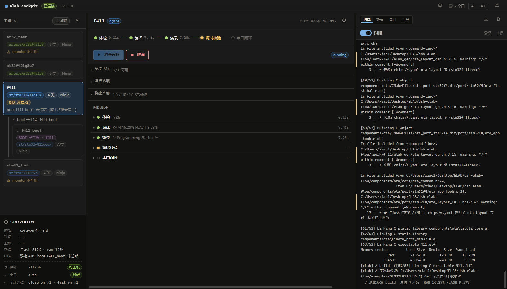

你应该看到：

| 事实 | 值 |
|---|---|
| run id | `r-e7136090`，标题旁带 `agent` 标签与 `running` 徽标 |
| 阶段灯 | 体检/编译/烧录已绿，调试校验半亮（进行中） |
| 互斥 | run 进行中「串口」工作区的监视按钮自动置灰（约束 N5：串口独占） |

跑完后的全绿收官（全闭环用时 24.52s）：

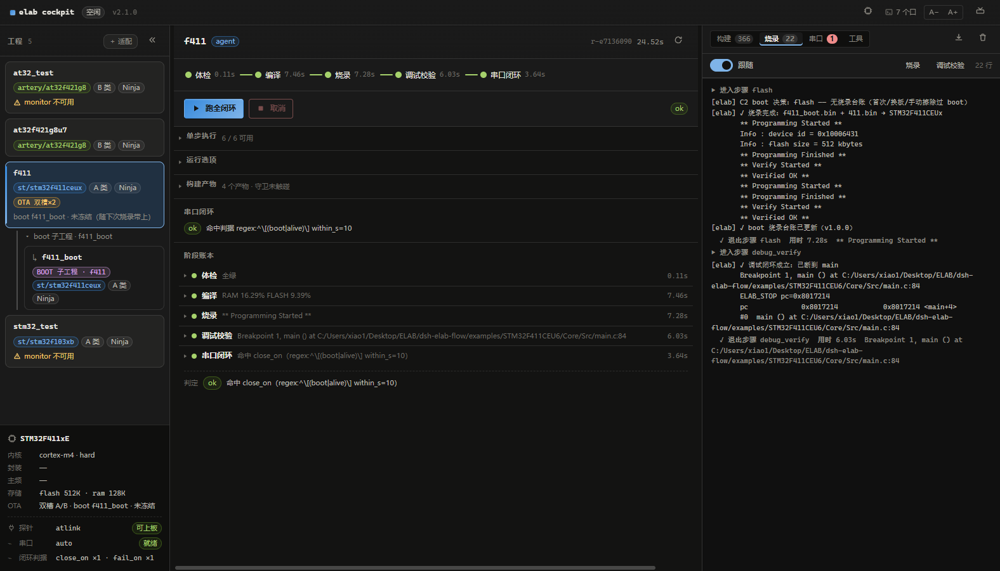

**常见坑**：烧录报「镜像不存在，请先 `elab build -p f411_boot`」——f411 是 OTA 双镜像工程（boot@app 两个 bin），全闭环只会构建主工程；boot 镜像需先单独构建一次（本仓实跑时就踩到，run `r-1510aaad` 失败后 `python -m elab build -p f411_boot` 再跑即绿）。

---

## 5. 单步执行与预览

**为什么**：排障的粒度是"步"，不是"闭环"。单步按钮可以只跑编译、只跑烧录、只跑调试校验；「预览」则在按下之前先告诉你**到底会执行什么命令**——`--clean` 会真删目录、烧录会真写板，先看再按。

步骤：

1. 展开中列「运行选项」，点「预览」——只读，不派生任何子进程；
2. 核对 argv 是否符合预期（工作目录、芯片、FPU 等宏）；
3. 点对应单步按钮执行，例如「调试校验」。

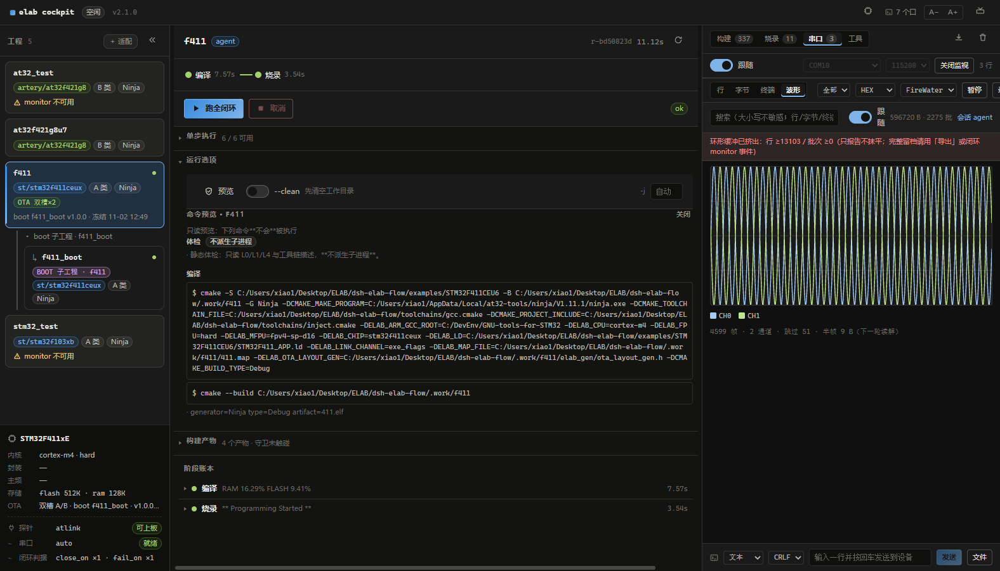

你应该看到（A-06）：

| 步骤 | 预览内容 |
|---|---|
| 体检 | 「不派生子进程」徽标——纯静态只读检查 |
| 编译 | `$ cmake -S .../examples/STM32F411CEU6 -B .../.work/f411 -G Ninja -DELAB_CPU=cortex-m4 -DELAB_FPU=hard -DELAB_MFPU=fpv4-sp-d16 -DELAB_CHIP=stm32f411ceux ...`，随后 `$ cmake --build .../.work/f411` |

单步「调试校验」的结果（run `r-a7aac10e`，4.58s）：

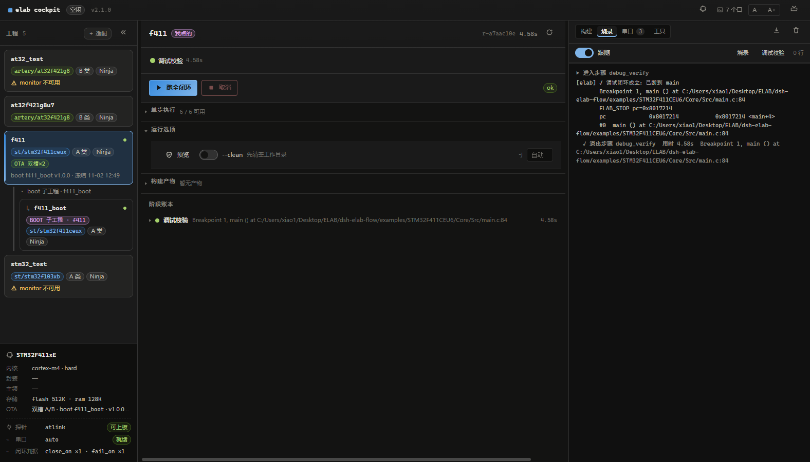

| 证据 | 值 |
|---|---|
| 结论行 | `[elab] ✓ 调试闭环成立：已断到 main` |
| 断点 | `Breakpoint 1, main () at .../Core/Src/main.c:84` |
| 寄存器 | `ELAB_STOP pc=0x8017214`，`#0 main () at main.c:84` |
| 退出 | `✓ 退出步骤 debug_verify 用时 4.58s` |

**常见坑**：单步按钮置灰时把鼠标悬上去——tooltip 会明说理由（缺前置产物 / run 进行中 / 探针不可用），不用猜。

---

## 6. 读懂证据

**为什么**：驾驶舱的原则是"结论必须有证据"——绿勾不是结论，日志里的实数才是。RAM/FLASH 占用、产物清单、烧录校验值，全部来自工具链的原始输出。

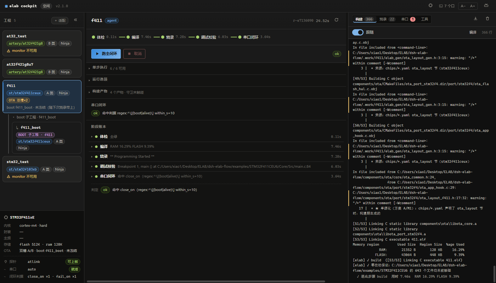

你应该看到（A-07，与图中 Memory region 表同源）：

| 区域 | 已用 | 容量 | 占比 |
|---|---|---|---|
| RAM | 21352 B | 128 KB | **16.29%** |
| FLASH | 43064 B | 448 KB | **9.39%** |

另有三处值得养成习惯看一眼：

- **构建产物**：`4 个产物 · 守卫未触碰`——零改动守卫确认本次构建没有意外改动受保护文件；
- **阶段账本**：`退出步骤 build 用时 7.46s`——每步用时都记账，方便发现异常变慢；
- **烧录日志**（A-08）：`** Programming Finished **`、`** Verified OK **`、`[elab] ✓ boot 烧录台账已更新 (v1.0.0)`——双镜像（boot@app）都校验通过，OTA 台账同步更新。

**常见坑**：「成功」的判据是日志里出现上述结论行，而不是"按钮没变红"——养成看证据轨的习惯。

---

## 7. 串口工作台

**为什么**：串口是嵌入式开发的"另一半闭环"。工作台的四个视图（行 / 字节 / 终端 / 波形）全部投影自**同一份原始字节**——切视图不重开串口、不丢数据。

步骤：

1. 切到右列「串口」工作区，点「打开监视」（端口 auto 自动选 COM10，115200）；
2. 「行」视图看文本流；「波形」视图选解码器（FireWater）看曲线；
3. 需要发数据时用底部发送面板；需要留档时点「录制」。

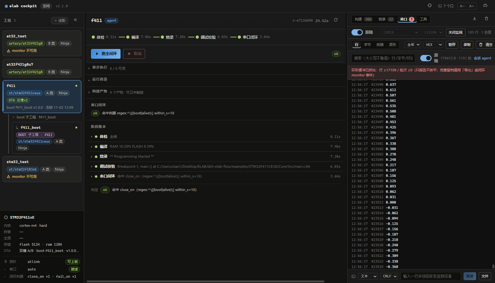

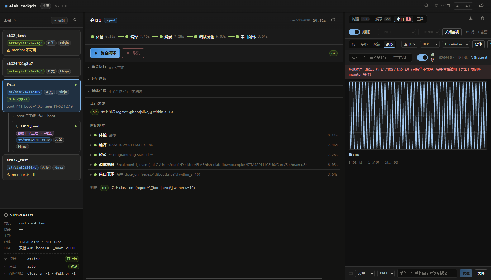

你应该看到（A-11）：

| 事实 | 值 |
|---|---|
| 解码器 | FireWater（ASCII 逗号分隔浮点，通道数自动推断） |
| 徽标 | `8k+01 帧 · 1 通道`（随固件输出滚动增长） |
| 会话 | 「会话 agent」徽标——本次监视由 agent 打开，WebUI 刷新后自动发现并接管显示 |

发送与录制（A-12）：

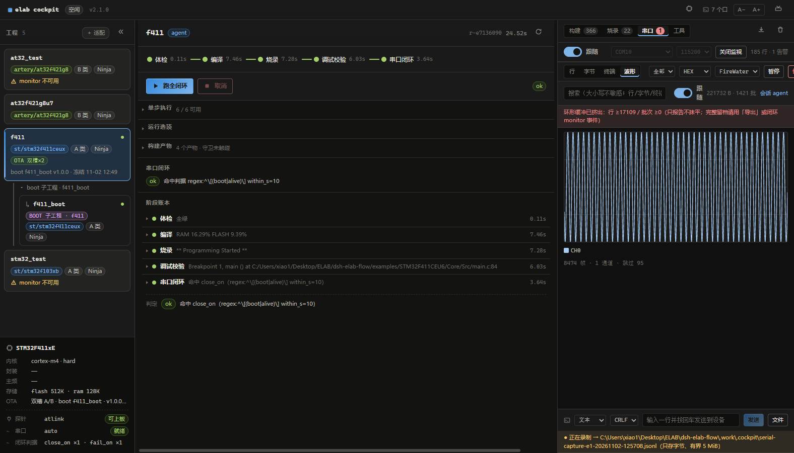

| 事实 | 值 |
|---|---|
| 发送 | 输入一行回车即发，支持换行符选择与文件按行发送 |
| 录制 | `● 正在录制 → .work/.cockpit/serial-capture-el-20261102-125708.jsonl`（只存字节、有界 5 MiB） |

**常见坑**：监视开着时跑不了含烧录/调试的闭环（409，约束 N5）——不是 bug，先「关闭监视」释放串口。

---

## 8. 上手任务：给固件加一路反相正弦（多通道波形）

**为什么**：单通道曲线只能证明"通了"。加一路**延迟半个周期**（相位 −π，即反相）的正弦，让面板同时渲染两条曲线——这才是对串口多通道能力的真实验证，也是你改动固件 → 重建 → 烧录 → 验证的完整小循环。

步骤：

1. 打开 [freertos.c](../../examples/STM32F411CEU6/Core/Src/freertos.c)，在 `StartTask02` 的 100 Hz 循环里，把单通道输出改为双通道（CH2 = CH1 延迟半个周期）：

```c
static float wave_phase = 0.0f;
wave_phase += 0.0314159f;                 /* 2π × 0.5 Hz / 100 Hz */
if (wave_phase >= 6.283185f) wave_phase -= 6.283185f;
wave_emit_sine2(sinf(wave_phase), sinf(wave_phase - 3.1415927f));
```

2. `wave_emit_sine2` 按 FireWater 协议输出一行两个逗号分隔的浮点（`"a,b\r\n"`）：

```c
static void wave_emit_sine2(float v1, float v2)
{
  char buf[24];
  int n = 0;
  for (int ch = 0; ch < 2; ch++) {
    int milli = (int)((ch == 0 ? v1 : v2) * 1000.0f);
    uint32_t mag = (uint32_t)(milli < 0 ? -milli : milli);
    if (ch == 1) buf[n++] = ',';          /* 通道分隔 */
    if (milli < 0) buf[n++] = '-';
    buf[n++] = (char)('0' + (mag / 1000u) % 10u);
    buf[n++] = '.';
    buf[n++] = (char)('0' + (mag / 100u) % 10u);
    buf[n++] = (char)('0' + (mag / 10u) % 10u);
    buf[n++] = (char)('0' + mag % 10u);
  }
  buf[n++] = '\r';
  buf[n++] = '\n';
  for (int i = 0; i < n; i++) fputc(buf[i], stdout);
}
```

> 注：本工程任务栈仅 512 B，禁用 `printf` 族（实测会压爆栈进 HardFault）；newlib-nano 也没有 `%f`，所以用 24 B 小缓冲 + `fputc` 逐字节拼装毫单位数值。

3. 点「编译」再点「烧录」（或「▶ 跑全闭环」）；本例由 agent 发起 build+flash（run `r-bd50823d`，编译 7.57s + 烧录 3.54s）；
4. 打开串口监视 →「波形」→ 解码器选 **FireWater**。


你应该看到：

| 事实 | 值（与图同源） |
|---|---|
| 徽标 | `4595 帧 · 2 通道 · 跳过 50`（"跳过"的是 `[alive]` 心跳行，非 FireWater 帧，属预期） |
| 图例 | CH0 / CH1 两条曲线，一条过零上升时另一条过零下降——**严格反相** |
| 数据 | 行视图可见 `-0.729,0.729` → `0.000,0.000` → `1.000,-1.000` 的镜像数值对 |
| 服务端 | `GET /api/serial/monitor/decoded` 返回 `channels: 2`、`decoder_by: "agent"`——面板与 agent 读同一份解码帧 |

**常见坑**：波形区显示「0 通道」时先检查解码器——JustFloat 是二进制小端协议，解不了 FireWater 文本帧；选错协议不会报错，只会"什么都没"。

---

## 9. 常见故障

| 症状 | 原因与修法 |
|---|---|
| 烧录报「镜像不存在，请先 `elab build -p f411_boot`」 | OTA 双镜像工程的 boot bin 未构建；先 `python -m elab build -p f411_boot`（或 WebUI 选中 `f411_boot` 工程单步编译）再跑闭环。本教程实拍时真实踩到（run `r-1510aaad`）。 |
| 发起闭环返回 409 / 监视开不了 | 串口独占（约束 N5）：有 run 在跑时不能开监视，反之亦然。等 run 完或先「关闭监视」。 |
| 探针「不可上板」/ openocd 起不来 | 残留 `openocd` 进程占用调试口：任务管理器结束 `openocd.exe`，或 `Get-Process openocd | Stop-Process`。 |
| monitor「不可用」徽标 | 工程 yaml 没有配置心跳判据（`close_on`），串口闭环步被判不可用——编译/烧录/调试不受影响。 |
| 串口 0 字节 / monitor 判 `inconclusive` | 固件没有初始化 USART1（或 PA9/PA10 接反、波特率不一致）。先看启动日志有没有 `[log] UART1 : ok (... TX=PA9, RX=PA10 ...)`；接线要 TX/RX **交叉**并共地。 |
| 「＋ 适配」探测后工程漂移 | 工程目录被外部改动（换了芯片/改了工程文件），重新「探测」让证据链刷新即可。 |

---

## 附录：命令速查

| WebUI 按钮 | 等价命令 |
|---|---|
| （启动） | `cockpit.cmd` / `python -m cockpit.server` |
| 体检 | `elab.cmd doctor` |
| 编译 | `elab.cmd build -p f411` |
| 烧录 | `elab.cmd flash -p f411` |
| 调试校验 | `elab.cmd debug -p f411` |
| ▶ 跑全闭环 | `elab.cmd loop -p f411` |
| 三档闭环 | `elab.cmd run -p f411 --steps build,flash,debug_verify` |
| 装包 / 启用 | `elab.cmd pkg install <name>` / `elab.cmd pkg activate <name>` |
| 市场索引重生成 | `elab.cmd pkg index`（改包后必跑） |
| 串口一行 | `elab.cmd serial -p f411 --data "hello"` |

> agent 侧：所有按钮动作都有对应的 loopback HTTP API（`POST /api/run`、`POST /api/serial/monitor`…），WebUI 与 agent 共用同一内核，状态实时同源——这正是本教程多幅截图带 `agent` 标签的原因。
