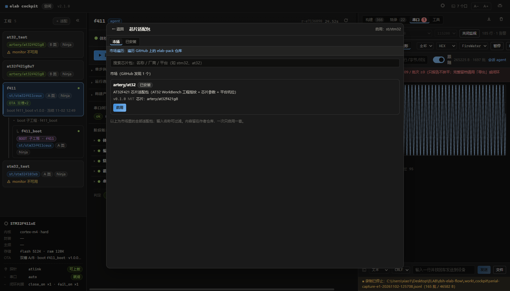
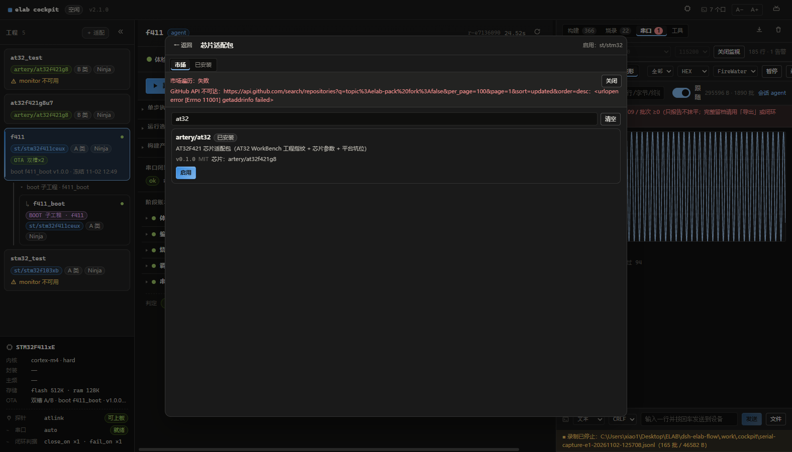
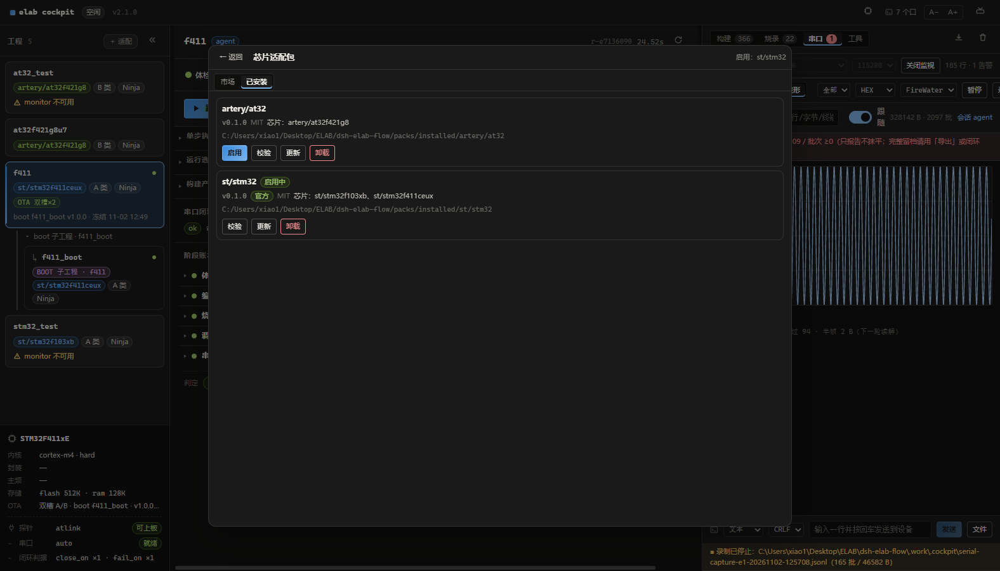
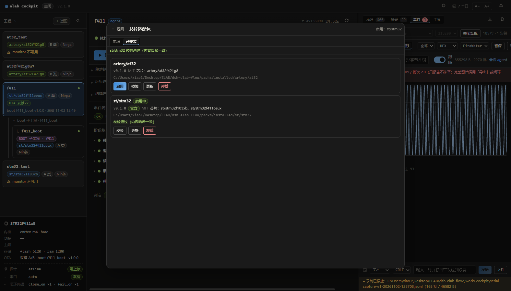
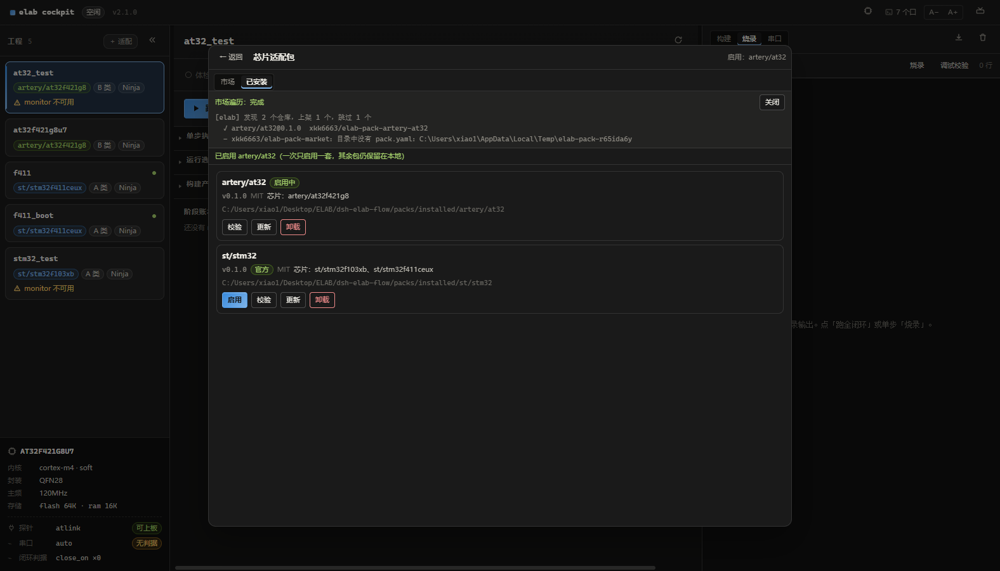
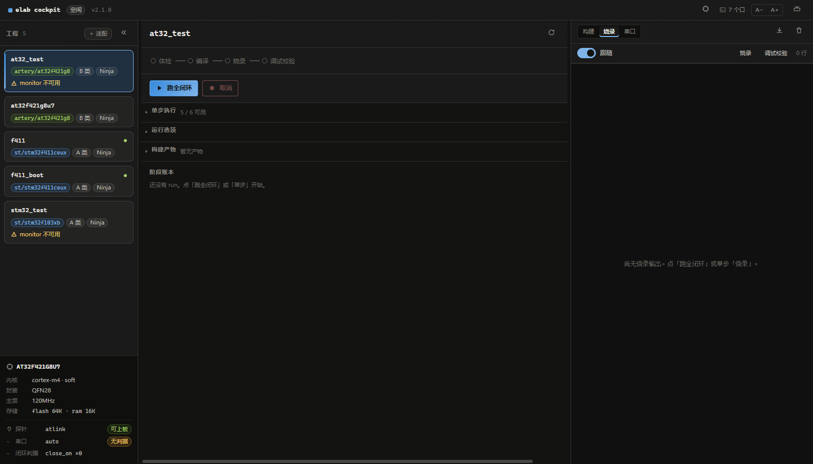
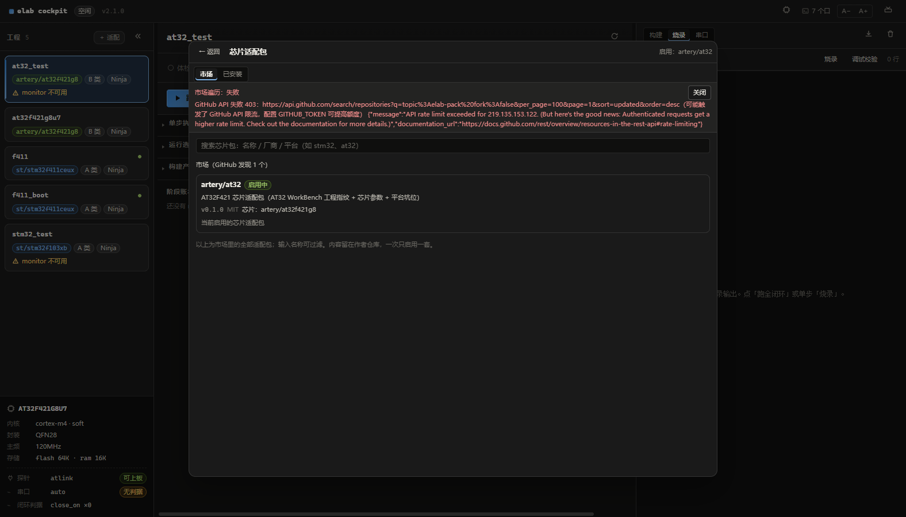

# 插件市场使用：独立 WebUI 安装与启用芯片适配包

> 目标读者：已经能启动 WebUI 的用户（可作为 [芯片开发上手](01-芯片开发上手_独立WebUI.md) 第 2 章的展开版，也可独立阅读）。
> 读完你能：在市场里找到芯片包 → 安装 → 启用 → 校验 / 看有没有新版本并手动更新 / 卸载 → 回到工程轨跑闭环。
>
> **拍摄口径**：与 A 篇同一次实机环境（深色，1600×1000）。截图均来自移植落地后的独立 WebUI 真实界面；遍历失败、限流等异常画面**如实保留**，作为兜底章节素材。

---

## 0. 市场是什么

**零服务器市场**：索引文件（`market/index.json`）只记元数据——name / version / source / sha256 / requires / license；**包内容留在作者自己的 GitHub 仓库**，内核按索引里的哈希下载并强校验。官方包 `st/stm32` 随仓自带，离线可用。

链路一句话：作者仓打 topic `elab-pack` → 市场仓定期发现 → 机器人重算 sha256 写入索引 → 用户端按名安装、按哈希验收。作者侧上架流程见 [市场适配包贡献](02-市场适配包贡献.md)，本篇只管"装和用"。

---

## 1. 进入市场

**为什么**：市场与已安装是同一个整幅视图的两个页签，进得去、回得来——「← 返回」随时回驾驶舱，闭环状态不受浏览影响。

步骤：

1. 点顶栏的**芯片图标**按钮（tooltip：「芯片适配包：市场搜索 / 已安装（一次只启用一套）」）；
2. 视图头部即显示当前启用包（图中「启用：st/stm32」）；
3. 两个页签：**市场**（远程发现）与**已安装**（本地管理）。



你应该看到：

| 位置 | 事实 |
|---|---|
| 头部 | 「← 返回」+「启用：st/stm32」 |
| 页签 | 市场 / 已安装 |
| 市场页 | 搜索框 + 包条目（名称、版本、license、芯片列表、来源仓） |

**常见坑**：找不到入口——它不在右列工作区里，在**顶栏**（芯片图标），与主题/字号按钮一排。

---

## 2. 市场页：浏览与搜索

**为什么**：市场页是**安装入口**。首次打开会现场遍历 GitHub 上所有带 `elab-pack` topic 的仓库（异步 job，只读远端、不改本地），搜索框按名称/厂商/平台过滤。

步骤：

1. 切到「市场」页签，等遍历 job 完成（进度可见）；
2. 搜索框输入关键词，例如 `at32`；
3. 看条目字段：official/community、版本、license、芯片、requires。



你应该看到（与本次实拍同源）：

| 事实 | 值 |
|---|---|
| 遍历结论 | `发现 2 个仓库，上架 1 个，跳过 1 个`——跳过的是市场索引仓自身（目录中没有 `pack.yaml`，正常） |
| 上架条目 | `artery/at32@0.1.0`（社区包，来自 `xkk6663/elab-pack-artery-at32`） |
| 搜索 `at32` | 列表过滤到 artery/at32 单条 |

**常见坑**：遍历失败不等于市场坏了——见第 7 章（限流/断网时回退本地索引，已安装页完全不受影响）。

---

## 3. 安装

**为什么**：安装只传**包名**——来源 URL 与 sha256 都由内核从市场索引解析，用户（和 agent）都碰不到"下载地址"这个攻击面。

步骤：

1. 在市场页条目上点「安装」；
2. 安装是异步 job，进度在视图内可见；
3. **安装 / 卸载 / 启用期间闭环冻结**：此时发起 run 会收到 409，界面会明说"有包管理操作进行中"——等它完成再跑闭环；
4. 装完出现在「已安装」页签（本次实拍的两套包 `st/stm32`、`artery/at32` 即由此装入 `packs/installed/`）。

> 本次实拍未重复演示安装过程（两套包此前已装好）；界面行为与上述一致，安装 job 完成后自动刷新已安装列表。

**常见坑**：安装按钮置灰 = 包与内核不兼容（`requires` 声明的内核版本高于本机）——先升级内核，不要想办法绕过。

---

## 4. 已安装页

**为什么**：已安装页是本地管理的全部：启用（一次只启用一套）、校验（内容哈希）、更新（按市场索引，索引版本更高时打「可更新 vX」并给「更新到 vX」）、卸载。其余包保留在本地磁盘，随时可切回。



你应该看到：

| 条目 | 状态 | 可用动作 |
|---|---|---|
| artery/at32 v0.1.0（MIT，芯片 artery/at32f421g8） | 已安装 | 启用 / 校验 / 更新 / 卸载 |
| st/stm32 v0.1.0（官方，芯片 st/stm32f103xb、st/stm32f411ceux） | **启用中**徽标 | 校验 / 更新 / 卸载 |

点「校验」——内核按安装时登记的 sha256 重算包内容：



| 事实 | 值 |
|---|---|
| 结论 | `st/stm32 校验通过（内容哈希一致）`（顶部通知 + 行内同步） |
| 含义 | 包目录自安装后没有任何字节被改动——换行符被动过都会校验失败 |

**常见坑**：校验失败九成是编辑器/换行转换动了包文件——重装该包即可（外置包仓库带 `.gitattributes` 就是为了防这个）。

---

### 4.1 检查与更新到新版本

**为什么**：包内容由作者维护，**市场索引里的 `version` 才是"有没有新版本"的唯一事实源**。内核读已安装列表时会顺带和市场索引比对（已装记录多出 `latest` / `updatable` 两个字段），只有索引版本确实更高才提示；**不做后台静默升级**，升不升由你点。

步骤：

1. 打开**市场**页签：已经装过的包若索引里有更高版本，条目上会出现琥珀色「可更新 vX」，主按钮直接变成「更新到 vX」；
2. 或打开**已安装**页签：同一事实显示在行内——「可更新 vX」徽标，右侧「更新」按钮变为「更新到 vX」；
3. 点「更新到 vX」→ 异步 job（与安装同一条通道）→ 完成后自动刷新列表、重生成平台 skill，并跑一遍环境自检。

你应该看到：

| 情况 | 界面与行为 |
|---|---|
| 索引版本更高 | 出现「可更新 vX」；按钮文案「更新到 vX」；按索引重新拉取并按 `sha256` 强校验 |
| 与索引同版本 | **不显示**「可更新」；点「更新」也只会打印「已是最新 vX」，不重复下载 |
| 索引没收录该包（如内置 `st/stm32`） | 不显示更新徽标（`latest = null`），离线用法不受影响 |
| 本地版本高于索引（本地开发版） | 默认**不降级**：界面不提示；CLI 打印「本地 v… 高于市场 v…，跳过（--force 可覆盖）」 |

更新是异步 job，**期间闭环冻结**：此时发起 run 会收到 409（与安装/卸载/启用同一条规则），等 job 完成再跑闭环。

**常见坑**：

- 「可更新」来自**市场索引**，不是作者仓库的实时 tag——作者刚发新版、索引还没刷新时看不到提示；索引由市场仓每小时重生成，等一轮或本机跑 `elab pkg index --remote` 即可。
- 更新只替换该包目录（启用关系记在 `active.json`，其余包与串口/工程配置都不动）；同版本不重复下载，确需强制重装才加 `--force`。
- 需要主动降级（本地开发版比索引高，想回到市场版）：CLI 加 `--force`；面板按钮默认不带强制。
- 更新完成后会自动跑 `elab setup` 环境自检，缺 provider / 主机键会当场列出下一步命令——不要跳过这段输出。

对应命令与接口：

```bash
./elab pkg update                 # 全部已装包按索引比对（同版本 / 本地更高默认跳过）
./elab pkg update artery/at32     # 只更新一套
./elab pkg update artery/at32 --force   # 同版本也重装 / 允许覆盖本地更高版本
```

| 通道 | 入口 | 说明 |
|---|---|---|
| CLI | `elab pkg update [NAME] [--force]` | 逐包比对索引 `version`；更新后自动 `elab setup` |
| HTTP | `POST /api/pkg/update` `{name}` | 202 + job；`GET /api/pkg/job` 跟进度；`name` 缺省 = 全部 |
| DSH 面板 | 已安装页 / 市场页「更新到 vX」 | 与内核 WebUI 同形，数据同源（`GET /api/packs` 的 `updatable`） |
| agent | `elab_pkg`（`action=update`） | 同一冻结规则：包管理期间发起 run 返回 409 |

---

## 5. 启用与生效

**为什么**：启用是**全局单选**——工程轨的芯片事实、内核的平台知识都跟着当前启用包走。切换即时生效，其余包保留本地。

步骤：

1. 在「已安装」页点目标包的「启用」；
2. 顶部通知确认，头部「启用：…」同步变化；
3. 「← 返回」回驾驶舱，看工程轨的芯片能力变化。



你应该看到（本次实拍：从 st/stm32 切到 artery/at32）：

| 事实 | 值 |
|---|---|
| 通知 | `已启用 artery/at32（一次只启用一套，其余包仍保留在本地）` |
| 头部 | 「启用：st/stm32」→「启用：artery/at32」 |
| 徽标 | artery/at32 行出现「启用中」（按钮收起「启用」）；st/stm32 行重新出现「启用」按钮 |

返回驾驶舱后，工程轨立即跟随（C-06b）：



| 事实 | 值 |
|---|---|
| `at32_test` 卡 | 芯片事实完整点亮：**AT32F421G8U7** · cortex-m4 · soft · QFN28 · 120MHz · flash 64K · ram 16K · 探针 atlink「可上板」（此前 st 包启用时这些字段是「—」） |
| `f411` 卡 | OTA 双槽 / boot 台账徽标消失（这些知识来自 st 包）；`f411_boot` 平铺为独立卡 |

> 实拍后已切回 `st/stm32` 继续 A 篇的 f411 闭环。切换是瞬时的，不产生任何构建副作用。

**常见坑**：切包后某工程卡片字段变「—」不是数据丢了——是该芯片不在当前启用包里，切回对应包即恢复。

---

## 6. 回到闭环

启用目标包后，闭环流程与 A 篇完全一致：

1. 左列「＋ 适配」→ 填工程绝对路径 →「探测」（探测用的厂商指纹同样来自启用包）；
2. 「写入」得到工程卡；
3. 「▶ 跑全闭环」或单步。

> **串口闭环前提**：`monitor` 读的是**工程固件已经初始化好的 UART**（本仓 STM32 示例：USART1，
> 115200 8N1，**PA9 = TX / PA10 = RX**，接线 TX/RX 交叉 + 共地）。elab 不配置芯片外设；
> 工程没初始化串口时，监视步骤只会判 `inconclusive`（0 字节）。说明见 [A 篇 §3.4](01-芯片开发上手_独立WebUI.md#34-串口闭环的硬前提工程里-usart1-已经初始化)。

实拍衔接：A 篇第 3 章的探测报告（T1 · 可适配 / 置信度 high / `st/stm32f411ceux`）就是在 `st/stm32` 启用状态下得出的——[见 A 篇](01-芯片开发上手_独立WebUI.md#3-接入你的工程)。

---

## 7. 异常与兜底

**市场遍历失败不影响已装包**。本次实拍真实遇到 GitHub API 限流（403），界面行为如下：



你应该看到：

| 事实 | 值 |
|---|---|
| 横幅 | `市场遍历：失败 —— GitHub API 失败 403 …（可能触发了 GitHub API 限流，配置 GITHUB_TOKEN 可提高额度）`，可「关闭」 |
| 回退 | 仍显示最近一次市场索引：`市场（GitHub 发现 1 个）`，artery/at32 条目完整可读 |
| 已安装页 | 完全不受影响，启用/校验/更新/卸载全部可用 |

其他情况：

| 症状 | 原因与修法 |
|---|---|
| 搜索不到某包 | 作者仓没打 `elab-pack` topic，或遍历缓存未刷新——切页签重进，或稍后再试 |
| 安装按钮置灰 | `requires` 内核版本不满足，先升级内核 |
| 看不到「可更新 vX」 | 索引没刷新（市场仓每小时重生成），或本地版本已不低于索引；`elab pkg update` 会按索引逐包比对 |
| 本地版本更高被跳过 | 正常防降级——`elab pkg update <name> --force` 才用索引版本覆盖 |
| 更新后校验失败 | 作者改了内容没升版本（违反市场规则）——卸载重装，并向市场仓举报 |

---

## 8. agent 代装（可选）

agent 与人工共用同一内核接口与同一套冻结规则：

- 安装：`POST /api/pkg/install`，**只收包名**（来源与哈希由内核从索引解析）；
- 更新：`POST /api/pkg/update`，`{name}` 缺省更新全部；同版本或本地更高默认跳过；
- 启用/校验/卸载同理走 `POST /api/pkg/*`；
- 包管理进行中发起 run 同样收到 409——agent 脚本应先查 job 状态再跑闭环。

界面会同步显示 agent 发起的包管理 job（与 run 的 `agent` 标签同一机制），人在界面里能看清"是脚本在装包"。
