# 调试工作区上手指南（STM32F103C8T6 实机 · 独立 WebUI）

> 目标：不是背按钮，而是**从一次真实的 HardFault 里学会调试工作区** —— 用断点、调用栈、寄存器、监视、内存、外设和 RTOS 栈水位，把一个「数组越界踩坏函数指针」的 bug 找出来并修好。
>
> 本文所有截图都来自 **STM32F103C8T6 + AT-Link 实机**，界面是随仓的**独立 WebUI**（`cockpit/web`，`http://127.0.0.1:8336`），不是渲染图；工程为 FreeRTOS 心跳工程 `stm32c8_test`。
>
> 截图 `12–17` 是 **P1/P2 新功能的实机演示**（行内编辑、反汇编定位、SVD 字段写、断点命中通知）。这些截图停点可能在 `main`，数值不必与第 0 节的 HardFault 现场一致 —— 看的是**交互与能力**，不是同一份现场取证。

相关设计：[技术方案_调试面板复刻 cortex-debug](../design/技术方案_调试面板复刻cortex-debug.md)；
IPC 契约见 [ICD_cockpit_events](../design/ICD_cockpit_events.md)。

---

## 0. 这次要抓的 bug

固件里有一个心跳任务，负责每 1 秒打一行 `[alive]` 并翻转板载 LED。为了让教程可复现，心跳里故意留了一个**数组越界**：

```c
typedef struct {
  unsigned char raw[16];        /* 只有 16 字节 */
  void (*on_frame)(void);       /* 紧跟其后：收完一帧的回调 */
  unsigned int reserved[2];
} hb_frame_t;

static hb_frame_t g_hb_frame = { .on_frame = hb_on_frame };

static void heartbeat_pack_buggy(void)
{
  unsigned int i;
  for (i = 0; i < 24; i++) {    /* BUG：上界写成了 24 */
    g_hb_frame.raw[i] = (unsigned char)(0x41 + i);
  }
  g_hb_frame.on_frame();        /* 指针已被覆盖成 0x54535251 */
}
```

后果：`raw[16..23]` 把 `on_frame` 覆盖成 `0x54535251`（'Q''R''S''T' 的小端值）。
调用它时 PC 跳到 `0x54535250`（Thumb 位被清），非法地址 → BusFault → 升级成 **HardFault**。

**现场症状**：串口一行 `[alive]` 都没有，LED 也不闪；但编译、烧录都显示成功。

这正是最容易被误判成「串口线没接 / 波特率不对」的那类问题 —— 用调试器可以直接看到根因。

---

## 1. 前置条件

| 项 | 要求 |
|---|---|
| 硬件 | STM32F103C8T6 最小系统板 + AT-Link（SWD），USB 已连接 |
| 串口 | USART1：115200 8N1，PA9=TX / PA10=RX（交叉 + 共地），本机 `COM10` |
| 工程 | `projects/stm32c8_test.yaml`；ELF：`.work/stm32c8_test/TEST.elf` |
| 工具链 | `arm-none-eabi-gdb`、`openocd` 在 `PATH`（或由 `elab.host.yaml` 声明） |
| 探针 | 默认 `atlink`；换 ST-Link / J-Link 只改 `projects/stm32c8_test.yaml` 的 `debug.probe: stlink`（或 `jlink`），host 已内置 interface cfg（J-Link 需装 SEGGER 驱动） |
| 内核 | `GET /api/capabilities` 的 `meta.debug.available == true` |

启动内核（独立 WebUI 与内核是同一个进程）：

```powershell
cd <elab 仓库根>
$env:PYTHONPATH = "$PWD\services"
python -m cockpit.server --port 8336     # 浏览器打开 http://127.0.0.1:8336
```

> 端口别用 3333：那是 openocd 的 gdb server 默认端口（见 `C34`）。本文用 8336，避开它。

先不改 UI 的烟测：

```powershell
.\elab.cmd debug -p stm32c8_test --verify
```

`--verify` 会非交互地复位、下载、停在 `main` 并打印证据后退出，适合 CI / 先确认链路。

---

## 2. 打开调试工作区

在 WebUI 右侧工作区栏点 **「调试」**（其余工作区是 `构建 / 烧录 / 串口`）。首次进入是待机状态：

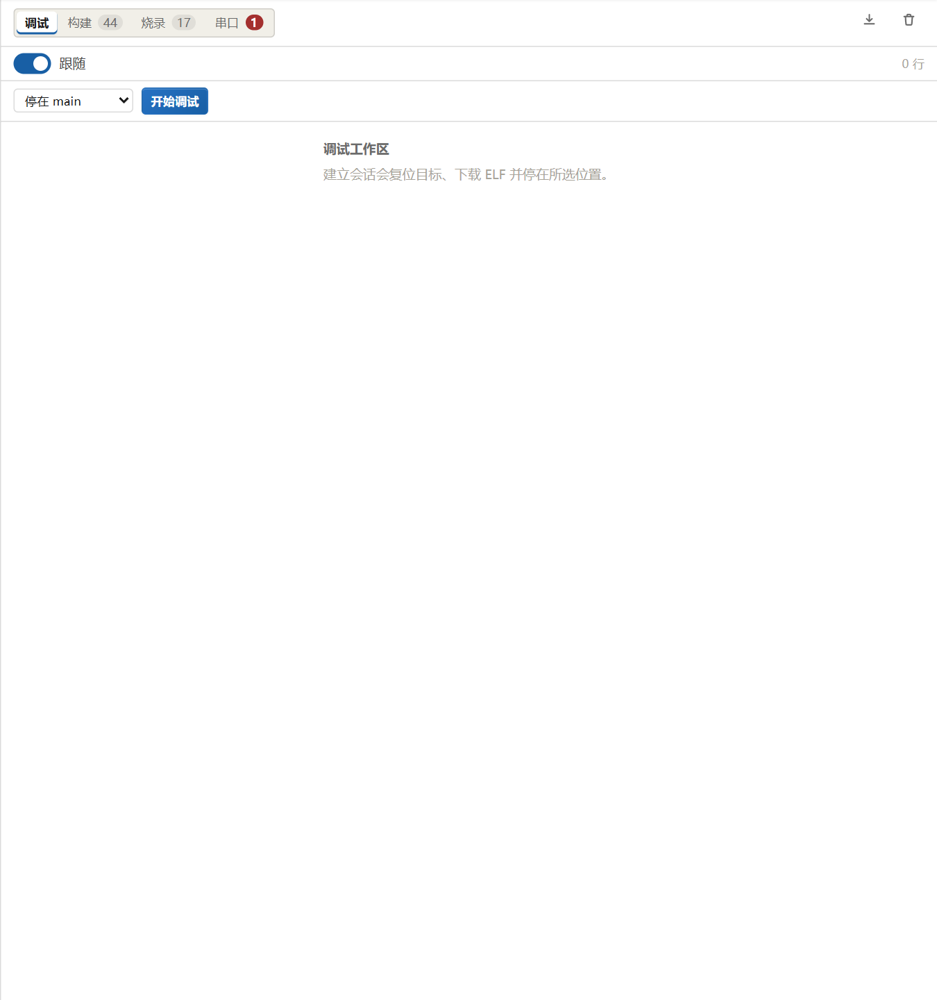

- 顶部 **`STOPPED`** 状态徽标、`继续 / 暂停 / 单步 / 步入 / 步出 / 复位`，右侧两个关闭按钮：**`关闭并运行`**、**`关闭并停住`**。
- 「跟随」开关：自动跟随最新一次停止事件（默认开）。
- 下拉框选择**开场停点**：`停在 main` / `停在 reset` / `不停住（none）`。排查启动类问题用 `reset`，排查应用逻辑用 `main`。
- 页签：`调用栈 变量 寄存器 断点 监视 内存 反汇编 外设 RTOS 栈 审计 输出`。

点 **「开始调试」**。内核会：动态分配 gdb 端口起 `openocd` → 起 `arm-none-eabi-gdb --interpreter=mi2` → `monitor reset halt` → `-target-download` 下载 ELF → 在所选位置停住。

完整界面（左：工程与运行区；右：调试工作区）：

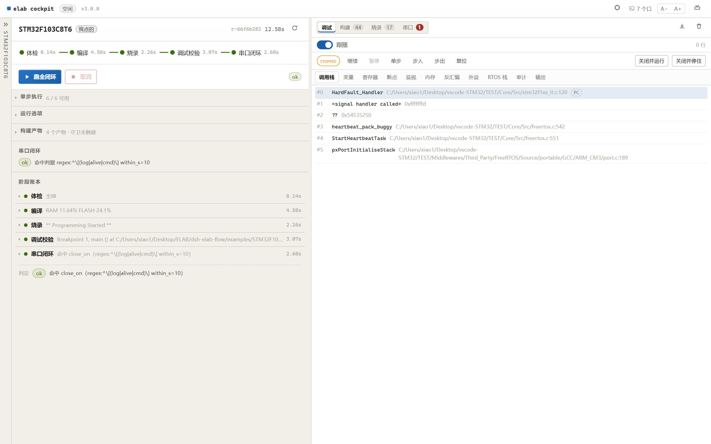

---

## 3. 断点：让崩溃现场自己停下来

HardFault 不是断点，但 **`HardFault_Handler` 是**。切到 **「断点」**页签，输入 `HardFault_Handler`，点 **「添加断点」**：


- 断点支持**函数名**与 **`*地址`** 两种；`条件` 里可写表达式（如 `i == 5`）。
- 断点会持久化到 `projects/stm32c8_test.debug.json`；重开会话自动回灌。
- 每个写操作都带 `rev` 乐观锁：两个窗口同时改断点，后到的会拿到 `409 debug-rev-conflict`，不会互相覆盖。

点 **「继续」**。固件跑起来后，越界写坏回调指针，调用时进入 HardFault —— 断点命中。

### 3.1 命中断点的即时反馈

命中断点后，调试栏顶部会出现一条 **3 秒自动消失**的提示，同时页签**自动切到「调用栈」**并选中停帧（PC 行高亮）。这样不用先猜「刚才停在哪」，也不会因为 toast 抢焦点影响继续操作：

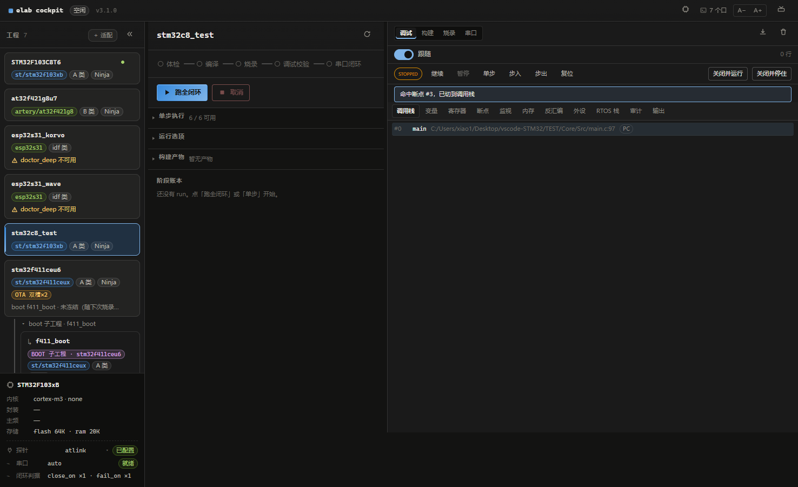

- 这个行为在独立 WebUI 与 **DSH 插件面板**里同源（两边都订阅 `debug/stop` 的 `reason/bkptno`）。
- 如果只是普通暂停（`pause`），不会弹这条提示，页签保持原样。

---

## 4. 调用栈：第一眼看到「非法地址」

切到 **「调用栈」**：

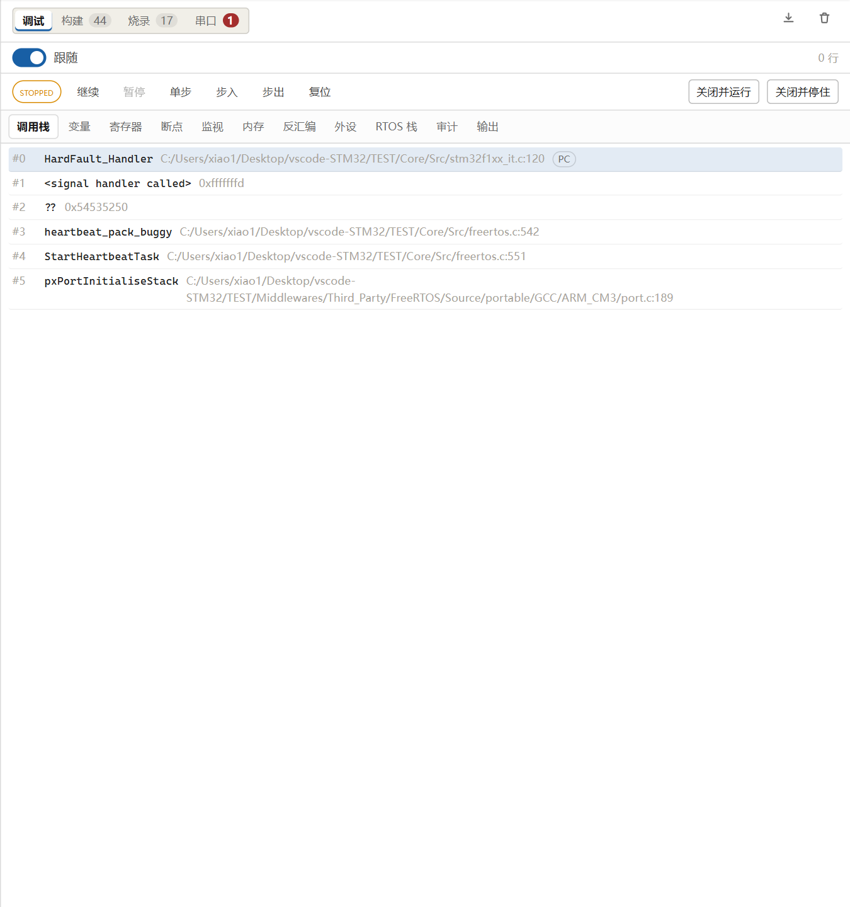

逐帧读：

| 帧 | 内容 | 说明 |
|---|---|---|
| `#0` | `HardFault_Handler` @ `stm32f1xx_it.c:120` | 当前执行点（PC） |
| `#1` | `<signal handler called>` @ `0xfffffff9` | `LR = EXC_RETURN`，返回 handler 模式的标记 |
| `#2` | `??` @ **`0x54535250`** | **没有对应的代码** —— 这就是跳飞的地方 |
| `#3` | `heartbeat_pack_buggy` @ `freertos.c:542` | 调用回调的那一行 |
| `#4` | `StartHeartbeatTask` @ `freertos.c:551` | 任务入口 |
| `#5` | `pxPortInitialiseStack` @ `port.c:189` | 任务首次被调度时的栈底 |

关键结论：**`0x54535250` 不是合法代码地址**，但它出现在调用链里，说明是「通过一个被写坏的函数指针调用」。
再往下看帧 `#3` 的源码行号，位置就锁定到 `heartbeat_pack_buggy` 的 `g_hb_frame.on_frame()`。

---

## 5. 寄存器：指针落在 `r3`

切到 **「寄存器」**（分组 `core`）：

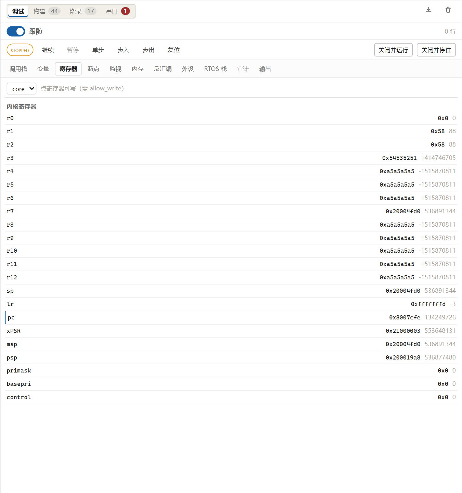

| 寄存器 | 值 | 怎么读 |
|---|---|---|
| `r3` | **`0x54535251`** | 调用前的函数指针（`blx r3` 的入参） |
| `pc` | `0x08007CFE` | 当前在 `HardFault_Handler` 里 |
| `lr` | `0xFFFFFFF9` | `EXC_RETURN`：异常返回 handler 模式 |
| `sp` | `0x20004FD0` | MSP（异常栈） |
| `xPSR` | `0x21000003` | `IPSR=3` → HardFault；`T=1` |
| `r4–r12` | `0xA5A5A5A5` | FreeRTOS 未使用栈槽的填充值，正常 |

`r3 = 0x54535251` 与帧 `#2` 的 `0x54535250` 恰好差 1（Thumb 位）——这坐实了「函数指针被覆盖」而不是「代码跑飞」。

> `sp = MSP` 而不是 PSP，也说明此刻在异常处理上下文里；任务栈指针稍后可用「RTOS 栈」页确认。

### 5.1 行内写寄存器（P1）

寄存器页的值现在可以**直接点开改写**，不再弹 `window.prompt`。点击 `r1` 的值进入编辑态：

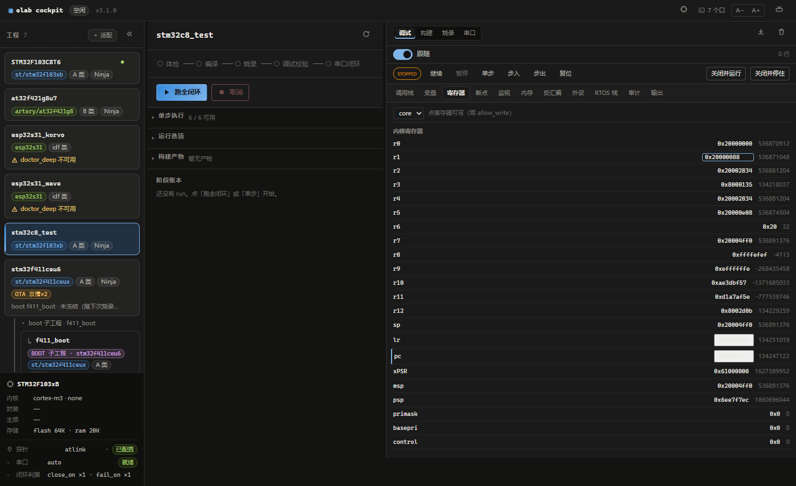

- 只接受 1–8 位 HEX（32 位），自动补零；值没变就直接关掉，不产生写操作。
- 提交走 `POST /api/debug/write`，**必须** `target=register` + `confirm=true`；内核先校验**寄存器白名单**（当前只放行 `core` 组），再写前/写后各记一条审计。
- 写权限来自会话：`/api/debug/breakpoints` 返回的 `allow_write`。人类会话默认开启；Agent 会话默认拒绝（`403 debug-write-denied`）。
- 不确定就先按 `Esc`：取消不会碰硬件。

### 5.2 按组批量写：草稿 → 一次提交（P3-C）

寄存器页顶部多了 **组下拉** 和 **「应用本组（N）」**。点值改数不再立刻写硬件，而是先攒成草稿：

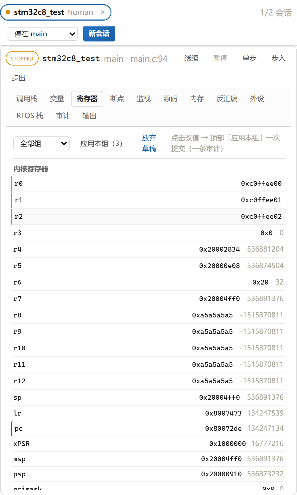

- 组下拉是 `GET /api/debug/registers?group=all` 的**投影**：内核返回几组就显示几组。Cortex-M3 只有「内核寄存器」；M4F/M7 会多一组「FPU 寄存器」。
- 点值 → 输入 → `Enter` **只进草稿**（一个请求都不发）；改过的行左侧有强调条、值变强调色，行尾的旧自然值被隐藏（插件面板里显示「草稿」）—— 免得把旧值读成"已经生效"。
- **「应用本组（N）」** → `POST /api/debug/registers`，`items=[{name,value}…]`：整批**先校验、再逐项 set、最后读回**，并**只落一条审计**。
- **「放弃草稿」** = 清掉本地草稿，硬件一个字节都没动过。

应用之后（值已生效、计数归零、自然值重新出现）：

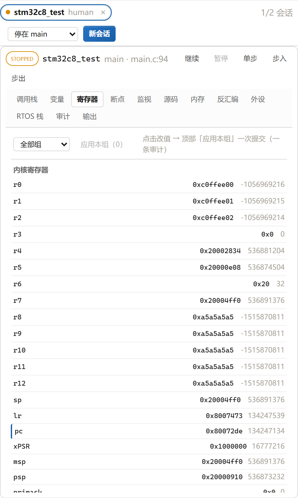

审计里就是**一条**记录（`target=register-group`），带每一项的 before/after：

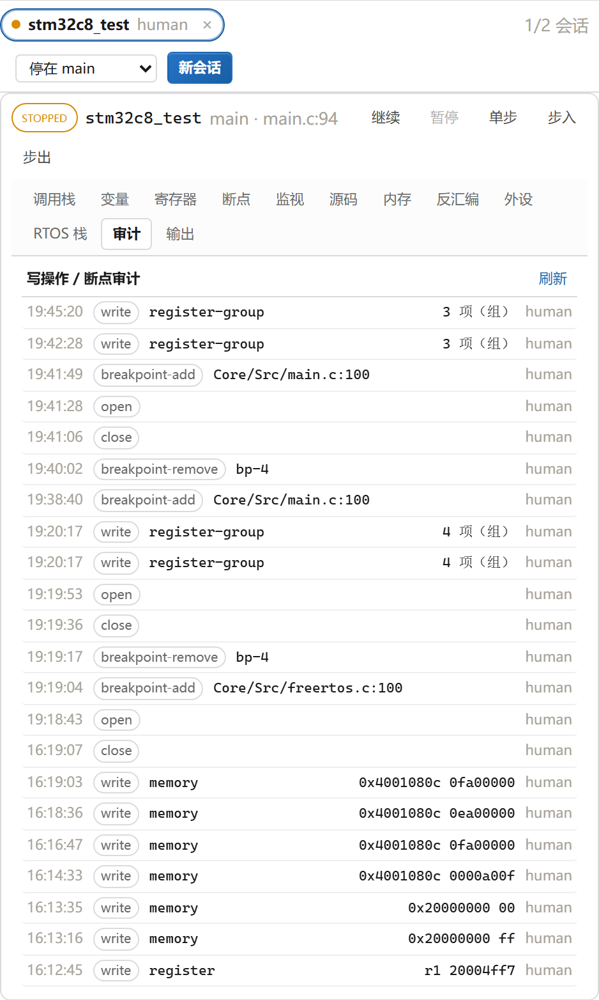

写权限与白名单和行内写是**同一套闸门**：

| 寄存器 | 可写 | 说明 |
|---|---|---|
| `r0–r12`、`sp` | ✅ | 走 `set $rN = 0x…`（GDB 控制台），写后读回校验 |
| `pc`、`lr`、`xpsr` | ❌ `403 debug-write-denied` | 改它们等于直接改控制流，不属于面板能力 |
| `d0–d15`、`q0–q15` | ❌ 只读 | 有 FPU 的核（M4F/M7）才出现；64/128 位宽寄存器留待 P3b |

> **F103 上看不到 d/q**：Cortex-M3 没有 FPU，所以这台板子的寄存器页一共 **23 个**内核寄存器
> （`r0–r12 / sp / lr / pc / xPSR / msp / psp / primask / basepri / faultmask / control`），
> 组下拉也只有「内核寄存器」一项。这不是面板缺项；换 `stm32f411ceu6`（M4F）才会多出 FPU 组。

- 单批 **≤16 项**；值必须落在寄存器位宽内（32 位 = 1–8 位 HEX），否则 `400 debug-bad-request`。
- **没有事务回滚**：内核对整批做校验，但写入是逐项的；失败时返回 `applied / failed`，UI 如实提示"已写入 k 项"，绝不假装原子。

---

## 6. 监视：把可疑变量钉在眼前

切到 **「监视」**，输入 `g_hb_frame.on_frame` 点 **「添加」**：

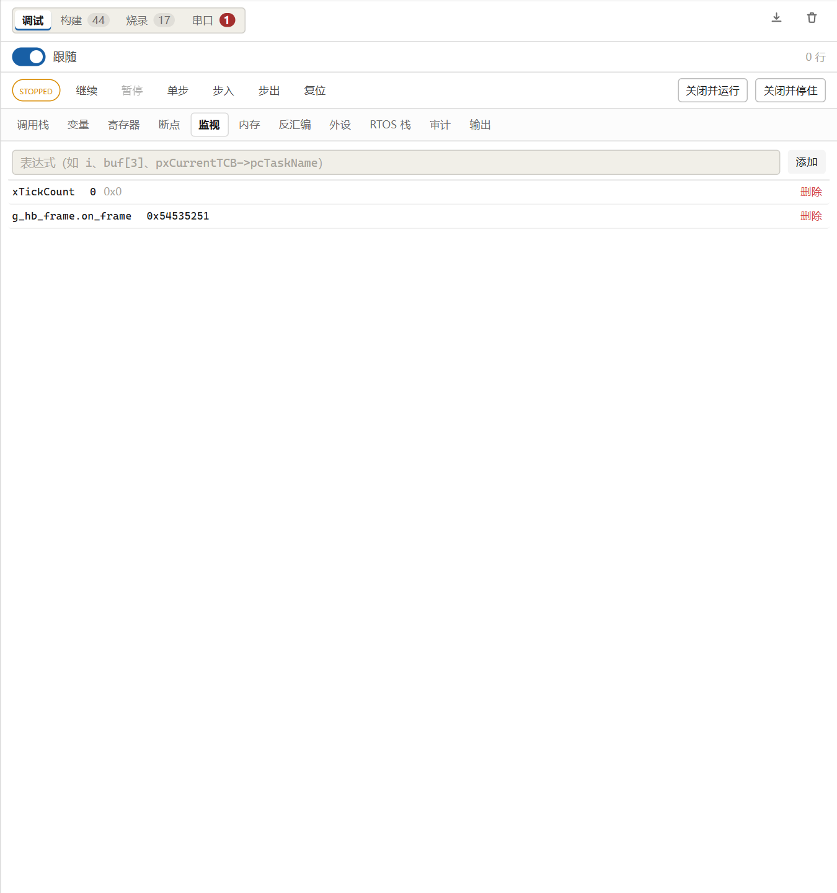

- 监视表达式**只在暂停态求值**；目标在跑时会返回 `debug-target-running`，不会给你一个过期值。
- 监视列表同样**持久化**（`rev` 乐观锁），下次打开工程还在。
- 这里 `xTickCount = 0` 也是证据：心跳任务在第一个 tick 之前就已崩了，所以串口一行都没打出来。

一眼就能看到：`on_frame` 本来应该指向 `hb_on_frame`（`0x08xxxxxx`），现在是 `0x54535251`。**可疑变量已确认被污染。**

---

## 7. 内存与反汇编（P1）：越界证据与指令定位

### 7.1 内存：看清越界写了哪 8 个字节

切到 **「内存」**，填地址 `0x20000010`（`g_hb_frame` 的地址，可由 `eval &g_hb_frame` 得到），长度 `64`，点 **「读取」**：

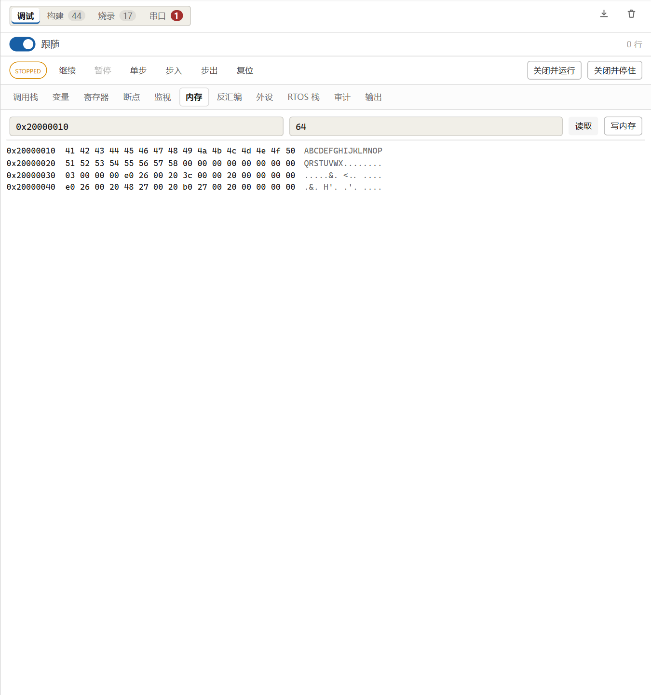

```
0x20000010  41 42 43 44 45 46 47 48 49 4a 4b 4c 4d 4e 4f 50   ABCDEFGHIJKLMNOP
0x20000020  51 52 53 54 55 56 57 58 00 00 00 00 00 00 00 00   QRSTUVWX........
```

- `g_hb_frame.raw[0..15]` = `41..50`（`0x41 + i`）。
- `g_hb_frame.on_frame` 位于 **`+0x10` = `0x20000020`**，被 `51 52 53 54` 覆盖 → 小端读出 `0x54535251`。
- 多出来的 `55 56 57 58` 继续踩到 `reserved[0]` 的高半字 —— 循环写到 24 的直接证据。

对照源码 `for (i = 0; i < 24; i++)`：**上界 24 > `sizeof(raw)=16`**，bug 定位完成。

### 7.2 行内改内存（P1）

不再弹 `window.prompt`：**直接点 HEX 单元格**进入 1 字节编辑，输入 `00–FF` 后 `Enter` 提交，`Esc` 取消：

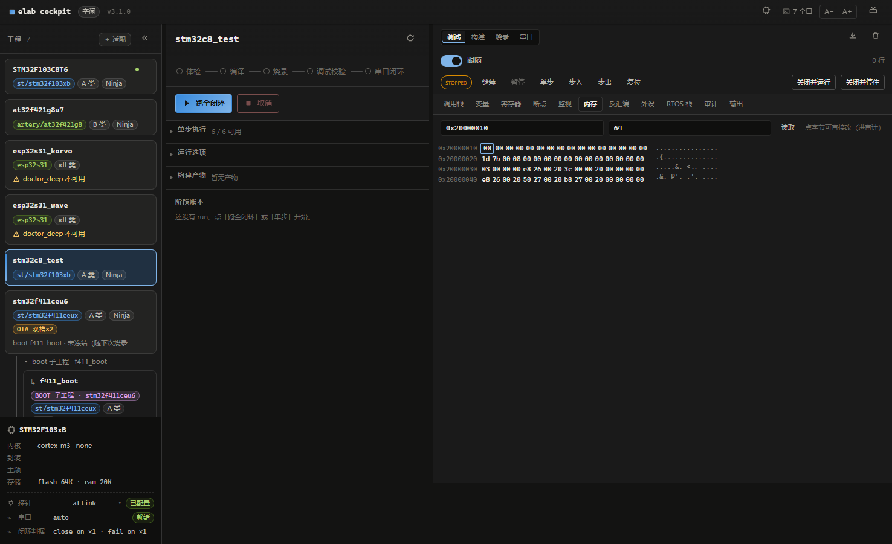

- 单元格用 `button` 而不是可拖选文本，避免「想改字节却选中整行」。
- 提交走 `POST /api/debug/write`（`target=memory`、`confirm=true`），内核限制**单次 1–32 字节**；行内编辑固定 1 字节，写前后值进审计。
- 内存写需要人类会话显式 `allow_write`；Agent 默认拒绝（`403 debug-write-denied`）。只读会话里单元格退化为普通文本，点了没反应。
- 多字节写仍可用 HTTP/CLI（`value` 用空格分隔 HEX）；行内编辑刻意只做 1 字节，降低误改风险。

### 7.3 反汇编（P1）：PC 行高亮 + 地址动作

切到 **「反汇编」**：


- PC 所在指令行有底色与 `PC` 徽标；**新停止（stop_seq 变化）后自动滚到视野中央**，单步/断点命中后不会「丢了当前行」。
- 点**指令地址** → 切到内存页并读该地址（看清楚这条指令的机器码/字面量）。
- 点行尾 **`⌖`** → 以该地址添加断点（`kind=addr`），列表里立即出现，`rev` 乐观锁照旧。
- 这也补上了 WebUI 之前没有「地址级动作」的缺口；插件面板同样支持。

---

## 8. 外设（P2）：SVD 三级树 + 现场字段

切到 **「外设」**。设备是 `STM32F103`（来自 `packs` 里的 SVD），点 `GPIOA` → `ODR`，会自动读回当前值并解码字段：

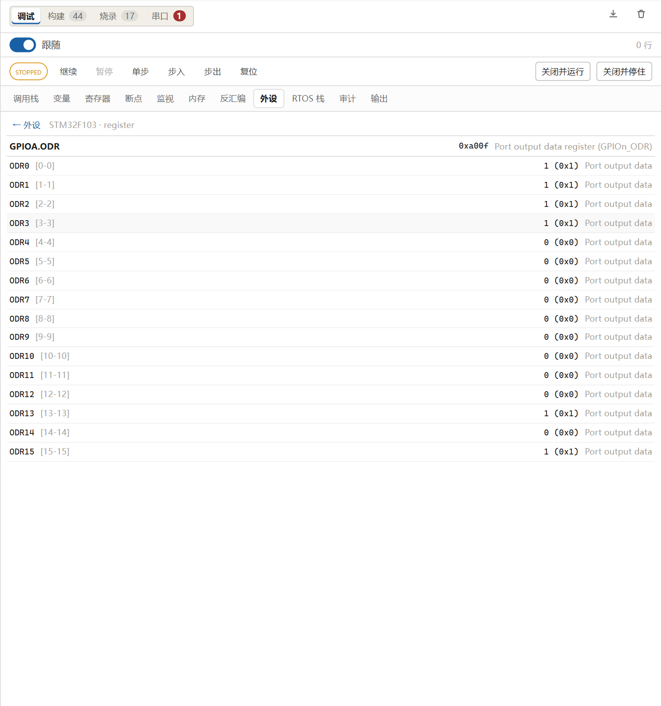

- 层级：`设备 → 外设 → 寄存器`，按需懒加载，不一次性解析整份 SVD。
- 字段解码：`ODR0..3=1`（PA0–PA3）、`ODR13=1`、`ODR15=1`；其余为 0。
- **PC13 是低电平点亮**：`ODR13=1` 表示 LED **灭** —— 与「崩溃后 LED 不闪」的现象一致。
- 读值走 GDB `-data-read-memory-bytes`，外设地址不受 RTOS 影响。

> 用法：改完固件、暂停后刷新外设页，就能核对 GPIO/USART/定时器寄存器的真实配置，不必翻手册算位。

### 8.1 搜索 / 分组折叠（P2）

设备页把外设按 SVD 的 `group` 分组（`FSMC` / `PWR` / `RCC` / `GPIO…`），组头可折叠；右上角搜索框同时匹配**外设名与描述**：

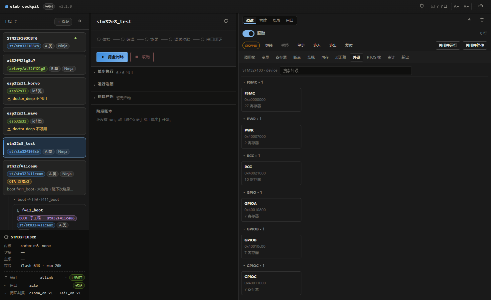

- 外设页也支持搜索**寄存器名/描述**，只过滤当前外设的寄存器列表，不改变 SVD 解析结果。
- 每次新的 `stop_seq` 都会重拉当前层：停在寄存器层时自动带 `read=1`，所以**单步/命中断点后值会跟着刷新**，不用手点。
- 折叠状态只存在前端内存，切工程/重开会话恢复默认展开。

### 8.2 字段级写：读-改-写 + 掩码（P2）

寄存器字段的取值现在是**可点的按钮**（需 `allow_write` 且寄存器 `access` 含 `write`）。点 `ODR0` 进入行内编辑：

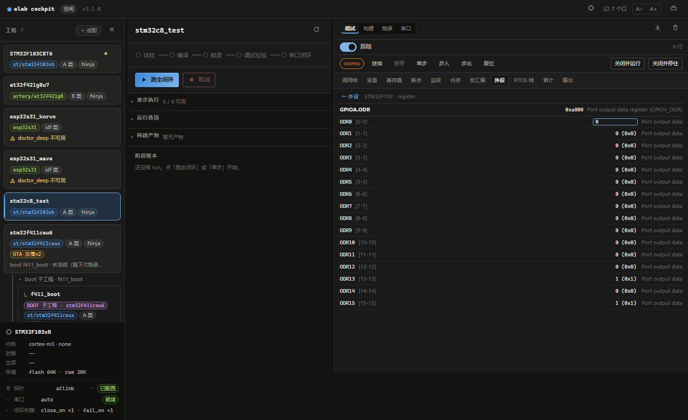

- 前端只发**整寄存器的一次写**：`new = (old & ~fieldMask) | ((value << offset) & fieldMask)`，**不碰同寄存器其它位**。
- 写目标走 `POST /api/debug/write` 的 `target=memory`（寄存器地址），宽度按 SVD `size` 取 1/2/4 字节；仍需 `confirm=true` 与人类会话。
- 字段取值范围按位宽校验（如 1 位字段只接受 0/1），越界在 UI 侧直接拦下，不发请求。
- 枚举字段仍以名字显示；写回后重新 `GET /peripherals?path=…&read=1` 刷新，避免 UI 留下过期值。

---

## 9. RTOS 栈水位（P3）

切到 **「RTOS 栈」**（内核通过 ELF 里的 `pxCurrentTCB`、就绪/延迟/挂起链表枚举任务，并扫描 FreeRTOS 的 `0xA5` 栈填充）：

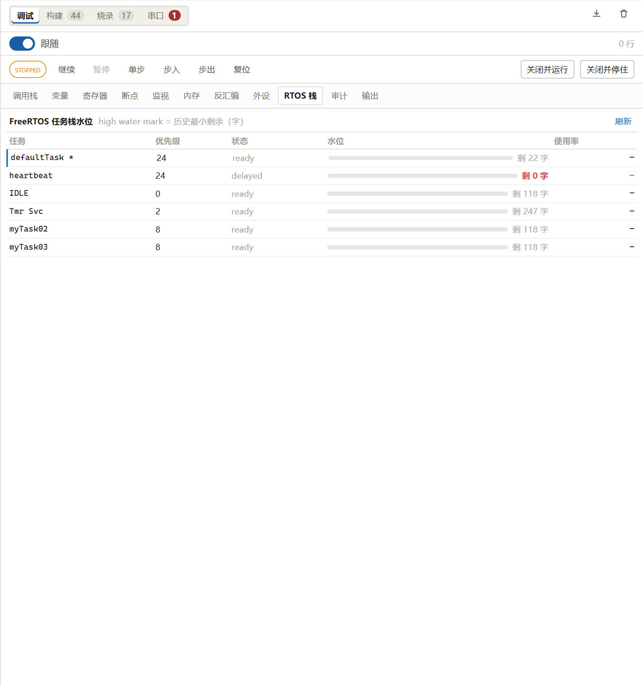

| 列 | 含义 |
|---|---|
| `任务` | `pcTaskName`；`*` 表示当前任务 |
| `优先级` | `uxPriority`（CubeMX 的 `osPriorityNormal` = 24） |
| `状态` | `running / ready / blocked / suspended` |
| `栈底` | `pxStack` |
| `水位` | 未被 `0xA5` 覆盖的字数（= 历史最小剩余栈） |
| `使用率` | 只有 ELF 里存在 `pxEndOfStack`（`configRECORD_STACK_HIGH_ADDRESS=1`）时才算；**算不出就不猜**，显示 `—` |

实测这台板子上：

- `heartbeat` **剩 0 字**（红色 `critical`）→ 512B（128 字）栈被 `printf` 吃满，已经在危险线；
  **建议把心跳任务栈从 `128 * 4` 提到 `256 * 4`**，再观察水位。
- `defaultTask` 剩 22 字（`warn`），`IDLE` 剩 85 字，`Tmr Svc` 剩 247 字。

> 这正是 P3 的价值：HardFault 修好后，顺手就能看到「另一个还没爆的坑」。
> 注意：LED 是否均匀闪烁需要**人眼确认**，调试器只能给你 `toggles/水位` 这类数字（见 `AGENTS.md` 芯片闭环第一关）。

---

## 10. 审计：谁在什么时候动过断点/内存

切到 **「审计」**：

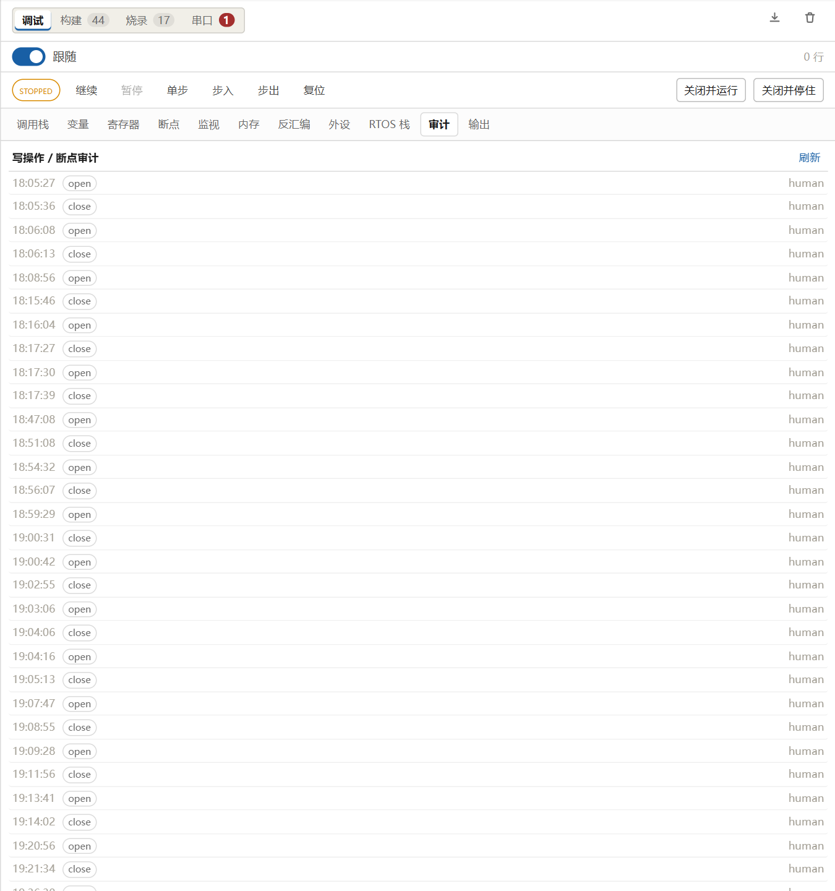

- 记录 `open / close / breakpoint-add / breakpoint-remove / watch-add / write(memory|register)`。
- 落盘在 `.work/debug-audit.jsonl`（最多 500 条重写），**不污染** `state.json`。
- 人类与 Agent 的会话都留痕，便于复盘「是谁把板子停住的」。

---

## 11. 源码级单步（P3-A）：不离开窄栏也能走源码

调试面板一直是**窄栏**（320–520px），过去只能看反汇编。可这次要抓的 bug 在 C 层（`heartbeat_pack_buggy` 的边界写），所以 P3 给它加了一个**源码页**：

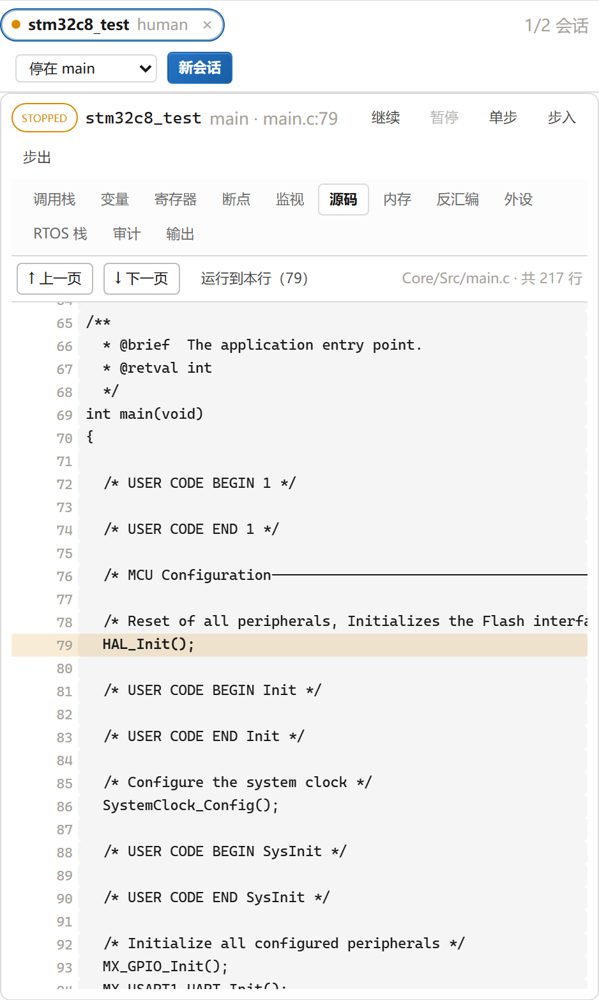

- 页签只在**内核声明了 `source` 能力**时出现（`meta.debug.features`），老内核不会硬编码兼容分支。
- 打开时窗口**以停止行为中心**自动开窗（默认往前 60 行）——217 行的文件里，若永远从第 1 行开始，`stop_line` 很可能落在窗口外，"高亮了但看不见"。
- 右侧标题显示 `相对路径 · 共 N 行`；行号右对齐并**粘在左边**（sticky），长行横向滚动时定位锚点不会跟着跑掉。

### 11.1 gutter 点一下就落盘一个源码断点

点某行的 gutter（圆点+行号）即可切换该行断点，落盘用的是**相对工程源码根**的定位串：

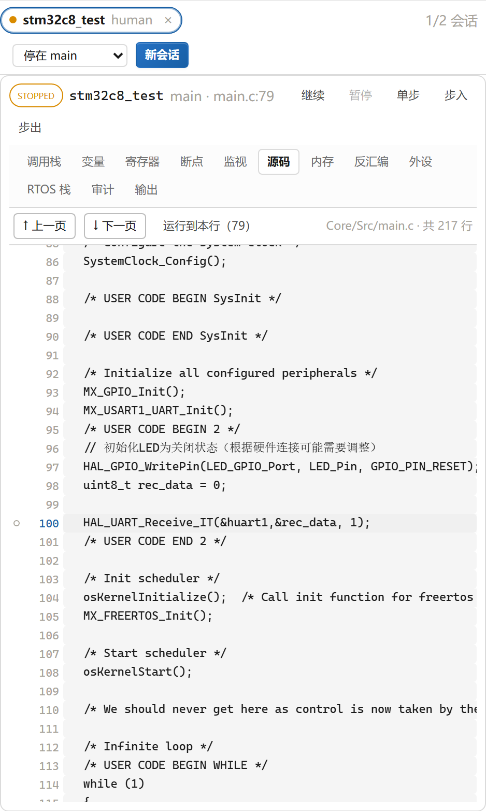

- 定位串形如 `Core/Src/main.c:100`，写进 `projects/<name>.debug.json`；换机器、换盘符都还能用（绝对路径只在内核内部换算）。
- 审计同时留痕：`breakpoint-add Core/Src/main.c:100`。
- 圆点语义：**实心**=启用，**空心**=禁用，**悬停才出现**=这一行还没断点（217 行每行一个灰环会把 gutter 变成噪点）。

### 11.2 运行到本行：临时断点 + continue

点一行源码选中它（左侧 2px 强调条），再点 **「运行到本行（N）」**：

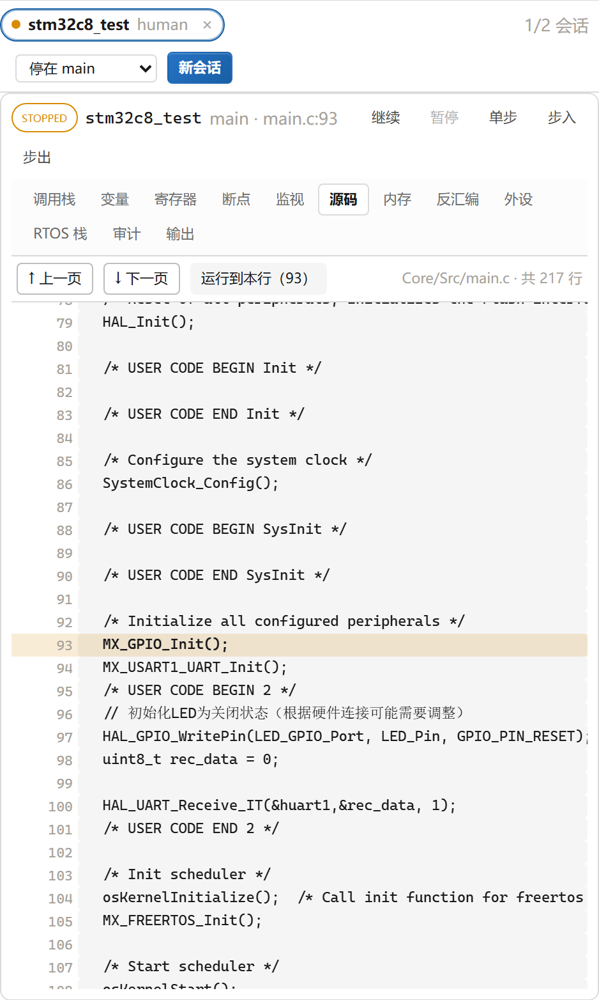

- 走 `POST /api/debug/control`，`action=run_to_line` + `file` + `line`：内核建**临时断点** → `continue` → 命中后**立即删除**临时断点，不会在断点列表里留下垃圾。
- 比"手工设断点→继续→删断点"少 3 步，且不会忘删。

### 11.3 单步之后，源码页自己跟着走

点工具栏 **「单步」**（`step_over`），`stop_seq` 变化会触发源码页重读并把窗口重新居中：

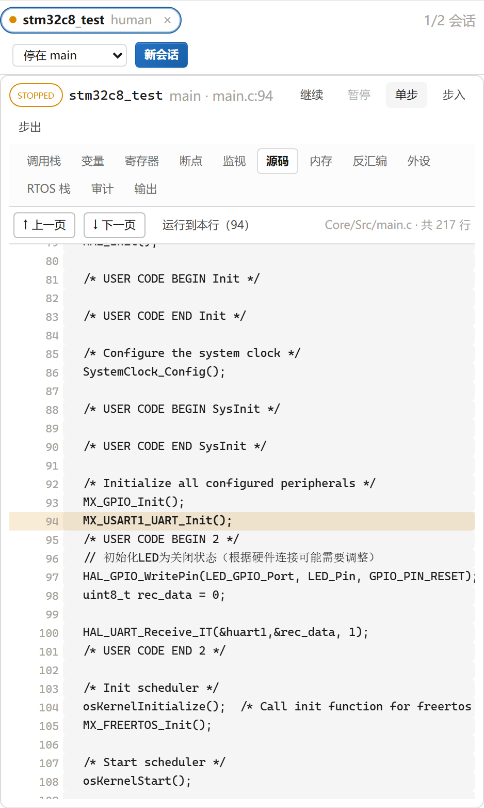

- 刷新闸门仍是 `stop_seq`：**没停就没必要重读**，窄栏不会因为轮询而闪。
- 换帧（调用栈里点 `#1`）也会重读 —— 因为"当前文件"是**帧**的属性，不是会话的。

### 11.4 安全边界

- 路径**沙箱**：`Path.resolve()` 后必须 `relative_to(source_dir)`，`..` 与指向外部的符号链接都会被拒（`400 debug-bad-request`）。
- 单次 **≤400 行 / ≤512 KB**；`truncated=true` 只表示"文件尾部被字节上限截断"，翻页该看 `has_more`。
- 没有调试信息（未加 `-g`）或源码已移动 → `debug-source-unavailable`，面板提示改看「反汇编」页，不猜。

---

## 12. 多会话（P3-B）：同目标 409，跨工程才并排

调试工作区顶部多了一条**会话条**：每个会话一枚 chip（工程 · owner · 状态点 · `×`），右侧是 `N/max 会话`：

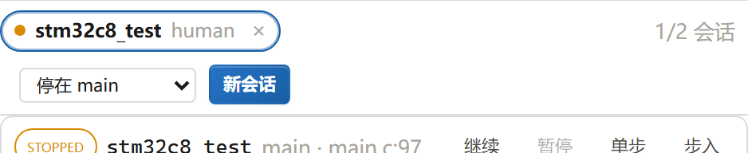

- 上限来自 `elab.host.yaml` 的 `debug.max_sessions`（默认 2，内核钳制在 1–4）。
- `×` 只关**这一个**会话，并把它的目标 `monitor reset run` 恢复运行；其它会话不受影响。

### 12.1 同一个目标不给开第二条

点 **「新会话」** 时如果选中工程已经有一条会话，内核直接拒绝：

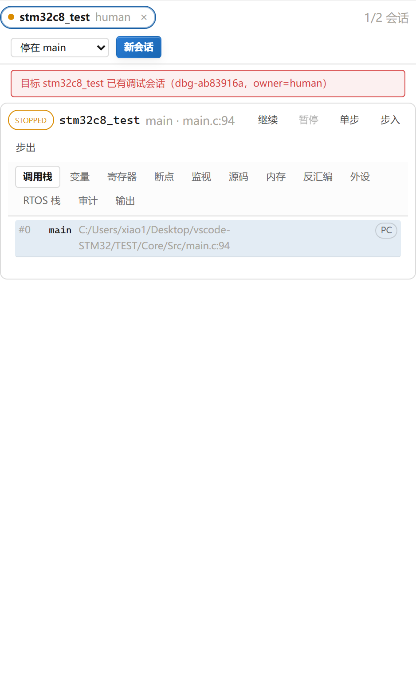

错误码一览（都能在 `meta.debug.error_codes` 里查到）：

| 错误码 | HTTP | 什么时候 |
|---|---|---|
| `debug-target-busy` | 409 | 同一工程/同一目标已有会话 |
| `debug-session-limit` | 409 | 超过 `debug.max_sessions` |
| `debug-session-required` | 409 | 有多条会话但请求没带 `debug_session` |
| `debug-port-hijacked` | 409 | openocd 起不来（端口被别的会话/进程占着） |

> 为什么这么严：一颗 MCU 同时只容得下**一条 GDB 附着**。放两条进来不会"更快"，只会两边都停在半路。

### 12.2 并排只在真的需要时出现

- 容器宽度 **≥1000px** 且**已有 ≥2 条会话**时，「并排 / 单列」开关才出现；窄栏两列都不可读，所以直接不给。
- 并排时每列是**独立的 SSE 流**（`/api/debug/events?debug_session=<id>`），壳层另开一条**不带过滤**的流，只用来同步会话清单。
- 任务 id 不再写死在信封里：事件带 `session`，UI 侧再做一次 `session` 比对（双保险）。

> 本次实测只走到"同目标 409"这一半：手头只有一颗 atlink 探针，第二条会话起不来 openocd（会得到 `debug-port-hijacked`）。
> "两条会话互不串台"由 `tests/test_debugp3.py` 覆盖（会话隔离 / SSE 过滤 / 按会话关闭 / 写权限各自独立）。

---

## 13. 修复、重烧、串口恢复

把上界改成结构体真实大小（`sizeof` 比手写 16 更稳）：

```c
-  for (i = 0; i < 24; i++) {
+  for (i = 0; i < sizeof(g_hb_frame.raw); i++) {
```

然后：

```powershell
.\elab.cmd build -p stm32c8_test     # 增量编译
.\elab.cmd flash -p stm32c8_test     # 烧录并复位运行
```

> 调试会话开着时先点 **「关闭并运行」**（或 `DELETE /api/debug/session`），否则烧录会被 409 互斥拦下。
> 关闭语义固定为 `monitor reset run`，**不会把板子留在 halt**。

再打开 **「串口」**工作区点 **「打开监视」**：`[alive]` 恢复 1Hz，相邻时间戳约 1.000s：

![串口：COM10@115200，[alive] 稳定 1Hz，tick 递增](assets/debug-panel/11-serial-alive.png)

串口恢复 = 应用逻辑已跑通；若要收「心跳第一关」，还要**肉眼确认 LED 以 1Hz 翻转**，两方信息齐了才算过。

---

## 14. 能力清单（P1 / P2 / P3）

| 期 | 能力 | 工作区页签 | 内核端点 |
|---|---|---|---|
| P0 | 开始/继续/暂停/单步/步入/步出/复位/关闭 | 工具栏 | `POST /api/debug/{session,control}` |
| P0 | 调用栈 / 变量 / 寄存器 / 断点 / 内存 / 反汇编 / 输出 | 对应页签 | `GET /api/debug/{stack,variables,registers,breakpoints,memory,disasm}` |
| **P1** | 断点 / 监视**持久化** + `rev` 乐观锁 | 断点 / 监视 | `POST /api/debug/{breakpoints,watch}` |
| **P1** | 监视求值（暂停态） | 监视 | `GET /api/debug/watch` |
| **P1** | 写审计（内存/寄存器/断点） | 审计 | `GET /api/debug/audit` |
| **P1** | 内存字节 / 寄存器**行内编辑**（`confirm` + 审计） | 内存 / 寄存器 | `POST /api/debug/write` |
| **P1** | 反汇编 PC 行高亮/自动滚动、地址跳内存、一键地址断点 | 反汇编 | `GET /api/debug/disasm` + `POST /api/debug/breakpoints` |
| **P2** | CMSIS-SVD 三级树、读值、字段枚举解码 | 外设 | `GET /api/debug/peripherals?path=GPIOA.ODR&read=1` |
| **P2** | SVD 搜索 / group 折叠 / `stop_seq` 自动刷新 | 外设 | `GET /api/debug/peripherals` |
| **P2** | SVD 字段级写（读-改-写 + 掩码） | 外设 | `POST /api/debug/write`（`target=memory`） |
| **P3** | FreeRTOS 任务枚举 + 栈高水位 | RTOS 栈 | `GET /api/debug/rtos` |
| **P3** | **源码页**（窄栏 gutter + 行断点 + 运行到本行） | 源码 | `GET /api/debug/source`、`POST /api/debug/control`（`run_to_line`） |
| **P3** | **寄存器组**：组切换 + 草稿 + 一次提交（一条审计） | 寄存器 | `GET /api/debug/registers?group=all`、`POST /api/debug/registers` |
| **P3** | **多会话**：会话条 / 同目标 409 / 跨工程并排 | 会话条 | `debug_session` 贯穿全部端点 + `DELETE /api/debug/session` |
| 面板 | 宽屏（≥680px）双列：左栈/变量/监视，右寄存器/外设 | 插件面板 | 纯前端布局（`ResizeObserver`） |
| 面板 | 断点命中 toast + 自动切栈并选中停帧 | 插件面板 / WebUI | SSE `debug/stop`（`reason/bkptno`） |

能力自描述在 `GET /api/capabilities` 的 `meta.debug.features` 里（`watch / svd / rtos / source`）；
面板按它决定显示哪些页签 —— 内核过旧时不会硬编码兼容分支。

### 14.1 DSH 插件面板：窄栏单列 / 宽屏双列

同一套功能在 **DSH 插件面板**（`packages/dsh-elab-cockpit`）里也有，注意它不是另一套实现：

- 窄栏（约 320–520px）保持**单列 + 分组子页签**，不挤压控件；
- 容器宽度 **≥680px** 时自动切**双列**：左列 `栈/变量/监视`，右列 `寄存器`（并给「外设」快捷入口）；
  用 `ResizeObserver` 监听容器，不依赖 DSH 栏位的固定宽度；
- 行内编辑、SVD 字段写、反汇编地址动作与 WebUI **行为同源**：都只走 `/elab/api/debug/*`，
  同一份 `allow_write` 闸门、同一份审计；
- 断点命中同样弹 3 秒 toast 并自动切到「调用栈」，选中停帧（PC 行高亮）；
- P3 的三件事（源码页 / 寄存器组 / 多会话）在插件里**同样可用** —— 见 `05-DSH插件上手_STM32F103C8T6.md` §11。

> 插件里没有 CSS 模块：所有颜色用 `--elab-*` 令牌（由 `theme/dsw-map.ts` 注入），
> 这样宿主主题切换时面板跟随，不会出现写死的颜色。

---

## 15. Agent 怎么用（人机同源）

面板里的每个动作，Agent 都能通过插件工具做到，且读写的是**同一个内核会话**：

| 工具 | 关键参数 | 用途 |
|---|---|---|
| `elab_debug_open` | `project`、`stop_at`(`main/reset/none`)、`load`、`lease_s` | 开会话并停住 |
| `elab_debug_control` | `action`、`addr`、`confirm`、`wait_s` | 继续/暂停/单步/步入/步出/复位/重启 |
| `elab_debug_inspect` | `what`(`session/stack/variables/registers/breakpoints/memory/disasm/evaluate`) | 只读数据面 |
| `elab_debug_breakpoint` | `op`(`list/add/update/toggle/remove`)、`kind`、`location`、`condition` | 断点管理（落盘 + `rev`） |
| `elab_debug_wait` | `after_seq`、`timeout_s` | 等下一个停止事件 |
| `elab_debug_close` | `resume`（默认 `true`） | 关闭并**恢复运行** |

一次典型 Agent 会话：

```text
elab_debug_open   { project: "stm32c8_test", stop_at: "main", lease_s: 600 }
elab_debug_breakpoint { op: "add", kind: "func", location: "HardFault_Handler" }
elab_debug_control{ action: "continue" }
elab_debug_wait   { timeout_s: 10 }
elab_debug_inspect{ what: "stack" }
elab_debug_inspect{ what: "registers", group: "core" }
elab_debug_close  { resume: true }
```

租约只对 `actor=agent` 生效：默认 600s、范围 60–1800s，到期自动关闭并 `monitor reset run`；
人类会话不限时。写内存/寄存器需要人类会话显式开启（Agent 默认 `debug-write-denied`）。

---

## 16. HTTP 小抄（脚本 / Agent 共用）

```powershell
$b = 'http://127.0.0.1:8336'

# 开会话并停在 main
Invoke-RestMethod "$b/api/debug/session" -Method Post -ContentType 'application/json' `
  -Body '{"project":"stm32c8_test","options":{"stop_at":"main"}}'

Invoke-RestMethod "$b/api/debug/stack"
Invoke-RestMethod "$b/api/debug/registers?group=core"
Invoke-RestMethod "$b/api/debug/evaluate" -Method Post -ContentType 'application/json' `
  -Body '{"expr":"g_hb_frame.on_frame"}'
Invoke-RestMethod "$b/api/debug/peripherals?path=GPIOA.ODR&read=1"
Invoke-RestMethod "$b/api/debug/rtos"
Invoke-RestMethod "$b/api/debug/audit?limit=100"

# P3：源码页（file 省略 = 当前停止帧；路径必须在工程源码根内）
Invoke-RestMethod "$b/api/debug/source?file=Core/Src/main.c&start=60&count=160"
# P3：从当前行走到目标行（内核建临时断点 → continue → 命中后删除）
Invoke-RestMethod "$b/api/debug/control" -Method Post -ContentType 'application/json' `
  -Body '{"action":"run_to_line","file":"Core/Src/main.c","line":93}'
# P3：按组批量写（整批校验 → 逐项 set → 一条审计）
Invoke-RestMethod "$b/api/debug/registers" -Method Post -ContentType 'application/json' `
  -Body '{"confirm":true,"items":[{"name":"r0","value":"0xc0ffee00"},{"name":"r1","value":"0xc0ffee01"}]}'

# 断点 / 监视：写操作都带 rev（从 GET 拿到）
Invoke-RestMethod "$b/api/debug/breakpoints" -Method Post -ContentType 'application/json' `
  -Body '{"op":"add","kind":"func","location":"HardFault_Handler","rev":7}'
Invoke-RestMethod "$b/api/debug/watch" -Method Post -ContentType 'application/json' `
  -Body '{"op":"add","expr":"g_hb_frame.on_frame","rev":7}'

# 关闭并恢复运行
Invoke-RestMethod "$b/api/debug/session" -Method Delete
```

错误码（HTTP 层映射）：`debug-busy`(409)、`debug-no-session`(404)、`debug-target-running`(409)、
`debug-rev-conflict`(409)、`debug-svd-missing`(503)、`debug-rtos-unavailable`(503)、
`debug-write-denied`(403)、`debug-limit`(413)、`debug-bad-request`(400)、
`debug-source-unavailable`(404)、`debug-target-busy`(409)、`debug-session-limit`(409)、
`debug-session-required`(409)、`debug-port-hijacked`(409)。

多会话时**所有**调试端点都可带 `debug_session=<id>`（`GET/POST/DELETE` 与 SSE 一致）；
只有一条会话时可以不带，内核会用它。

---

## 17. 常见问题

| 现象 | 原因 | 处理 |
|---|---|---|
| `409 debug-busy` | 已有会话（人/Agent） | 先「关闭并运行」或 `DELETE /api/debug/session` |
| `409 serial-busy` / `409 monitor-active` | 串口监视占着 COM10 | 先关串口监视再开调试 |
| 调用栈显示「目标可能在运行」 | 会话 `state=running` 或线程参数 0 | 先「暂停」；面板已修正不再传 `thread=0` |
| 监视报 `debug-target-running` | 目标在跑 | 暂停/命中断点后再求值 |
| 外设报 `debug-svd-missing` | 适配包里没有该芯片 SVD | `elab pkg install` 对应包，或检查 `chips/*.yaml` |
| RTOS 页报 `debug-rtos-unavailable` | ELF 无 `pxCurrentTCB` / 未用 FreeRTOS | 确认工程启用 FreeRTOS 且 `-g` 保留符号 |
| RTOS 使用率是 `—` | FreeRTOS 未记录 `pxEndOfStack` | 正常；以内核「剩 N 字」水位为准 |
| 关闭后串口 tick 从 0 开始 | `monitor reset run` 复位了芯片 | 正常现象，节奏不变 |
| 源码页不出现 | 内核没声明 `source` 能力，或 ELF 没带 `-g` | 同步内核；重新以 Debug 构建 |
| 源码页报 `debug-source-unavailable` | 停止帧没有 `fullname` / 源码被移动 | 用「反汇编」页；或修 `source_dir` 后重开会话 |
| `400 debug-bad-request`（源码） | 路径越出工程源码根（`..` / 符号链接） | 只能读工程内的文件 |
| 点「新会话」报 `debug-target-busy` | 同一目标已有会话 | 这是**设计**：一颗 MCU 只容一条 GDB 附着 |
| 寄存器写 `403 debug-write-denied` | `pc/lr/xpsr` 只读，或会话没有 `allow_write` | 改控制流请用「复位」/断点，不要改 `pc` |
| 点「开始调试」只显示 `HTTP 503` / 什么原因都没有（旧版） | 前端按 `body.error.code` 解析，而内核把 `code`/`hint` 放在 body 顶层、`error` 是字符串 → 一律退化成 `http-503` | 升级到 2026-11-05 之后的版本；现在空态正文直接给出 `打不开调试会话 · <code>` + `hint` + 「怎么办」 |
| `503 debug-gdb-missing`（hint 含 `CMSIS-DAP command mismatch`） | 探针被别的进程占着：另一条调试会话，或**旧版本**强杀内核后残留的 `openocd` | 先关掉其它会话，再重试。2026-11-05 之后内核用作业对象兜底，强杀内核会连 `openocd`/`gdb` 一起带走，不再产生新的孤儿；升级前就在跑的那个仍需在任务管理器结束一次 |

---

## 18. 边界与安全

- **唯一缝隙**：工具层与内核只走 loopback HTTP；`packages/dsh-elab-cockpit/test/boundary.test.mjs` 拦跨层 `import`。
- **会话上限**：`elab.host.yaml: debug.max_sessions`（默认 2，钳制 1–4）；**同一目标仍只允许一条会话**（`409 debug-target-busy`）。
  调试与 `flash / debug_verify / monitor`、串口监视互斥。
- **关闭即恢复**：所有关闭路径（面板、Agent、租约到期、进程退出）都会 `monitor reset run`。
- **不留孤儿**：内核派生的 `openocd` / `gdb` / 运行进程都挂在 Windows 作业对象
  （`KILL_ON_JOB_CLOSE`）里，内核被强杀（任务管理器结束任务 / 关掉窗口）时由系统一并
  终止——不再需要手动 `taskkill`。非 Windows 或作业建不出来时退化为原行为，功能不受影响。
- **写保护**：人类会话默认只读；写内存/寄存器要显式开启，Agent 默认拒绝。
- **审计独立**：调试痕迹只进 `.work/debug-audit.jsonl`，不改 `state.json`。

---

## 19. 本文实测结论

| # | 验证项 | 结果 |
|---|---|---|
| 1 | 独立 WebUI 打开调试工作区 | ✅ 工具栏 + 11 个页签正常渲染 |
| 2 | 越界 bug 复现 | ✅ `HardFault_Handler` 断点命中，栈 `#2 = 0x54535250` |
| 3 | 寄存器取证 | ✅ `r3 = 0x54535251`、`lr = 0xFFFFFFF9`、`xPSR.IPSR = 3` |
| 4 | 监视取证 | ✅ `g_hb_frame.on_frame = 0x54535251` |
| 5 | 内存取证 | ✅ `0x20000020` 起 `51 52 53 54 55 56 57 58` 越界 8 字节 |
| 6 | 外设 SVD | ✅ `GPIOA.ODR = 0xA00F`，ODR13/15 位解码正确 |
| 7 | RTOS 栈水位 | ✅ 6 个任务枚举；heartbeat 剩 0 字（critical） |
| 8 | 断点/监视持久化 | ✅ `projects/stm32c8_test.debug.json` 落盘，重开回灌 |
| 9 | 修复后复烧 | ✅ `[alive]` 恢复 1Hz，串口时间戳间隔 ≈1.000s |
| 10 | 寄存器行内编辑 | ✅ 点击值进入输入框；`Esc` 取消不写硬件，写操作带 `confirm` + 审计 |
| 11 | 内存字节行内编辑 | ✅ 点 HEX 单元格 → 1 字节输入；只读会话退化为文本 |
| 12 | 反汇编定位 | ✅ PC 行高亮/自动滚动；地址跳内存；`⌖` 设地址断点 |
| 13 | SVD 搜索/分组/字段写 | ✅ 设备分组折叠 + 搜索；`ODR0` 字段读-改-写（掩码保留其它位） |
| 14 | 断点命中通知 | ✅ toast「命中断点 #3，已切到调用栈」+ 自动选中停帧 |
| 15 | 源码页（P3-A） | ✅ 停在 `main:79`；`Core/Src/main.c · 共 217 行`，停止行高亮 + 粘性 gutter |
| 16 | 源码断点落盘（P3-A） | ✅ gutter 点第 100 行 → `breakpoint-add Core/Src/main.c:100`（相对路径） |
| 17 | 运行到本行（P3-A） | ✅ 从 79 行跑到 93 行（`MX_GPIO_Init`），临时断点命中后自动删除 |
| 18 | 源码级单步（P3-A） | ✅ `step_over` 后 93 → 94，源码页随 `stop_seq` 重新居中 |
| 19 | 寄存器组草稿（P3-C） | ✅ r0–r2 改值只进草稿（`应用本组（3）`），硬件未被触碰 |
| 20 | 寄存器组批量写（P3-C） | ✅ 一次 `POST /api/debug/registers` 写入 3 项，读回一致，`应用本组（0）` |
| 21 | 一条审计（P3-C） | ✅ 审计只有一条 `write register-group 3 项`，含每项 before/after |
| 22 | 只读白名单（P3-C） | ✅ `pc`/`lr`/`xpsr`/`d0` → `403 debug-write-denied`；`0xZZ` → `400` |
| 23 | 同目标第二会话（P3-B） | ✅ `409 debug-target-busy`：「目标 stm32c8_test 已有调试会话」 |
| 24 | 会话上限自描述 | ✅ `/api/debug/session` 返回 `max_sessions`，会话条显示 `1/2 会话` |

> 教程里的固件只改了 `i < sizeof(g_hb_frame.raw)` 这一行；其余现象均来自真实上机。
> 第 10–14 项是 P1/P2 功能演示，截图停点可能在 `main`，不要求与 HardFault 现场数值一致。
> 第 15–24 项是 P3 功能演示（2026-11-05，STM32F103C8T6 + atlink + COM10），
> 截图里的寄存器值（`0xc0ffee00…`）是为了看清"草稿/已生效"而特意写入的，不代表业务状态。
> 本次改动尚未提交（按约定先不 commit）。
