# DSH 插件实机上手：右侧栏闭环 + 调试工作区（STM32F103C8T6 实拍 · 附录 ESP32-S31 网络/波形进阶）

> 目标读者：已经装好 DSH Desktop 与 `dsh-elab-cockpit` 插件，想把「体检 → 编译 → 烧录 → 调试校验 → 串口」以及**调试工作区**放进 DSH 右侧栏的人。
> 读完你能：认出面板每一块 → 接入 DSH 会话里的工程 → 跑通三连 → 判读串口心跳 → 用调试工作区单步/断点/看寄存器 → 正确关闭不把板子留在 halt。
>
> **拍摄口径**：§1–§9 的截图来自 STM32F103C8T6 + CMSIS-DAP（atlink）+ COM10@115200，DSH Desktop 深色主题（2026-11-03）；
> §10 的截图来自 ESP32-S31 + `examples/ESP32S31_Wave`，用 **DSH 右侧栏的 ELAB 面板**（`dsh web` 实机驱动，窄栏原尺寸）拍摄（2026-11-04）。
> 图中用时/行号/寄存器值/统计均与当时内核记录同源，未做修饰；§10.9 的重连演示用本机可控 TCP 源（面板仍是同一个右栏）。
> 配套阅读：调试面板的 Agent 工具、HTTP ICD 与 DoD 详见 [调试面板上手指南](04-调试面板上手_STM32F103C8T6.md)；独立 WebUI 的同款闭环见 [芯片开发上手](01-芯片开发上手_独立WebUI.md)。

---

## 0. 你将得到什么

一个右侧栏，三块信息：

- **阶段梯**：`编译` `烧录` `调试校验` 三步的用时与结论；
- **通道页签**：`构建` `烧录` `调试` `串口`——每步的原始日志，失败原因直接可读；
- **手动条**：`三连` `闭环` `取消` `预览`，以及单步的 `▶ 构建` `▶ 烧录` `▶ 调试` `▶ 串口`。

最终效果（本节第 4 章实拍）：三连全绿，调试校验停在 `main.c:79`，串口同时打印 1 Hz 心跳：

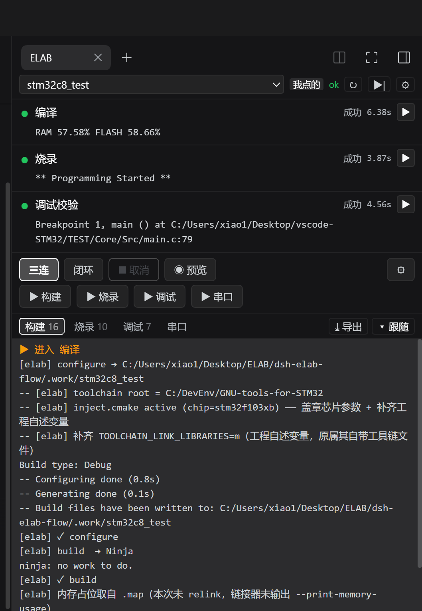

---

## 1. 前置条件

| 项 | 要求 |
|---|---|
| DSH | DSH Desktop 已安装，插件 `dsh-elab-cockpit` 已装好并启用 |
| 硬件 | STM32F103C8T6 最小系统板 + CMSIS-DAP 探针，SWD 接好、USB 连电脑 |
| 串口 | 板载 USB 转串口（本例 COM10），115200 8N1 |
| 串口闭环前提 | 工程固件已初始化 USART1：**PA9 = TX / PA10 = RX**，115200 8N1，主循环有 1 Hz 心跳；elab 只负责主机侧 COM 收发，不配置芯片引脚 |
| 工程 | 一个可构建的 CubeMX/CMake 工程（本例 `C:\Users\xiao1\Desktop\vscode-STM32\TEST`，对应工程卡 `stm32c8_test`） |
| 内核 | 面板会按需拉起；调试入口要求内核能力表里有 `meta.debug` |

插件安装/启用见插件 README 与市场页；启用成功后，DSH 右侧栏出现 **ELAB** 页签。

### 1.1 工具链与探针（可替换）

首次打开自动补齐四件**通用开源工具**：`arm-none-eabi-gcc 13.3.1` / `CMake 3.28.1` / `Ninja 1.11.1` /
`OpenOCD 0.12.0-3`（官方上游直链 + sha256，Windows x64；清单见
[manifest.json](../../packages/dsh-elab-cockpit/envpacks/manifest.json)）。已装过自己的会跳过；
也可用 `ELAB_ARM_GCC_ROOT` / `ELAB_CMAKE` / `ELAB_NINJA` / `ELAB_OPENOCD` / `ELAB_OPENOCD_SCRIPTS` 覆盖。

烧录/调试探针不是代码绑定：[elab.host.yaml](../../elab.host.yaml) 的 `probes.list` 已内置
`atlink` / `dap` / `stlink` / `jlink`，换探针只改工程接入文件：

```yaml
# projects/<name>.yaml
debug:
  probe: stlink     # atlink | dap | stlink | jlink
```

ST-Link 用 OpenOCD 原生驱动、一般免装厂商软件；J-Link 需先装 SEGGER J-Link 驱动（仍走 OpenOCD）。
新适配工程的默认探针取 `probes.default`。

---

## 2. 认清面板

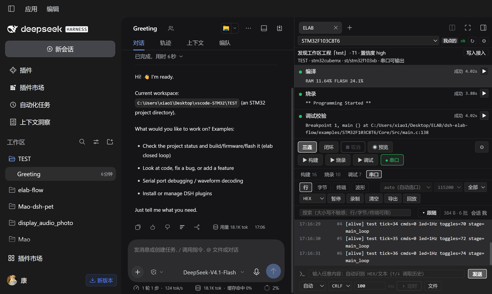

从上到下：

| 区域 | 内容 |
|---|---|
| 页签行 | `ELAB` 页签；右侧是刷新/设置，以及 **`▶|` 调试工作区入口**（title「调试面板：调用栈 / 变量 / 寄存器 / 断点」） |
| 工程行 | 工程下拉（`projects/*.yaml`）、归属标记（`我点的`）、内核状态 `ok`、刷新 `↻` |
| 适配横幅 | 自动探测结论 / 已接入提示 / 复探测按钮（下一节） |
| 阶段梯 | `编译` `烧录` `调试校验`，每行：状态点 · 用时 · 关键证据（断点位置、RAM/FLASH 占比） |
| 手动条 | `三连` `闭环` `■ 取消` `○ 预览`；下一行 `▶ 构建` `▶ 烧录` `▶ 调试` `▶ 串口` |
| 日志区 | 通道页签（带计数）+ 过滤/导出/跟随 + 搜索框 |
| 底部 | 串口参数（行/字节/终端/波形、自动选口、波特率）+ 通用发送框 |

> 窄栏（约 320–520 px）下调试视图是**单栏 + 子页签**，不是 Cortex-Debug 的三栏；这是 DSH 侧栏的物理边界，不是功能缺失。

---

## 3. 接入会话里的工程（自动只读探测）

**为什么**：DSH 会话打开的是**你的工程目录**，面板需要先把它映射成 `projects/*.yaml`。探测只读、不写盘；你点「写入接入」才落盘。

1. 在 DSH 里打开工程目录（本例 `C:\Users\xiao1\Desktop\vscode-STM32\TEST`）；
2. 面板自动探测，横幅显示 `发现工作区工程「test」· T1 · 置信度 high` 与事实行 `TEST · stm32cubemx · st/stm32f103xb · 串口可输出`；
3. 点 **「写入接入」**，面板落 `projects/<name>.yaml` 并切成该工程。

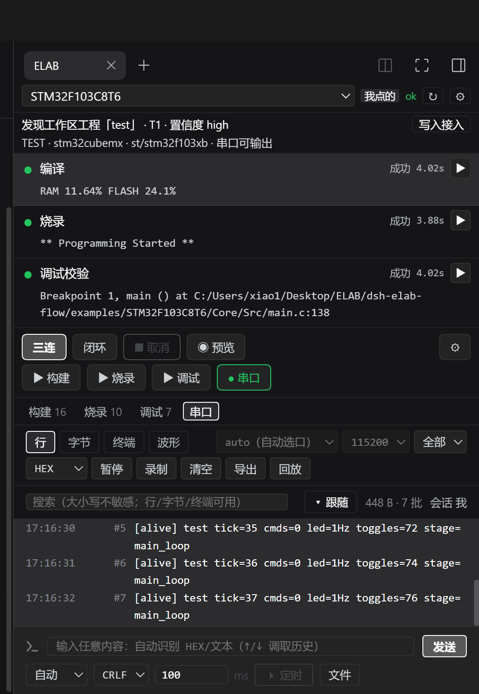

接入后横幅变成 `已接入工程「test」——建议跑一次三连自证（体检+编译）`，右侧出现 **「复探测」**：

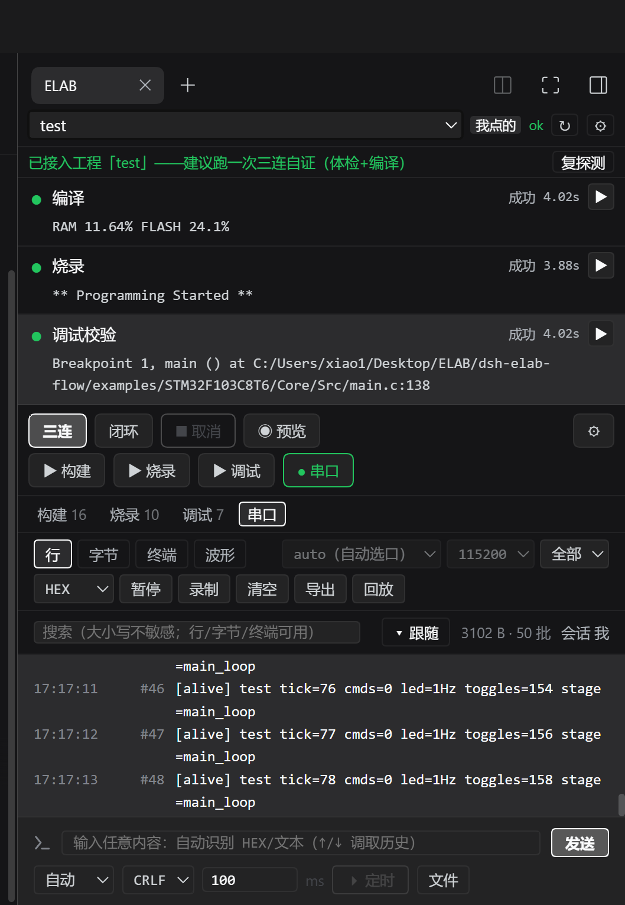

- **复探测**：重新只读探测并与 YAML 逐字节比对，结论是 `配置一致` / `工程已漂移（需重新适配）` / `配置缺失`；
- 已接入工程改名或换芯片后，旧结论不做数——复探测结果只对当前工程有效。

> 如果你已经有对应工程卡（如 `stm32c8_test`），也可以直接在下拉里选它，不必再写一份新 YAML。
> 本次实拍就是这种情形：`test` 与 `stm32c8_test` 指向同一个工程根目录（`...\vscode-STM32\TEST`），
> 三连与调试都跑在已接入的 `stm32c8_test` 卡上；点「写入接入」则会新建一张名为 `test` 的卡。

---

## 4. 跑一次三连

点 **「三连」**。每一步结束都会在阶段梯上落账：

| 步 | 本次实拍 | 证据 |
|---|---|---|
| 编译 | 成功 6.38 s | `RAM 57.58% FLASH 58.66%`（取自 `.map`） |
| 烧录 | 成功 3.87 s | `** Programming Started **`，探针回 `Verified OK` |
| 调试校验 | 成功 4.56 s | `Breakpoint 1, main () at .../TEST/Core/Src/main.c:79` |


判读与常见现象：

- **零改动时会看到 `ninja: no work to do.`**——这不是跳过编译，而是构建系统确认无变更；阶段仍会继续烧录/调试。
- 任何一步失败即中断，不会「跳过继续」；失败行会以红色语气落在对应通道。
- 想单步：直接点 `▶ 构建` / `▶ 烧录` / `▶ 调试`；运行中点 `■ 取消` 结束当前 run。
- `○ 预览` 展示将要执行的计划（命令、产物、超时），不落盘。
- **监视开着也能直接点「三连」**：烧录/调试前内核会自动挂起监视并释放串口，run 收尾按
  `serial.resume_after_run` 自动开回来；不需要先手动关监视。
- **通道会跟着当前步骤自动切换**（构建 → 烧录 → 调试），所以不会再出现「编译完停在构建页、
  以为卡住」的错觉。烧录本身可能持续几十秒（ESP32 `--no-stub` 460800 尤甚），
  只要「烧录」通道日志还在增长就是正常进行中。

---

## 5. 串口监视：用心跳判活

点 **「▶ 串口」**（自动选口，115200）：

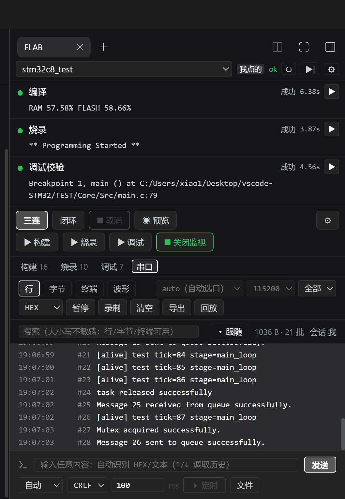

判活两条硬指标（同一时基）：

1. 相邻 `[alive]` 行间隔 ≈ **1.000 s**；
2. 每次心跳 `toggles` **严格 +2**（500 ms 翻转一次，LED 亮灭周期 1 s）。

本例实拍：`tick=84..87`、`toggles=168..174`、`stage=main_loop`，与固件主循环一致。

> **前提**：上面这些字节来自**工程固件已经初始化好的 USART1**（本例 115200 8N1，PA9=TX、PA10=RX，
> 接线为 TX/RX 交叉 + 共地）。elab 不配置芯片外设——工程没初始化串口或接反时，这里只会是 0 字节，
> `monitor` 判 `inconclusive`；先看启动日志里的 `[log] UART1 : ok (... TX=PA9, RX=PA10 ...)`。

面板能力：

- 视图：`行` / `字节` / `终端` / `波形`；`HEX` 切换、`暂停`、`录制`、`清空`、`导出`、`回放`；
- 过滤：`全部`、搜索框（大小写不敏感，行/字节/终端可用）、`▾ 跟随`；
- 发送：底部输入框自动识别 HEX/文本，行尾 `CRLF`，可 `定时` 连续发送。

**关闭监视（本次修复的回归点）**：运行中按钮会变成 **`■ 关闭监视`**，再点一次即关闭并释放串口——日志停在 `tick=103`，按钮回到 `▶ 串口`，提示恢复为「监视未启动」：

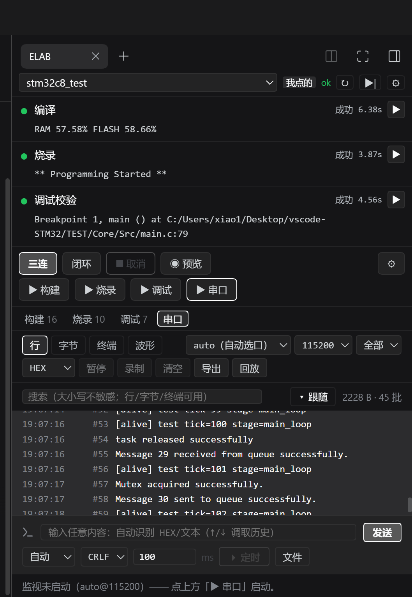

> 判定纪律（C36）：**Agent 只能凭串口计数判活；「LED 均匀闪烁」必须由人肉眼确认**。两边都收到信息才算第一关通过。

---

## 6. 调试工作区（新增）

### 6.1 进入与开始

点面板右上角 **`▶|`**：

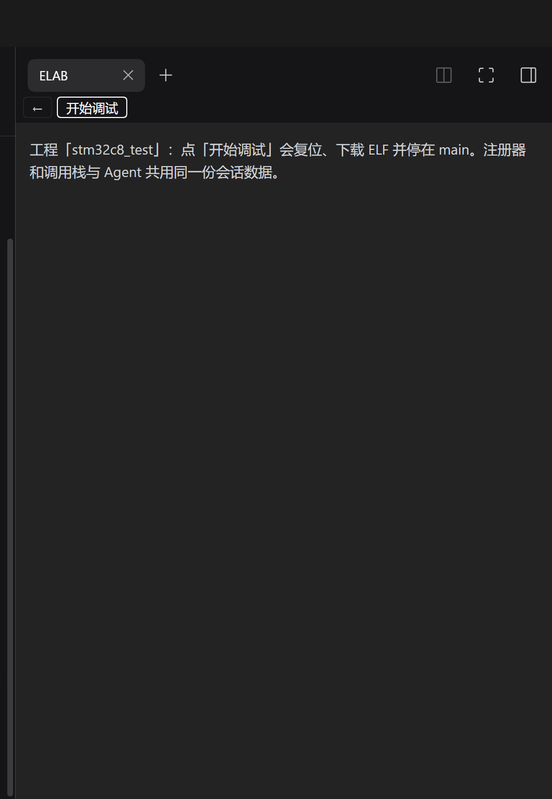

点 **「开始调试」**。内核依次：选空闲端口起 `openocd` → 起 `arm-none-eabi-gdb` → `monitor reset halt` → 下载 ELF → 停在 `main`。实测停在：

```
main @ C:/Users/xiao1/Desktop/vscode-STM32/TEST/Core/Src/main.c:79   0x8007302
```

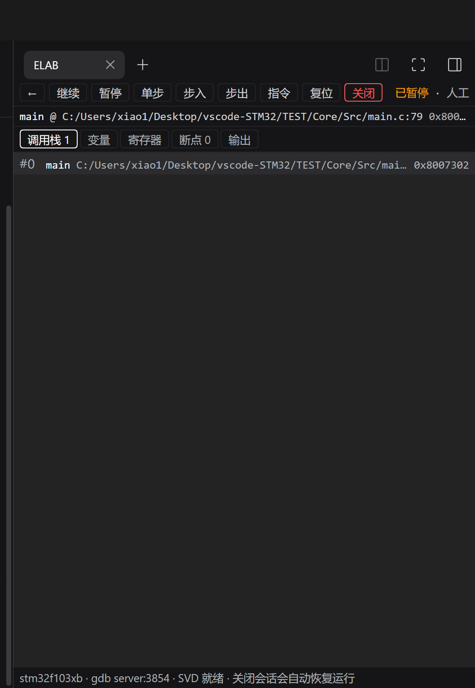

四块：

1. **工具栏**：`←` 返回工作区 + `继续` `暂停` `单步` `步入` `步出` `指令` `复位` `关闭`；状态 `已暂停 · 人工`（Agent 会话显示 `Agent` + 租约秒数）。
2. **位置条**：`函数 @ 文件:行  PC`；复位后也保持真实位置（不再显示 `??`）。
3. **子页签**：`调用栈` `变量` `寄存器` `断点` `监视` `内存` `反汇编` `外设` `RTOS 栈` `审计` `输出`（页签上的数字是条目数；`监视/外设/RTOS 栈` 按内核 `meta.debug.features` 出现）。
4. **页脚**：芯片 · gdb server 端口 · SVD 就绪 · 「关闭会话会自动恢复运行」。

### 6.2 单步 / 继续 / 暂停 / 复位

- **单步**：位置条行号与 PC 立即变化（实测 `0x8001786 → 0x8001792`）；每次 stop 的 `stop_seq` 严格递增，不会拿到旧画面。
- **继续**：状态切 `运行中`；命中下一个断点或手动 **暂停** 后回到 `已暂停`。实测暂停时停在 FreeRTOS 空闲任务（`vPortSuppressTicksAndSleep`），栈帧真实。
- **复位**：`monitor reset halt` + 重新停到 `main`，位置条照常更新。
- **指令**：指令级单步（无源码行时使用）。

### 6.3 断点

窄栏没有源码 gutter，用**函数断点 / 地址断点**（可加条件）。切「断点」页签 → 类型 `函数` → 输入 `HAL_UART_Receive_IT` → **添加**：

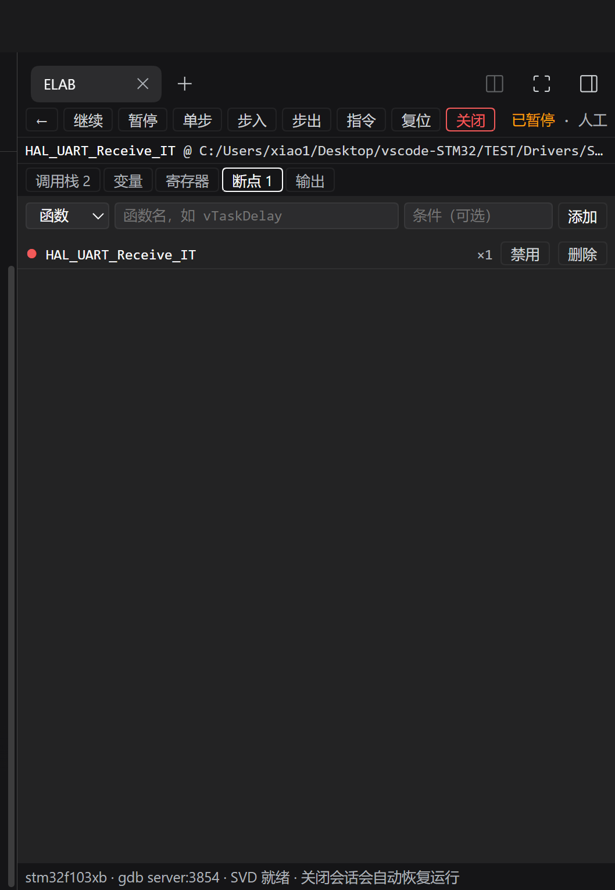

然后 **复位 → 继续**，断点命中，命中计数变成 `×1`；「调用栈」同时给出 `#0 HAL_UART_Receive_IT` 与 `#1 main`：

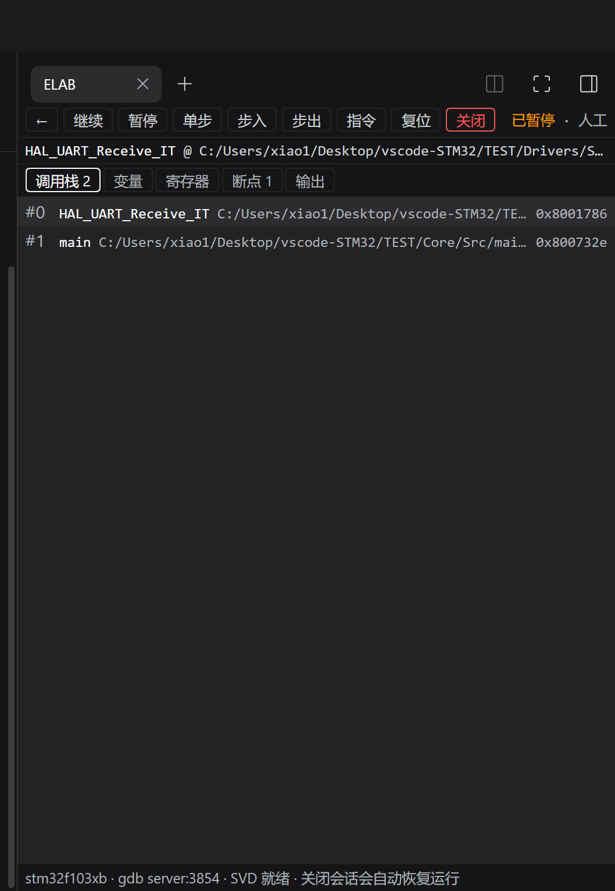

### 6.4 变量与寄存器

- **变量**：`局部` / `参数`，按帧切换；结构体/指针可展开（懒加载）。

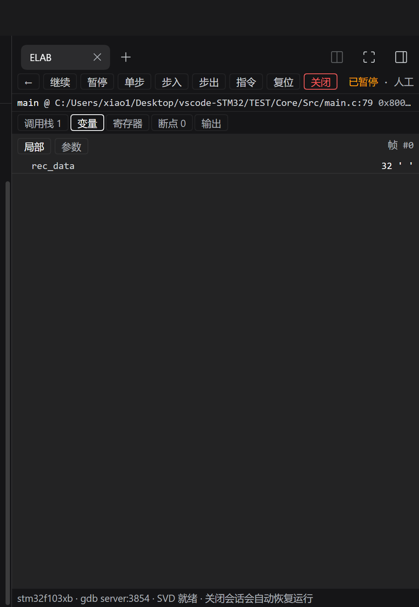

- **寄存器**：内核组，十六进制 + 自然值，`xPSR` 带标志位；与 Agent 读到的是同一份会话数据。

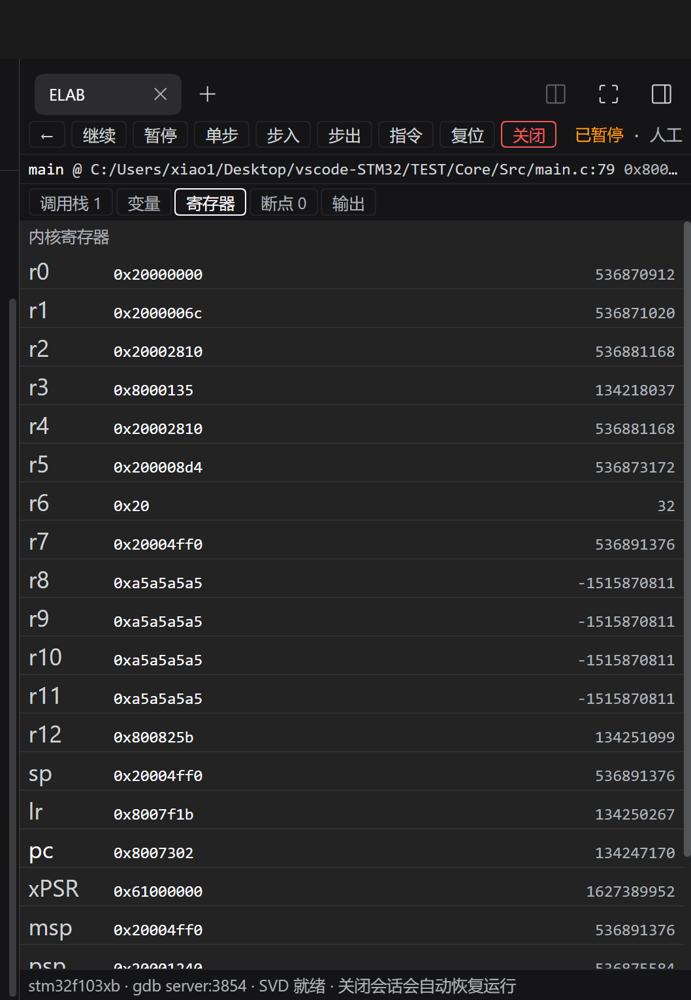

### 6.5 输出与关闭

- **输出**：GDB/MI 原始输出（连接、下载、`*stopped`、`SIGINT` 等），排障时先看这里。

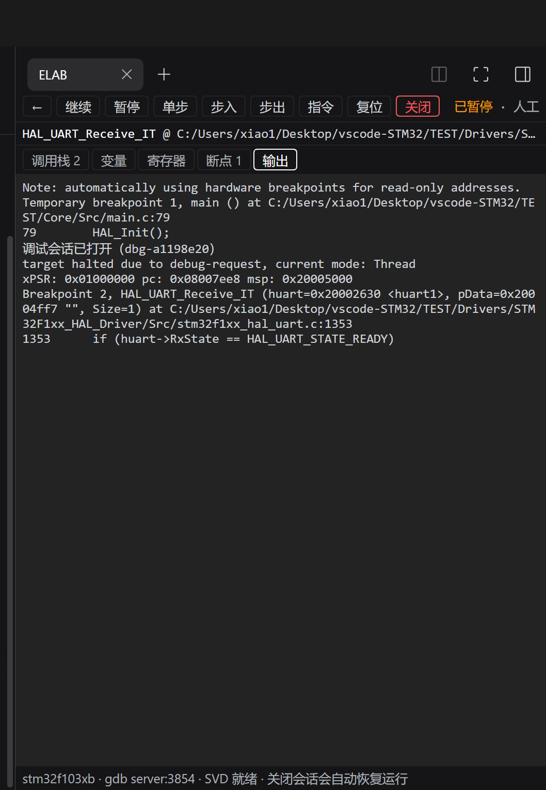

- **关闭**：内核执行 `monitor reset run` → **目标复位并恢复运行**，openocd/gdb 退出；面板回到「开始调试」，输出保留。

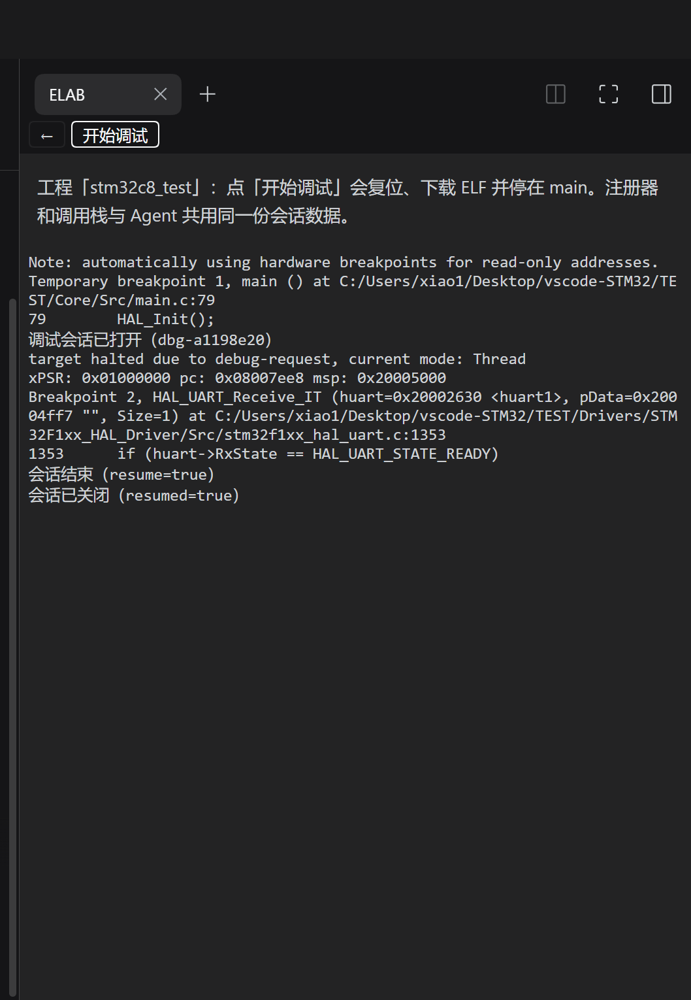

> 关闭后串口 `tick` 从 0 重新计是 `reset run` 的正常现象；心跳节奏不变。

---

## 7. Agent 也能开同一套会话

Agent 用 `elab_debug_open` 发起后，右侧栏会在新 `open_seq` 上**自动切到调试视图一次**（你手动切走后不会反复抢焦点）。读栈、读寄存器、单步、断点、关闭都是同一份内核会话数据（人机同源）。

六个工具与参数、HTTP ICD、租约与写保护见 [调试面板上手指南 §13–§16](04-调试面板上手_STM32F103C8T6.md)。

---

## 8. 常见问题

| 现象 | 原因 | 处理 |
|---|---|---|
| 右侧栏没有 `ELAB` 页签 | 插件未启用，或内核未就绪 | 在市场里启用插件；必要时重启 DSH Desktop |
| 面板右上角没有 `▶|` | 内核过旧（无 `meta.debug`） | 同步内核到含调试能力的版本 |
| 改了插件 **host** 代码，面板行为没变 | DSH 桌面端在启动时加载 host 模块，刷新页面只更新 client | **整体重启 DSH Desktop**（不是只 reload 页面） |
| `409 debug-busy` / `serial-busy` | 调试会话仍开着（`debug-busy`）；`serial-busy` 只可能来自内核真占用 | 先关闭调试；串口不再需要提前关监视（内核会在烧录/调试前自动让位） |
| 三连「编译完就停住」 | 面板通道停在「构建」，烧录日志在「烧录」通道里；ESP32 `--no-stub` 烧录本身要 30–80 s | 升级插件：通道现在自动跟随当前步骤；点「烧录」页签看日志是否仍在增长 |
| `debug-elf-missing` | 还没构建或 ELF 路径不对 | 先跑一次 `▶ 构建` |
| `debug-port-hijacked` | 动态 gdb 端口被别的 openocd 占用 | 结束残留 `openocd`；内核会在日志里确认实际监听端口 |
| 关闭调试后心跳没了 | 进程被强杀，没走到 `monitor reset run` | 给板子重新上电，或手动跑一次 `elab debug --resume-only`（等价 `monitor reset run`） |
| 串口 0 字节 / 没有心跳 | 工程未初始化 USART1，或 PA9/PA10 接反、波特率不一致 | 先确认启动日志有 `[log] UART1 : ok (... TX=PA9, RX=PA10 ...)`；接线 TX/RX **交叉**并共地 |
| 串口关闭按钮没反应（旧版本） | 旧版按钮只做「启动」 | 升级插件；当前版本运行中显示 **`■ 关闭监视`** |
| 闭环结束后提示「监视已在运行」、怎么都打不开 | 闭环含串口步骤会**借走**串口；收尾时内核按 `serial.resume_after_run: open` 已把会话自己开回来，旧前端看不见，再点「打开监视」就被「已在运行」拒绝 | 升级内核/插件：现在点「打开监视」会**接上**这条已有会话（`adopted=true`；epoch 不变）；只有换口/换工程才需要先关闭 |
| 烧录显示 `ninja: no work to do` | 没有源码变更 | 正常；阶段会继续烧录/校验 |
| 调试视图按钮换行/信息被截断 | 窄栏宽度（320–520 px） | 拉宽右侧栏，或改用子页签逐项看 |

---

## 9. 本次实机验证记录

| 项 | 结果 |
|---|---|
| 自动只读探测 → 写入接入 | ✅ 发现 `test`（T1 / high），写入后 `已接入` + `复探测` 可用 |
| 三连（零改动） | ✅ 编译 6.38 s（`ninja: no work to do`）/ 烧录 3.87 s / 调试校验 4.56 s，停在 `main.c:79` |
| 串口监视 | ✅ `[alive] tick=84..103`，1 Hz，`toggles` 每次 +2 |
| 关闭监视（回归） | ✅ 运行中变 `■ 关闭监视`，点击后 tick 停止、按钮回 `▶ 串口`、端口释放 |
| 调试：开始/单步/继续/暂停/复位 | ✅ 停 `main.c:79 @ 0x8007302`；单步 `0x8001786 → 0x8001792`；暂停落在空闲任务 |
| 调试：函数断点 | ✅ `HAL_UART_Receive_IT`，命中 `×1`，栈 `#0/#1` 完整 |
| 调试：变量/寄存器/输出 | ✅ `rec_data` / `pc=0x8007302` / MI 原始输出 |
| 调试：关闭 | ✅ `resumed=true`，目标恢复运行，无残留进程 |
| 门禁 | ✅ `npm test` 135/135、host/client `tsc --noEmit`、`npm run build` 全绿 |

---

## 10. 2026-11-04 更新：网络传输 / 帧协议 / 日志诊断 / 波形测量（ESP32-S31 实机）

这一章是「同一套插件、换一颗板子再跑一遍」的进阶实机记录：硬件仍是 ESP32-S31-Korvo-1，
但固件换成了专门为教学做的 [`examples/ESP32S31_Wave`](../../examples/ESP32S31_Wave)。
它只发 **7 字节一帧**、50 Hz 的三路波形，并且把三条链路的日志前缀刻意分开：

| 链路 | 文本前缀 | 你在面板里会看到 |
|---|---|---|
| USB 串口（COM9） | `[usb]` | `[usb] seq=…` + 二进制帧（行视图里的乱码） |
| TCP（板子 9000 端口，PC 主动连） | `[net]` | `[net] seq=…` + 二进制帧 |
| UDP（板子主动发给 PC 9100） | `[udp]` | `[udp] seq=…` + 二进制帧 |

> 三条链路是**三个独立会话**，不是同一份数据。看教程时若发现串口和网络日志「一模一样」，
> 那是看错了会话——本固件里它们的前缀、入口、方向都不同。

> 本章所有截图都取自 **DSH 右侧栏的 ELAB 面板**（`dsh web` 实机驱动，窄栏原尺寸）。
> 控件与桌面版完全同一套，照着点即可复现。

### 10.1 先烧新固件

新工程 `projects/esp32s31_wave.yaml` 已接入内核，可走面板「编译 / 烧录」，也可命令行：

```powershell
.\elab.cmd doctor -p esp32s31_wave
.\elab.cmd run -p esp32s31_wave --steps doctor,build,flash
```

WiFi 凭据只写本地 `examples/ESP32S31_Wave/sdkconfig`（已被 `.gitignore` 忽略）；
UDP 目标地址 `CONFIG_WAVE_UDP_HOST` 写你 PC 的局域网 IP。串口里出现这两行就说明链路就绪：

```text
[wifi] got ip=10.115.126.252
[net] tcp server listening port=9000
[udp] sending to 10.115.126.238:9100
```

### 10.2 第一步：选链路（M4）

串口 / TCP 客户端 / TCP 服务端 / UDP 都从同一个「连接方式」下拉进入：

- **串口**：本地 COMx，最稳，适合 bring-up 与看启动日志；
- **TCP 客户端**：板子做服务端（本例 9000），PC 主动连——最常见；
- **TCP 服务端**：PC 监听，设备主动连入；
- **UDP**：PC 监听，设备主动发包；内核会记住第一个发来的对端，之后才能回写。

安全默认：只允许 `127.0.0.1` / `localhost`；连板子或跨机必须勾「允许非回环」。
地址填错、端口没开、忘勾这一项，都会在「打开监视」处直接报错，不会假装成功。

### 10.3 第二步：串口链路看 `[usb]`

连接方式选 `串口`，端口 `COM9`，波特率 `115200`，点「▶ 打开监视」。
行视图里同时有 `[usb]` 人读日志和二进制帧——**二进制帧显示成乱码是正常的**，
它不是给人读的；波形页才是它的正确打开方式。

![USB 串口行视图：[usb] 人读日志 + 二进制帧（乱码）](assets/wave/w-serial-lines.png)

切到「波形」页，协议解码器选 `三通道波形帧（7B，sum8）`：

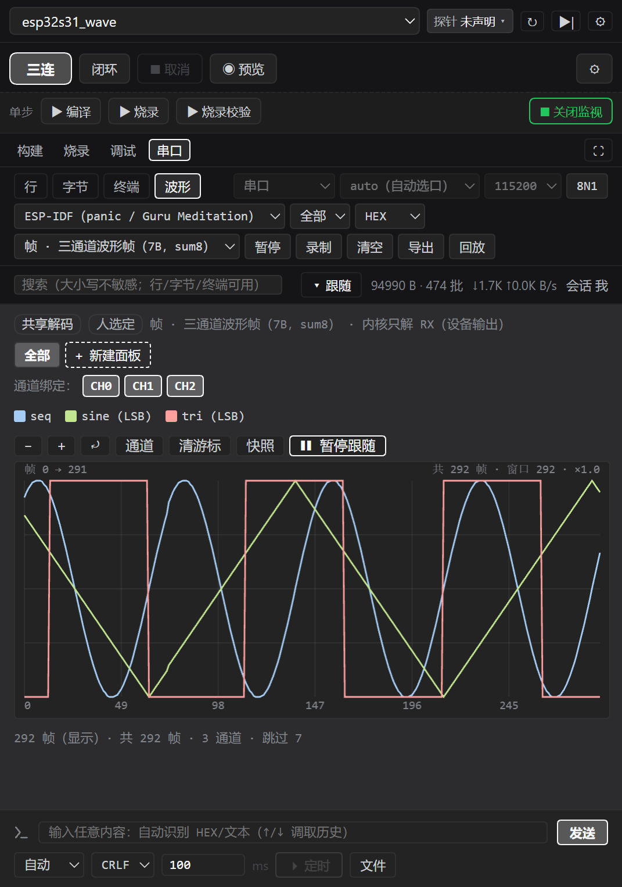

三条曲线的形状/周期刻意不同：正弦（约 1.5 s）、三角（3 s）、方波（2 s），
一眼就能确认「解的确实是三路不同信号」，而不是同一条线复制三遍。

### 10.4 第三步：TCP 链路看 `[net]`

关掉串口会话，连接方式换成 `TCP 客户端`，地址 `10.115.126.252`、端口 `9000`，
勾选「允许非回环」，再打开监视。行视图里人读日志全部是 `[net]`，二进制帧仍显示成乱码：

![TCP 客户端行视图：[net] 人读日志 + 二进制帧](assets/wave/w-tcp-lines.png)

波形页选同一个帧协议 profile，曲线一致：

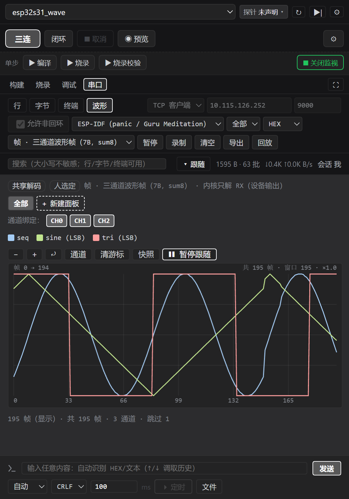

### 10.5 第四步：UDP 链路看 `[udp]`

关掉 TCP 会话，连接方式换成 `UDP`，绑定地址 `0.0.0.0`、端口 `9100`，勾「允许非回环」。
UDP 没有“连接”概念：**板子必须先发**，内核才能学到对端。行视图里人读日志全部是 `[udp]`：

![UDP 行视图：绑定 0.0.0.0:9100，[udp] 日志 + 二进制帧](assets/wave/w-udp-lines.png)

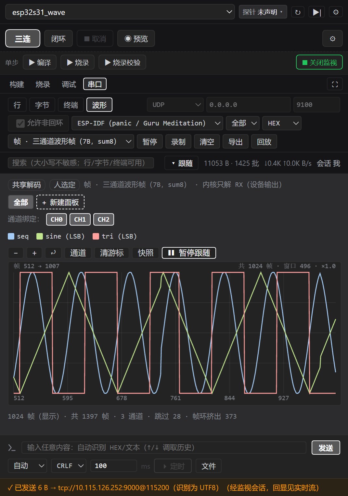

### 10.6 第五步：帧协议（M5）——一次定义，三条链路共用

帧协议是**工程数据** `projects/esp32s31_wave.frames.json`，本帧只有 7 字节，适合手算：

```text
AA 55 | seq u8 | sine u8 | tri u8 | sq u8 | sum8
```

在右栏**波形**页：把解码器下拉选成 `帧 · 三通道波形帧（7B，sum8）`，再点 `+ 新建面板`，
把 `CH0 / CH1 / CH2` 分别绑到 `seq / sine / tri`，曲线就出来了。插件里它是**只读解码器**——
新建/编辑/保存帧协议仍在独立驾驶舱的「帧协议」抽屉里，两边读同一个
`projects/esp32s31_wave.frames.json`，所以不会出现两套定义。

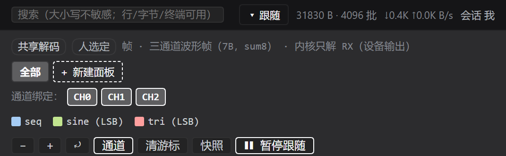

想看字段表与样本预览（确认 `AA 55 07 02 10 96 AE` 能解出 `sine=2 / tri=16 / sq=150`），
在驾驶舱「帧协议」抽屉里粘贴样本点「预览」，应显示 `✓ 通过（1 帧，4 字段）`。

### 10.7 第六步：日志诊断（M6）——panic 变卡片，地址一键符号化

本例的 `projects/esp32s31_wave.yaml` 声明了 `serial.log_profiles: esp-idf`。
在 TCP 会话的发送框里输入 `boom` 并发送，板子会打印一段与真 panic 同格式的文本：

```text
Guru Meditation Error: Core  0 panic'ed (LoadProhibited). Exception was unhandled.
Backtrace: 0x400d… 0x400d… 0x400d…
```

它不会真崩溃（链路不断），但足以让规则识别。工具栏出现「异常 1 ▸」，展开：

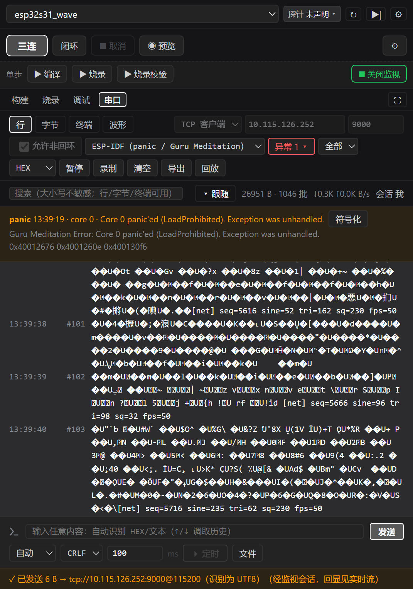

点「符号化」，内核用工程 ELF 的 `addr2line` 把地址解回函数/文件行：

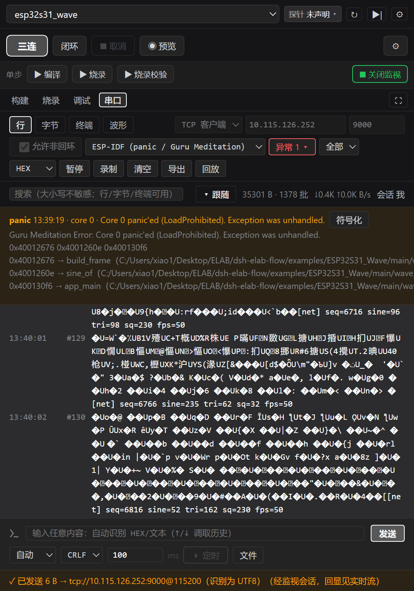

解不出来时它会如实报「无法解析」，**不会编造函数名**。

### 10.8 第七步：波形测量（M7）——游标、增益、冻结

- 点画布放**游标 A**，`Shift` + 点放**游标 B** → 读数卡给出 `Δt` 与各通道 `ΔY`；
- 「通道」面板给每条曲线独立的**增益 / 偏移**（小信号不用改固件也能看清）；
- 「暂停跟随」**冻结**时间窗，滚轮/拖拽回看历史，数据仍在后台入环。

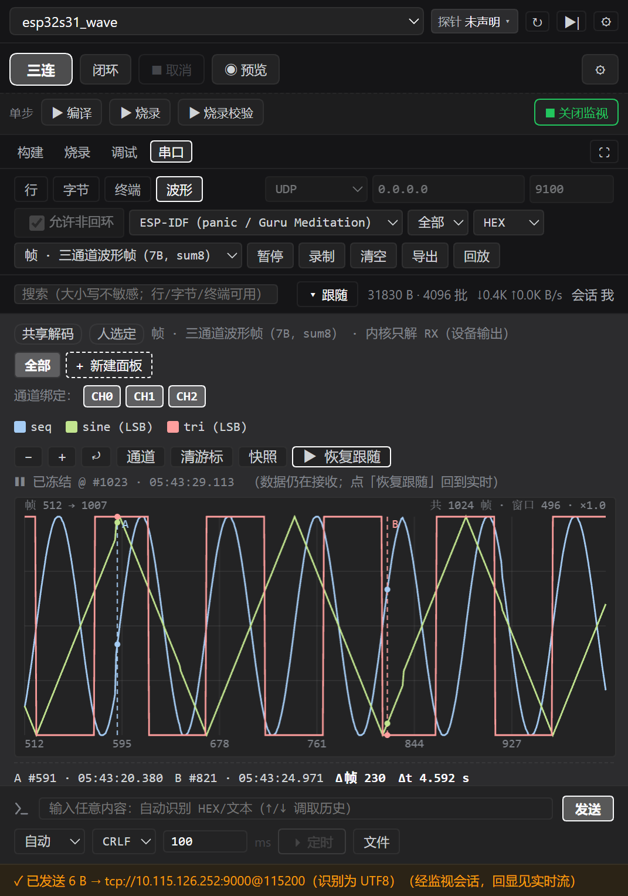

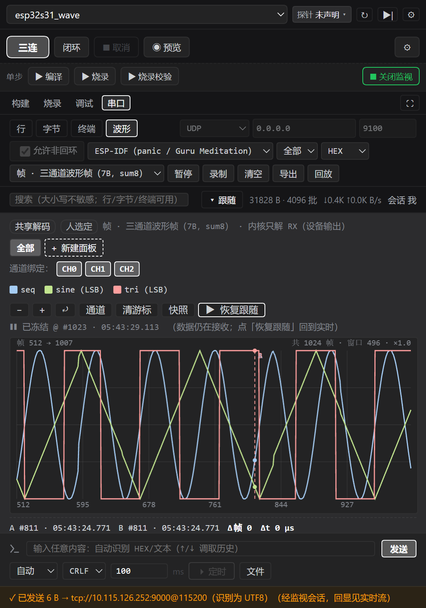

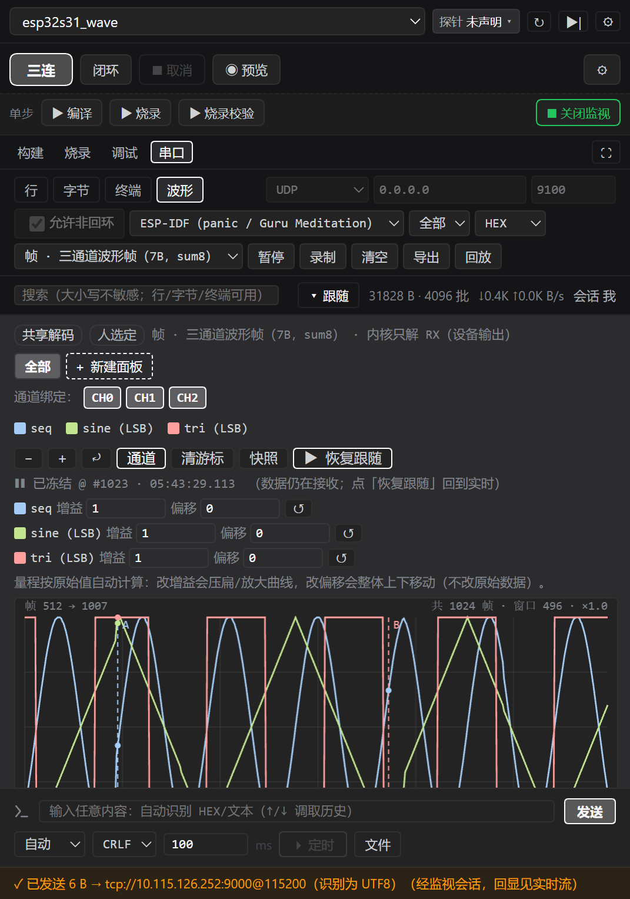

### 10.9 第八步：断线重连（M2）

对端主动断开（或板子复位、拔插 USB）时，会话**不会结束**：状态切到 `reconnecting`，
橙红横幅给出已断开时长与最后一次错误，后台按 `200ms → 5s` 退避重试；恢复后同一条逻辑会话
自动续上，行/字节游标不跳（`epoch` 不变），统计里的 `conn` 递增、`reconnects` 加一。

串口真断线需要拔插 USB；不想动线时，可以用一个本机可控 TCP 源复现同一套状态机
（`127.0.0.1:9101` 起个每 100ms 发一行的小服务，杀掉它即“对端主动断开”）：

1. 连接方式 `TCP 客户端` + `127.0.0.1:9101`，打开监视，正常收 `[mock]` 行；
2. 杀掉这个小服务 → 横幅出现（本次实拍：`ConnectionRefusedError [WinError 10061]`，
   已断开时长在涨），但会话仍是 `reconnecting`，**不用手动重开**；
3. 重新启动小服务 → 插件自己接回，日志从新连接继续，`conn #2 / reconnects 1`。

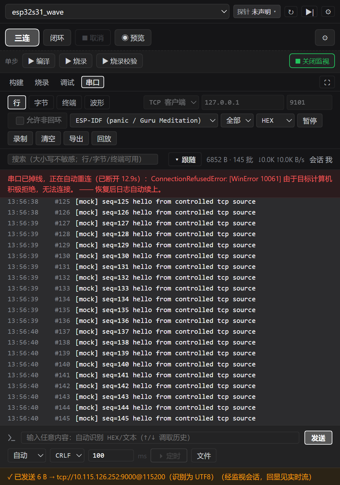

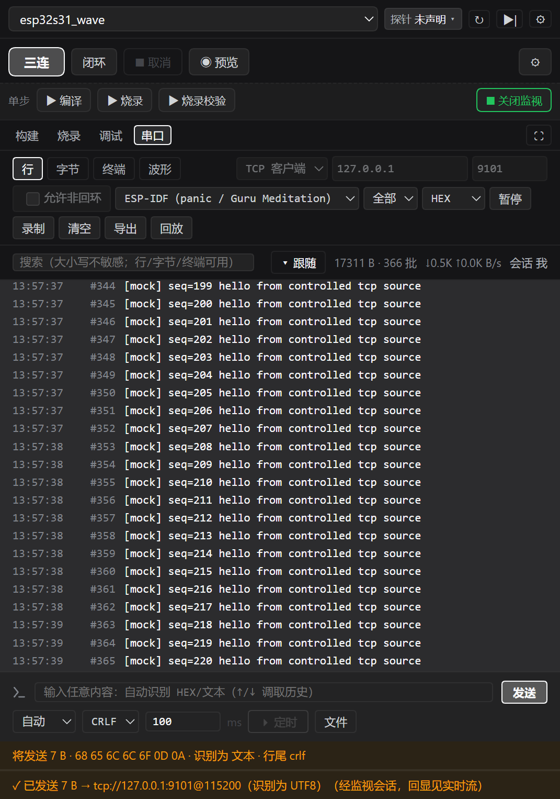

> 面板只显示 `reconnecting` 横幅；`conn` / `reconnects` / `down_s` 在内核快照里，
> 是判断“真断过”还是“没断”的事实源，agent 用 `elab_serial_monitor` 拿到的是同一份快照。

### 10.10 本章验收表

| 项 | 结果 |
|---|---|
| 新固件编译/烧录 | ✅ `elab run -p esp32s31_wave --steps doctor,build,flash` 通过；COM9 启动打印 `[boot]` |
| 串口链路 | ✅ `[usb]` 日志 + 二进制帧；波形 50 fps，三通道形状不同 |
| TCP 链路 | ✅ `TCP 客户端 10.115.126.252:9000`；人读日志全为 `[net]`；波形正常 |
| UDP 链路 | ✅ `UDP 0.0.0.0:9100`；人读日志全为 `[udp]`；波形正常 |
| 帧协议 | ✅ 7B / `sum8`；样本预览 1 帧 4 字段通过 |
| 日志诊断 | ✅ `boom` → panic 卡片；符号化解回 `build_frame @ wave_main.c` |
| 波形测量 | ✅ 游标 Δt/ΔY、每通道增益/偏移、暂停跟随冻结 |
| 断线重连 | ✅ 可控源断开 → 橙红横幅（含错误与已断开时长）；恢复后 `conn #2 / reconnects 1`，游标连续 |
| 插件门禁 | ✅ `npm test` + `npm run build` 通过（含新增网络/诊断 UI） |

---

## 11. 下一步

- 调试 P1：内存/反汇编页签的可视化编辑、写寄存器 UI；
- 调试 P2：SVD 外设视图（页脚已显示「SVD 就绪」）；
- 面板侧：窄栏宽屏双列布局、断点命中通知与跳转。
