# 串口面板使用教程（通用发送 · 真机实操）

> 本文界面与截图来自 **2026-11-03 真机**：STM32F103C8T6（`stm32_test` 工程）+ CMSIS-DAP，
> 串口 `COM10 @ 115200`。固件在初始化时逐条打印外设结果，主循环每秒打心跳，
> 并响应 `PING` / `STAT` / `ECHO` 串口命令。
>
> 当前串口面板是**通用发送框架**：自动格式识别、服务端字节预览、发送历史、定时发送、
> 文件按行发送，跨工程可用。参数化发送组件已从面板 UI 下线，只保留给 agent
> （`elab_serial_widget`，按固定格式发送）。
>
> **2026-11-04 追加（第 5 章）**：断线自动重连（M2）、结构化日志诊断（M6）、
> 自定义帧协议（M5）、波形游标/通道坐标（M7）、TCP/UDP 传输（M4），
> 全部在 **ESP32-S31-Korvo / COM9 @ 115200** 实机验证并截图。
>
> **2026-11-05 追加（5.6 节）**：帧协议增强 P0/P1——位域、变长 `length_field`、
> 多 ID `variants`、模板库、草稿预览、反向组帧，以及 Agent 工具 `elab_frame_profile`；
> 在 **STM32F103C8T6 / COM10 @ 115200** 实机验证并截图。
>
> 说明：第 4 章的波形截图仍来自 **f411 波形固件**（`01`–`06`），仅用于演示波形 UI；
> 当前 F103 固件已追加三类演示帧（见 5.6），波形截图以 5.6 为准。
>
> **2026-11-05 追加（5.7 节）**：帧协议补强 P2.2（校验预设/转义/多帧头/空闲分包/
> 数组·字符串·f16·位标志/错误分类）、观测 P3（帧级健康度 + 触发式录制）、
> Agent 生产力 P4（**learn 自学协议** / verify / auto / codegen）。
> 全部在 **STM32F103C8T6 / COM10 @ 115200** 实机验证，验收表见附录 D。

---

## 0. 一句话看懂

| 能力 | 入口 | 状态 |
|---|---|---|
| 打开 / 关闭监视 | 串口区顶部 `打开监视` / `关闭监视` | ✅ |
| 四视图 | `行` / `字节` / `终端` / `波形` | ✅ |
| **自动格式识别** | 发送框格式选 `自动`，HEX/文本自动判断 | ✅ |
| **服务端字节预览** | 发送框下方 `将发送 N B · XX XX … · 识别为 …` | ✅ |
| **发送历史** | 输入框内 `↑` / `↓` 调取，含格式与行尾 | ✅ |
| **定时发送** | `⏵ 定时` / `■ 停止定时`，间隔 ≥ 20ms | ✅ |
| 文件按行发送 | `文件`，每行按当前格式与行尾发送 | ✅ |
| 波形（缩放 / 多面板 / 定格） | `波形` tab（需波形固件） | ✅ 既有 |
| **掉线自动重连** | 默认开（200ms→5s 退避），顶部状态徽标 + 重连次数 | ✅ M2 |
| **结构化日志诊断** | `异常 N` 面板 + `符号化`（addr2line 到文件:行） | ✅ M6 |
| **自定义帧协议** | `波形` tab → `帧协议` 抽屉（编辑 / 预览 / 校验） | ✅ M5 |
| **帧协议增强 P0/P1** | 位域 / 变长 `length_field` / 多 ID `variants` / 模板库 / 草稿预览 / 组帧 | ✅ 5.6 |
| **帧协议补强 P2.2** | 9 个 CRC 预设 + 覆盖锚点 / 转义 / 多帧头 / 空闲分包 / 数组·字符串·f16·位标志 / 错误分类 | ✅ 5.7 |
| **★ Agent 自学协议** | `elab_frame_profile action=learn`（抓包 → 草稿 → 解码） | ✅ 5.7.8 / 按钮实操 5.7.9 |
| **帧级健康度 / 触发录制** | `GET /api/serial/monitor/stats` + `capture trigger`（pattern/field/frame_index + 预录） | ✅ 5.7.6 / 5.7.7 |
| **波形游标 A/B** | 画布点击 / Shift+点击，Δ帧、Δt、ΔY；通道 gain/offset | ✅ M7 |
| **网络传输 TCP/UDP** | `连接方式`：串口 / TCP 客户端 / TCP 服务端 / UDP | ✅ M4 |
| 组件（agent 夹具） | `elab_serial_widget`，面板不展示 | ✅ 仅 agent |

---

## 1. 三步准备（真机）

整页布局见下图：左侧工程树，右侧串口工作区。

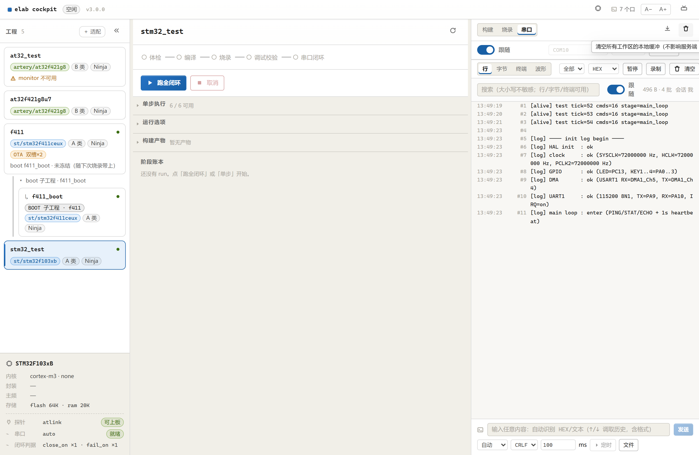

**① 选工程**：左侧点 `stm32_test`（STM32F103C8T6 / CMSIS-DAP）。
**② 进串口**：右侧顶部切到 `串口` 工作区。
**③ 开监视**：端口选 `auto`（本文解析到 `COM10`）、波特率 `115200`，点 `打开监视`；
按钮变成 `关闭监视` 就说明会话在跑。

> 工程卡片底部应显示 `闭环判据 close_on ×1 · fail_on ×1`。如果显示
> `monitor 不可用`，说明该工程 YAML 缺 `serial.port` 或 `monitor.close_on`，
> 先补配置再开监视（见第 5 章 FAQ）。

> **硬前提（所有工程通用）**：面板读的是**固件已经初始化好的 UART**。本仓 STM32 示例都走 USART1
> （115200 8N1，**PA9 = TX / PA10 = RX**）；接线必须交叉（PA9→模块 RX、PA10→模块 TX）并共地。
> elab 只打开主机侧 COM 口，不配置芯片引脚——工程没初始化串口时，这里只会是 0 字节。

---

## 2. 用串口日志看程序跑到哪一步

固件在 `main.c` 里按阶段打日志，串口一就绪就补打外设结果：

```text
[log] ---- init log begin ----
[log] HAL init  : ok
[log] clock     : ok (SYSCLK=72000000 Hz, HCLK=72000000 Hz, PCLK2=72000000 Hz)
[log] GPIO      : ok (LED=PC13, KEY1..4=PA0..3)
[log] DMA       : ok (USART1 RX=DMA1_Ch5, TX=DMA1_Ch4)
[log] UART1     : ok (115200 8N1, TX=PA9, RX=PA10, IRQ=on)
[log] main loop : enter (PING/STAT/ECHO + 1s heartbeat)
[alive] test tick=0 cmds=0 stage=main_loop
[alive] test tick=1 cmds=0 stage=main_loop
```

| 行 | 含义 |
|---|---|
| `[log] HAL init` | HAL / SysTick 初始化完成 |
| `[log] clock` | 时钟树生效，`SYSCLK/HCLK/PCLK2` 是实际频率 |
| `[log] GPIO` | LED 与按键 GPIO 初始化完成 |
| `[log] DMA` | USART1 的 RX/TX DMA 通道就绪 |
| `[log] UART1` | 串口参数与引脚，`IRQ=on` 表示接收中断已挂 |
| `[log] main loop` | 进入主循环，开始处理命令与心跳 |
| `[alive] tick=` | 每秒一条，`tick` 递增说明主循环没卡死 |
| `[cmd] …` | 收到命令后的回显，证明 RX 正常 |

初始化失败时会打印失败阶段后停机：

```text
[log] FATAL: init failed at SystemClock_Config, halted
```

所以只看串口日志就能判断程序**跑到哪一步、卡在哪一步**。

---

## 3. 通用发送面板

### 3.1 面板布局

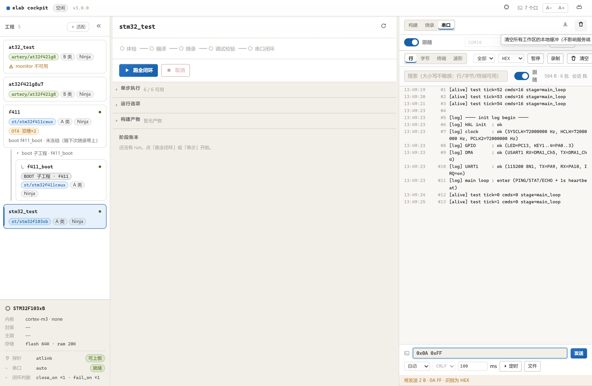

发送区分两行：

| 位置 | 用途 |
|---|---|
| 第一行 输入框 + `发送` | 要发的内容；`Enter` 等价于点 `发送` |
| 第二行 `自动` | 发送格式：`自动 / 文本 / ASCII / GBK / HEX` |
| `CRLF` | 行结束符：`无 / LF / CR / CRLF / TAB`；HEX 模式自动禁用 |
| `100` + `ms` | 定时发送间隔（最小 20ms，最大 600s） |
| `⏵ 定时` / `■ 停止定时` | 按固定节拍重复发送输入框内容 |
| `文件` | 选择本地文本文件，按行逐条发送 |
| 下方预览行 | **服务端**算出的最终字节、识别格式与行尾 |

预览行示例：

```text
将发送 2 B · 0A FF · 识别为 HEX
```

> 预览和真正发送共用内核同一个编码入口 `serialterm.resolve_payload`，
> 所以「看到的字节」就是「发出去的字节」。

### 3.2 自动格式识别规则

格式选 `自动` 时，只有**明确写法**才按 HEX 处理，避免把普通数字误判成二进制：

| 输入 | 识别为 | 实际字节 | 说明 |
|---|---|---|---|
| `0x0A 0xFF` | HEX | `0A FF`（2 B） | `0x` 前缀 |
| `\x41\x42` | HEX | `41 42`（2 B） | `\x` 前缀 |
| `0A,FF` | HEX | `0A FF`（2 B） | 分隔符 + 全十六进制 + 偶数字节 |
| `01 A0 FF` | HEX | `01 A0 FF`（3 B） | 同上 |
| `1234` | 文本 | `31 32 33 34` + 行尾 | **裸数字按文本**，不会拆成 0x12 0x34 |
| `PING` | 文本 | `50 49 4E 47` + 行尾 | 普通命令 |
| `你好` | 文本 | UTF-8 字节 + 行尾 | 中文按 UTF-8 发；需要 GBK 时手动选 `GBK` |

补充规则：

- HEX 模式**不追加行尾**（二进制帧多一个 `0D 0A` 就是错）。
- 自动识别为 HEX 时，行尾下拉框会变灰，预览里也不会出现「行尾」。
- 要强制按十六进制发，把格式从 `自动` 改成 `HEX`；要强制按文本发，改成 `文本`。

### 3.3 发送历史（↑ / ↓）

发送过的内容按 `{文本, 格式, 行尾}` 记入本地历史，最多 **50 条**，跨会话保留：

1. 点一下输入框，按 `↑` 调出上一条，连续按继续往前翻；
2. 按 `↓` 往后翻，回到底部是当前草稿；
3. 调取历史时会**同时恢复格式与行尾**，重发前预览行会重新计算。

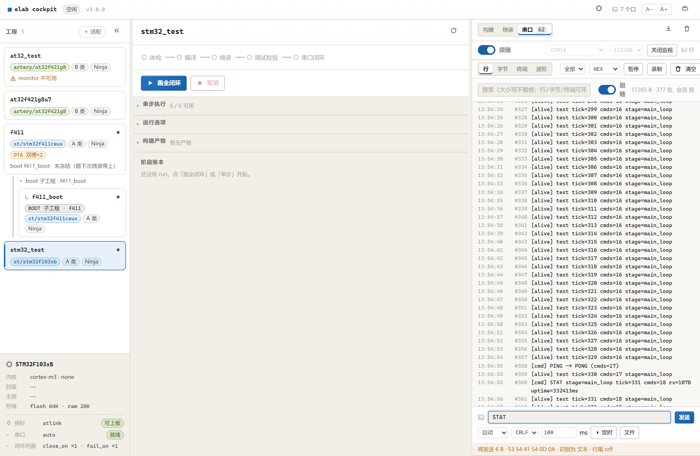

> 历史存在 `localStorage`（键 `elab.serial.send.history`）。隐私模式或配额满时
> 只是不写历史，不影响发送。相同内容会去重并移到最前。

### 3.4 定时发送

1. 输入框填要重复发送的内容（如 `STAT`）；
2. 间隔填 `200`（毫秒，最小 20）；
3. 点 `⏵ 定时`，按钮变成 `■ 停止定时`，预览行下方提示
   `⏵ 定时发送中：每 200ms（停止后才可手发）`。

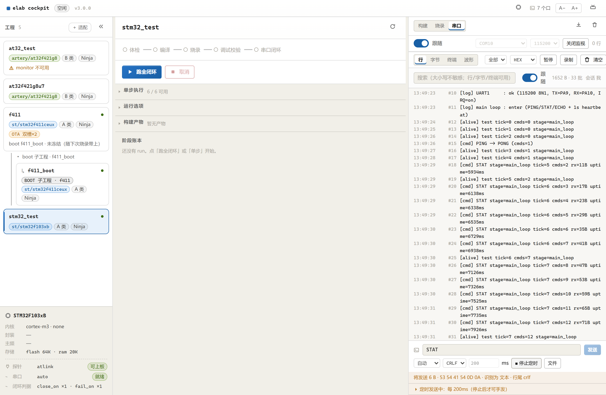

行为约定：

- **固定节拍**：按间隔推进，上一轮没发完只记 `skipped`，不补发、不乱发；
- 定时任务运行期间手写发送按钮置灰，先 `■ 停止定时`；
- 停止是内核取消标志，1 秒内退出，不再发后续轮次；
- 闭环 run 正在占用串口时启动会返回 `409`，先停闭环；
- 定时任务不落盘、不写工程文件，只在 `.work/.cockpit/serial-console.jsonl` 留 TX 记录。

### 3.5 文件按行发送

点 `文件` 选择本地 `.txt / .csv / .log / .json / .hex`，内核按行拆分，每行都按
当前格式与行尾发送；最多 2000 行。文件只读、不写入工程目录。

### 3.6 实机收发验证：PING → PONG

在发送框输入 `PING`（格式 `自动`、行尾 `CRLF`），按 `Enter`：

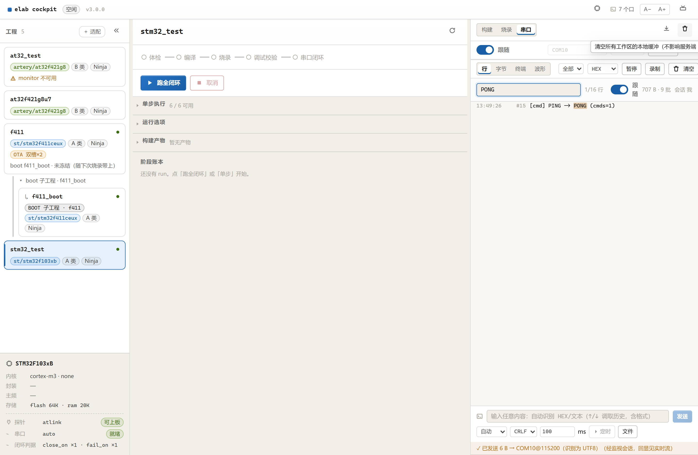

- 发送后预览提示 `✓ 已发送 6 B → COM10@115200（识别为 UTF8）`；
- 行视图出现 `[cmd] PING -> PONG (cmds=…)`，说明 **TX → 设备 → RX** 整条链路通了；
- 搜索框输入 `PONG` 可以只看回显；
- `STAT` 返回当前阶段、tick、命令数、RX 字节数与运行时长；
- `ECHO hello` 原样回显 `hello`，未知命令回 `[cmd] unknown: …`。

固件侧处理在
[main.c](../../examples/STM32F103C8T6/Core/Src/main.c) 的 `HAL_UART_RxCpltCallback`
与 `handle_line`：中断只收字节，主循环解析并打印，避免在中断里做阻塞发送。

---

## 4. 波形（既有能力 · 旧图说明）

> 本章截图来自 **f411 波形固件**（FireWater 双通道，10ms 一帧），用于演示波形 UI。
> 当前 `stm32_test` 是日志工程，不会产生波形；要复现下图请烧写 f411 波形固件。

### 4.1 选解码器

在波形 tab 右侧下拉框选 **FireWater**（固件输出 `a,b\r\n` 文本行）；纯二进制 float 流用
**JustFloat**。选对后出现默认面板「全部」：

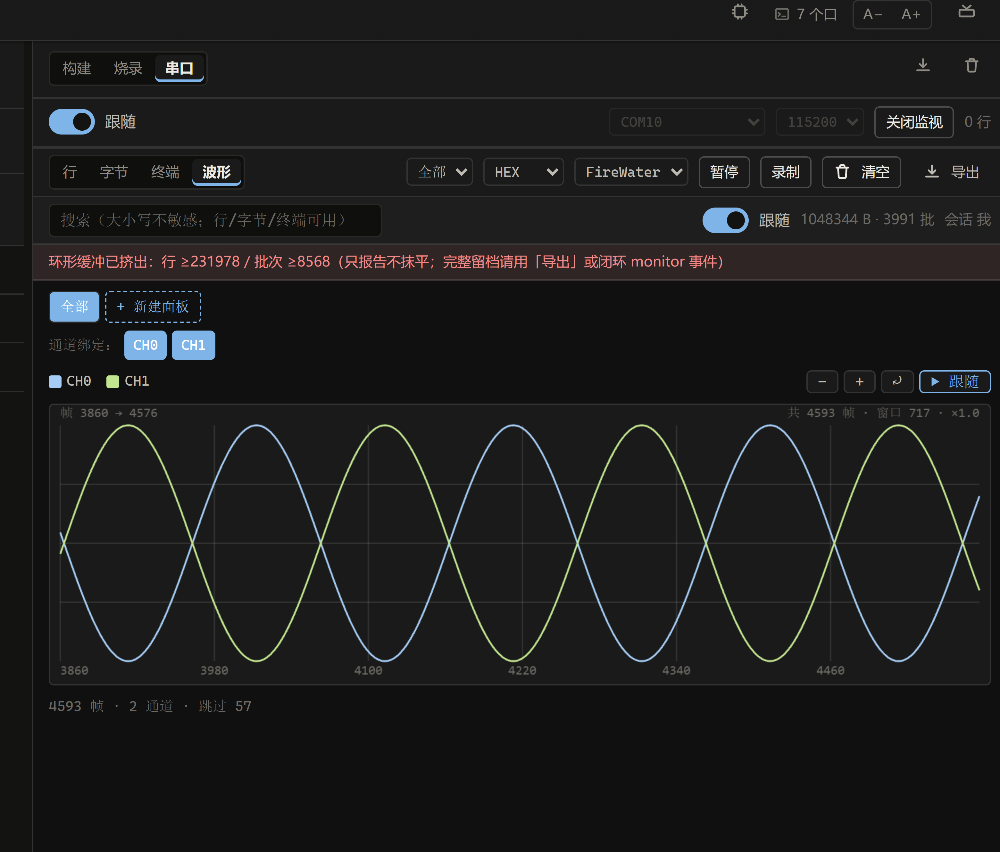

| 位置 | 含义 |
|---|---|
| 面板 tab | 当前激活面板；`×` 删除（至少保留一个） |
| `通道绑定：CH0 CH1` | 蓝色 = 正在画；灰框 = 已关闭 |
| `■ CH0 ■ CH1` | 图例，颜色与曲线一致 |
| `−` `+` `⤾` | 缩小 / 放大 / 重置 |
| `❚❚ 暂停跟随` / `▶ 恢复跟随` | 定格画面 / 跳回最新帧 |
| 画布顶部 `帧 N → M` | 视口左右边界的帧号 |
| `共 N 帧 · 窗口 M · ×1.0` | 总帧数 / 视口帧数 / 缩放倍数 |
| 底部 `N 帧 · 2 通道 · 跳过 X` | 解码统计；`跳过` 是协议外字节 |

每个通道**独立归一化**，量纲不同的通道不会互相压扁；代价是 Y 轴没有绝对值刻度。

### 4.2 新建面板 + 绑定通道

点 `+ 新建面板` 后自动切到「面板 2」，默认绑定全部通道：

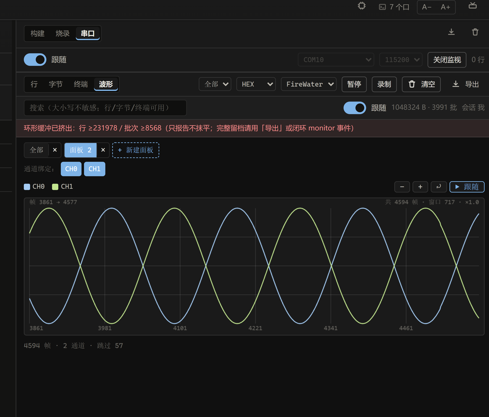

点掉 `CH1` 后只剩 CH0：

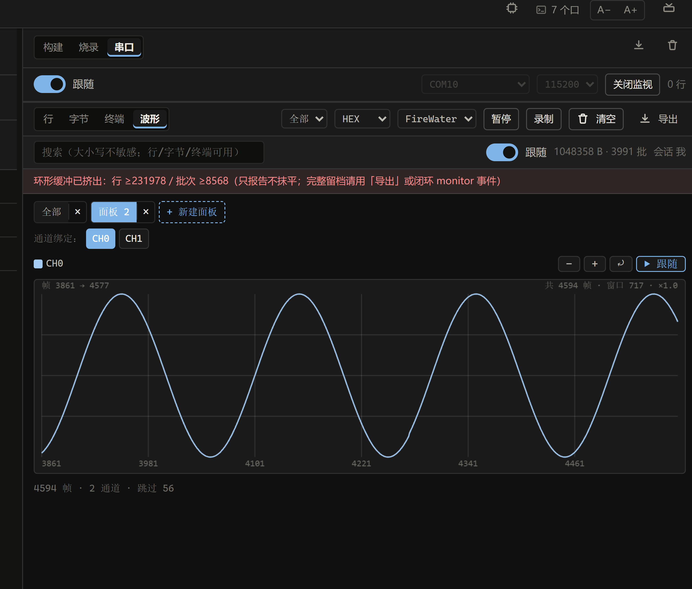

最后一个通道点不掉——每个面板至少保留一条曲线；「全部」面板不受影响。

### 4.3 放大 / 平移 / 定格

连点 `+` 或滚轮缩放，顶部倍率与窗口帧数同步变化：

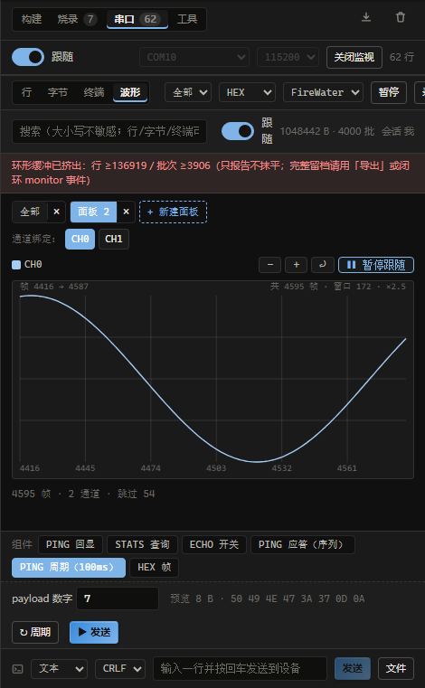

点 `❚❚ 暂停跟随` 定格，再点 `⤾` 回到缓冲区开头：

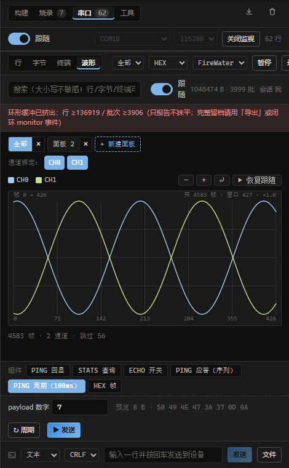

V3 起定格是**帧快照**：解码窗口只解最近 64 KiB，定格时把当帧数组留下，恢复跟随时
才换回实时帧。顶部工具栏的 `暂停` 是「停止入环」，与画布里的「暂停跟随」不是一回事。

### 4.4 切回「全部」

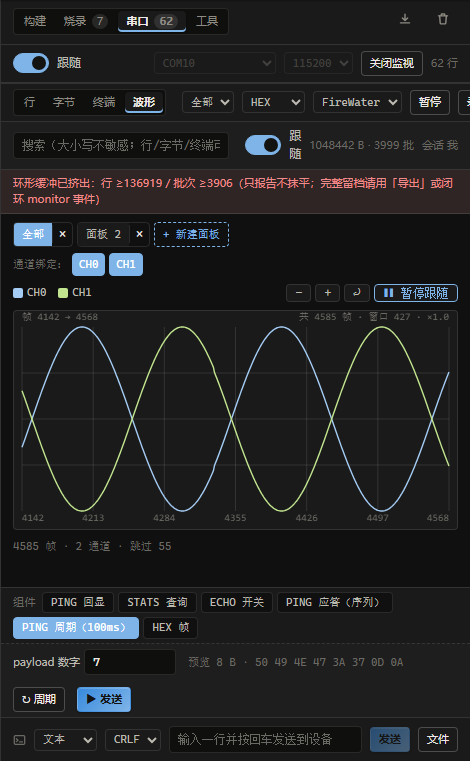

通道绑定、缩放、平移、跟随**按面板各自保存**，来回切换不会串味。

---

## 5. 新能力（2026-11-04 · ESP32-S31-Korvo 实机）

> 本章截图全部来自 `esp32s31_korvo` 工程、`COM9 @ 115200`（板载 USB-UART）。
> 固件 `examples/ESP32S31_Korvo` 同时输出两种东西：1Hz 文本心跳
> `[alive] tick=N toggles=M stage=boot`，以及 500ms 一帧 11 字节自定义遥测帧
> （`AA 55 | seq | status | tick u16 | adc0 u16 | adc1 | vbat | sum8`）。
> 所以同一次会话里能同时演示文本日志、结构化异常、帧解码和波形。
>
> 联网相关的截图有两条来源：宿主端 TCP 模拟源（`.work/m4_emulator.py`，不入库），
> 以及**板子自己当数据源**（ESP32-S31 WiFi STA + TCP 服务，见 §5.5.1）。
> 解析链与串口完全同一条，只是底层 IO 换成了 socket。

### 5.1 为什么闭环结束后串口要常开：断线自动重连（M2）

以前一次烧录/复位、USB 线抖一下，监视就停了，得手动重新点 `打开监视`。
现在监视会话有三种状态，掉线时**自己接回来**：

| 状态 | 界面 | 含义 |
|---|---|---|
| `live` | `关闭监视` + `conn #N` | 正常收数据 |
| `reconnecting` | 橙红提示条 | 已掉线，按 200ms→5s 退避无限重试 |
| `suspended` | `闭环占用，监视已让位` | 有 run 在跑（约束 N5），等它结束自动回归 |
| `closed` | `打开监视` | 会话结束 |

**怎么用**：默认就开着（工程 YAML 的 `serial.reconnect` 是 `enabled: true`，无需勾选）。
把线拔掉/板子断电，会看到：

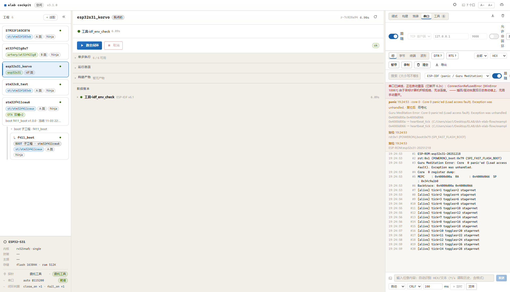

插回/上电后**不需要任何操作**，日志自动续上，并显示「已自动重连 1 次（当前 conn #2）」：

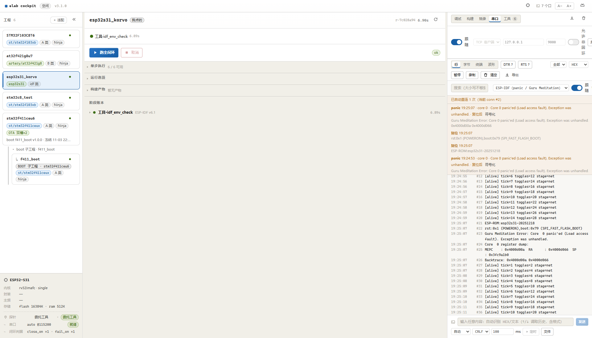

要点：

- **重连不换纪元（epoch）**：行/字节游标不重置，客户端只补增量，不会重复刷历史；
- 统计区 `reconnects` / `down_s` / `last_error` 是事实源，用来判断是「真断过」还是「没断」；
- 闭环跑起来时监视**自动让位**（`suspended`），闭环结束后按 `resume_after_run: open` 自动回归；
- 端口换了（比如 `COM9 → COM11`）会在 `port_changed` 里如实记录，不会假装是同一个口。

### 5.2 结构化日志诊断：panic / 复位一眼定位（M6）

行视图适合人读；`异常` 面板把同一批字节里的**结构化事件**抽出来，一眼能看出
「这是复位、这是 panic、这是 assert，回溯地址是哪几个」：

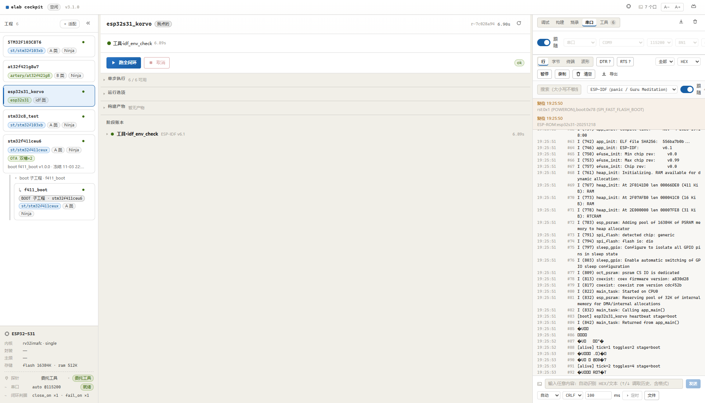

**怎么用**：

1. 顶部 `日志诊断 profile` 选 `ESP-IDF（panic / Guru Meditation）`（工程 YAML 的
   `serial.log_profiles` 提供规则，内核只有通用解释器，不写厂商分支）；
2. 复位一次板子：按板上 `EN` 键，或在面板上用 `DTR`/`RTS` 走一次复位序列
   （只拉单线通常不会复位，需要 DTR+RTS 组合，等价 esptool 的 `--before default-reset`）；
3. 顶栏出现 `异常 N`，点开展开事件列表：
   - `复位` 行带 `rst:0x1 (POWERON),boot:0x79…`（来自 ROM 启动信息）；
   - `panic` 行带 `Guru Meditation Error: Core N panic'ed (原因)` 和 `Backtrace:`；
4. 点事件卡里的 `符号化`，用工程 ELF + `addr2line` 把地址翻译成 `函数 (文件:行)`：

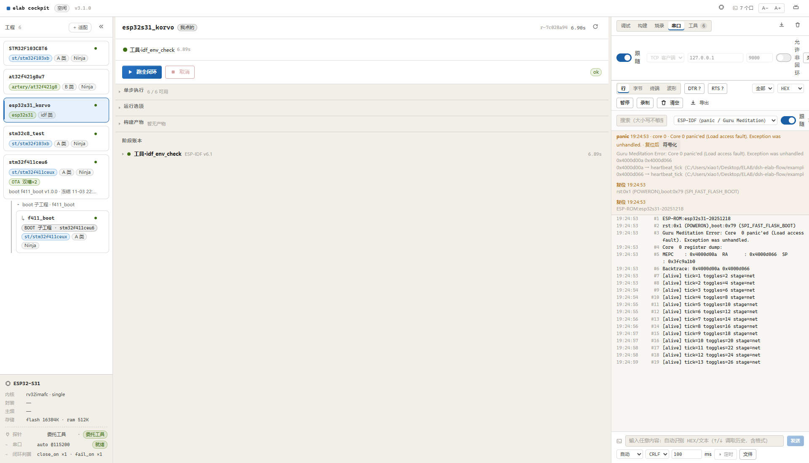

> 上图是 **TCP 模拟源**喂入的 panic（固件地址与真实 ELF 一致），所以能直接符号化；
> 上板后设备自己 panic 时，面板会用同一条链路解析，操作完全一样。

要点与限制：

- 规则全部是**工程数据**（`panic_lines` / `reset_lines` / `backtrace_line` /
  `addr_pattern` / `symbolize.args`），换芯片/换日志格式只改 YAML；
- 符号化结果按地址缓存；解不出来时提示「ELF 中没有该地址的调试信息」或
  「ROM 地址」——**不会伪造结果**；
- `rom_prefixes` 不要滥配（ESP32-S31 的 IRAM 就在 `0x4000xxxx`，按前缀预判会把
  真实函数误判成 ROM）；
- 符号化需要工程有 `artifacts.elf`，且 `elab.host.yaml` 里配好 addr2line 工具。

### 5.3 自定义帧协议：二进制帧 → 字段 / 曲线（M5）

设备经常发自定义二进制帧（不是 FireWater/JustFloat）。把帧格式写成工程数据
`projects/<工程名>.frames.json`，面板和 agent 就都能按同一份定义解码：

> 本节是基础版（头/尾/固定长/字段表）。位域、变长 `length_field`、多 ID `variants`、
> 模板库与反向组帧见 **5.6 节**。

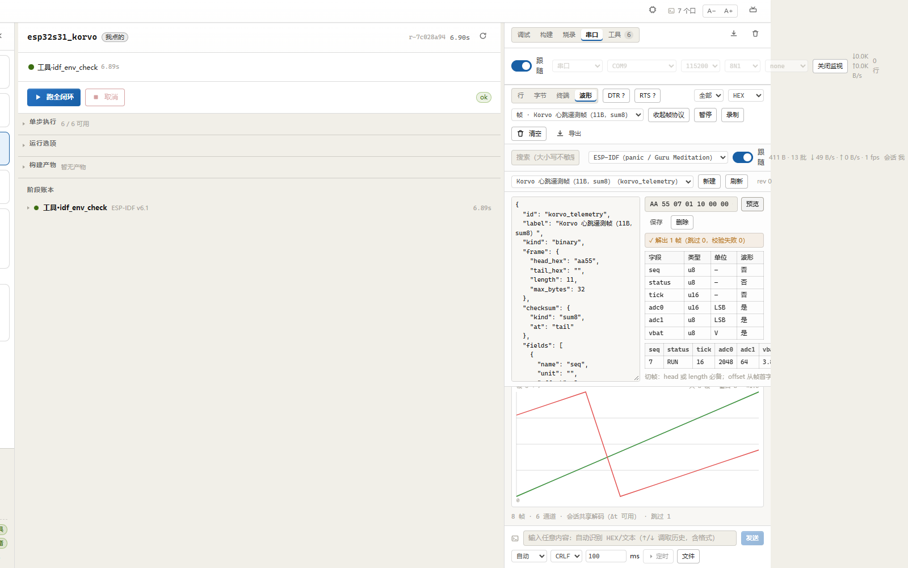

**怎么用**（入口只在 `波形` 页签的 `帧协议` 按钮）：

1. 打开抽屉，左侧是工程里的 profile 清单；选一个 → 右侧显示它的 JSON；
2. `新建` 生成骨架，按需改：`head_hex` / `tail_hex` / `length` / `max_bytes`、
   `checksum`（`none | sum8 | xor8 | crc16modbus`）、`fields`（`offset` / `type` / `endian` / `scale` / `unit`）；
3. `保存` 写回工程文件（带 `rev` 乐观锁，别处改过会拒绝覆盖）；
4. 在「预览样本 HEX」里粘贴一段真实字节，点 `预览`：显示**解出几帧、跳过几段、校验失败几项**，
   以及字段表与记录行——先在面板上验证，再上设备；
5. 回到波形，`协议解码器` 选 `profile:<id>`，曲线就按字段画出来。

字段规则（容易踩的点）：

- `offset` **从帧首字节算，包含 head**（示例：`AA 55` 之后 `seq` 在 offset 2）；
- `length` 是**整帧长度**（含 head/tail/checksum）；只有 head/tail 时靠边界切帧；
- `checksum` **不包含尾标记**，`at: tail` 表示校验字节在帧尾；
- `enum` 字段只做字段表展示、**不进波形**（枚举值画成折线没有意义）；
- `scale` / `unit` 是显示缩放（如 vbat ×0.02 = 3.9V），不改原始字节。

> 编辑器**只在 cockpit**；DSH 插件侧只读/可选同一份 profile 清单，
> 避免两套前端各写一份编辑器而漂移。

PowerShel
浏览器打开`http://127.0.0.1:8333` 。
- 进入工程，打开串口监视，切到「波形」页签。
- 点右上角「帧协议」按钮，打开抽屉：
- 左侧选 profile，或点「新建」生成骨架；
- 右侧直接编辑 JSON。
- 写一个最小 profile，例如：
`{
  "id": "my_frame",
  "label": "我的帧",
  "kind": "binary",
  "frame": { "head_hex": "aa55", "tail_hex": "", "length": 11, "max_bytes": 32 },
  "checksum": { "kind": "sum8", "at": "tail" },
  "fields": [
    { "name": "seq",   "type": "u8",  "offset": 2, "plot": false },
    { "name": "status","type": "u8",  "offset": 3, "enum": { "0": "IDLE", "1": "RUN" } },
    { "name": "adc0",  "type": "u16", "offset": 4, "endian": "le", "unit": "LSB", "plot": true }
  ]
}`

要点：`offset` 从帧首字节算， 包含帧头 ；`length` 是整帧长度， 包含帧头/帧尾/校验 。
- 保存 → 在「预览样本 HEX」粘贴真实字节点预览 → 回到波形，把「协议解码器」选成`profile:my_frame` ，曲线就按字段名出来。

### 5.4 波形测量：A/B 游标、通道坐标、冻结快照（M7）

波形不只是「看个热闹」，还要能**量**。新加的交互都在画布上：

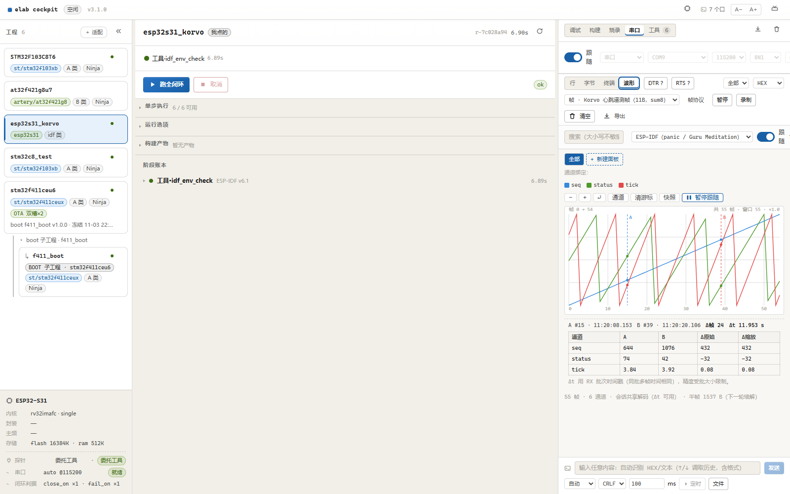

| 操作 | 效果 |
|---|---|
| 点击画布 | 放游标 A（竖线 + 帧号） |
| `Shift` + 点击 | 放游标 B；A/B 数值在画布下方表格对照 |
| 表格 | `Δ帧` / `Δt`（按每帧时间戳）/ `Δ原始` / `Δ缩放`（应用 gain/offset 后） |
| `清游标` | 清空 A/B |
| `通道` | 显示/隐藏某条曲线（不影响解码） |
| 每通道 `gain` / `offset` + `↺` | 只改**绘制**坐标（叠加/错开看），原始数据与量程不动 |
| `快照` | 把当前视口 + 游标 + 通道坐标复制成 JSON，便于贴进 issue/报告 |
| `❚❚ 暂停跟随` / `▶ 恢复跟随` | 定格当前帧窗口 / 跳回最新帧 |

配套细节：

- 游标定位按**实际画出的帧跨度**换算（帧数少于视口槽位时也不会两个游标都吸到最后一帧）；
- 平移距离同样按实际跨度换算，低频遥测（帧稀疏）拖动不会慢一个数量级；
- 定格是**帧快照**：恢复跟随时才换回实时帧；
- 缩放/平移/绑定按面板各自保存，切面板不串味。

### 5.5 网络传输：TCP 客户端 / 服务端 / UDP（M4）

串口监视的「数据面」不再只能是串口。`连接方式` 下拉可选：

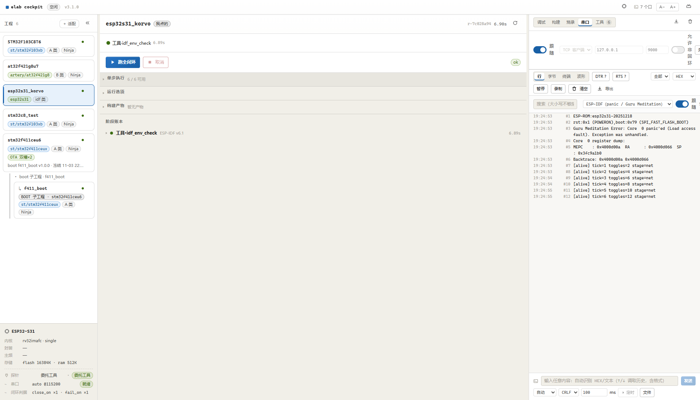

| 连接方式 | 面板字段 | 用途 |
|---|---|---|
| `串口` | 端口 / 波特率 / 线参 | 默认；真实硬件 |
| `TCP 客户端` | 地址 + 端口（默认 `127.0.0.1:9000`） | 连板子的 WiFi/以太网转串口服务、连仿真器 |
| `TCP 服务端` | 绑定地址 + 端口 | 让设备/上位机主动连进来（**一次只服务一个客户端**） |
| `UDP` | 绑定地址 + 端口 | 无连接数据面；无对端时写入返回 0，不假装已发送 |

安全与使用约定：

- **默认只绑回环**：`127.0.0.1` / `localhost` 之外一律拒绝，除非打开 `允许非回环`；
- 第一次打开 `允许非回环` 会弹一次确认（说明会把设备数据面暴露到局域网），确认后记住；
- `连接方式` 与地址/端口是**打开时属性**：监视进行中下拉框置灰，先 `关闭监视` 再改；
- 传输底层与串口同契约（`open/read/write/close` + `TransportLost`），所以
  M2 重连、M6 诊断、M5 帧解码、M7 波形对网络链路**全部照常生效**；
- TCP 对端优雅关闭（收到 EOF）也算掉线，会进 `reconnecting` 自动重试，不会假装还在收。

给我的经验值：想验证「联网 + 断线重连」，最省事的是先用宿主端模拟源
（TCP 监听 9000）打通，再把同样的地址换到板子的网络串口服务上。

#### 5.5.1 真板 WiFi 闭环：ESP32-S31 自己发遥测（实机验证）

上面那张图连的是宿主模拟源。真正要验证「抓包」，得让**板子自己**成为数据源。
`examples/ESP32S31_Korvo` 的固件已经内置：WiFi STA 连上热点后开一个单客户端
TCP 服务，串口打什么，TCP 客户端就收到什么（文本心跳 + 同一份 11B 二进制帧）。

![真板 WiFi：TCP 客户端连 10.115.126.252:9000，收到 [net] ready 与 stage=wifi 心跳](assets/serial-2/m4-wifi-board.png)

操作步骤（凭据只在本地，不入库）：

1. **配 WiFi**：`sdkconfig.defaults` 里 `CONFIG_KORVO_WIFI_SSID/PASSWORD` 默认是空串
   （不配就只在串口跑心跳，不启 WiFi）。本地在 `examples/ESP32S31_Korvo/sdkconfig`
   里填自己的热点（该文件被 `.gitignore` 忽略），或用 `idf.py menuconfig` 改
   `elab-Korvo telemetry` 下的三项（SSID / 密码 / TCP 端口，默认 9000）；
2. **编译烧录**：`elab run -p esp32s31_korvo --steps build`、`--steps flash`（先关监视释放 COM9）；
3. **串口确认联网**：抓到 `[wifi] got ip=10.115.126.252`、`[net] tcp server listening port=9000`
   两行，说明板子拿到 IP 且服务已就绪；
4. **面板连接**：`连接方式` 选 `TCP 客户端`，地址填板子的 IP、端口 `9000`，
   打开 `允许非回环`（首次会弹一次确认），点 `打开监视`；
5. 三种视图随便切：`行` 看文本心跳（`stage=wifi`）、`字节`+`HEX` 看原始帧、
   `波形` + 协议解码器 `profile:korvo_telemetry` 看曲线。

同一个会话切到 `字节` 视图、表示选 `HEX`，二进制帧就是干净的 `AA 55 …`：

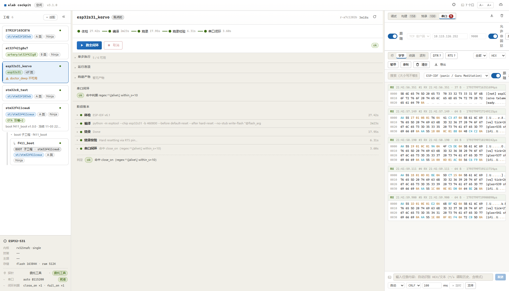

切到 `波形`，解码器选工程里的 `profile:korvo_telemetry`，`status` / `adc0` / `adc1` / `vbat`
按字段画成曲线（`status` 是枚举，只做字段表、不画线）：

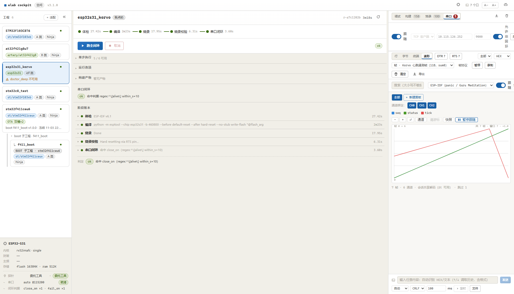

限制（如实说明）：

- 固件是**单客户端**服务，第二个客户端连进来会被排队，先关旧会话再连；
- 没有鉴权、没有加密传输，只用于局域网内闭环验证，别接到不可信网络；
- 板子**断电/重启**这种没有 `FIN`/`RST` 的静默掉线，TCP 客户端不会立刻察觉
  （当前没有空闲超时判定）；重启板子后建议手动 `关闭监视` → `打开监视`。
  对端主动关闭（正常断开）仍会被判成 `TransportLost` 并自动重连。

### 5.6 帧协议增强（P0/P1）：位域 / 变长 / 多 ID / 组帧（2026-11-05 实机）

这一节是本次新增能力的**上机演示**：STM32F103C8T6（COM10 @115200，CMSIS-DAP），
固件每 100ms 依次发三类帧——位域遥测、变长 MAVLink、多 ID 分发。

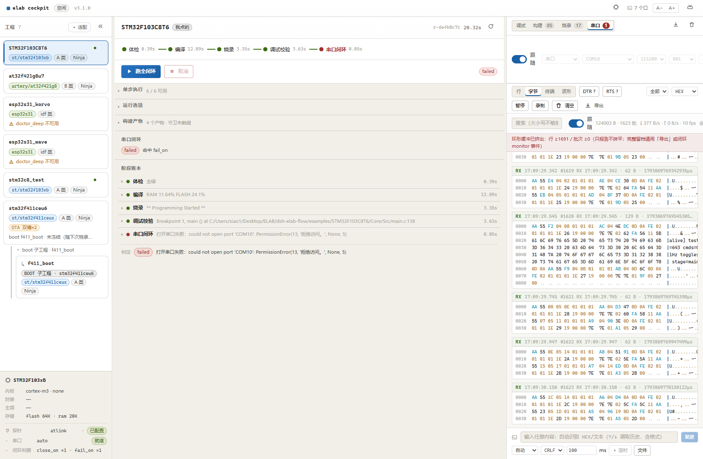

对应的三份 profile 已写在 `projects/STM32F103C8T6.frames.json`：

| profile | 演示能力 | 切帧方式 |
|---|---|---|
| `hw_telemetry` | 位域 + CRC16 + 固定长 | `AA55` 头 + `length:14` + `0D0A` 尾 |
| `hw_mavlink` | 变长（长度字段驱动） | `FE` 头 + `frame.length_field` |
| `hw_multi` | 多 ID（variants） | `7E7E` 头 + `frame.id_field` |

#### 5.6.1 位域：一个字节拆多个标志

位域字段在普通字段上加三个键（默认值可省略）：

```json
{
  "name": "flags",
  "offset": 7,
  "type": "u8",
  "bit_offset": 0,
  "bit_length": 3,
  "bit_order": "lsb0",
  "enum": { "0": "NONE", "1": "READY", "2": "BUSY", "4": "ERR" }
}
```

- `bit_offset`：相对 `offset` 字节的起始位，`0..7`；
- `bit_length`：位宽 `1..32`（有符号位域按最高位做符号扩展）；
- `bit_order`：
  - `lsb0`（默认）：从 `offset` 字节的 **LSB** 起按位流取，跨字节继续；
  - `msb0`：从帧首字节的 **MSB** 起按线性大端位流计数（**不是** DBC Motorola 的锯齿语义）；
- 位域只允许整型；`bit_offset + bit_length` 不能越出 `max_bytes`，否则 profile 校验直接拒绝。

实机 `flags` 只占 bit0..2，同一字节高 5 位可留给别的标志：

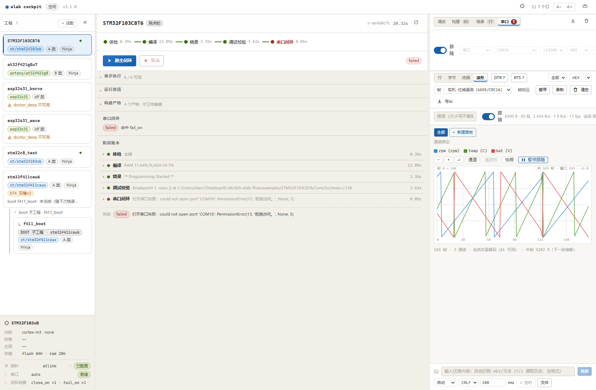

#### 5.6.2 变长：帧内长度字段驱动切帧

有些协议没有固定长度，而是在帧内写「负载字节数」。用 `frame.length_field` 描述：

```json
{
  "frame": {
    "head_hex": "fe",
    "max_bytes": 64,
    "length_field": { "offset": 1, "type": "u8", "mul": 1, "add": 8 }
  }
}
```

- `total = raw * mul + add`，`raw` 按 `offset/type/endian` 从**帧首**（含 head）读取；
- `length` 与 `length_field` **互斥**，只能选一种切帧方式；
- 长度算出来对不上边界（越过 `max_bytes`、负数、尾标记不在位）时，该段进 `skipped` 并重新同步，
  不会把后续帧一起吞掉。

实机 MAVLink 帧的 `raw=2`、`add=8` → 整帧 10 字节；同一个 profile 可以继续吃更长消息：

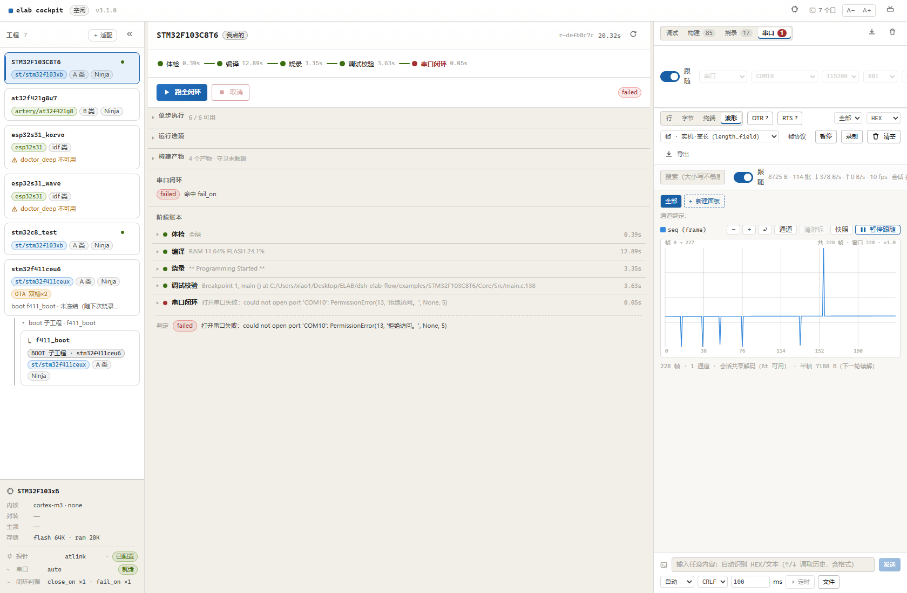

#### 5.6.3 多 ID：一个 profile 按 id 分发字段

固定头 + 消息 id + 不同负载，用 `frame.id_field` + `variants`：

```json
{
  "frame": {
    "head_hex": "7e7e",
    "length": 7,
    "max_bytes": 32,
    "id_field": { "offset": 2, "type": "u8" }
  },
  "variants": [
    { "id": 1, "label": "speed", "fields": [
      { "name": "speed", "offset": 3, "type": "u16", "endian": "le" },
      { "name": "aux",   "offset": 5, "type": "u16", "endian": "le" }
    ]},
    { "id": 2, "label": "env", "fields": [
      { "name": "temp", "offset": 3, "type": "i16", "endian": "le", "scale": 0.01 },
      { "name": "hum",  "offset": 5, "type": "u16", "endian": "le", "scale": 0.01 }
    ]}
  ]
}
```

规则：

- `variants` 必须配合 `id_field`，id 可以是数字或 `"0x03"` 这种字符串，且**唯一**；
- 命中 variant 时只按该 variant 的字段解；未命中且顶层有 `fields` 则按顶层兜底；
  都没有 → `unknown_id += 1`、该帧计入 `skipped`；
- 波形通道按**所有 variant 字段的并集**对齐，缺失值填 `null`；
  所以交替出现的 id1/id2 曲线会出现断点（这是如实表示，不是解码失败）；
- 想看两种 id 各自解出了什么，用抽屉里的**草稿预览**最直观（带 `ID` 列）：

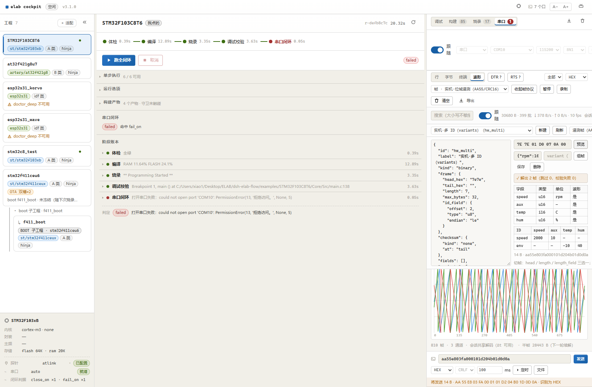

#### 5.6.4 模板库：协议数据随仓库走

`templates/frames/` 内置 4 份只读模板，抽屉头部下拉即可选：

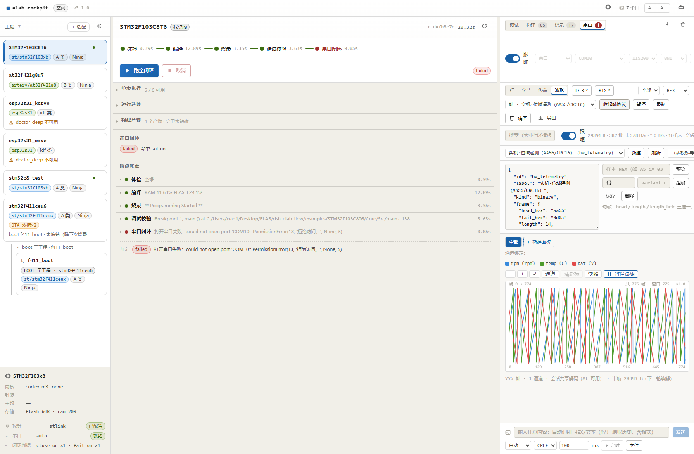

| 模板 id | 内容 |
|---|---|
| `telemetry_u16` | `AA55` 遥测：u16 转速/温度/状态 + 位域 flags + CRC16 |
| `mavlink_v1` | `FE` 头 + 帧内长度字段 + msgid（变长） |
| `modbus_rtu` | Modbus RTU 0x03 / 0x10 两个 variant（多 ID + CRC16） |
| `dlt645_read` | `68` 头 + 6 字节表号 + 控制码 + `16` 尾 + sum8（DL/T 645） |

点 `导入` 会**复制**模板成工程里的新 profile（不覆盖原文件；`rev` 冲突会拒绝）；
模板本身是协议数据，不属于任何芯片包。

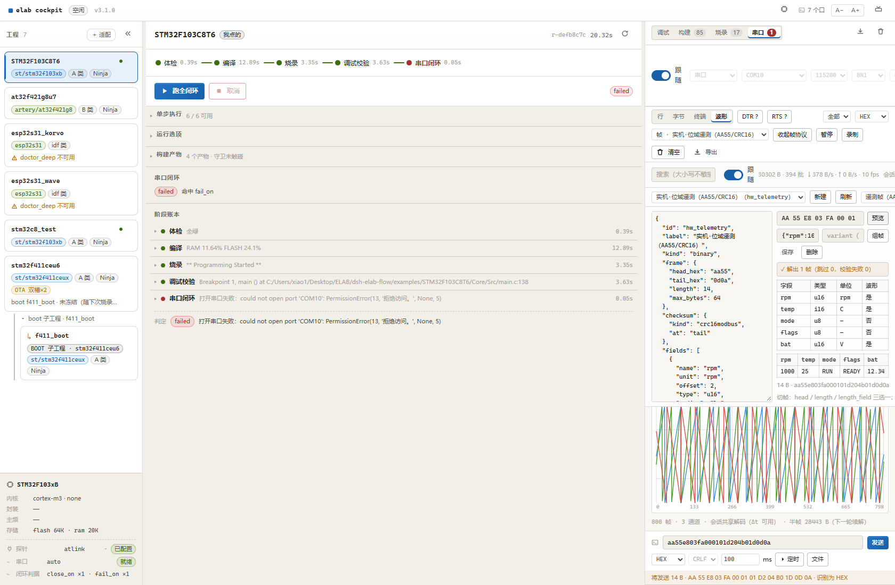

#### 5.6.5 草稿预览：不保存也能试

「预览样本 HEX」现在支持**未保存的草稿**：右侧 JSON 改完直接粘贴真实字节点 `预览`，
内核会先跑 `normalize_profile` 再解码，不会先落盘。

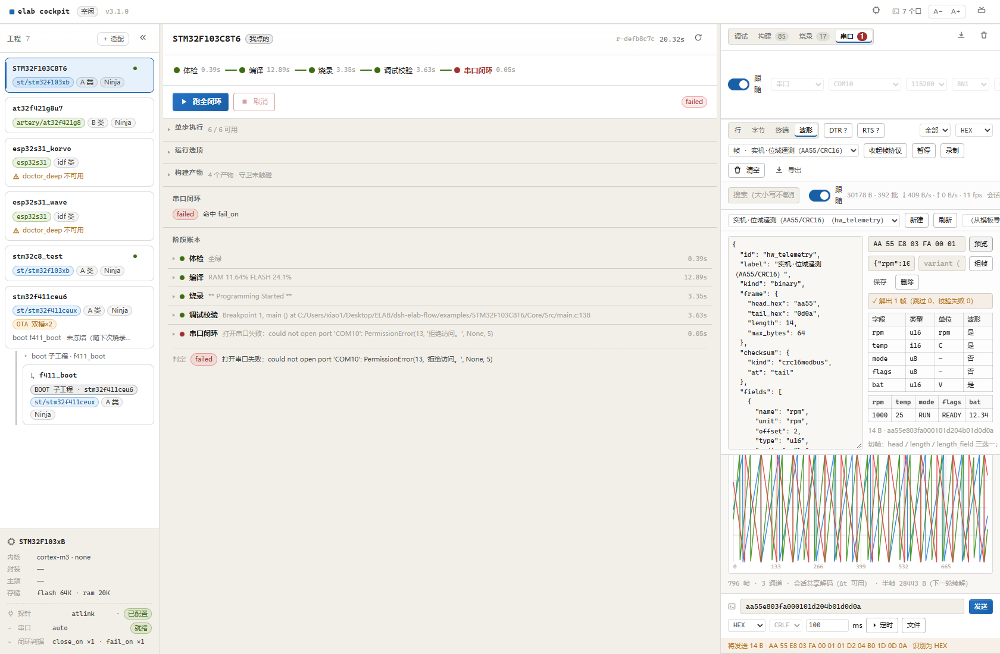

#### 5.6.6 反向组帧（encode）：字段值 → 字节

抽屉底部新增「组帧」行：填字段值 JSON（可选 variant），点 `组帧`：

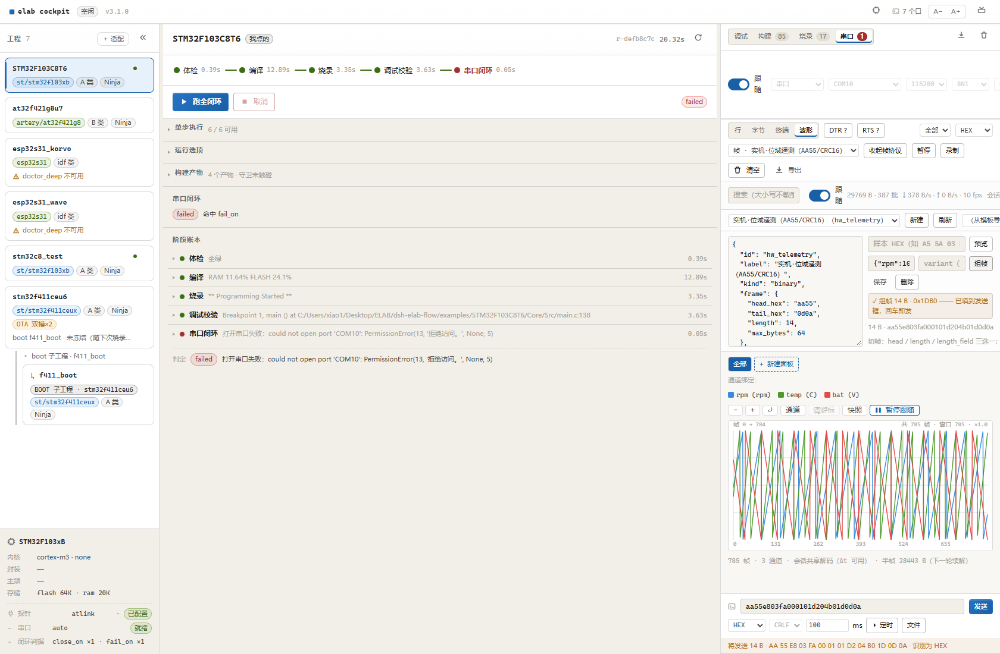

- 枚举可填 label（`"RUN"`）或原始键（`1`）；`scale` / `bias` 按反函数换算回原始整数；
- 固定长度帧校验字段是否越界；变长帧按 `length_field` 反算长度（`k*mul + add`，`raw` 不为负）；
- 自动写 head / tail / `id_field` / `length_field` / checksum（`sum8` / `xor8` / `crc16modbus`）；
- 成功后 HEX 直接填进发送框并把格式切成 `HEX`，点发送即可闭环验证。

例如遥测帧填：

```json
{ "rpm": 1000, "temp": 25.0, "mode": "RUN", "flags": "READY", "bat": 12.34 }
```

组帧结果：`AA 55 E8 03 FA 00 01 01 D2 04 B0 1D 0D 0A`（14B，CRC16 已算好）。

#### 5.6.7 Agent 一等能力：`elab_frame_profile`

插件侧新增 `elab_frame_profile`，Agent **只写声明式 JSON**，不生成可执行解码代码：

| action | 用途 |
|---|---|
| `list` / `get` | 读工程 profile 清单 / 单份 |
| `preview` | 无硬件试解字节；`profile` 可传**未保存草稿**，`hex` / `b64` 二选一 |
| `encode` | 字段值 → 字节；`values` 是 JSON 字符串，多 variant 传 `variant` |
| `templates` | 列只读模板；可带 `template` 取单份 |
| `save` / `delete` / `import` | 改配置；需要 `allowAgentWrite`，且必须带 list 返回的 `rev` |

示例（先预览草稿，再保存）：

```text
elab_frame_profile action=preview project=STM32F103C8T6 \
  profile='{"id":"demo","frame":{"head_hex":"aa55","length":14},"fields":[...]}' \
  hex="AA 55 E8 03 FA 00 01 01 D2 04 B0 1D 0D 0A"

elab_frame_profile action=encode project=STM32F103C8T6 id=hw_telemetry \
  values='{"rpm":1000,"temp":25.0,"mode":"RUN","bat":12.34}'

elab_frame_profile action=save project=STM32F103C8T6 rev=1 profile='{...}'
```

实时解码仍用 `elab_serial_decode`（可传 `profile` 草稿）或 `elab_serial_monitor`
（`decoder=profile:<id>`）；保存 profile 时活动会话会热更新，不用重开。

#### 5.6.8 边界（如实说明）

- **不支持** CAN 原生传输、DBC 文件、节点图、任意脚本解码器——只做「声明式帧协议」；
- 旧 profile（如 `korvo_telemetry`）的字段形状与解码结果保持不变：没启用新特性时，
  输出的 JSON 不会多出 `length_field` / `id_field` / `variants` 键；
- 模板是**协议数据**，放仓库 `templates/frames/`，不写进芯片包（pack）。

### 5.7 帧协议补强 · 帧级观测 · Agent 自学习（2026-11-05 实机）

这一节对应执行计划 `docs/design/执行计划_串口存量优化_帧协议补强与Agent能力.md` 的
P2.2 / P3 / P4 三块。**重点在 5.7.8：给 Agent 一段陌生协议，它自己学出 profile 并正确解码**
—— 这是本节唯一"没有先例"的能力，其余都是为它铺路的底座。

一句话分工：

| 块 | 能力 | 谁受益 |
|---|---|---|
| P2.2 | 校验声明化 / 转义 / 多帧头 / 空闲分包 / 数组·字符串·f16·位标志 / 错误分类 | 手写 profile 的人 |
| P3 | 帧级健康度（fps·间隔·错误占比·每类消息）+ 触发式录制（含预录） | 排查现场的人 |
| P4 | **learn / verify / auto / codegen** | **Agent**（人只需复核） |

#### 5.7.1 校验：一套引擎覆盖 9 个 CRC + 4 个锚点

`checksum` 从"枚举几个算法"改成**参数化**（Rocksoft 模型：width/poly/init/xorout/refin/refout），
`crc8 / crc8_maxim / crc8_j1850 / crc16_ccitt_false / crc16_xmodem / crc16_x25 /
crc16_modbus / crc16_ibm / crc32` 全用同一段代码算，标准检查值 `123456789` 逐个对过。

```jsonc
"checksum": {
  "kind": "crc16",              // 宽度档：sum8/xor8/crc8/crc16/crc32/none
  "preset": "crc16_modbus",     // 或直接写 poly/init/xorout/refin/refout
  "at": "tail",                 // 校验字段在帧尾 / 帧头
  "cover": {"from": "after_head", "to": "before_tail"}   // 覆盖范围锚点
}
```

`cover` 的锚点是 `frame / after_head / before_checksum / before_tail / payload`
（`payload` 用于"校验只算负载，不算协议头"的设备）。老写法 `{"kind":"crc16modbus"}`
**行为与输出一字不变** —— 兼容是硬约束，不是"尽量"。

#### 5.7.2 转义：先切帧，再反转义

```jsonc
"escape": {"escape_byte": "7d", "xor": "20", "targets": ["7d", "7e"],
           "applies": ["payload"]}
```

顺序是**先按帧头/帧尾切帧，再对帧体反转义**（反转义后长度会变，先反转义必然切错帧）；
校验值在**转义之前**计算。`applies` 决定头尾是否也参与转义（多数协议不参与）。
转义与 `frame.length` / `length_field` **互斥**（线上长度 ≠ 解码后长度，混用必然对不上），
保存时直接报错而不是默默算错。

#### 5.7.3 多帧头与空闲分包

- `frame.heads: ["aa55", "a5", "7e"]`：同一路流里多种帧头，**最长匹配优先**；
- `frame.idle_gap_ms: 40`：没有帧头/长度/帧尾的协议（固定频率整包输出）只能靠**时间**定界。
  实时监视按字节到达时间切段，静默超过阈值即判一帧结束；离线预览（一段字节）会当成一帧，
  面板会明确提示这一点。

#### 5.7.4 字段模型：数组 / 字符串 / 半精度 / 位标志 / 重叠

```jsonc
"fields": [
  {"name": "ch",  "offset": 2, "type": "u16", "array": {"count": 4, "stride": 2}},
  {"name": "dev", "offset": 10, "type": "str", "length": 12, "encoding": "gbk"},
  {"name": "t",   "offset": 22, "type": "f16", "unit": "C"},
  {"name": "st",  "offset": 24, "type": "u8", "bits": {"0": "RUN", "1": "ALM", "3": "CAL"}}
]
```

- `array` 展开成 `ch[0]..ch[3]` 四条波形通道；
- `str` 支持 `utf-8 / gbk / ascii / latin-1`（GBK 用 Python 内置 codec，不引第三方库）；
- `f16` 走 IEEE 754 半精度（struct `e`）；
- `bits` 保留原始数值，额外给 `flags: {"st": ["RUN","CAL"]}` 这样的**人话列表**；
- 位域重叠按**位区间**判，`bit_offset 0/3` 同处一字节是合法的（按字节区间会误杀）。

#### 5.7.5 错误分类：跳过多少条不再是黑盒

解码结果多一个 `reasons`：`no_head / bad_length / short / tail_mismatch / checksum /
unknown_id / bad_id / field`，`skipped` 是它们的和。面板把分类翻成人话
（"校验失败 3 · 找不到帧头 12"），Agent 也能直接读 `reasons` 判断"是协议配错了还是设备在抖"。

#### 5.7.6 帧级健康度：`GET /api/serial/monitor/stats?window_s=10`

```json
{"frames": 59, "fps": 5.9,
 "interval_ms": {"mean": 47.9, "p95": 214.4, "max": 218.2, "min": 0.0},
 "variants": {"ENV": 30, "VSYS": 29},
 "reasons": {"no_head": 179}, "checksum_fail": 0, "unknown_id": 0,
 "error_rate": 0.7521, "pending_bytes": 0, "rate_bps": 39.0}
```

面板波形页右下角直接把 `fps / Δ均值·p95 / 错占比 / 几种消息 / 半帧字节` 排成一行，
常态极淡、出错变黄 —— 健康度不该为"一切正常"抢眼。`window_s=0` 的语义是"给我最短窗口"
（下限 1 s），不是"没给"。

#### 5.7.7 触发式录制：等故障发生再录

```text
POST /api/serial/capture
{"action":"start","max_bytes":1000000,"pre_bytes":4096,
 "trigger":{"pattern":"5a a5"}}                      # 原始字节包含
{"trigger":{"field":{"name":"mv","op":"gt","value":3350}}}  # 解码后字段比较
{"trigger":{"frame_index":3}}                        # 第 3 帧
```

- 命中前字节只进**预录环形缓冲**（按字节封顶），命中那一刻连同"命中之前"一起落盘
  —— 只录命中之后，等于把事故现场删掉；
- 命中后**继续录**，直到 `stop` 或到 `max_bytes`（到顶标 `truncated`，绝不截半条 JSON）；
- `pattern` 在**写入同一批**时就能判（`_cap_emit` 之前），`field` / `frame_index` 必须等解码，
  所以后两种**至少保留命中前的一批字节**（否则命中的现场会被自己丢掉）；
- `stop` 返回 `armed / triggered / triggered_by / note`：布防了没命中会明说"文件里可能只有标记"。
- **参数在布防时就校验**（写错别等）：`pattern` 必须是合法 HEX、`op` 只能是
  `eq/ne/gt/ge/lt/le`、`frame_index ≥ 1`；字段名不在当前解码器里不会拦住你，但会在
  `warnings` 里点名（"这条触发不会命中"）—— 静默失效比报错更难查。

#### 5.7.8 ★ Agent 自学习：不认识的格式，抓一段字节就会解

**为什么这件事重要**：真实设备的手册常常缺失、版本对不上、或者干脆是私有协议。
传统的路子是人读手册手写解析；这里的路子是——**Agent 拿一段原始字节，自己把协议推出来**，
写进工程的 `projects/<name>.frames.json`，随后实时解码、波形、健康度全部照常工作。
人只需要复核一份声明式 JSON。

**四个动作（`elab_frame_profile`，HTTP 同 `POST /api/serial/frames/<action>`）**：

| action | 输入 | 产出 | 真机实测（F103 私有协议） |
|---|---|---|---|
| `learn` | `capture=<.work/.cockpit/*.jsonl>` 或 `hex` / `b64` / `frames` | 草稿 profile + 证据链 + 置信度 + 回放结果 | 置信度 **0.99**，回放 **168/168** |
| `verify` | `id` + 同一段字节 | 解 → 逐字段重编 → 与线上字节比对 | **177/177** 全等 |
| `auto` | 一段字节 + 工程已有 profile | 推荐最像的一个（分数 + 差距不足则拒绝） | 4 个 profile 里选中 `f103-private`（0.709） |
| `codegen` | `id`（`write=true` 才落盘） | C 头文件（偏移宏 + 打包结构体 + 读函数） | `generated/f103-private.h`，`-Wall -Werror` 干净编译 |

**learn 是怎么推的**（不是"猜"，每一步都有证据）：

1. **帧头候选**：n-gram 统计 + 间隔一致性；按**长度分组**取候选（见下方"真机教训"）；
2. **逐个切法打分**：每种候选都切一遍，用"能不能解出帧 / 校验能不能过"选，
   **不比长度**——`AA 55 01 0A` 这种"头 + 恒定字段"就是这样被淘汰的；
3. **帧长**：全等 → 定长；不等 → 找长度字段（`total = raw + add`，必须全部成立）；
4. **校验**：在末尾按 10 个预设 × 2 种覆盖范围试算，通过率 ≥ 90% 才采纳；
5. **消息 id**：找"取值很少"的字节/半字，并展开成 `variants`；
6. **字段**：按剩余空间切 u16/u8，语义推不出来就**诚实命名** `b3 / b5`；
7. **回放自检**：拿草稿把样本重解一遍，`decode_rate` 与失败帧一起报出来。

**真机实操（2026-11-05，STM32F103C8T6 / COM10 @115200）**：

```text
① 让设备发一段"没人认识"的协议（固件 `LEARN` 命令：5A A5 + id + 4B + CRC8 ×200 帧）
   POST /api/serial {"data":"LEARN","format":"ascii"}      → 写 7 B

② 布防抓包（命中前一并留证）
   POST /api/serial/capture {"action":"start","trigger":{"pattern":"5a a5"},"pre_bytes":4096}
   → 45 批次 / 6.5 KB，triggered_by=pattern

③ 自学（只给录制文件，不给任何提示）
   POST /api/serial/frames/learn {"capture":"...jsonl","name":"f103-private"}
   → 帧头 0x5AA5，定长 10，crc8_maxim（通过率 100%），id@2 两种取值
   → 置信度 0.99，证据 7 条，回放 168/168，另 9 个"长度不符"片段被排除

④ 落盘（rev 乐观锁）+ 换解码器
   POST /api/serial/frames   {"rev":1,"profile":{...改好字段名...}}   → rev 2
   POST /api/serial/monitor  {"action":"decoder","decoder":"profile:f103-private"}

⑤ 直播解码（同一个口，不重开）
   → 59 帧 / 6 通道；ENV: temp 20.0℃ hum 45.0%
     VSYS: mv 3301 mV ma 125 mA；flags 解出 DATA / VSYS
```

第 ④ 步的字段名是**人/Agent 读过固件源码之后**改的（`b3 → temp`、`b5 → hum`）：
learn 只从字节里看结构，不看语义 —— "offset 3 是温度"这件事必须有第二个信息源。

**真机教训（两条，都写进回归测试了）**：

- **帧头不能全局按长度取前 N**：抓包里混着设备自己打的 ASCII 日志（` tick=` 这种 4 字节
  片段间隔还出奇地稳），全局排序把 8 个候选位全给了它们，2 字节真帧头 `5A A5` 连候选都进不去，
  learn 学出了 `0A5AA501` 这种鬼东西。现在按长度分组各取前 4，且 1 字节帧头排末尾
  （`5A` 命中 179 次 > `5A A5` 的 177 次，但它把帧头吞掉一字节，消息 id 偏移跟着错）。
- **"长度全等才算定长"太脆**：心跳日志每 20 帧插一行，一堆帧变成 76 字节，被判成"变长帧"，
  字段整体错位。现在允许**多数派等长**（≥80% 同长即定长），并把"168/177 等长，
  另 9 个长度不符（日志行/粘包）已排除"如实写进证据 —— 悄悄修样本等于让学习不可证伪。

**边界（如实说明）**：

- `learn` **只产草稿、不写任何文件**：保存必须走 `save` 的 `rev` 乐观锁，学习不会偷偷改配置；
- **大样本会自动截断**：只分析前 128 KB（配置常量 `MAX_ANALYZE_BYTES`），并在 `warnings`
  里写明。不是省事，是因为帧头/校验/字段的统计几千帧就饱和，再往上只费时间 ——
  实测 58 KB 要 30 s，加闸后 1 s 内出结果，结论一模一样（真机抓包回放 169/169 不变）；
- **保存同名 profile 会覆盖**：`learn` 默认 id 是 `learned`，连学两次再保存会冲掉前一个。
  内核响应里 `overwritten=true`，面板保存前会弹确认 —— 想都留着就先改 JSON 里的 `id`；
- 字段**语义**（单位、缩放、位含义）推不出来，只能给结构；名字要么是 `b<offset>`，要么人来改；
- 强加密/压缩的负载、按内容长度变化的 header、多路复用（同一帧里嵌两套协议）不在能力范围；
- `capture` 参数接受 JSONL **文本**或**录制文件路径**，路径限本工程 `.work/.cockpit/*.jsonl`
  —— 这是个"读文件"的入口，不能让 Agent 拿它去读源码/密钥；单文件上限 16 MB；
- `codegen` 产物默认只返回文本，落盘要显式 `write=true`（已存在再覆盖要 `overwrite=true`）；
  `guard` 必须是合法 C 标识符（否则退回默认名并告警），字段名会被净化为 C 标识符。

#### 5.7.9 ★ 按钮实操：不写一行命令，从陌生字节到直播解码（2026-11-05 实机）

5.7.8 讲的是 API/Agent 视角；这一节全部用**面板按钮**走完同样的闭环。
硬件与协议同 5.7.8：STM32F103C8T6（COM10 @115200），固件 `LEARN` 命令打一段
"没人认识"的私有帧（`5A A5 | id | v1 | v2 | seq | flags | crc8`）。

> 按钮位置有个小前提：「学习」在**波形视图 → 帧协议抽屉**里
> （先点视图行的「波形」，再点工具栏「帧协议」展开抽屉）。

**第 1 步 · 让设备说"外语"**：终端视图，发送框输入 `LEARN`，行结束符选 `CRLF`
（固件按行取命令，**不带换行它不认**），点「发送」。监视区立刻出现一段乱码字节流
（私有帧混着设备自己的 ASCII 日志）——这就是我们要喂给 Agent 的"未知协议"：

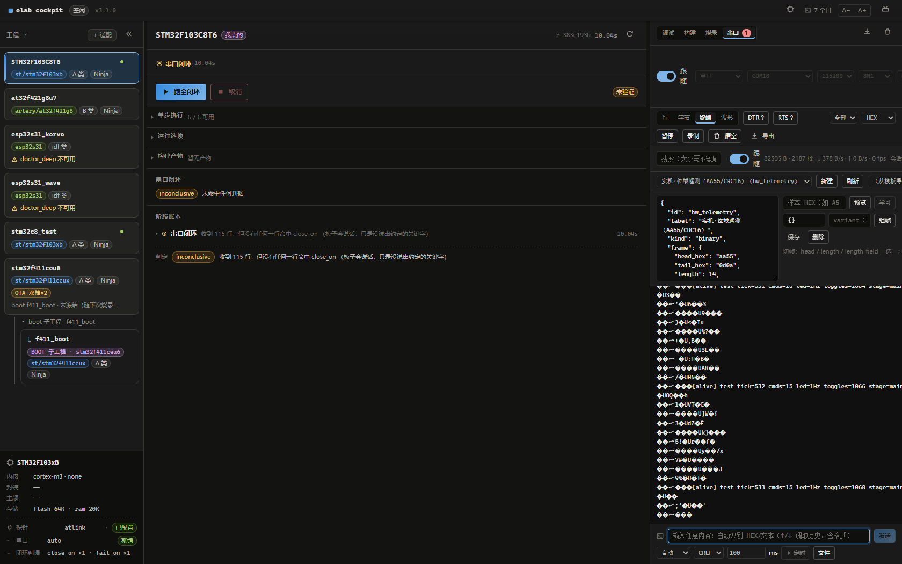

**第 2 步 · 粘样本**：把这段字节复制成 HEX 文本（`5AA5 81CB 0BB8 …`，几十到几百
字节都行，**最好包含多帧**），切到波形视图 → 点「帧协议」展开抽屉，粘进右上角
「样本 HEX」输入框：

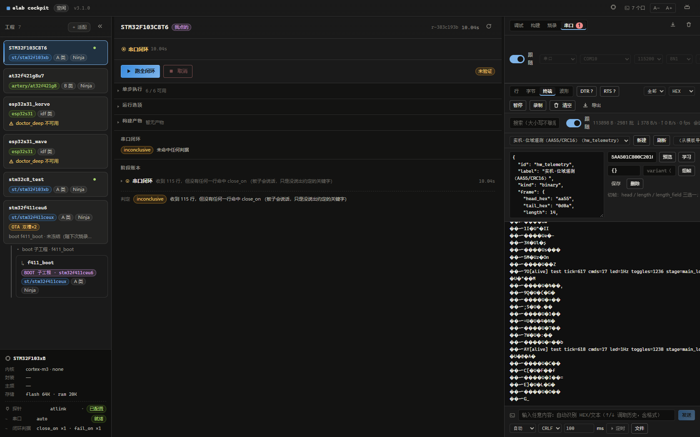

**第 3 步 · 点「学习」**：按钮进入「分析中 Ns」走秒状态（大样本几秒，期间按钮锁定
防连点）。完成后草稿直接填进左侧 JSON 编辑器，绿色提示条给出**证据链**：

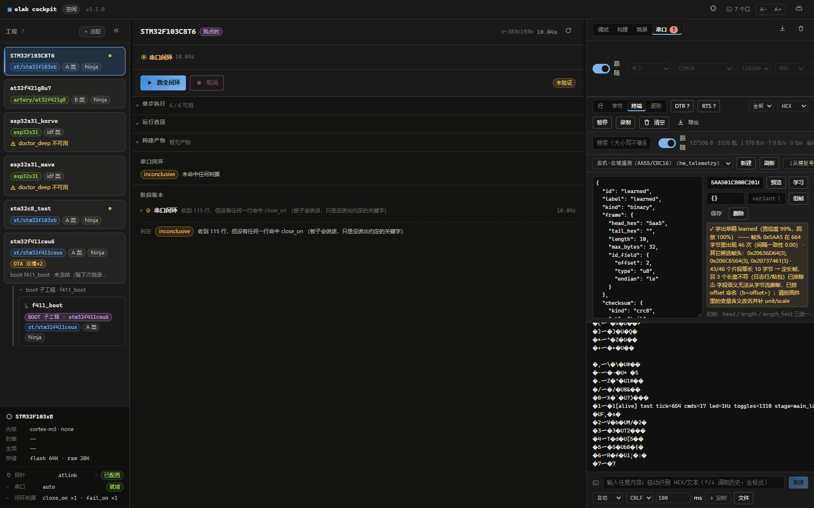

本次实机提示条原文（与 5.7.8 的 API 结果一致）：

```text
✓ 学出草稿 learned（置信度 99%，回放 100%）
  —— 帧头 0x5AA5 在 664 字节里出现 46 次（间隔一致性 0.00）
  · 其它候选帧头：0x20636D64(3), 0x206C6564(3), 0x20737461(3)
  · 43/46 个片段等长 10 字节 → 定长帧，另 3 个长度不符（日志行/粘包）已排除
  ⚠ 字段语义无法从字节流推断，已按 offset 命名（b<offset>）；请按固件里的变量名复核
```

**第 4 步 · 人复核（唯一需要动脑的一步）**：learn 只懂结构不懂语义——
`b3 → temp`、`b5 → hum` 这种事必须由人（或读过固件源码的 Agent）改：把 JSON 里的
`id` 改成有意义的名字、把字段名按固件变量名改掉、配好单位/缩放/位含义，然后点
「保存」。若工程里已有同名 profile，会弹**覆盖确认**（"保存会覆盖它，想保留原来的
先把 JSON 里的 id 改掉"）——确认后提示 `✓ 已保存 f103-private（rev 3）`，
profile 已写进工程的 `projects/<name>.frames.json`。

**第 5 步 · 换解码器，看它活过来**：工具栏解码器下拉里会出现刚保存的
「帧 · F103 私有协议（learn）」，选中它，再发一次 `LEARN`——波形区立刻多出
9 条通道，通道名就是第 4 步改的 `temp (C) / hum (%) / mv (mV) / ma (mA) / flags`，
状态行报 `396 帧 · 9 通道 · 会话共享解码 · 2 种消息`（ENV / VSYS 两种消息 id
各解出 23 帧，日志行按 `no_head` 如实排除）：

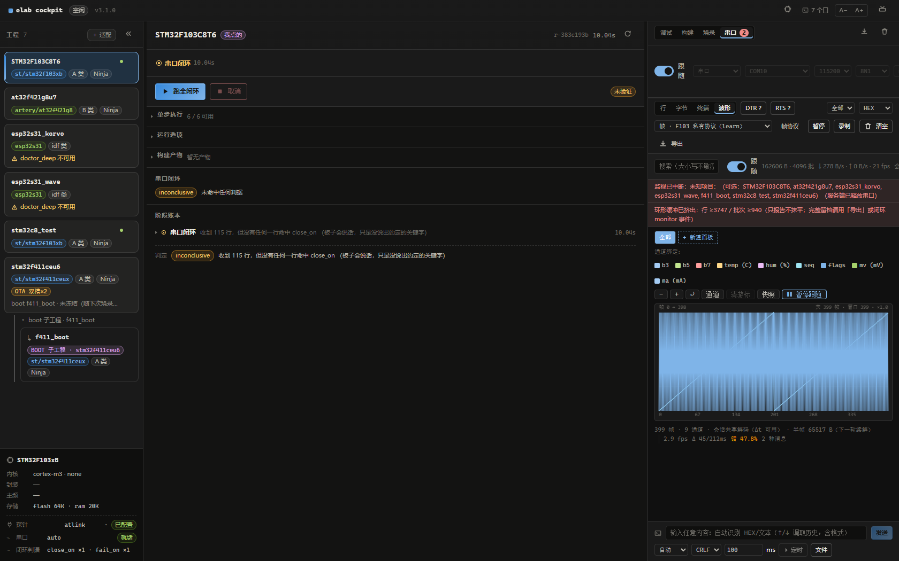

**按钮 ↔ API 对照**（同一套能力，两个入口）：

| 面板按钮 | 等价调用 | 备注 |
|---|---|---|
| 「学习」 | `POST /api/serial/frames/learn`（hex） | 只产草稿不落盘；按钮带秒表 + 防连点 |
| 「预览」 | `POST /api/serial/frames/preview` | 草稿未保存也能试解码 |
| 「保存」 | `POST /api/serial/frames`（rev 乐观锁） | 同名覆盖会弹确认 |
| 解码器下拉 | `POST /api/serial/monitor {action:"decoder"}` | 会话共享，Agent 同图 |

**实机提示**：

- 发命令别忘了行结束符（`CRLF`）——本节截图时第一条 `LEARN` 就是因为裸发没换行，
  固件 `strcmp` 永远等不到行尾，设备毫无反应；
- 样本里混着 ASCII 日志**不影响**学习（5.7.8 的"真机教训"就是为它修的），
  但样本要有多帧（≥10 帧）才能让帧头/校验统计立得住；
- 「学习」样本框是手动粘贴入口；Agent 走 `capture=<录制文件>` 不占这个框（5.7.8）。

---

## 6. 常见问题

### Q: 串口一直没数据 / 打开监视失败
1. 顶部是否显示 `关闭监视`（会话在跑）？
2. 端口选 `auto` 时是否解析到 USB 串口（本文 `COM10`），而不是蓝牙 COM 口？
3. 波特率是否与固件一致（本文 `115200`）？
4. 是否刚烧录完但 MCU 停在 halt 态？重跑一次 `elab flash`（自带 Resetting Target）。
5. 闭环 run 正在跑时串口被独占（约束 N5），等它结束再开监视。

### Q: 工程卡片显示「monitor 不可用」
工程 YAML 缺判据。至少要有：

```yaml
serial:
  port: auto
monitor:
  close_on:
    - { kind: regex, pattern: "^\\[(log|alive|cmd)\\]", within_s: 10 }
```

改完重启内核（`python -m cockpit.server --port 8333`）再看工程卡片。

### Q: 输入 `1234` 为什么按文本发，不是 HEX？
自动识别故意保守：只有 `0x` / `\x` 前缀，或「分隔符 + 全十六进制 + 偶数字节」
才判 HEX。裸 `1234` 按文本发，避免把普通数字误拆成 `0x12 0x34`。
要发二进制就写 `12 34` 或 `0x12 0x34`，或把格式改成 `HEX`。

### Q: 预览字节和实际发送不一致？
不会。预览与发送共用内核 `serialterm.resolve_payload`；如果你改了格式/行尾，
等预览行刷新（约 300ms 防抖）后再点发送。

### Q: 点 `⏵ 定时` 没反应 / 按钮还是定时
按顺序检查：
1. 输入框是否为空（空内容不允许定时）；
2. 间隔是否 ≥ 20ms、≤ 600s；
3. 是否已有 run 占用串口（返回 `409`）；
4. 是否已经有另一个发送任务在跑（先停止）。

### Q: 发送历史丢了
历史存 `localStorage`；隐私模式、清缓存、换浏览器都会丢。重新发一次即可重新记录。

### Q: 波形 tab 一直 `等待帧`
1. 监视是否在跑；
2. 解码器是否选对（FireWater ↔ JustFloat）；
3. 切「行」视图确认设备是否真的在输出波形文本；
4. 当前烧的是日志工程（`stm32_test`）还是波形工程（`f411`）——日志工程没有曲线。

### Q: 帧协议预览「跳过 N 段 / 校验失败」，波形一条线都没有？
先看预览样本：如果**边界找得到但校验全错**，多半是二进制经过了文本换行转换。
ESP-IDF 默认 `CONFIG_LIBC_STDOUT_LINE_ENDING_CRLF=y`，`\n`(0x0A) 会被扩成 `0D 0A`，
帧内任何 0x0A 字节都会把长度和校验打乱——波形自然解不出来。
在工程 `sdkconfig.defaults` 加：

```
CONFIG_LIBC_STDOUT_LINE_ENDING_LF=y
```

重新 `build` + `flash` 即可（`examples/ESP32S31_Korvo` 已内置该配置）。

### Q: 多 ID（variants）的波形为什么一条连续线都没有？
`variants` 按帧内 `id_field` 分发，波形通道取**所有 variant 字段的并集**，当前帧没有的字段填 `null`。
如果设备交替发 id1 / id2，同一通道必然隔帧才有值，折线按 `null` 断开——这是如实表示，不是解码失败。
要看每个 id 解出了什么，用 `帧协议` 抽屉的**草稿预览**（记录表有 `ID` 列）；
想要连续曲线，就让设备在同一 id 下连续发该字段，或给该 variant 单独建一份 profile。

### Q: 变长帧（length_field）长度算错会怎样？
内核按 `total = raw * mul + add` 校验边界：越过 `max_bytes`、负数、尾标记不在位都进 `skipped`
并从下一个候选头重新同步，不会吞掉后续帧。先在预览里看「解出 N 帧 / 跳过 M 段」，
确认切帧对了再上设备。

### Q: 行视图里 `[alive]` 之间夹着一堆乱码，是串口坏了吗？
**正常现象，不是故障。** 固件每 500ms 往 stdout 写一帧 **11 字节二进制遥测帧**
（`AA 55 …`），同时每 1s 写一行文本心跳。`行` 视图按「一行一段文本」渲染，
二进制帧会被当 UTF-8 解码：`AA 55` 这类非打印字节就变成 `◆U…` 之类的替换字符，
而帧里的 `0x0A` 又会被当成换行，把一帧拆成两三行——所以你看到的是
「文本心跳 + 二进制帧乱码」交替，正是转发链路正常工作的证据。

正确的查看方式（任选其一）：

| 想看什么 | 视图 / 设置 |
|---|---|
| 原始字节、帧边界 | `字节` + 表示 `HEX`（干净的 `AA 55 …`） |
| 按字段画曲线 | `波形` + `协议解码器` 选 `profile:korvo_telemetry` |
| 只看文本日志 | `行` + 搜索框过滤（如 `stage=`），或把固件里的二进制帧先关掉 |

如果**只有纯文本工程**（如 `stm32_test`）也出现乱码，那才要查波特率、线序或
`CONFIG_LIBC_STDOUT_LINE_ENDING_CRLF`（见上一问）。

### Q: 选了非回环地址（0.0.0.0 / 192.168.x.x）打不开？
默认只允许 `127.0.0.1` / `localhost`。要在局域网里暴露数据面，
必须打开 `允许非回环`（首次会弹一次确认），否则内核直接拒绝。

### Q: 监视进行中改「连接方式」没反应？
连接方式、地址、端口、波特率、线参都是**打开时属性**。监视中下拉框置灰是故意的：
先 `关闭监视` → 改参数 → 再 `打开监视`。改完重开不会丢历史（历史是本地的）。

### Q: 点「符号化」报「ELF 中没有该地址的调试信息」？
1. 工程是否配了 `artifacts.elf`（`examples/.../build/*.elf` 存在）；
2. `elab.host.yaml` 的 `symbolize`/`addr2line` 工具路径是否正确（ESP32 用
   `riscv32-esp-elf-addr2line`）；
3. 地址是不是 ROM 里的（ROM 无调试信息，提示是**如实**的，不是 bug）；
4. 工程 YAML 的 `rom_prefixes` 不要照抄别家芯片。

### Q: 底部的「组件」行去哪了？
组件 UI 已下线。参数化发送仍保留给 agent：`elab_serial_widget`
（list / preview / run / status / cancel / pause / resume / save / delete），
定义在 `projects/<工程名>.widgets.json`，面板只做通用发送。

---

## 7. 代码位置

| 内容 | 独立 WebUI | DSH 插件 |
|---|---|---|
| 串口面板（四视图 / 发送 / 历史 / 定时） | `cockpit/web/src/serial/SerialWorkspace.tsx` | `packages/dsh-elab-cockpit/src/adapters/dsh-web/SerialPane.tsx` |
| 发送历史纯函数（50 条、去重移尾、旧数据迁移） | `packages/cockpit-ui-core/src/send-history.ts` | 同一份包 |
| 编码 / 自动识别 / 行尾 | 内核 `services/elab/serialterm.py`（`resolve_payload`） | 同一个内核（不重写） |
| 定时发送任务 | 内核 `services/elab/serialwidgets.py`（`run_raw`） | 同一个内核 |
| 发送 / 预览 / 定时端点 | `cockpit/server.py`：`POST /api/serial`（`dry_run=true` 预览）、`POST /api/serial/loop` | 走同一套 loopback ICD |
| 监视配置 / 闭环判据 | `projects/<工程名>.yaml` 的 `serial` + `monitor` | 内核读取，插件只渲染 |
| **断线自动重连（M2）** | `services/elab/serialmon.py`（backoff / `conn` / `state`） | 同一内核 |
| **结构化日志诊断（M6）** | `services/elab/logdecode.py`（规则解释器 + issue 环 + addr2line 缓存） | 同一内核 |
| **帧协议（M5）** | `services/elab/serialframes.py`、`projects/<工程名>.frames.json` | 插件只读/可选 |
| **帧协议增强 P0/P1** | `serialframes.py`（位域/变长/variants/模板规整）、`serialcodec.py`（解码 + `encode`） | `elab_frame_profile`（同一 ICD） |
| **帧协议模板库** | `templates/frames/*.json`（只读）、`POST /api/serial/frames/templates/import` | 同一份清单 |
| **反向组帧** | `serialcodec.encode` → `POST /api/serial/frames/encode` | 同一个内核 |
| **波形纯数学（M7）** | `packages/cockpit-ui-core/src/wave.ts` | 同一份包 |
| **网络传输（M4）** | `services/elab/netio.py` + `services/elab/serialtransport.py` | 同一内核 |
| 固件日志与命令回显 | `examples/STM32F103C8T6/Core/Src/main.c` | — |
| ESP32 心跳 + 遥测帧固件 | `examples/ESP32S31_Korvo/main/heartbeat_main.c` | — |
| ESP32 WiFi / TCP 遥测服务 | 同文件 `tcp_server_task` / `wifi_start_sta`；凭据项在 `main/Kconfig.projbuild` | — |
| Agent 组件工具 | — | `elab_serial_widget`（`src/adapters/dsh-tools/tools.ts`） |
| Agent 帧协议工具 | — | `elab_frame_profile`、`elab_serial_decode`（同一文件） |

**纪律**：

1. 编码只在 `serialterm.resolve_payload` 做，前端不重复实现；
2. 预览必须走 `dry_run`（在 `_serial_blocker` 之前返回），否则与真发字节会分叉；
3. 定时发送复用内核任务引擎（`run_raw`），不要在前端起 `setInterval` 直接写串口；
4. 串口写通道与闭环 run 的独占统一由 `_serial_blocker` 拦截，两侧都不单独加判断；
5. 业务语义只在 `cockpit/server.py` 的 `SERIAL_META` / `STEP_META`，插件不写死。

---

## 附录：真机验收记录（2026-11-03 · STM32F103C8T6 / COM10 @115200）

| 场景 | 结果 |
|---|---|
| `elab doctor -p stm32_test` | ✅ 通过（根目录修正为 `examples/STM32F103C8T6`） |
| `elab build -p stm32_test --clean` | ✅ 通过，产物 `.work/stm32_test/TEST.{elf,hex,bin,map}` |
| `elab flash -p stm32_test` | ✅ `Verified OK` + `Resetting Target`（64 KiB flash） |
| `elab monitor -p stm32_test` | ✅ 命中 `^\[(log|alive|cmd)\]`，判 **ok** |
| 复位瞬间 init 日志 | ✅ 抓到 `HAL init / clock / GPIO / DMA / UART1 / main loop` 全链路 |
| `PING` → `PONG` | ✅ `[cmd] PING -> PONG`，TX/RX 双向正常 |
| `STAT` | ✅ 返回 `stage=main_loop`、tick、cmds、rx 字节数、uptime |
| `ECHO hello-elab` | ✅ 原样回显 |
| 自动识别 `0x0A 0xFF` | ✅ 预览 `2 B · 0A FF · 识别为 HEX` |
| 定时 `STAT` / 200ms | ✅ `■ 停止定时` 运行态，连续回显；停止后 1s 内退出 |
| 发送历史 `↑` | ✅ 恢复 `STAT`（含格式与行尾） |

### 版本变化

| 维度 | V3 | 当前（V4） |
|---|---|---|
| 面板发送 | 组件 chips + 参数 + 序列 / 周期 | **通用发送框**：自动格式 / 历史 / 定时 / 文件 |
| 组件 UI | 宽栏 + DSH 窄栏都展示 | **下线**，只保留 agent 工具 `elab_serial_widget` |
| 字节预览 | 组件参数预览 | 手写内容也预览（`POST /api/serial` + `dry_run`） |
| 定时发送 | 组件 `repeat` | 输入框 `⏵ 定时`（内核 `run_raw`，不落盘） |
| 历史 | 无 | `{文本, 格式, 行尾}` × 50，↑/↓ 调取 |
| 工程 | f411 波形工程 | `stm32_test`（F103C8T6）独立工程，初始化日志 + 命令回显 |

---

## 附录 B：真机验收记录（2026-11-04 · ESP32-S31-Korvo / COM9 @115200）

| 场景 | 结果 |
|---|---|
| 心跳 bring-up（第一关） | ✅ `[alive] tick` 递增、`toggles` 每次 +2（1Hz 文本） |
| 遥测帧（固件） | ✅ 500ms 一帧 `AA 55 …` 11B，sum8 含帧头；`sdkconfig` 需 LF 行尾 |
| **M2 断线重连** | ✅ 杀 TCP 对端 → `reconnecting`（`down_s=6.3`）；重启 → `conn #2`、`reconnects=1`，日志续上 |
| **M4 TCP 客户端** | ✅ `tcp://127.0.0.1:9000` 连模拟源，panic/心跳照常解析；EOF 也判定为掉线 |
| **M4 真板 WiFi** | ✅ ESP32-S31 STA 连 `Power` → 串口 `got ip=10.115.126.252`、`tcp server listening port=9000`；面板 `TCP 客户端` + `允许非回环` 收到 `[net] ready` 与 `stage=wifi` 心跳 |
| **M4 真板 HEX / 波形** | ✅ `字节`+`HEX` 看到 `AA 55` 帧；`波形` 选 `profile:korvo_telemetry` 画出 status/adc0/adc1/vbat |
| **M5 帧协议** | ✅ `korvo_telemetry` 解出 seq/status(enum)/tick/adc0/adc1/vbat(×0.02)；预览「解出 1 帧」 |
| **M6 复位判据** | ✅ DTR/RTS 复位序列 → `ESP-ROM:esp32s31-20251218`、`rst:0x1 (POWERON),boot:0x79` |
| **M6 符号化** | ✅ `0x4000d00a → heartbeat_tick (heartbeat_main.c:…)`（TCP 模拟 panic） |
| **M7 A/B 游标** | ✅ 点击 / Shift+点击 → `Δ帧=432`、`Δt=11.953s`、ΔY 非零 |
| **M7 通道坐标 / 快照** | ✅ 每通道 gain/offset、`清游标`、`快照`（复制 JSON） |
| 内核门禁 | ✅ `tests/`（serialmon / serialterm / serialtransport / netio / logdecode / serialframes / reconnect）全绿 |
| 面板门禁 | ✅ cockpit `npm run build`；插件 `npm test` / `tsc --noEmit` / `npm run build` |

---

## 附录 C：真机验收记录（2026-11-05 · STM32F103C8T6 / COM10 @115200）

固件 `examples/STM32F103C8T6` 每 100ms 发一组三帧（位域遥测 / 变长 MAVLink / 多 ID），
LED 与心跳仍是 1Hz 第一关判据。

| 场景 | 结果 |
|---|---|
| `elab build -p STM32F103C8T6 --no-guard` | ✅ FLASH 16700 B / 25.48% |
| `elab flash -p STM32F103C8T6` | ✅ `Verified OK`（device id 0x20036410，64 KiB） |
| 心跳 / LED 第一关 | ✅ 串口判据：`[alive] tick` 递增、`toggles` 每次 +2；LED 1Hz 待用户肉眼确认 |
| **P0 位域** | ✅ `profile:hw_telemetry` 实时解出 rpm/temp/mode/flags(bit0..2)/bat；CRC16 通过 |
| **P0 变长** | ✅ `profile:hw_mavlink` 按 `length_field` 切 10B 帧；`seq` 单通道进波形 |
| **P0 多 ID** | ✅ `profile:hw_multi` 按 id 分发 speed/aux 与 temp/hum；`unknown_id=0` |
| **P1 模板库** | ✅ 4 份模板通过校验；`templates` 端点返回 telemetry_u16 / mavlink_v1 / modbus_rtu / dlt645_read |
| **P1 草稿预览** | ✅ 未保存 profile + 两帧 HEX → 「解出 2 帧、跳过 0」，记录表按 id 分列 |
| **P1 反向组帧** | ✅ `{rpm:1000,temp:25.0,mode:"RUN",flags:"READY",bat:12.34}` → `AA55 E803 FA00 0101 D204 B01D 0D0A` |
| **Agent 工具** | ✅ `elab_frame_profile` list/preview/encode 走同一 loopback ICD |
| 混合帧流说明 | 三个 profile 共用同一串口，各自会把另外两类帧计入 `skipped`（这是正常边界，不是错误） |


## 附录 D：真机验收记录（2026-11-05 · P2.2 / P3 / P4 · STM32F103C8T6 / COM10 @115200）

固件在原有三帧演示之外新增 `LEARN` 命令：收到后发 **200 帧 / 20 Hz** 的私有协议
（`5A A5 | id | v1 | v2 | seq | flags | crc8_maxim`，10 字节，无帧尾），
期间三帧演示暂停 —— 目的是造一段"Agent 从没见过、且只有一种协议"的样本。

| 场景 | 命令 / 端点 | 结果 |
|---|---|---|
| 编译 | `elab build -p STM32F103C8T6` | ✅ FLASH 17520 B / 26.73%，RAM 2400 B / 11.72%，零改动保证通过 |
| 烧录 | `elab flash -p STM32F103C8T6` | ✅ `Verified OK`（device id 0x20036410，64 KiB） |
| 私有协议突发 | `POST /api/serial {"data":"LEARN","format":"ascii"}` | ✅ 写 7 B；设备回 `[cmd] LEARN -> 200 frames ...`；串口侧收到预测字节 `5A A5 01 C8 00 C2 01 00 01 C8`（与内核 CRC8 预演逐字节一致） |
| **P3.2 pattern 布防** | `capture start trigger={"pattern":"5a a5"} pre_bytes=4096` | ✅ 45 批次 / 6.5 KB，`triggered_by=pattern`，命中前的三帧演示与日志一并留证 |
| **P4.1 learn** | `POST /api/serial/frames/learn {"capture":"…jsonl"}` | ✅ 帧头 `0x5AA5`、定长 10、`crc8_maxim`（100%）、id@2 两种取值；置信度 **0.99**，回放 **168/168**，另 9 个长度不符片段如实排除 |
| **P4.2 verify** | `POST /api/serial/frames/verify {"id":"f103-private","capture":…}` | ✅ **177/177**（pass_rate 1.0），逐字节还原 |
| **P4.3 auto** | `POST /api/serial/frames/auto {"project":…,"capture":…}` | ✅ 4 个 profile 中选中 `profile:f103-private`（score 0.709），无并列 |
| **P4.4 codegen** | `POST /api/serial/frames/codegen {"id":…,"write":true}` | ✅ `generated/f103-private.h`；`gcc -std=c99 -Wall -Werror` 编译通过 |
| **P3.5 + 直播解码** | `monitor action=decoder decoder=profile:f103-private` | ✅ 59 帧 / 6 通道；`ENV`: temp 20.0 ℃ / hum 45.0%；`VSYS`: mv 3301 mV / ma 125 mA；`flags` 解出 `DATA` / `VSYS` |
| **P3.1 帧级健康度** | `GET /api/serial/monitor/stats?window_s=10` | ✅ `frames 59 / fps 5.9 / Δmean 47.9 ms / p95 214.4 ms / variants ENV 30·VSYS 29 / checksum_fail 0` |
| **P3.2 field 布防** | `capture start trigger={"field":{"name":"mv","op":"gt","value":3350}}` | ✅ `triggered_by="field mv>3350"`，45 批次；首次用 `gt 3450` 未命中（该窗口 mv 最大值 3420）—— 条件与样本必须自洽 |
| **P2.2 兼容性** | 旧 profile `hw_telemetry` / `hw_mavlink` / `hw_multi` | ✅ 形状与解码结果不变（`tests/test_serialframes.py::Compat` 逐字比对） |

单测门禁：`tests.test_serialframes` 61 · `tests.test_framelearn` 22 · `tests.test_serialmon` 60 ·
`tests.test_serialcodec` + `tests.test_serialreconnect` 通过；插件 `npm test` 135/135，
WebUI `tsc --noEmit` 无错。

> 本次实机还纠出两个 learn 的真实缺陷（1 字节帧头抢跑、日志行打断定长判定），
> 两条都补成了回归用例 —— 见 5.7.8「真机教训」。
