# 串口面板使用教程（通用发送 · 真机实操）

> 本文界面与截图来自 **2026-11-03 真机**：STM32F103C8T6（`stm32_test` 工程）+ CMSIS-DAP，
> 串口 `COM10 @ 115200`。固件在初始化时逐条打印外设结果，主循环每秒打心跳，
> 并响应 `PING` / `STAT` / `ECHO` 串口命令。
>
> 当前串口面板是**通用发送框架**：自动格式识别、服务端字节预览、发送历史、定时发送、
> 文件按行发送，跨工程可用。参数化发送组件已从面板 UI 下线，只保留给 agent
> （`elab_serial_widget`，按固定格式发送）。
>
> 说明：第 4 章的波形截图仍来自 **f411 波形固件**（`01`–`06`），仅用于演示波形 UI；
> 当前 F103 日志工程只输出文本日志，不会产生曲线。

---

## 0. 一句话看懂

| 能力 | 入口 | 状态 |
|---|---|---|
| 打开 / 关闭监视 | 串口区顶部 `打开监视` / `关闭监视` | ✅ |
| 四视图 | `行` / `字节` / `终端` / `波形` | ✅ |
| **自动格式识别** | 发送框格式选 `自动`，HEX/文本自动判断 | ✅ |
| **服务端字节预览** | 发送框下方 `将发送 N B · XX XX … · 识别为 …` | ✅ |
| **发送历史** | 输入框内 `↑` / `↓` 调取，含格式与行尾 | ✅ |
| **定时发送** | `⏵ 定时` / `■ 停止定时`，间隔 ≥ 20ms | ✅ |
| 文件按行发送 | `文件`，每行按当前格式与行尾发送 | ✅ |
| 波形（缩放 / 多面板 / 定格） | `波形` tab（需波形固件） | ✅ 既有 |
| 组件（agent 夹具） | `elab_serial_widget`，面板不展示 | ✅ 仅 agent |

---

## 1. 三步准备（真机）

整页布局见下图：左侧工程树，右侧串口工作区。

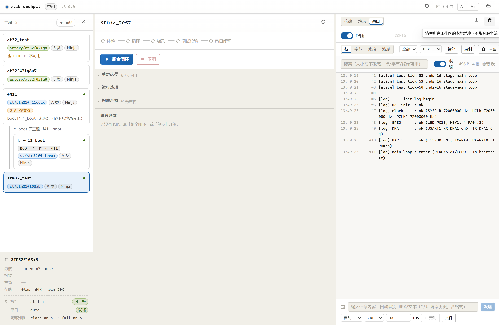

**① 选工程**：左侧点 `stm32_test`（STM32F103C8T6 / CMSIS-DAP）。
**② 进串口**：右侧顶部切到 `串口` 工作区。
**③ 开监视**：端口选 `auto`（本文解析到 `COM10`）、波特率 `115200`，点 `打开监视`；
按钮变成 `关闭监视` 就说明会话在跑。

> 工程卡片底部应显示 `闭环判据 close_on ×1 · fail_on ×1`。如果显示
> `monitor 不可用`，说明该工程 YAML 缺 `serial.port` 或 `monitor.close_on`，
> 先补配置再开监视（见第 5 章 FAQ）。

> **硬前提（所有工程通用）**：面板读的是**固件已经初始化好的 UART**。本仓 STM32 示例都走 USART1
> （115200 8N1，**PA9 = TX / PA10 = RX**）；接线必须交叉（PA9→模块 RX、PA10→模块 TX）并共地。
> elab 只打开主机侧 COM 口，不配置芯片引脚——工程没初始化串口时，这里只会是 0 字节。

---

## 2. 用串口日志看程序跑到哪一步

固件在 `main.c` 里按阶段打日志，串口一就绪就补打外设结果：

```text
[log] ---- init log begin ----
[log] HAL init  : ok
[log] clock     : ok (SYSCLK=72000000 Hz, HCLK=72000000 Hz, PCLK2=72000000 Hz)
[log] GPIO      : ok (LED=PC13, KEY1..4=PA0..3)
[log] DMA       : ok (USART1 RX=DMA1_Ch5, TX=DMA1_Ch4)
[log] UART1     : ok (115200 8N1, TX=PA9, RX=PA10, IRQ=on)
[log] main loop : enter (PING/STAT/ECHO + 1s heartbeat)
[alive] test tick=0 cmds=0 stage=main_loop
[alive] test tick=1 cmds=0 stage=main_loop
```

| 行 | 含义 |
|---|---|
| `[log] HAL init` | HAL / SysTick 初始化完成 |
| `[log] clock` | 时钟树生效，`SYSCLK/HCLK/PCLK2` 是实际频率 |
| `[log] GPIO` | LED 与按键 GPIO 初始化完成 |
| `[log] DMA` | USART1 的 RX/TX DMA 通道就绪 |
| `[log] UART1` | 串口参数与引脚，`IRQ=on` 表示接收中断已挂 |
| `[log] main loop` | 进入主循环，开始处理命令与心跳 |
| `[alive] tick=` | 每秒一条，`tick` 递增说明主循环没卡死 |
| `[cmd] …` | 收到命令后的回显，证明 RX 正常 |

初始化失败时会打印失败阶段后停机：

```text
[log] FATAL: init failed at SystemClock_Config, halted
```

所以只看串口日志就能判断程序**跑到哪一步、卡在哪一步**。

---

## 3. 通用发送面板

### 3.1 面板布局

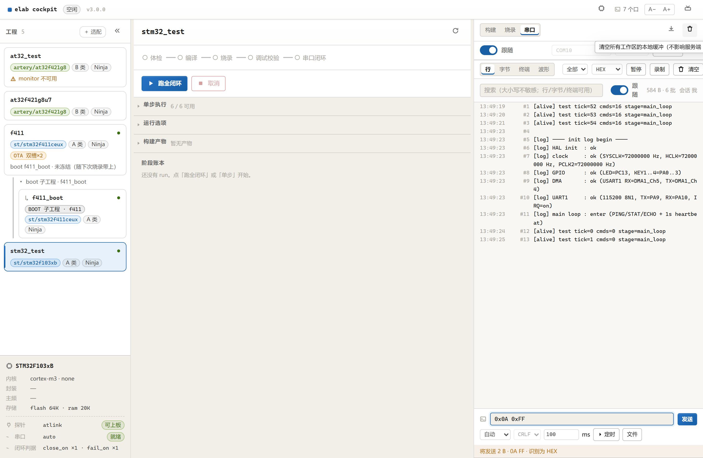

发送区分两行：

| 位置 | 用途 |
|---|---|
| 第一行 输入框 + `发送` | 要发的内容；`Enter` 等价于点 `发送` |
| 第二行 `自动` | 发送格式：`自动 / 文本 / ASCII / GBK / HEX` |
| `CRLF` | 行结束符：`无 / LF / CR / CRLF / TAB`；HEX 模式自动禁用 |
| `100` + `ms` | 定时发送间隔（最小 20ms，最大 600s） |
| `⏵ 定时` / `■ 停止定时` | 按固定节拍重复发送输入框内容 |
| `文件` | 选择本地文本文件，按行逐条发送 |
| 下方预览行 | **服务端**算出的最终字节、识别格式与行尾 |

预览行示例：

```text
将发送 2 B · 0A FF · 识别为 HEX
```

> 预览和真正发送共用内核同一个编码入口 `serialterm.resolve_payload`，
> 所以「看到的字节」就是「发出去的字节」。

### 3.2 自动格式识别规则

格式选 `自动` 时，只有**明确写法**才按 HEX 处理，避免把普通数字误判成二进制：

| 输入 | 识别为 | 实际字节 | 说明 |
|---|---|---|---|
| `0x0A 0xFF` | HEX | `0A FF`（2 B） | `0x` 前缀 |
| `\x41\x42` | HEX | `41 42`（2 B） | `\x` 前缀 |
| `0A,FF` | HEX | `0A FF`（2 B） | 分隔符 + 全十六进制 + 偶数字节 |
| `01 A0 FF` | HEX | `01 A0 FF`（3 B） | 同上 |
| `1234` | 文本 | `31 32 33 34` + 行尾 | **裸数字按文本**，不会拆成 0x12 0x34 |
| `PING` | 文本 | `50 49 4E 47` + 行尾 | 普通命令 |
| `你好` | 文本 | UTF-8 字节 + 行尾 | 中文按 UTF-8 发；需要 GBK 时手动选 `GBK` |

补充规则：

- HEX 模式**不追加行尾**（二进制帧多一个 `0D 0A` 就是错）。
- 自动识别为 HEX 时，行尾下拉框会变灰，预览里也不会出现「行尾」。
- 要强制按十六进制发，把格式从 `自动` 改成 `HEX`；要强制按文本发，改成 `文本`。

### 3.3 发送历史（↑ / ↓）

发送过的内容按 `{文本, 格式, 行尾}` 记入本地历史，最多 **50 条**，跨会话保留：

1. 点一下输入框，按 `↑` 调出上一条，连续按继续往前翻；
2. 按 `↓` 往后翻，回到底部是当前草稿；
3. 调取历史时会**同时恢复格式与行尾**，重发前预览行会重新计算。

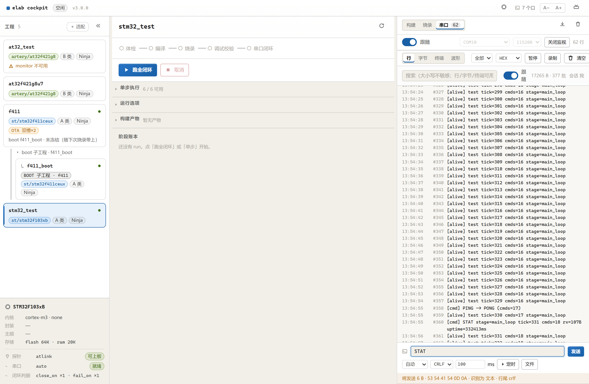

> 历史存在 `localStorage`（键 `elab.serial.send.history`）。隐私模式或配额满时
> 只是不写历史，不影响发送。相同内容会去重并移到最前。

### 3.4 定时发送

1. 输入框填要重复发送的内容（如 `STAT`）；
2. 间隔填 `200`（毫秒，最小 20）；
3. 点 `⏵ 定时`，按钮变成 `■ 停止定时`，预览行下方提示
   `⏵ 定时发送中：每 200ms（停止后才可手发）`。

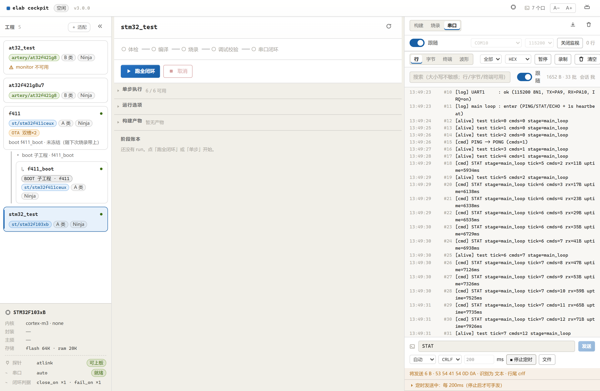

行为约定：

- **固定节拍**：按间隔推进，上一轮没发完只记 `skipped`，不补发、不乱发；
- 定时任务运行期间手写发送按钮置灰，先 `■ 停止定时`；
- 停止是内核取消标志，1 秒内退出，不再发后续轮次；
- 闭环 run 正在占用串口时启动会返回 `409`，先停闭环；
- 定时任务不落盘、不写工程文件，只在 `.work/.cockpit/serial-console.jsonl` 留 TX 记录。

### 3.5 文件按行发送

点 `文件` 选择本地 `.txt / .csv / .log / .json / .hex`，内核按行拆分，每行都按
当前格式与行尾发送；最多 2000 行。文件只读、不写入工程目录。

### 3.6 实机收发验证：PING → PONG

在发送框输入 `PING`（格式 `自动`、行尾 `CRLF`），按 `Enter`：

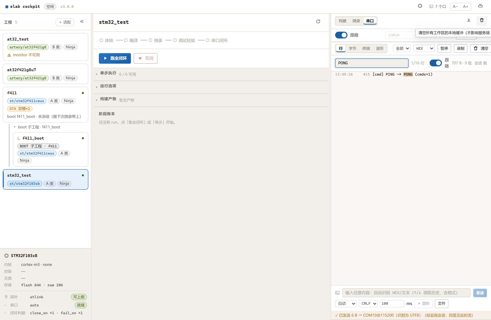

- 发送后预览提示 `✓ 已发送 6 B → COM10@115200（识别为 UTF8）`；
- 行视图出现 `[cmd] PING -> PONG (cmds=…)`，说明 **TX → 设备 → RX** 整条链路通了；
- 搜索框输入 `PONG` 可以只看回显；
- `STAT` 返回当前阶段、tick、命令数、RX 字节数与运行时长；
- `ECHO hello` 原样回显 `hello`，未知命令回 `[cmd] unknown: …`。

固件侧处理在
[main.c](../../examples/STM32F103C8T6/Core/Src/main.c) 的 `HAL_UART_RxCpltCallback`
与 `handle_line`：中断只收字节，主循环解析并打印，避免在中断里做阻塞发送。

---

## 4. 波形（既有能力 · 旧图说明）

> 本章截图来自 **f411 波形固件**（FireWater 双通道，10ms 一帧），用于演示波形 UI。
> 当前 `stm32_test` 是日志工程，不会产生波形；要复现下图请烧写 f411 波形固件。

### 4.1 选解码器

在波形 tab 右侧下拉框选 **FireWater**（固件输出 `a,b\r\n` 文本行）；纯二进制 float 流用
**JustFloat**。选对后出现默认面板「全部」：

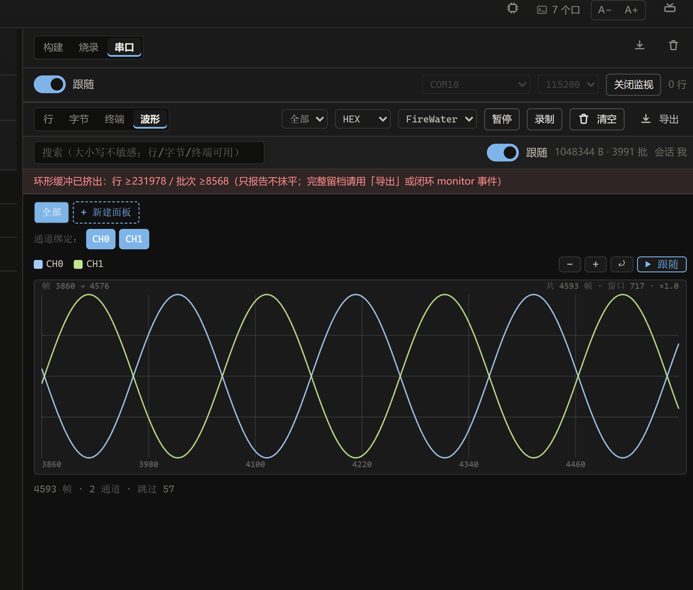

| 位置 | 含义 |
|---|---|
| 面板 tab | 当前激活面板；`×` 删除（至少保留一个） |
| `通道绑定：CH0 CH1` | 蓝色 = 正在画；灰框 = 已关闭 |
| `■ CH0 ■ CH1` | 图例，颜色与曲线一致 |
| `−` `+` `⤾` | 缩小 / 放大 / 重置 |
| `❚❚ 暂停跟随` / `▶ 恢复跟随` | 定格画面 / 跳回最新帧 |
| 画布顶部 `帧 N → M` | 视口左右边界的帧号 |
| `共 N 帧 · 窗口 M · ×1.0` | 总帧数 / 视口帧数 / 缩放倍数 |
| 底部 `N 帧 · 2 通道 · 跳过 X` | 解码统计；`跳过` 是协议外字节 |

每个通道**独立归一化**，量纲不同的通道不会互相压扁；代价是 Y 轴没有绝对值刻度。

### 4.2 新建面板 + 绑定通道

点 `+ 新建面板` 后自动切到「面板 2」，默认绑定全部通道：

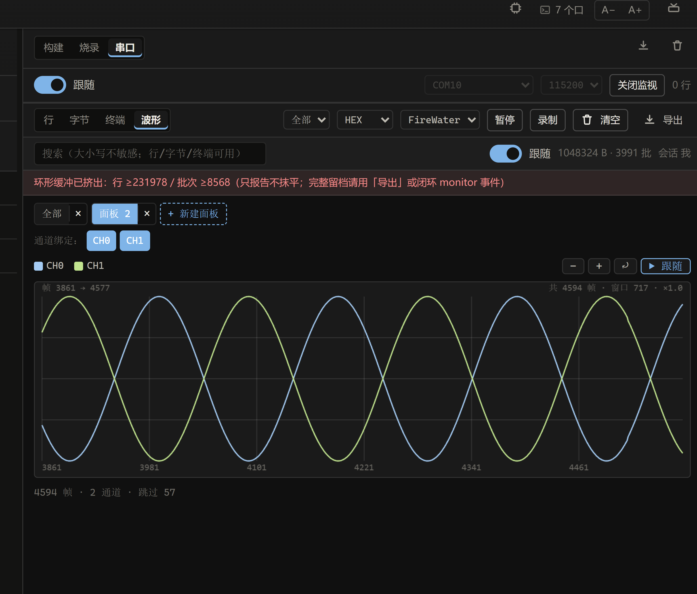

点掉 `CH1` 后只剩 CH0：

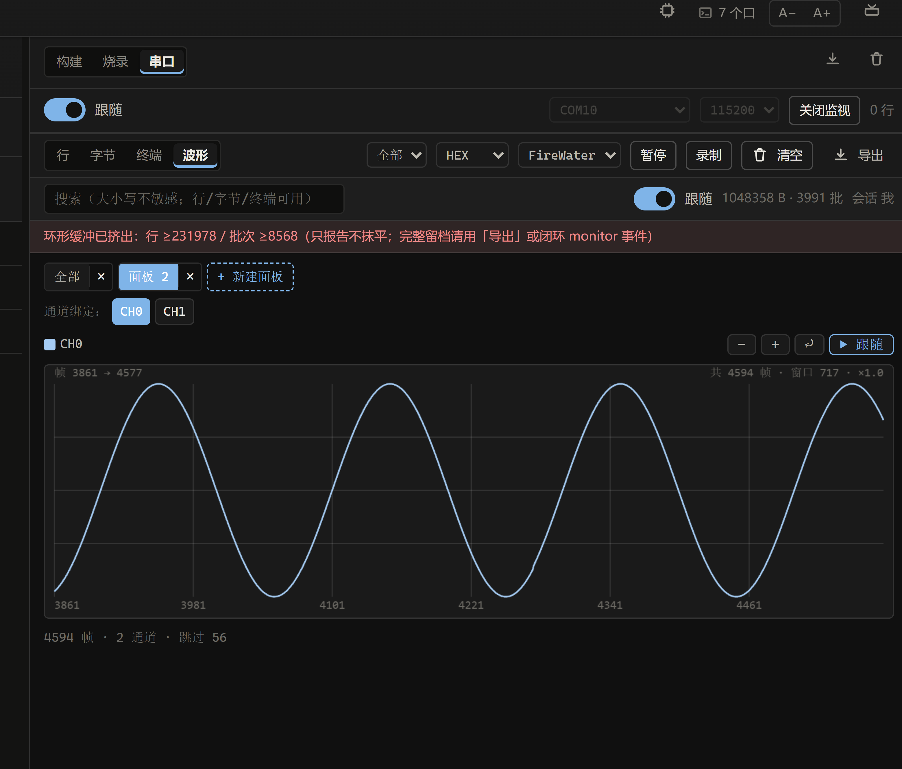

最后一个通道点不掉——每个面板至少保留一条曲线；「全部」面板不受影响。

### 4.3 放大 / 平移 / 定格

连点 `+` 或滚轮缩放，顶部倍率与窗口帧数同步变化：

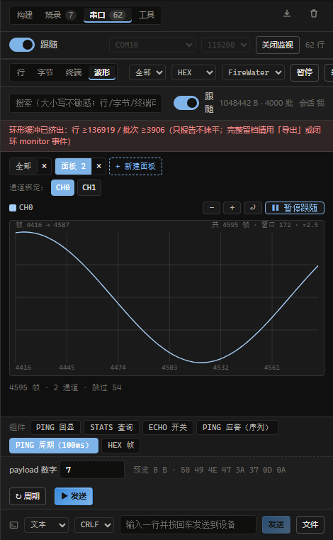

点 `❚❚ 暂停跟随` 定格，再点 `⤾` 回到缓冲区开头：

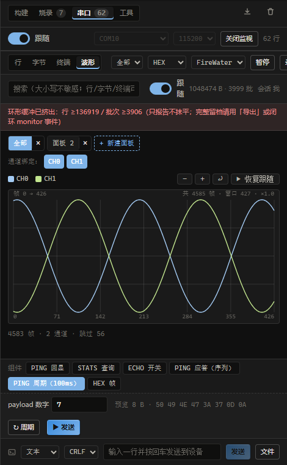

V3 起定格是**帧快照**：解码窗口只解最近 64 KiB，定格时把当帧数组留下，恢复跟随时
才换回实时帧。顶部工具栏的 `暂停` 是「停止入环」，与画布里的「暂停跟随」不是一回事。

### 4.4 切回「全部」

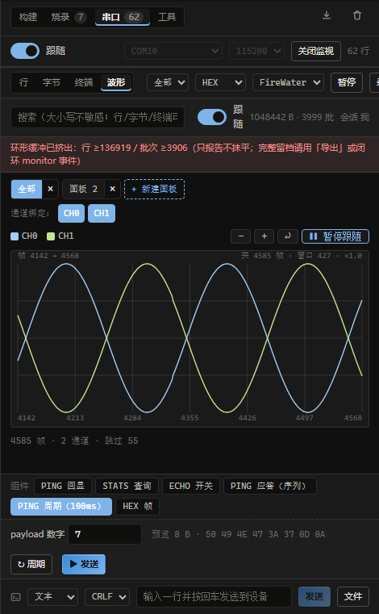

通道绑定、缩放、平移、跟随**按面板各自保存**，来回切换不会串味。

---

## 5. 常见问题

### Q: 串口一直没数据 / 打开监视失败
1. 顶部是否显示 `关闭监视`（会话在跑）？
2. 端口选 `auto` 时是否解析到 USB 串口（本文 `COM10`），而不是蓝牙 COM 口？
3. 波特率是否与固件一致（本文 `115200`）？
4. 是否刚烧录完但 MCU 停在 halt 态？重跑一次 `elab flash`（自带 Resetting Target）。
5. 闭环 run 正在跑时串口被独占（约束 N5），等它结束再开监视。

### Q: 工程卡片显示「monitor 不可用」
工程 YAML 缺判据。至少要有：

```yaml
serial:
  port: auto
monitor:
  close_on:
    - { kind: regex, pattern: "^\\[(log|alive|cmd)\\]", within_s: 10 }
```

改完重启内核（`python -m cockpit.server --port 8333`）再看工程卡片。

### Q: 输入 `1234` 为什么按文本发，不是 HEX？
自动识别故意保守：只有 `0x` / `\x` 前缀，或「分隔符 + 全十六进制 + 偶数字节」
才判 HEX。裸 `1234` 按文本发，避免把普通数字误拆成 `0x12 0x34`。
要发二进制就写 `12 34` 或 `0x12 0x34`，或把格式改成 `HEX`。

### Q: 预览字节和实际发送不一致？
不会。预览与发送共用内核 `serialterm.resolve_payload`；如果你改了格式/行尾，
等预览行刷新（约 300ms 防抖）后再点发送。

### Q: 点 `⏵ 定时` 没反应 / 按钮还是定时
按顺序检查：
1. 输入框是否为空（空内容不允许定时）；
2. 间隔是否 ≥ 20ms、≤ 600s；
3. 是否已有 run 占用串口（返回 `409`）；
4. 是否已经有另一个发送任务在跑（先停止）。

### Q: 发送历史丢了
历史存 `localStorage`；隐私模式、清缓存、换浏览器都会丢。重新发一次即可重新记录。

### Q: 波形 tab 一直 `等待帧`
1. 监视是否在跑；
2. 解码器是否选对（FireWater ↔ JustFloat）；
3. 切「行」视图确认设备是否真的在输出波形文本；
4. 当前烧的是日志工程（`stm32_test`）还是波形工程（`f411`）——日志工程没有曲线。

### Q: 底部的「组件」行去哪了？
组件 UI 已下线。参数化发送仍保留给 agent：`elab_serial_widget`
（list / preview / run / status / cancel / pause / resume / save / delete），
定义在 `projects/<工程名>.widgets.json`，面板只做通用发送。

---

## 6. 代码位置

| 内容 | 独立 WebUI | DSH 插件 |
|---|---|---|
| 串口面板（四视图 / 发送 / 历史 / 定时） | `cockpit/web/src/serial/SerialWorkspace.tsx` | `packages/dsh-elab-cockpit/src/adapters/dsh-web/SerialPane.tsx` |
| 发送历史纯函数（50 条、去重移尾、旧数据迁移） | `packages/cockpit-ui-core/src/send-history.ts` | 同一份包 |
| 编码 / 自动识别 / 行尾 | 内核 `services/elab/serialterm.py`（`resolve_payload`） | 同一个内核（不重写） |
| 定时发送任务 | 内核 `services/elab/serialwidgets.py`（`run_raw`） | 同一个内核 |
| 发送 / 预览 / 定时端点 | `cockpit/server.py`：`POST /api/serial`（`dry_run=true` 预览）、`POST /api/serial/loop` | 走同一套 loopback ICD |
| 监视配置 / 闭环判据 | `projects/<工程名>.yaml` 的 `serial` + `monitor` | 内核读取，插件只渲染 |
| 固件日志与命令回显 | `examples/STM32F103C8T6/Core/Src/main.c` | — |
| Agent 组件工具 | — | `elab_serial_widget`（`src/adapters/dsh-tools/tools.ts`） |

**纪律**：

1. 编码只在 `serialterm.resolve_payload` 做，前端不重复实现；
2. 预览必须走 `dry_run`（在 `_serial_blocker` 之前返回），否则与真发字节会分叉；
3. 定时发送复用内核任务引擎（`run_raw`），不要在前端起 `setInterval` 直接写串口；
4. 串口写通道与闭环 run 的独占统一由 `_serial_blocker` 拦截，两侧都不单独加判断；
5. 业务语义只在 `cockpit/server.py` 的 `SERIAL_META` / `STEP_META`，插件不写死。

---

## 附录：真机验收记录（2026-11-03 · STM32F103C8T6 / COM10 @115200）

| 场景 | 结果 |
|---|---|
| `elab doctor -p stm32_test` | ✅ 通过（根目录修正为 `examples/STM32F103C8T6`） |
| `elab build -p stm32_test --clean` | ✅ 通过，产物 `.work/stm32_test/TEST.{elf,hex,bin,map}` |
| `elab flash -p stm32_test` | ✅ `Verified OK` + `Resetting Target`（64 KiB flash） |
| `elab monitor -p stm32_test` | ✅ 命中 `^\[(log|alive|cmd)\]`，判 **ok** |
| 复位瞬间 init 日志 | ✅ 抓到 `HAL init / clock / GPIO / DMA / UART1 / main loop` 全链路 |
| `PING` → `PONG` | ✅ `[cmd] PING -> PONG`，TX/RX 双向正常 |
| `STAT` | ✅ 返回 `stage=main_loop`、tick、cmds、rx 字节数、uptime |
| `ECHO hello-elab` | ✅ 原样回显 |
| 自动识别 `0x0A 0xFF` | ✅ 预览 `2 B · 0A FF · 识别为 HEX` |
| 定时 `STAT` / 200ms | ✅ `■ 停止定时` 运行态，连续回显；停止后 1s 内退出 |
| 发送历史 `↑` | ✅ 恢复 `STAT`（含格式与行尾） |

### 版本变化

| 维度 | V3 | 当前（V4） |
|---|---|---|
| 面板发送 | 组件 chips + 参数 + 序列 / 周期 | **通用发送框**：自动格式 / 历史 / 定时 / 文件 |
| 组件 UI | 宽栏 + DSH 窄栏都展示 | **下线**，只保留 agent 工具 `elab_serial_widget` |
| 字节预览 | 组件参数预览 | 手写内容也预览（`POST /api/serial` + `dry_run`） |
| 定时发送 | 组件 `repeat` | 输入框 `⏵ 定时`（内核 `run_raw`，不落盘） |
| 历史 | 无 | `{文本, 格式, 行尾}` × 50，↑/↓ 调取 |
| 工程 | f411 波形工程 | `stm32_test`（F103C8T6）独立工程，初始化日志 + 命令回显 |
