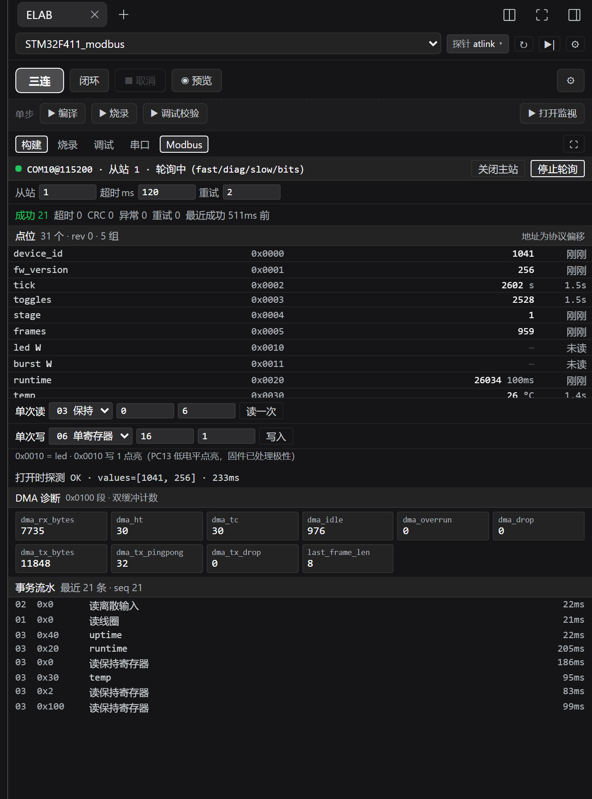
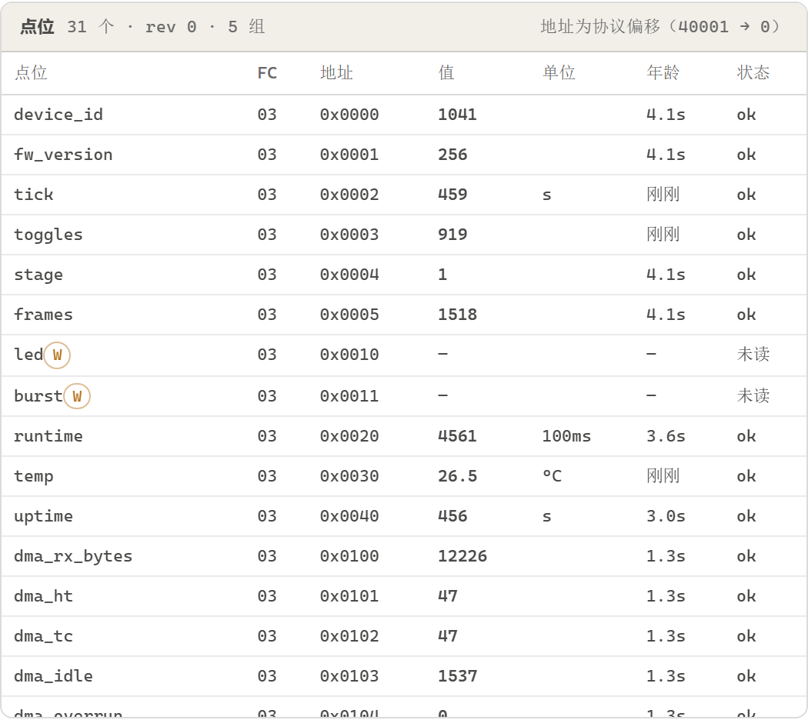
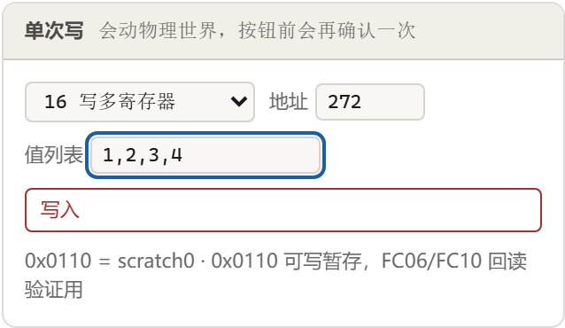
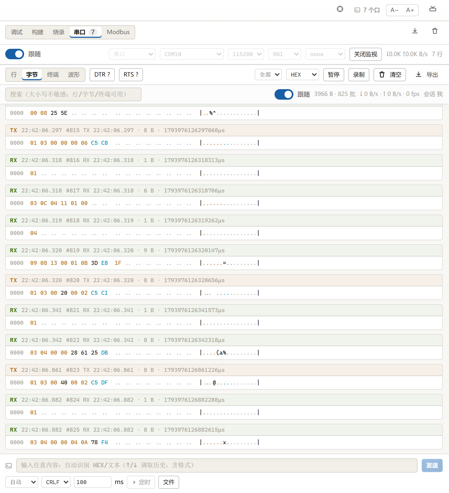
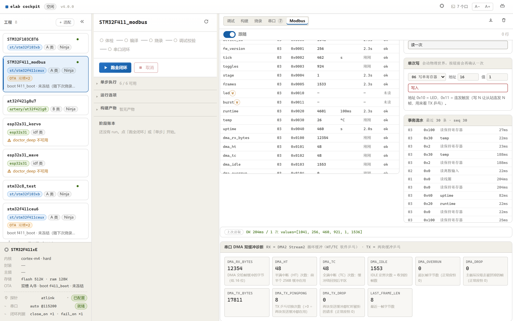
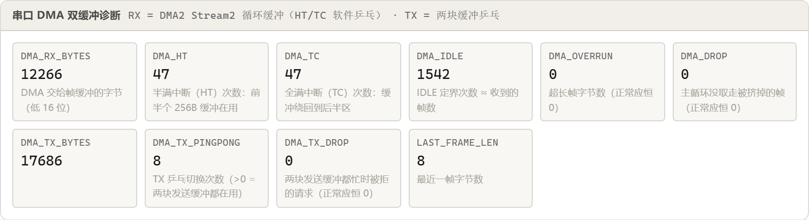

# 协议上手 09：Modbus RTU 主站 + 硬件串口双缓冲（STM32F411 实机）

> 从站固件：`examples/STM32F411_modbus`（STM32F411CEU6 / Cortex-M4F / 115200 8N1）
> 主站实现：`services/elab/modbus.py`（编解码）+ `services/elab/modbusmaster.py`（事务与轮询）
> 面板：WebUI「Modbus」工作区（`cockpit/web/src/modbus/`）
> Agent 工具：`elab_modbus`（10 个 action）
> 本文所有数字均为**本轮实机实测**，不是估算；截图均为真机 + 真内核 + 真面板。

---

## 0. 这篇教程要解决三件事

| 编号 | 问题 | 对应章节 |
|---|---|---|
| A | **面板上 Modbus 到底怎么用**：点表怎么来的、轮询在做什么、写操作敢不敢按 | §1、§5、§6、§10 |
| B | **字节层怎么收**：为什么是「循环 DMA + HT/TC」而不是硬件双缓冲（DBM） | §7、§8 |
| C | **字节层怎么发**：为什么发送只能是「软件乒乓」，怎么证明它真在工作 | §9 |

三个问题的顺序是**先会用手，再拆发动机**。如果你只是想驱动一块 Modbus 从站，读 §1–§6、§10、§11 就够；想改 `uart_dma.c`，必须先读 §7–§9。

---

## 1. 先看面板：Modbus 在工作区里是什么样子


从上到下六块，每一块都对应协议里的一个概念：

| 面板区域 | 协议含义 | 关键点 |
|---|---|---|
| 连接条（从站 / 超时 / 重试 / 打开主站 / 开始轮询） | 从站地址 unit_id、应答超时、重试次数 | 超时 200ms、重试 2 次是本例默认；**超时必须大于从站的静默定界窗口**（本例 20ms），否则正常应答也会被当超时 |
| 统计条（成功 / 超时 / CRC / 异常码 / 重试 / 噪声 / 最近成功） | 事务结果分类计数 | 这七个数字是排错的第一现场：**CRC 涨 = 物理层；超时涨 = 没人应答；异常码涨 = 从站听懂了但拒绝** |
| 点表 | 名义地址 → 实际寄存器 | 点表不是协议的，是本工具的「命名层」：`device_id` = FC03 @ 0x0000 |
| 结果条（上次读取 / 上次写入 / 打开时探测） | 一次事务的完整结果 | 单次读写和探测分开显示，避免"我刚写的东西被探测结果盖掉" |
| 事务流水 | 每一帧的 TX/RX 十六进制 + 耗时 | 抓协议问题只看这里：请求长什么样、应答长什么样、差了多少毫秒 |
| 诊断卡（FC03 @ 0x0100 段） | 从站自报的 DMA 计数 | 把 0x0100 段自动翻译成卡片，`DMA_HT`/`DMA_TC`/`DMA_TX_PINGPONG` 就是双缓冲的仪表盘 |

**面板不懂业务**。它不知道 `device_id` 是"设备型号"，只知道"这个名字对应 FC03、地址 0x0000、类型 u16"。所有业务语义都在点表的 `note` 里，人看。

### 1.1 同一个面板，两个入口

独立 WebUI 是右侧「Modbus」工作区（上图）；装到 DSH 后是日志尾页签行里的 **`Modbus`**
（`构建 | 烧录 | 调试 | 串口 | Modbus`）—— 两处读的是**同一份内核状态、同一个事务引擎**，
连点表也是同一份 `projects/<name>.modbus.json`，所以数据不会"两边对不上"。



窄栏比独立面板少了两样东西：诊断卡从"仪表盘"退化成紧凑卡片网格（宽度不够），
点表只保留 名称 / 地址 / 值 / 年龄（单位跟在值后面）。除此之外口径一致：
统计条同样七个数、写同样先弹确认、流水同样带 `tx_hex` / `rx_hex` 悬停。

---

## 2. 一帧 RTU 的解剖

Modbus RTU **没有帧头、没有长度字段、没有结束符**。一帧就是：

```
[从站地址 1B] [PDU: 功能码 1B + 数据 nB] [CRC16 2B，低字节在前]
```

一帧到哪结束，只能靠**静默时间**判断（这直接决定了 §7、§8 的全部设计）。

### 2.1 三条真实帧（CRC 已用 `elab.modbus` 核算）

| 场景 | 帧（十六进制） | 拆解 |
|---|---|---|
| 读 2 个保持寄存器 @0x0000 | `01 03 00 00 00 02 C4 0B` | 地址 01 / FC03 / 起始 0x0000 / 数量 0x0002 / CRC |
| 正常应答（2 个寄存器） | `01 03 04 04 11 01 00 AA 96` | 地址 01 / FC03 / **字节数 04** / 值 0x0411 0x0100 / CRC |
| 异常应答（地址越界） | `01 83 02 C0 F1` | 地址 01 / **FC03\|0x80 = 0x83** / 异常码 02 / CRC |
| 写单个寄存器 0x0010 = 1 | `01 06 00 10 00 01 49 CF` | 正应答**原样回显**请求前 6 字节 |
| 读 4 个线圈 @0x0000 | `01 01 00 00 00 04 3D C9` | 位访问：数量单位是 bit，应答按 LSB 打包成字节 |

### 2.2 为什么"应答长度只能由请求推出来"

请求里没有长度字段，应答里也只有一个"字节数"。所以主站必须**先知道自己在问什么**，才知道该等多少字节：

```python
# services/elab/modbus.py
response_size(req)   # FC03: 5 + 2*count；FC01/02: 5 + ceil(count/8)
                     # FC05/06/0F/10: 8；异常: 5
```

这不是实现偷懒，是协议本身的形状。面板上"超时"和"CRC 错"能分得开，靠的就是这个函数。

### 2.3 CRC 的参数（别自己发挥）

| 参数 | 值 |
|---|---|
| 宽度 | 16 |
| 多项式 | `0x8005`（反射算法里写成 `0xA001`） |
| 初值 | `0xFFFF` |
| 输入/输出反射 | 都开（refin = refout = true） |
| 结果异或 | `0x0000` |
| 传输字节序 | **低字节在前** |

从站侧实现（`modbus_slave.c`）：

```c
static uint16_t crc16_modbus(const uint8_t *p, uint16_t n)
{
    uint16_t crc = 0xFFFFu;
    for (uint16_t i = 0; i < n; i++) {
        crc ^= p[i];
        for (uint8_t b = 0; b < 8u; b++)
            crc = (crc & 1u) ? (uint16_t)((crc >> 1) ^ 0xA001u) : (uint16_t)(crc >> 1);
    }
    return crc;
}
```

**踩过的坑**：把手写的组帧函数再补一次 CRC，等于对"帧 + 它自己的 CRC"求 CRC，结果恒为 `0x0000`，从站看到的是 10 字节的怪帧 → 回异常码 03。这是本项目调试期真实发生的事故，症状极具欺骗性（"我明明算对了 CRC 却不认"）。

---

## 3. 功能码与异常码

从站实现了 8 个功能码（`Core/Src/modbus_slave.c` 的 `switch`）：

| FC | 名称 | 请求 | 应答 | 上限 |
|---|---|---|---|---|
| 01 | 读线圈 | addr + count | 字节数 + 位图 | 2000 bit |
| 02 | 读离散输入 | addr + count | 字节数 + 位图 | 2000 bit |
| 03 | 读保持寄存器 | addr + count | 字节数 + 值 | **125** 个寄存器 |
| 04 | 读输入寄存器 | addr + count | 字节数 + 值 | 125 |
| 05 | 写单个线圈 | addr + 0xFF00/0x0000 | 原样回显 | 1 |
| 06 | 写单个寄存器 | addr + value | 原样回显 | 1 |
| 0F | 写多个线圈 | addr + count + 字节数 + 位图 | addr + count | 1968 bit |
| 10 | 写多个寄存器 | addr + count + 字节数 + 值 | addr + count | **123** 个寄存器 |

三个异常码（应答里功能码最高位置 1）：

| 码 | 名称 | 本从站什么时候回 | 排查方向 |
|---|---|---|---|
| 01 | 非法功能 | 功能码不在上表 | 主站发了 FC 07/08/11/16 之类的扩展功能 |
| 02 | 非法数据地址 | 地址越界，或**落在写白名单之外** | 地址算错，或想写只读点 |
| 03 | 非法数据值 | 长度字段与数量不匹配、数量为 0 或超上限、FC05 写了 `0x1234` | 组帧时字节数字段填错 |

**设计取舍**：读错可以重读，写错会动硬件。所以从站的写地址是**显式白名单**（`writable_holding()`），不在表里的一律回 02 —— 宁可拒绝，不猜意图。

---

## 4. 从站寄存器表

地址单位是寄存器（16 bit）。`holding[]` 每次应答前由 `mb_refresh()` 刷新，所以读到的永远是"此刻的事实"。

| 地址 | 类型 | 内容 | 可写 |
|---|---|---|---|
| 0x0000 | u16 | 设备 ID `0x0411` = STM32F411 | 否 |
| 0x0001 | u16 | 固件版本 `0x0100` = v1.0 | 否 |
| 0x0002 | u16 | 心跳秒计数，每秒 +1 | 否 |
| 0x0003 | u16 | LED 翻转次数，每秒 +2 | 否 |
| 0x0004 | u16 | stage，1 = 从站在跑 | 否 |
| 0x0005 | u16 | 收到的**合法帧**计数（低 16 位） | 否 |
| 0x0010 | u16 | LED 命令：写非 0 点亮 | **是** |
| 0x0011 | u16 | 连发触发：写 N（1..8）→ 连发 N 帧（§9） | **是** |
| 0x0020/21 | u32 | 运行计数器（每 100ms +1），字序测试点 | 否 |
| 0x0030/31 | f32 | 模拟温度 25.0–27.0，float 字序测试点 | 否 |
| 0x0040/41 | u32 | 运行秒数 | 否 |
| 0x0100 | u16 | DMA 交给帧缓冲的总字节 | 否 |
| 0x0101 | u16 | **HT 命中次数**（前半个环在用） | 否 |
| 0x0102 | u16 | **TC 命中次数**（环绕回） | 否 |
| 0x0103 | u16 | IDLE 命中次数（≈ 帧数） | 否 |
| 0x0104 | u16 | 超长帧字节数（应恒 0） | 否 |
| 0x0105 | u16 | 帧被挤掉的次数（应恒 0） | 否 |
| 0x0106 | u16 | DMA 发出的总字节 | 否 |
| 0x0107 | u16 | **TX 乒乓切换次数**（第二块缓冲真被用上） | 否 |
| 0x0108 | u16 | 两块发送缓冲都忙被拒的次数（应恒 0） | 否 |
| 0x0109 | u16 | 最近一帧长度 | 否 |
| 0x010A | u16 | 一帧内部观察到的**最大字节间隔**（ms） | 否 |
| 0x0110–0x0117 | u16 | 随便读写的 scratch，验收用 | **是** |

线圈 0–3 可读写（线圈 0 与 LED 联动）；离散输入 0 = LED 现况、离散输入 1 = 最近 2s 总线上有帧。

**字序约定**：u32/f32 拆成两个寄存器时**高字在前**。f32 走 IEEE754，所以 `temp` 要读 0x0030 起 2 个寄存器再拼 —— 面板点表的 `type: f32` 替你做了这件事，手写脚本时必须自己拼。

---

## 5. 点表与轮询：31 个点怎么变成每轮 8 条读

### 5.1 点表的形状（`projects/STM32F411_modbus.modbus.json`）

```json
{ "name": "device_id", "fc": 3, "address": 0, "type": "u16",
  "note": "0x0411 = STM32F411" }
```

只有四个字段是机器读的：`fc` / `address` / `type` / `name`；`note` 是给人看的。

### 5.2 五个组

| 组 | 间隔 | 点 | 说明 |
|---|---|---|---|
| `fast` | 500ms | tick、toggles、temp | 0x02/0x03 相邻合并成一条；0x30/0x31 是 f32 两个字 |
| `diag` | 1000ms | 0x0100 段 10 个 | 连续 10 个寄存器 → 一条读就够，双缓冲是否在工作全看这几个数 |
| `slow` | 2000ms | device_id、fw_version、stage、frames、runtime、uptime | 身份与累计量，慢一点没人介意 |
| `bits` | 2000ms | coil0–3、di_led、di_bus | FC01 与 FC02 **不能合并**，必须两条 |
| `writes` | 1000ms（默认关闭） | led、burst | 写点不参与轮询：读回来只是自己刚写下去的值 |



### 5.3 合并规则（`_plan_group`）

同组内的点按 `(fc, address)` 排序后贪心合并，三个条件同时满足才并进去：

```python
p["address"] <= cur["addr"] + cur["count"] + MERGE_GAP        # 间隙 ≤ 4 个寄存器
max(...) - cur["addr"] <= mb.MAX_READ_REGS                    # 总跨度 ≤ 125
cur["fc"] == p["fc"]                                          # 功能码必须相同
```

于是 `slow` 组的 6 个点变成 3 条请求（0x00–0x05 / 0x20+0x21 / 0x40+0x41），`fast` 组变成 2 条，`diag` 组 1 条，`bits` 组 2 条。**一轮完整的点位刷新 = 8 条事务**，而不是 31 条。

为什么 `MERGE_GAP` 是 4 而不是"无限合并"：跨过未定义区域去凑一条长读，会把别人的寄存器一起读回来，既浪费带宽，也让"读到的值属于谁"变得含糊。4 个寄存器是"顺手带上"和"乱读别人"的分界。

### 5.4 轮询是单飞 + 定间隔

引擎里同一时刻只有**一条事务在飞**（Modbus 是主从半双工，并行没有意义），每条事务之间还有 `MIN_INTERVAL_MS = 50` 的总线间隔。组间隔到了就往队列里塞任务，先后顺序由队列决定 —— 这就是为什么 500ms 的 `fast` 组在忙的时候会"晚一点"，但不会撞车。

---

## 6. 写操作：怎么敢按下去

### 6.1 三层闸门

| 层 | 闸门 | 表现 |
|---|---|---|
| 从站 | `writable_holding()` 白名单 | 写只读地址 → 异常码 02 |
| 面板 | 写之前 `window.confirm` | 弹窗确认，取消就什么都不发 |
| Agent | `confirm: true` + 宿主 `allowAgentWrite` | 缺一个就返回 `confirm-required` / `agent-write-disabled` |

Agent 侧的返回长这样（不静默失败，也不假装成功）：

```json
{ "ok": false, "code": "confirm-required",
  "note": "写操作需要 confirm: true",
  "nextAction": "确认目标点后再调用，并带上 confirm: true" }
```

### 6.2 广播：执行，但不回答

`unit_id = 0` 是广播。从站**照做但不回**（`modbus_slave.c` 的最后一个判断）：

```c
if (req[0] == 0u || olen == 0) {
    return;                    /* 广播：执行但不回答 */
}
```

回一句反而会撞上总线上别的从站。主站侧对广播事务的 `elapsed_ms` 直接记 0，因为"没有应答"是正常结果，不是超时。

### 6.3 FC 0x10（十进制 16）的"全批拒绝"

写多个寄存器时，先整批检查白名单，有一个不可写就整批回 02：

```c
for (i = 0; i < cnt; i++)
    if (!writable_holding(addr + i)) { olen = build_exception(out, fc, EXC_ILLEGAL_ADDR); break; }
if (olen) break;               /* 有一个不可写就整批拒绝 */
```

半批写进去是最糟的结果：主站以为失败，从站已经有半边新值，下次读回来谁也说不清。要么全做，要么全不做。

### 6.4 批量写：面板上的"值列表"

写多个寄存器（FC16）和写多个线圈（FC15）与单值写**不是同一条路径**：协议里带的是 `values[]`
而不是 `value`。面板按功能码切换输入框 —— 选 15/16 时「值」变成「值列表」（逗号分隔），
并在本地先拦两道（必须是数字；FC15 只认 0/1）：



写下去之后必须**读回来对账** —— 这是唯一能证明"从站真的收了"的方式，也是本教程所有验收的做法：

![FC16 写 1,2,3,4 到 0x0110 后 FC03 读回 values=[1, 2, 3, 4]](assets/protocol/modbus/07-batch-readback.png)

实测两条路径都通：

| 路径 | 写 | 读回 |
|---|---|---|
| FC16 写多个寄存器 → FC03 | `1,2,3,4` 到 `0x0110`（scratch 区） | `values=[1, 2, 3, 4]`，逐字一致 |
| FC15 写多个线圈 → FC01 | `1,0,1,1` 到 `0x0000` | `[1, 0, 1, 1]`，逐位一致 |

顺带一个**故意做错**的反例：地址填 `0x0010`（LED，单寄存器可写）却批量写 4 个，
从站整批回**异常码 02** —— `0x0010..0x0013` 越界。面板的「异常」计数 +1、流水里那条标红
（`写多寄存器 · except`）。这不是 bug，正是 §6.3 的白名单在生效。

---

## 7. 硬件串口双缓冲（一）：接收为什么是 CIRC + HT/TC

### 7.1 问题不是"慢"，是"窗口"

115200 下一个字节约 87 µs。Modbus 一次读 125 个寄存器，线上一连串 300 多字节。如果收字节靠 CPU（中断或轮询），CPU 正在处理上一批的那几微秒就是**丢字节的窗口**，而丢一个字节 = 整帧 CRC 废。

把"接字节"这件事交给 DMA 是对的。错的是**用哪种 DMA 模式**。

### 7.2 硬件 DBM 的硬伤：固定 NDTR，整块才切

STM32 的 DMA 双缓冲模式（DBM 位 + M0AR/M1AR）确实能"收满 M0 自动切 M1"。但它的 NDTR 是**固定的**，必须整块传完才切换，而且切换发生在**块边界**上。

| | 硬件 DBM | 循环 DMA + HT/TC |
|---|---|---|
| 适合的流 | 定长（PWM 波形、I2S 音频、DAC 查表） | 不定长、靠静默定界的串口帧 |
| 块大小 | 固定 NDTR（比如 256B） | 环形 256B，绕回继续写，永不停止 |
| 短帧（8B） | 要等攒满 256B 或超时才切换 | 主循环随时按 NDTR 取走，2ms 就能交 |
| 长帧跨块 | 被块边界切碎 | 环继续写，`[tail, pos)` 拆两段搬 |
| 启动方式 | `HAL_DMAEx_MultiBufferStart`（**注意：它不打开 HT/TC 中断**） | `HAL_DMA_Start_IT`（顺带打开 HT/TC） |

Modbus RTU 一帧 8–256 字节不定长、靠静默定界。用 DBM 只能把块定成 256B，结果就是短帧被拖长、长帧被切碎，**定界逻辑整个失效**。所以本例的接收侧：**不上硬件 DBM**。

### 7.3 两种"软件双缓冲"的分野：本实现选的是哪一种

社区里"软件双缓冲"这个词被用在两个完全不同的东西上，混起来会写出看起来能跑、实际偶发丢帧的代码。

**方案 A：拿 HT/TC 当乒乓切帧（错）**

```
buffer[0..255] 一整块，NDTR=256
HT（收到 128B）→ 把前半段当一帧交给上层
TC（收到 256B）→ 把后半段当一帧交给上层
```

三个致命问题：

| 问题 | 后果 |
|---|---|
| 一帧正好跨在 128 边界 | 一帧被劈成两半，两半 CRC 都错 |
| 短帧（8B）离 128 还差很远 | HT、TC 都不触发，这帧根本交不上去 |
| HT/TC 是**计数事件**，不是**帧事件** | 它只知道"搬了多少字节"，不知道"帧到哪结束" |

它只适合**定长块、不在乎帧边界**的流（ADC 连续采样、I2S 音频）。Modbus 是"靠静默断帧"的协议，方向就不对。

**方案 B：CIRC 环形收 + 上层帧级双缓冲（对，本实现就是它）**

```
DMA 一直往 rx_buf[0..255] 环里写（永不停止）
        ↓ NDTR 反推写头 pos
rx_drain() 把 [rx_tail, pos) 搬进 frm_mem[写块]
        ↓ 帧结束判据命中
frm_end() 翻下标：刚写完的块 → 待取，新帧写另一块
        ↓
主循环 ud_frame_get() 从"待取"块里拷走 → 解析
```

**但方案 B 的经典伪代码有一个必须改的地方**：

```c
void UART_IDLE_ISR() {
    len = ...;
    memcpy(rx_free_buf, &dma_buf[frame_start], len);   /* ← 两个坑 */
    swap(rx_ready_buf, rx_free_buf);
}
```

| 坑 | 本实现怎么处理 |
|---|---|
| **IDLE ≠ 帧结束**（本板经 CDC 桥，包间隙 8ms，IDLE 会误触） | IDLE 只做 `rx_drain()`（把已收的搬走）+ 清标志；切帧交给 `ud_poll()` 按 **20ms 静默**判（§8） |
| 一帧可能**跨越环尾**，一次 `memcpy` 会读到还没写入的区域 | `rx_drain()` 拆两段搬：`[tail, 256)` + `[0, pos)` |
| `frame_start` 哪来的 | 没有"帧起点"这个东西，只有追尾指针 `rx_tail`；搬多少由 `NDTR` 反推 |

所以准确的说法是：**方案 B 的骨架（环形收 + 上层双 buffer + 解析慢也不丢）正是本实现**；
只是把"帧结束判据"从 IDLE 改成"静默 ≥ UD_FRAME_GAP_MS"，因为我们的"串口"实际是 USB-CDC 桥。

**HT/TC 在本实现里退化成"提前搬运的提示"**：长帧时早点交数据，避免 256B 环被写穿；
它**不参与**任何帧边界判断。这样既保留了 HT/TC 的好处（不会因为搬运不及时丢字节），
又不让它们错误地决定帧的边界。

### 7.4 环形收：一个 256B 的环，DMA 写头、CPU 追尾

```c
#define UD_RX_BUF 256u          /* Modbus 整帧上限；115200 下填满要 22ms，主循环有充足时间取走 */

static uint8_t rx_buf[UD_RX_BUF] __attribute__((aligned(4)));
static volatile uint16_t rx_tail;      /* 已经搬走的读指针 */

/* ★ 整体原子：本函数有 3 个调用者（主循环 / DMA ISR / USART IDLE ISR）。
 *   ISR 之间同优先级互不抢占，但主循环随时会被 ISR 打断：主线程刚算完 pos、
 *   还没执行 rx_tail = pos，此刻来一次 HT/TC 中断 → 中断里用旧 tail 又 push 一遍，
 *   同一段字节被记两次 → 帧长被撑大（overrun）+ 偶发 CRC 错（见 §11 事故 G）。 */
static void rx_drain(void)
{
    uint32_t primask = __get_PRIMASK();
    uint16_t pos, tail;

    __disable_irq();
    pos  = (uint16_t)(UD_RX_BUF - __HAL_DMA_GET_COUNTER(&hdma_usart1_rx));
    tail = rx_tail;

    if (pos == tail) { rx_tail = pos; __set_PRIMASK(primask); return; }  /* 99% 走这里 */
    if (pos > tail) {
        frm_push(&rx_buf[tail], (uint16_t)(pos - tail));
    } else {
        frm_push(&rx_buf[tail], (uint16_t)(UD_RX_BUF - tail));   /* 绕回了：先搬尾巴 */
        if (pos > 0u) { frm_push(&rx_buf[0], pos); }             /* 再搬头部 */
    }
    rx_tail = pos;
    __set_PRIMASK(primask);        /* 存/恢复 PRIMASK：自己被 ISR 调用时不越权开中断 */
}
```

四个调用点，优先级从高到低：

| 调用点 | 为什么在这里 |
|---|---|
| `ud_rx_irq()`（HT/TC 中断） | 长帧时提前交，避免 256B 环被写穿 |
| `ud_on_idle()`（IDLE 中断） | 线路刚静过，通常一帧已经到齐 |
| `ud_poll()`（主循环每圈） | **主力**：不打中断也能取，8 字节短帧 2ms 内就上来 |
| 不用别的 | — |

`ud_poll()` 每圈都 `rx_drain()` 是刻意的：只靠 HT/TC 搬，8 字节的短帧要等到"半满 128B"才被看见 —— 而它永远到不了 128B，只能等 IDLE 超时。

### 7.5 帧级双缓冲才是真双缓冲

字节层是环，**帧层**仍然是两块内存：

```c
static uint8_t frm_mem[2][UD_FRAME_MAX];
static volatile uint8_t  frm_idx;         /* ISR 正在写的下标；待取 = frm_idx ^ 1 */
static volatile uint16_t frm_len;         /* 当前帧已收字节 */
static volatile uint16_t frm_ready_len;
static volatile uint8_t  frm_ready;
```

ISR 往里一块攒，主循环从另一块取；`frm_end()` 翻下标的一瞬间关中断，否则正好在翻缓冲的中间来个字节，会写进刚被标成"待取"的那一块。主循环还没取走上一帧时来了新帧？丢新的（`rx_drop++`），不覆盖还没被读走的证据。

**"双缓冲"在本例里有两个落点，别混**：

1. RX 帧级双缓冲（`frm_mem[2]`）—— ISR 写一块，主循环读另一块；
2. TX 软件乒乓（`tx_mem[2]`）—— DMA 发一块，CPU 填另一块（§9）。

**都不是 DMA 硬件的 DBM 位。**

### 7.6 HT/TC 只是"早点交"，不是"帧完了"

这一点必须在代码里写死，否则后人一改就退回去：

```c
void ud_rx_irq(void)
{
    if (__HAL_DMA_GET_FLAG(&hdma_usart1_rx, DMA_FLAG_HTIF2_6)) { 清标志; st.rx_ht++; rx_drain(); }
    if (__HAL_DMA_GET_FLAG(&hdma_usart1_rx, DMA_FLAG_TCIF2_6)) { 清标志; st.rx_tc++; rx_drain(); }
    __HAL_DMA_CLEAR_FLAG(&hdma_usart1_rx, TEIF|DMEIF|FEIF);   /* 不清会被 HAL 停流 */
}
```

中断里**只搬字节，不切帧**。切帧是 `ud_poll()` 的活（§8）。

---

## 8. 帧定界：为什么是 20ms，而不是规范的 3.5 字符

### 8.1 规范怎么说

Modbus 规范：波特率 > 19200 时用固定 **1.75ms** 静默当作帧结束；≤ 19200 时用 3.5 个字符时间。

### 8.2 为什么本板不能用 1.75ms

因为板子上的"串口"其实是 **DAPLink 的 USB-CDC 虚拟串口**。主机写下去的一帧，到 CDC 桥之后会被**重新拆包**，包与包之间线路是真的静了 —— IDLE 真的会置位，但帧还没完。

这不是猜的，从站自己记着证据（诊断寄存器 **0x010A**）：

```
max_gap = 8        # 一帧内部观察到的最大字节间隔 = 8ms，远超 1.75ms
```

一个 8 字节的请求被拆成 2+6 两包，中间静 8ms。若按 IDLE 立刻切帧，就变成两个 4 字节的残帧，两半 CRC 都错 —— 症状是"偶尔丢一帧，重试一次就好"，最难查的那一类。



上面这张字节视图把现场原样摆出来了：

- `TX … 01 03 00 00 00 06 C5 C8` —— 请求是**完整的一帧**（主站一次写下去）；
- `RX … 1 B "01"`、`RX … 6 B "03 0C 04 11 01 00"`、`RX … 1 B "04"` —— 应答被 USB 拆成了 1/6/1 三个小包，**中间隔着 2ms、21ms 的静默**。

所以：**一次 USB 读 ≠ 一帧**。从站只能靠"静默够久了"来判断，而"够久"必须大于 CDC 的拆包间隔。

### 8.3 IDLE 当提示，不当判据

```
IDLE 中断 → 暂停 DMA 请求 → rx_drain() → 读 SR/DR 清 IDLE
         → 把 RXNE 里的残字节自己收下（最多 8 个）→ 恢复 DMA 请求
         → st.rx_idle++            ★ 到此为止，不切帧
主循环   → rx_drain() → 有半帧 且 静默 ≥ UD_FRAME_GAP_MS(20) → frm_end()
```

第 4 步那个"自己收下"是必须的：清 IDLE 要求"先读 SR 再读 DR"，而 DMA 正在读同一个 DR。此刻若 RXNE=1，CPU 这一读会把 DMA 该收的字节抢走 —— 一个字节都不丢的做法就是先关 `CR3.DMAR`，把残字节收进来，再打开。

### 8.4 20ms 的代价，以及怎么按现场调

| 场景 | 建议 `UD_FRAME_GAP_MS` | 理由 |
|---|---|---|
| 经 DAPLink/CDC 桥（本例） | **20ms** | 实测包间隙 8ms，留 2.5 倍余量；仍远小于主站 200ms 超时 |
| 真 USB-TTL（CH340/CP210x） | 4–5ms | 驱动一次交一整帧，间隙通常 <1ms |
| 板上直连 UART（RS-485 收发器） | 2ms | 没有 USB 层，可逼近规范值 |
| 9600 波特 | 5–8ms | 一字符 1.04ms，3.5 字符 ≈ 3.7ms，再给拆包留余量 |

代价很直接：**从站要等 20ms 才认帧，所以应答天然晚约 20ms**。这不是 bug，是"静默定界"的固有成本，详见 §12 的延迟账本。

---

## 9. 发送：软件乒乓 + 连发夹具

### 9.1 为什么发送不能用硬件双缓冲

DBM 对"外设→内存"和"内存→外设"的**循环**传输有意义。串口发送是**一次性**的（发完就停），硬件不会替你切到下一块。所以发送侧只能用软件：

```c
static uint8_t  tx_mem[2][UD_TX_MAX];
static volatile uint16_t tx_len[2];
static volatile uint8_t  tx_cur    = 0xFF;   /* 正在被 DMA 发送的块（0xFF = 空闲） */
static volatile uint8_t  tx_queued = 0xFF;   /* 已排队等发送的块 */
```

状态机只有三个状态：

| 现场 | `ud_tx()` 行为 | 返回 |
|---|---|---|
| 两块都空 | 用 0 号块，立刻 `HAL_UART_Transmit_DMA` | 1 |
| 一块在发、另一块空 | 填另一块，标记排队（等 TC 回调接力） | 1 |
| 两块都占着 | 诚实拒绝，**不排队等** | 0 |

接力点在发送完成回调里（`HAL_UART_TxCpltCallback` → `ud_on_tx_complete()`）：

```c
tx_cur = 0xFF;
if (tx_queued != 0xFF) {
    uint8_t nxt = tx_queued;
    tx_queued = 0xFF;
    tx_cur = nxt;
    st.tx_pingpong++;          /* 每切换一次 +1：面板上能直接看到乒乓在跑 */
    tx_start(nxt);
}
```

### 9.2 `ud_tx_room()`：把"等"和"丢"分开

这是本项目一个真实事故换来的 API。连发夹具最初这么写：

```c
while (burst_left) { if (ud_tx(...)) burst_left--; }    /* 错 */
```

主循环空转一圈就重试一次，每次 `ud_tx` 拒绝都 `tx_busy_drop++` —— 实测 `tx_drop = 1056`，而实际上**一帧都没丢**。于是那个数字彻底失去意义：面板上有个 1056 的红字，你既不能判断它坏，也不能判断它好。

改成"先问后发"：

```c
int ud_tx_room(void)          /* 0 / 1 / 2：还能立刻受理几帧 */
{
    int room = 0;
    __disable_irq();
    if (tx_cur == 0xFF)            room = 2;
    else if (tx_queued == 0xFF)    room = 1;
    __enable_irq();
    return room;
}
```

```c
if (ud_tx_room() <= 0) return;                    /* 下一圈再来 —— 这是"等"，不是"丢" */
if (ud_tx(line, len)) { burst_left--; burst_seq++; }
```

`tx_drop` 从此恒 0，它重新变成一个**可信的报警灯**：只要它涨，就真的丢了。

### 9.3 连发夹具：让乒乓在面板上可见

写 `0x0011 = N`（1..8），从站就连续发 N 行 `[burst] n=k\r\n`（每行 12 字节，主循环一圈发一帧，不阻塞）。这批短帧会不停地占用两块发送缓冲，于是 `tx_pingpong` 必然跳变：

```
写 0x0011=8 回显: 01 06 00 11 00 08 D8 09
收到 8 帧: [burst] n=1|[burst] n=2|…|[burst] n=8
诊断: tx_bytes 2175  tx_pingpong 8  tx_drop 0
```

这一套就是"双缓冲到底有没有在工作"的**可复现实验**，不用示波器、不用逻辑分析仪。

---

## 10. 面板实操：从打开到关掉

### 10.1 打开主站（自动带上串口会话）

点「打开主站」做三件事：

1. 如果还没有串口会话，先开一个（复用监视会话，不新开口、不复制读线程）；
2. 挂一个 RX 观察者到会话上（`add_rx_sink`），Modbus 字节从这里来；
3. 顺手探测一次（FC03 @0x0000 读 2 个），把"上电首帧撞心跳"这类一次性抖动吸收掉 —— 面板一打开就是绿的。

结果条会显示 `打开时探测 OK 225ms / 1 次 values=[1041, 256]`：`1041` = 0x0411 = STM32F411，`256` = 0x0100 = 固件 v1.0。

### 10.2 开始轮询

点「开始轮询」，4 个启用的组按各自间隔排队。看两处：

- 统计条的**成功**在涨，**超时 / CRC / 异常码**保持 0；
- 点表的值在动：`tick` 每秒 +1、`toggles` 每秒 +2、`temp` 在 25.0–27.0 之间来回。

### 10.3 单次读与事务流水



一条事务记录里能看到 `tx_hex` / `rx_hex` / `elapsed_ms` / 是否重试。协议层的问题是**只能**在这里定位：

| 现象 | 流水里长什么样 |
|---|---|
| 地址错 | `rx_hex` = `01 83 02 …`（异常码 02） |
| CRC 算错 | 没有 `rx_hex`，或从站回 `01 83 03 …` |
| 波特率/接线错 | 一条记录里只有 `tx_hex`，且状态是 timeout |
| 从站没上电 | 同上，但连续 N 条都 timeout |

### 10.4 写操作

单次写要先选点、填值，点「写入」时弹确认框。写完立刻读一次同一个点，值应该已经变了（`led` 写 1 → 板载 PC13 点亮；`burst` 写 3 → 串口上应该冒出 3 行 `[burst]`）。

注意：`writes` 组**默认关闭轮询**。写点参与轮询没有信息量 —— 读回来只是自己刚写下去的值，还会把"谁改的"搅混。要看效果就单次读一次。

### 10.5 诊断卡



| 卡片 | 正常值 | 说明 |
|---|---|---|
| `DMA_RX_BYTES` | 持续增长 | 总字节数。**应该约等于 `DMA_TC × 256` + 余数** —— 对不上说明 HT/TC 计数和实际搬运不一致 |
| `DMA_HT` / `DMA_TC` | 1:1 增长 | 环的两半都被用到。长期只有 HT 没有 TC，说明环没绕回过（流量太小或缓冲太大） |
| `DMA_IDLE` | 远大于帧数 | 每次线路静默都 +1，包含拆包间隙，所以它 ≈ 帧数的 3–10 倍是正常的 |
| `DMA_OVERRUN` | **恒 0** | 有值 = 单帧超过 256B，协议已经错了 |
| `DMA_DROP` | **恒 0** | 有值 = 主循环来不及取，帧被挤掉。要查主循环里有没有阻塞调用 |
| `DMA_TX_PINGPONG` | 连发时跳变 | 0 = 第二块发送缓冲从没被用过（可能永远没出现过"发一帧时又来一帧"） |
| `DMA_TX_DROP` | **恒 0** | 有值 = 真的丢了发送帧（不是"等"） |
| `LAST_FRAME_LEN` | 8 / 13 / 25… | 最近一帧长度。如果恒等于某个值而请求在变，说明定界出问题了 |

---

## 11. 排错手册

| 症状 | 最可能的原因 | 怎么确认 | 怎么修 |
|---|---|---|---|
| 统计条 `超时` 涨，流水只有 tx | 接线（A/B 反、TX/RX 没交叉）、波特率、从站没上电 | 串口字节视图里 RX 有没有任何字节 | 先看物理层，再看协议 |
| `CRC` 涨 | 波特率偏差、地线、CRC 字节序、组帧多算一次 | 流水里 `rx_hex` 末尾两字节与预期不符 | 用 `elab.modbus.crc16_modbus()` 对拍 |
| `异常码` 涨且 code=02 | 地址越界 / 写白名单外 | 读的点表地址 vs 从站寄存器表 | 改点表或改从站白名单 |
| `异常码` 涨且 code=03 | 数量为 0 或超上限、字节数字段不匹配 | 请求帧的第 5、6 字节 | 组帧函数 |
| `malformed` 涨 | 应答长度对不上（被前面残留帧污染） | 流水里 `rx_hex` 长度 | 关掉会话重开；检查是否有别的程序同时在读同一个口 |
| 面板 timeout 但字节视图有字节 | 静默窗口 < CDC 拆包间隔 | 读 0x010A `max_gap` | 调大 `UD_FRAME_GAP_MS` |
| 打开报 `ACCESS_DENIED` | 端口被 openocd / 另一个会话占着 | `netstat` + 进程列表 | 关掉占用者；烧录与串口监视互斥 |
| 串口里出现 `[burst]` 之外的日志混进应答 | 心跳口和 Modbus 口共用了 USART1 | 从站心跳走 USART2 | 物理隔离（`board.h` 的注释写明了原因） |
| 每条事务固定慢 200ms | 读线程用 `read(n)` 语义（凑够 n 或超时） | 看是不是 pyserial 后端 | 用 `in_waiting` 先问到货量再读（`SerialIO.in_waiting`） |
| **偶发**丢一帧（几十到几百次里 1 次），`overrun` 缓慢上涨 | `rx_drain()` 被 ISR 打断造成字节重复入帧（重入竞态） | 连续跑 300 次读，看 `overrun` 是否从 0 变正 | `rx_drain` 整体关中断（存/恢复 PRIMASK）—— 见下面的事故 G |

最后一条是本项目真实踩过的：`read(4096)` 的语义是"凑够 4096 字节或超时"，一条 11 字节的回包必须**再等满 200ms 超时**才返回。修法是先问"到货多少"，再按到货量读 —— 298ms/条 → 40ms/条。这条经验对**任何**一问一答的串口协议都成立。

### 事故 G：`overrun = 8` 与"偶尔丢一帧"

**现象**：连续跑验收脚本，100 次里偶尔 1 次失败（失败点不固定：第 1 次、第 20 次都出现过），
重试即好；诊断寄存器 `overrun` 从上电的 0 慢慢涨到 8。没有 CRC 异常上报（从站按规范静默丢弃坏帧），
主站只能看到 timeout。

**定位**：`USART1_IRQn` 与 `DMA2_Stream2_IRQn` 都是 `(0,0)` 优先级 —— 两个 ISR 之间互不抢占，
但**主循环会被任意 ISR 打断**。而 `rx_drain()` 有三个调用者，其中 `ud_poll()` 在主循环里：

```
主线程：pos = 128, tail = 120   ← 算完了
        [被 HT 中断打断]
ISR  ：pos = 128, tail = 120   ← 读到同一个旧 tail
        push(rx_buf[120..128))  → frm_len += 8
        rx_tail = 128
主线程：push(rx_buf[120..128))  → 同一段字节**又** += 8   ← 重复
```

同一段字节被记两遍：帧长虚增（累积到超过 256 就 `overrun++`），CRC 自然错，从站静默丢弃
→ 主站 timeout。发生的概率 = "ISR 恰好落在这几微秒里"，所以表现为几百次一次。

**修复**：`rx_drain()` 整体进临界区（保存/恢复 PRIMASK，而不是无脑 `__enable_irq()`，
否则从 ISR 调用时会把中断提前打开）。代价是拷贝期间关中断几十微秒（≤256B memcpy），
对比"偶发丢帧"完全划算。

**修复后实测**：300 次连读 + 3 轮 ×100 次验收，**全过**，`overrun` 保持 **0**（修复前为 8）。

---

## 12. 延迟账本：面板上那一百毫秒是哪来的

实测（F411 + DAPLink 虚拟串口@115200，同一次上电）：

| 测法 | 数值 | 含什么 |
|---|---|---|
| 引擎内 `elapsed`（进程内，两次事务间隔 150ms） | **p50 22ms** | 20ms 静默定界 + 2ms 链路 |
| HTTP 单次读，背靠背连打 | **p50 92ms** | + 50ms `MIN_INTERVAL_MS` 总线间隔 + HTTP/会话开销 |
| HTTP 单次读，两次之间 sleep 60ms | **p50 32ms** | 没有节流惩罚，只剩静默窗口 + HTTP |
| 独立脚本直连串口（不经内核） | **p50 90.8ms** | 脚本自己的读循环粒度 + 静默窗口 |

四条数字放在一起，结论很清楚：

```
面板单次读 ≈ 20ms（从站静默定界，改不了，除非改 gap）
           + 50ms（主站总线最小间隔，防把总线压死）
           + 20ms（HTTP + 会话 + 面板刷新）
           ≈ 90ms
```

要更快，有三条路，但每条都有代价：

1. **调小 `UD_FRAME_GAP_MS`**：DAPLink 下最多降到 ~10ms，再低就开始遇见拆包 → 偶发 CRC 错。真 USB-TTL 下可以到 4ms。
2. **调小 `MIN_INTERVAL_MS`**：从站在静默定界期间本来就有 20ms 空窗，节流到 50ms 有一半是冗余的。但 RS-485 半双工切换需要时间余量，不要低于 10ms。
3. **换真 USB-TTL**：省掉的不是协议时间，是 CDC 桥的拆包与 USB 帧调度。

**轮询不受这个数字拖累**：组的间隔（500ms/1000ms/2000ms）远大于单次事务耗时，8 条事务跑完一轮不到 1 秒，`fast` 组的 500ms 节奏能守住。

---

## 13. 验收数据（本轮实测）

### 13.1 连读稳定性

| 跑法 | 结果 |
|---|---|
| 100 次 ×4 轮（`mb_accept`） | 每轮 **ok=100 fail=0** |
| 300 次连读（`mb_loss`，请求更密集） | **ok=300 fail=0** |
| 合计 | **700 次事务，0 失败；`overrun` / `drop` / `tx_drop` 全程恒 0** |

RTT（独立脚本直连串口，不经内核）：

```
ok=100  fail=0
RTT ms  min=88.8  p50=90.8  p95=92.4  max=93.4  mean=90.9
```

> 这段 RTT 的构成见 §12，不是从站响应慢，是 20ms 静默窗口 + 读循环粒度。
>
> **修复前**的对照：同样是 100 次，会出现 `fail=1`（失败点随机），且 `overrun` 从 0 涨到 8 ——
> 那就是 §11 事故 G 的重入竞态。修复后不再出现。

### 13.2 连发（TX 乒乓）

```
写 0x0011=8 回显: 01 06 00 11 00 08 D8 09
收到 8 帧: [burst] n=1 … [burst] n=8
```

### 13.3 诊断寄存器（上电后跑完 4 轮 ×100 次 + 连发）

| 寄存器 | 值 | 判读 |
|---|---|---|
| `rx_bytes` | 5682 | = 22×256 + 50，与 `rx_ht/rx_tc` 严格对得上 |
| `rx_ht` / `rx_tc` | 22 / 22 | 环的两半都被用到，1:1 |
| `idle` | 719 | ≈ 帧数 × 7（CDC 每帧拆成 1–3 包，每个包间隙都触发一次） |
| `overrun` | **0** | 没有超长帧（修复竞态前这里是 8） |
| `drop` | 0 | 主循环没丢帧 |
| `tx_bytes` | 9097 | 应答 + 4 轮 ×8 行连发 |
| `tx_pingpong` | 32 | 4 轮 ×8 次切换 = **第二块发送缓冲每轮都被用上** |
| `tx_drop` | 0 | 没有因两块都忙被拒 |
| `last_len` | 8 | 最近一帧 8 字节 |
| `max_gap` | 8 | 一帧内部最大字节间隔 8ms —— §8 的定界依据 |

长跑后的截图（`03-diag.png`）里读到 `DMA_RX_BYTES 12266 / DMA_HT 47 / DMA_TC 47 / DMA_IDLE 1542`，同样满足 `12266 ≈ 47×256 + 234`。

---

## 14. 复现步骤

### 14.1 烧从站

```bash
./elab build --project STM32F411_modbus
./elab flash --project STM32F411_modbus
```

上电看一眼启动横幅（USART1，115200）：

```
[boot] STM32F411 Modbus RTU slave unit=1 115200 8N1 rx=DMA2_S2/circ+ht-tc tx=DMA2_S7/pingpong
```

**CubeMX 里的配置**（`STM32F411_modbus.ioc`）：

| 项 | 值 | 说明 |
|---|---|---|
| `Dma.USART1_RX.0.Mode` | `DMA_CIRCULAR` | 必须 Circular：DMA 绕圈收，永不停止 |
| `Dma.USART1_TX.1.Mode` | `DMA_NORMAL` | **必须 Normal**：发送是一次性的，Circular 会把同一块缓冲**反复重发** |
| `USART1 global interrupt` | 使能 | IDLE 定界靠它 |
| `DMA2 Stream2 global interrupt` | 使能 | HT/TC 中断 |
| `USART2`（PA2/PA3） | 异步 115200 | 心跳日志口，与总线物理隔离 |

`ud_init()` 里还会**再强制一次** `DMA_CIRCULAR` —— 谁在 CubeMX 里手滑点回 Normal 重新生成代码，
缓冲收满 256B 就停，故障现象是"收一会儿就不动了"，一行保险换个不可能犯的错。

### 14.2 开面板

```bash
PYTHONPATH=".;services" python -m cockpit.server --port 8399
```

浏览器打开 `http://127.0.0.1:8399/` → 选 `STM32F411_modbus` → 右侧「Modbus」工作区 → 打开主站 → 开始轮询。

### 14.3 用 Agent 工具（不开面板也能跑）

```json
{ "action": "open",  "project": "STM32F411_modbus", "port": "COM10", "baud": 115200, "unit_id": 1 }
{ "action": "read",  "project": "STM32F411_modbus", "fc": 3, "address": 4096, "count": 11 }
{ "action": "write", "project": "STM32F411_modbus", "fc": 6, "address": 17, "value": 3, "confirm": true }
{ "action": "start", "project": "STM32F411_modbus", "groups": ["fast", "diag"] }
{ "action": "status" }
{ "action": "close" }
```

`write` 少了 `confirm: true` 会被拒绝（`confirm-required`），宿主未开 `allowAgentWrite` 也会被拒绝（`agent-write-disabled`）。这两道闸门是给"Agent 自己决定写硬件"设的，不是防手滑。

### 14.4 不装内核，直连串口验一遍

```bash
PYTHONPATH=".;services" python - <<'PY'
from elab import modbus as mb
from elab.serialport import SerialIO

req = mb.build(3, 0x0000, count=2, unit=1)        # FC03 @0x0000 读 2 个
with SerialIO("COM10", 115200, for_write=True) as io:
    io.write(req.encode())
    print(io.read(256).hex(" "))
PY
```

---

## 15. 与计划书的差异（为什么改了）

| 计划书原案 | 实际交付 | 原因 |
|---|---|---|
| F103C8T6 教学从站 | **STM32F411CEU6** | 硬件换了；F411 的 DMA2 资源更宽裕，也顺带验证了 `-mfpu=hard` 工程 |
| 接收用**硬件双缓冲（DBM）** | **循环 DMA + HT/TC（软件乒乓）** | Modbus RTU 帧不定长、靠静默定界，DBM 的固定 NDTR / 整块切换是硬伤（§7.2） |
| 帧结束由 IDLE 判定 | IDLE 只当提示，**静默 20ms** 才切帧 | 实测 CDC 拆包间隙 8ms，IDLE 会误切（§8.2） |
| 诊断寄存器 0x0100 段含"块 A/块 B" | 语义改为 `rx_ht` / `rx_tc` | 循环收没有"块 A/B"了，改成半满/绕回命中次数，含义更准 |

计划书主体（协议学习路径、点表设计、异常码矩阵、面板交互）全部沿用；上述四条是实机逼出来的修正，代码注释里都写了"为什么"。

---

## 16. 文件地图

| 文件 | 职责 | 改动风险 |
|---|---|---|
| `examples/STM32F411_modbus/Core/Src/uart_dma.c` | 字节层：环形收 + 帧双缓冲 + TX 乒乓 | **高**：改错就丢帧，改完必须跑 §13 的三项 |
| `examples/STM32F411_modbus/Core/Src/modbus_slave.c` | 协议层：CRC / 功能码 / 异常 / 寄存器表 | 中：白名单与长度校验是安全边界 |
| `examples/STM32F411_modbus/Core/Src/main.c` | 主循环三件事：判静默 → 取帧 → 处理 | 低：**不要**在这里加阻塞调用（会让 `rx_drop` 涨） |
| `services/elab/modbus.py` | 主站编解码：build / parse / response_size / CRC | 中：兼容性依赖它 |
| `services/elab/modbusmaster.py` | 事务引擎、轮询、合并、统计 | 中：节流与单飞约束是总线活命的保证 |
| `cockpit/web/src/modbus/*.tsx` | 独立 WebUI 面板 | 低 |
| `packages/dsh-elab-cockpit/src/adapters/dsh-web/ModbusPane.tsx` | DSH 窄栏面板（同一份状态，密度更紧） | 低 |
| `packages/dsh-elab-cockpit/src/adapters/dsh-tools/modbus-ops.ts` | agent 门面（10 个 action，写双闸） | 中：权限判断别绕过 |
| `packages/dsh-elab-cockpit/src/adapters/kernel-http/icd-client.ts` | 面板/工具共用的 HTTP 客户端方法 | 低 |
| `projects/STM32F411_modbus.modbus.json` | 点表（31 点 / 5 组） | 低：改完面板立刻生效 |

---

## 17. 一句话总结

**Modbus RTU 的全部难点都不在功能码，而在"一帧到哪结束"。** 因为它没有帧头没有长度，只能靠静默；因为要靠静默，接收侧就必须是"环形 DMA 不停收 + CPU 追尾取"，不能是"固定块双缓冲"；因为静默窗口必须大于 USB 拆包间隔，所以应答天然晚 20ms。把这三句话记住，剩下都是查表。
