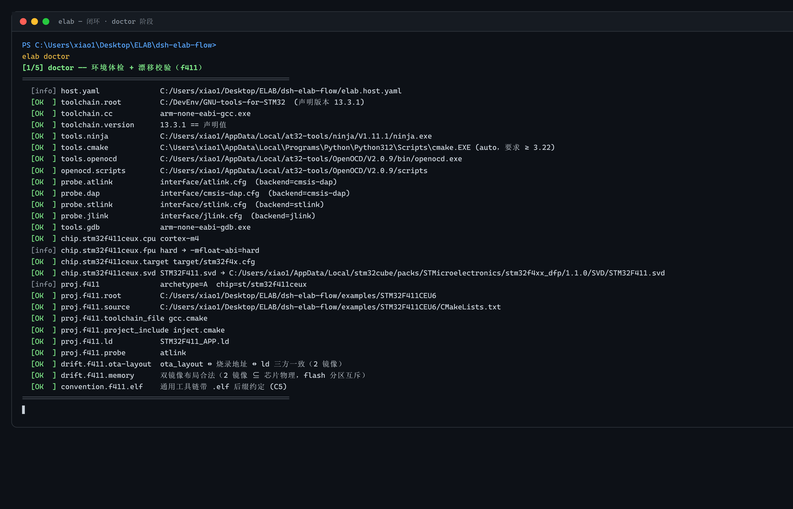
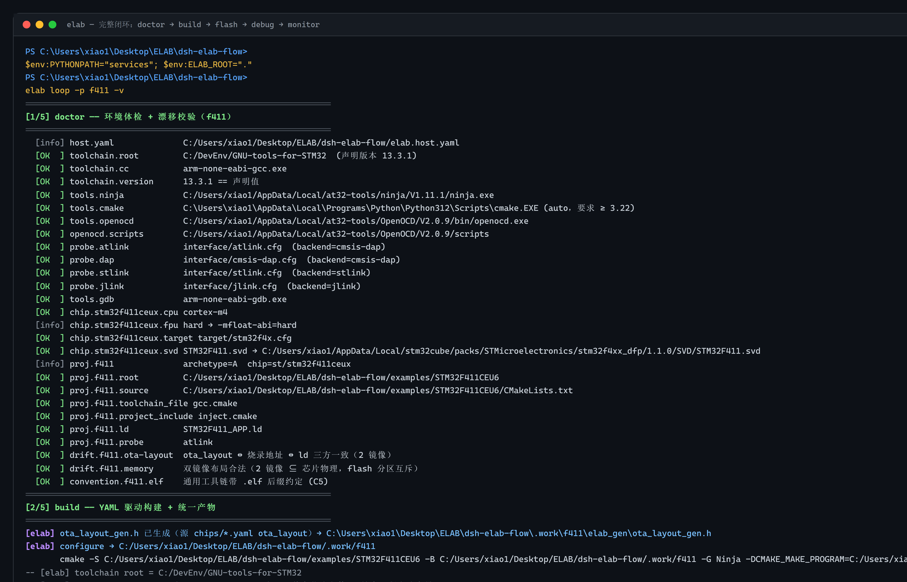
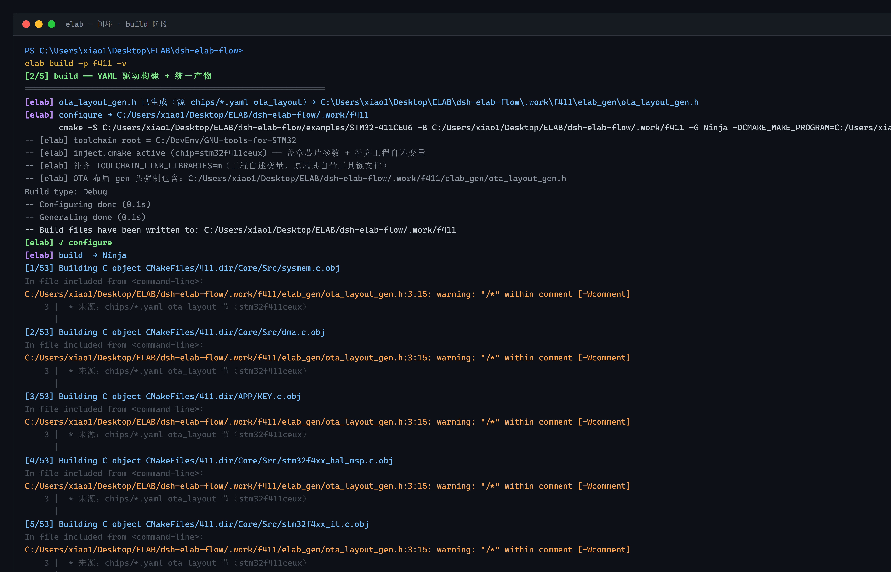
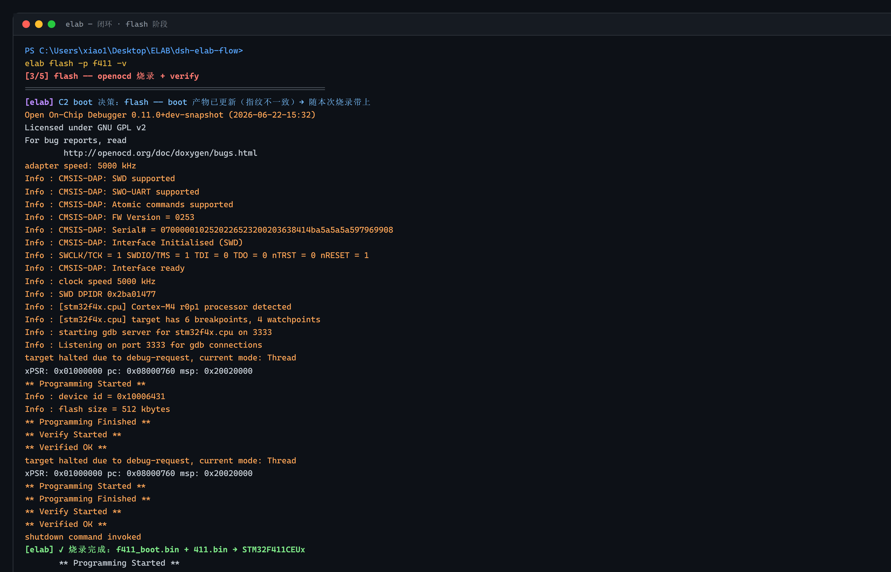
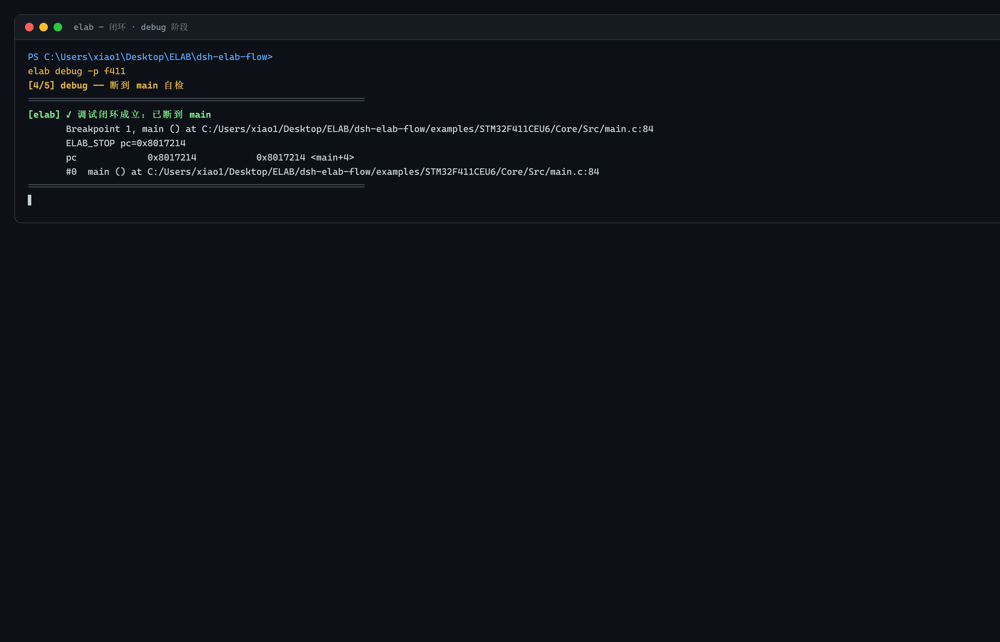
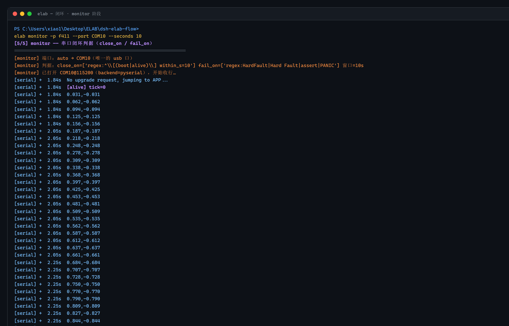
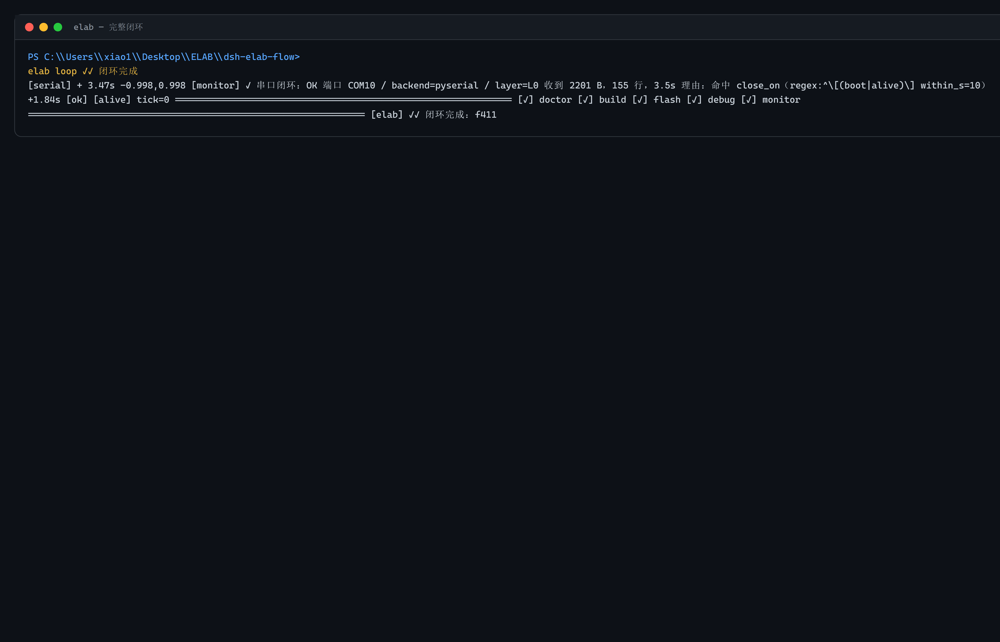

# elab CLI 终端闭环上手教程

> 本文所有截图来自 **2026-11-03 真机**：STM32F411CEU6（`f411` 工程）+ CMSIS-DAP，
> 串口 `COM10 @ 115200`，固件输出 FireWater 双通道正弦波 + `[alive] tick=N` 心跳。
> 终端为 Windows PowerShell 深色主题；输出按内容类型自动着色，不同阶段一目了然。

---

## 0. 一句话看懂 elab CLI

| 能力 | 命令 |
|---|---|
| **一键 5 阶段闭环** | `elab loop -p <工程> -v` |
| 体检（工具链 / 芯片 / 漂移） | `elab doctor` |
| 构建（cmake → ninja → 内存报告） | `elab build -p <工程> -v` |
| 烧录（OpenOCD + verify） | `elab flash -p <工程> -v` |
| 断到 main 自检 | `elab debug -p <工程>` |
| 串口闭环判据 | `elab monitor -p <工程> --port <端口> --seconds 10` |

所有子命令共享同一套 `pack.yaml` 协议，**工程适配写在 YAML 里，终端命令不用改**。
切换芯片 = 换 `-p` 参数，终端输出自动适配芯片的 RAM/FLASH、烧录器、波特率。

---

## 1. 前置：环境准备好了吗？

先跑一次 `doctor`，elab 会自动校验：工具链版本、probe 连接、芯片参数漂移、
工程自述变量。这一步不通过，后面的 build/flash/debug 都会被拦住。

```powershell
# PowerShell 前置（elab.cmd 在仓库根可直接跑）
$env:PYTHONPATH = "services"
$env:ELAB_ROOT  = "."
.\elab.cmd doctor
```



每行标签含义：

| 标签 | 含义 | 颜色 |
|---|---|---|
| `[OK  ]` | 校验通过 | 绿色 |
| `[info]` | 提示信息（非关键） | 蓝色 |
| `[FAIL]` | 校验失败，闭环会在此终止 | 红色 |
| `drift.*` | 漂移校验：OTA 布局 ↔ 烧录地址 ↔ ld 三方一致性 | — |
| `convention.*` | 工程约定校验（如 `.elf` 后缀） | — |

上例 27 行全部 `[OK]`，从工具链到 OTA 布局一路绿灯。

---

## 2. 一条命令跑完 5 阶段闭环

真机跑的就是这条：

```powershell
.\elab.cmd loop -p f411 -v
```



一条命令 = 5 个子命令顺序执行：**doctor → build → flash → debug → monitor**，
每个阶段独立着色，阶段头用不同颜色高亮：

| 阶段 | 阶段头颜色 | 输出特征 |
|---|---|---|
| `[1/5] doctor` | 绿色 | `[OK  ]` / `[info]` 漂移校验 |
| `[2/5] build` | 青色 | Ninja 进度 `[n/53]` 蓝 + gcc 警告黄 + 内存条形图 |
| `[3/5] flash` | 橙红 | OpenOCD 探测橙色 + `** Verified OK **` 高亮 |
| `[4/5] debug` | 粉红 | 行号 + pc/寄存器 |
| `[5/5] monitor` | 紫色 | `[serial] +` 蓝色前缀 + `[alive] tick=N` 紫色心跳 |

下面拆开讲每个阶段的关键输出。

---

## 3. 分步详解：从构建到串口判据

### 第 2 步：build —— YAML 驱动 + 内存报告

```powershell
.\elab.cmd build -p f411 -v
```



**三个关键片段：**

| 片段 | 说明 |
|---|---|
| `[elab] ota_layout_gen.h 已生成` | elab 在构建前自动从 `chips/*.yaml` 的 `ota_layout` 节生成头文件 |
| `[1/53] ... [53/53]` | Ninja 进度条：f411 主工程 53 目标 + C1 级联 f411_boot 32 目标 |
| `[###.................] RAM 21864 B / 131072 B 16.68%` | **内存占用报告**：RAM / FLASH 百分比 + 条形图，build 完就能看到还剩多少 |

gcc 的 `-Wcomment` 警告是 OTA 生成头里 `/* */` 嵌套导致的，不影响构建；
`-Wimplicit-function-declaration` 是 boot 工程缺 `#include <stdio.h>`，属于示例工程的瑕疵。

**elab 的 build 不是裸跑 ninja**——它会在 cmake configure 前注入：
工具链根、CPU/FPU 参数、芯片 YAML 里的 ld 脚本、OTA 生成头、以及工程自述变量
（`elab_*` 前缀的 cmake 变量）。工具链文件只提供编译器路径，**芯片知识全部从 YAML 来**。

### 第 3 步：flash —— OpenOCD 探测 + 双镜像烧录

```powershell
.\elab.cmd flash -p f411 -v
```



烧录日志重点看三件事：

1. **CMSIS-DAP 探测**：`Info : CMSIS-DAP: FW Version = 0253` / `Info : [stm32f4x.cpu] Cortex-M4 r0p1`——
   probe 识别成功 + 芯片型号匹配，烧录前提
2. **Programming → Verify**：`** Programming Started **` → `** Programming Finished **` →
   `** Verify Started **` → `** Verified OK **`——**两次 Verified OK**，因为 f411 是 C1 级联
   （boot + app 双镜像）
3. **`[elab] ✓ 烧录完成：f411_boot.bin + 411.bin → STM32F411CEUx`**——elab 自动按 OTA 布局决定
   烧哪些 bin、烧到哪个地址，用户不需要记 `openocd -f ... -c "program xxx.bin verify reset exit"`

### 第 4 步：debug —— 断到 main 自检

```powershell
.\elab.cmd debug -p f411
```



debug 阶段做的是**断到 main 再自动 continue**——不是交互式 GDB 会话，
而是闭环的一个判据：

```
Breakpoint 1, main () at .../main.c:84
ELAB_STOP pc=0x8017214
pc             0x8017214           0x8017214 <main+4>
#0  main () at .../main.c:84
```

关键信息：`pc=0x8017214` 在 0x0800_0000 ~ 0x0808_0000 范围内（STM32F411 的 APP 区），
说明**烧录的 bin 就是当前跑的固件**，没有被 bootloader 跳到别处。

### 第 5 步：monitor —— 串口闭环判据

```powershell
.\elab.cmd monitor -p f411 --port COM10 --seconds 10
```



monitor 不是「开个串口等你手动 Ctrl+C」，它**带判据**：

| 判据 | 作用 |
|---|---|
| `close_on=['regex:^\[(boot\|alive)\] within_s=10']` | 10 秒内收到 `[alive] tick=N` 或 `[boot]` 就判定 OK 并退出 |
| `fail_on=['regex:HardFault\|Hard Fault\|assert\|PANIC']` | 收到这些关键词立刻判 FAIL |

上例命中了 `[alive] tick=0`（紫色加粗行），3.5 秒收了 2201 B / 155 行，闭环 OK：

```
[monitor] ✓ 串口闭环：OK
          端口 COM10 / backend=pyserial / layer=L0
          理由：命中 close_on（regex:^\[(boot|alive)\] within_s=10）
          +1.84s  [ok] [alive] tick=0
```

---

## 4. 闭环结果：5 个 ✓



5 个阶段全部绿勾 = 从环境到固件运行，elab 全程把关。
任何一步出问题，对应的 `[✗]` 会标红，终端里能直接看到是哪个阶段挂的。

---

## 5. 彩蛋：子命令独立跑

`loop -v` 是一键闭环，但每个子命令也能独立执行：

```powershell
# 只体检（第一次上手推荐先跑这个）
.\elab.cmd doctor

# 只构建（改了代码后快速验证能编过）
.\elab.cmd build -p f411

# 只烧录（构建已通过，直接刷进去）
.\elab.cmd flash -p f411 -v

# 调试某个断点（交互式 GDB 会话）
.\elab.cmd debug -p f411 --interactive

# 长时间监视（30 秒，只关心 alive ping）
.\elab.cmd monitor -p f411 --port COM10 --seconds 30 --close-on '^\[alive\]' --fail-on 'HardFault'

# 看工程列表
.\elab.cmd list
```

颜色规则在 render 脚本里定义，核心优先级从高到低：

```
[✓] / [✗] 汇总行       → 绿加粗 / 红加粗
[elab] ✓ / [elab] ✗    → elab 内核的阶段级 OK / FAIL
[monitor] ✓ / ✗        → 串口判据结果
[serial] + ... [alive] tick=N  → 紫色加粗（心跳）
[serial] + ... [boot]         → 绿色加粗（启动日志）
[OK  ] / [FAIL] / [info]      → doctor 标签，绿 / 红 / 蓝
OpenOCD 输出行                 → 橙色
Ninja [n/m] 进度              → 亮蓝
gcc warning                   → 黄色
阶段头 [n/5] xxx              → 按阶段配不同颜色
```

终端样式是 GitHub Dark + macOS traffic lights，截图时用 CDP 驱动 headless Chrome 做
`Emulation.setDeviceMetricsOverride` + boundingClientRect clip 截 `.term` 容器，
保证 2x deviceScaleFactor 的清晰效果。

---

## 6. 切换芯片：换 -p 就行

```powershell
# at32 系列，同上闭环
.\elab.cmd loop -p at32_test -v
```

elab 会自动从 `packs/` 加载对应厂商的 YAML（芯片参数、probe 配置、OTA 布局），
终端命令不用改，输出格式自动适配。切换 = 换适配包。
