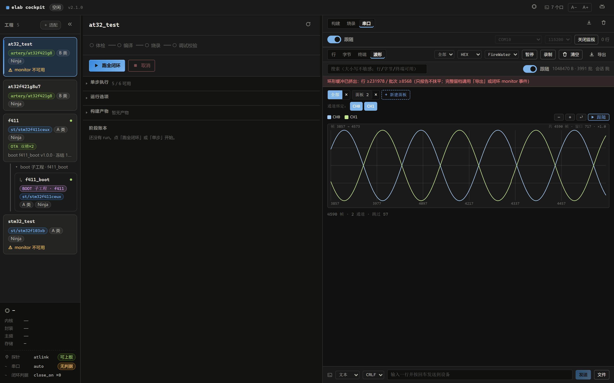
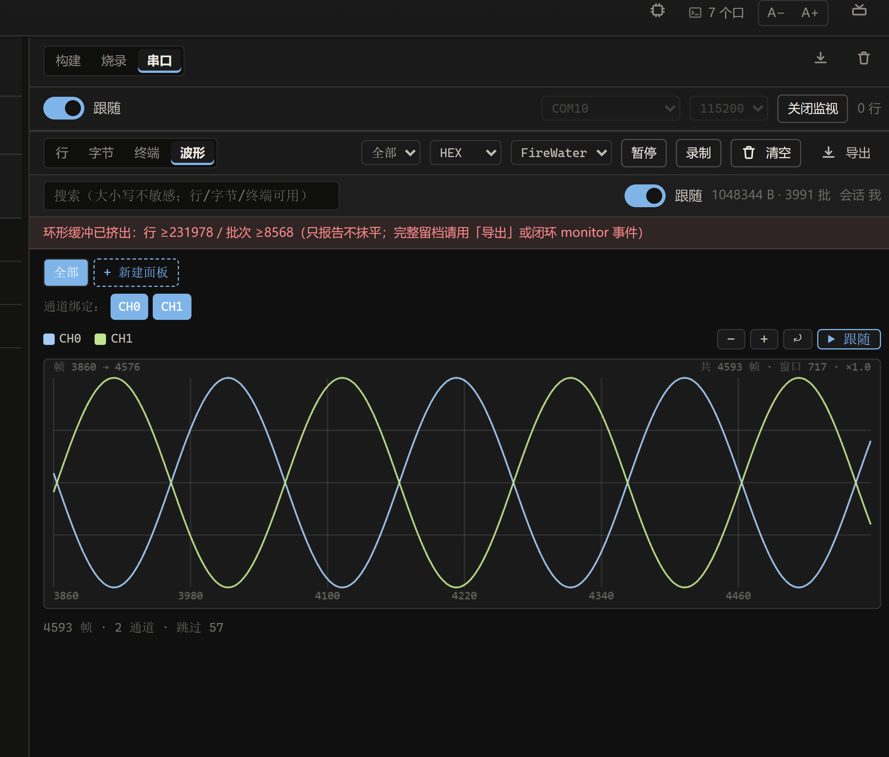
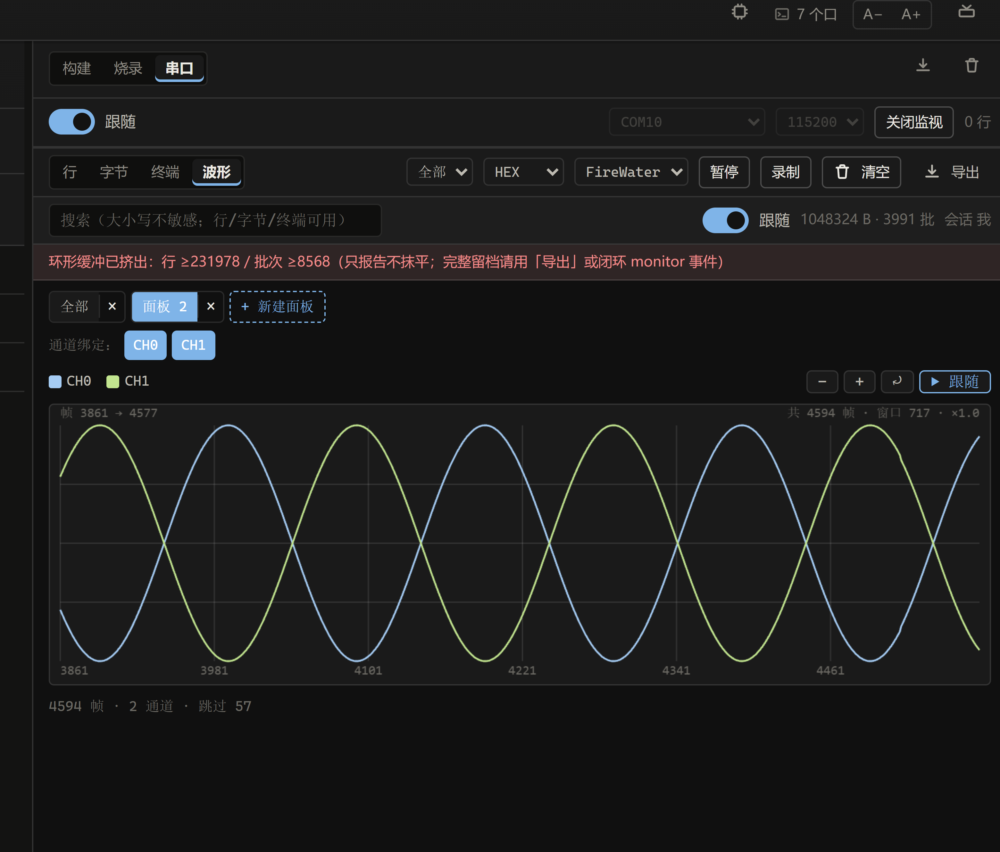
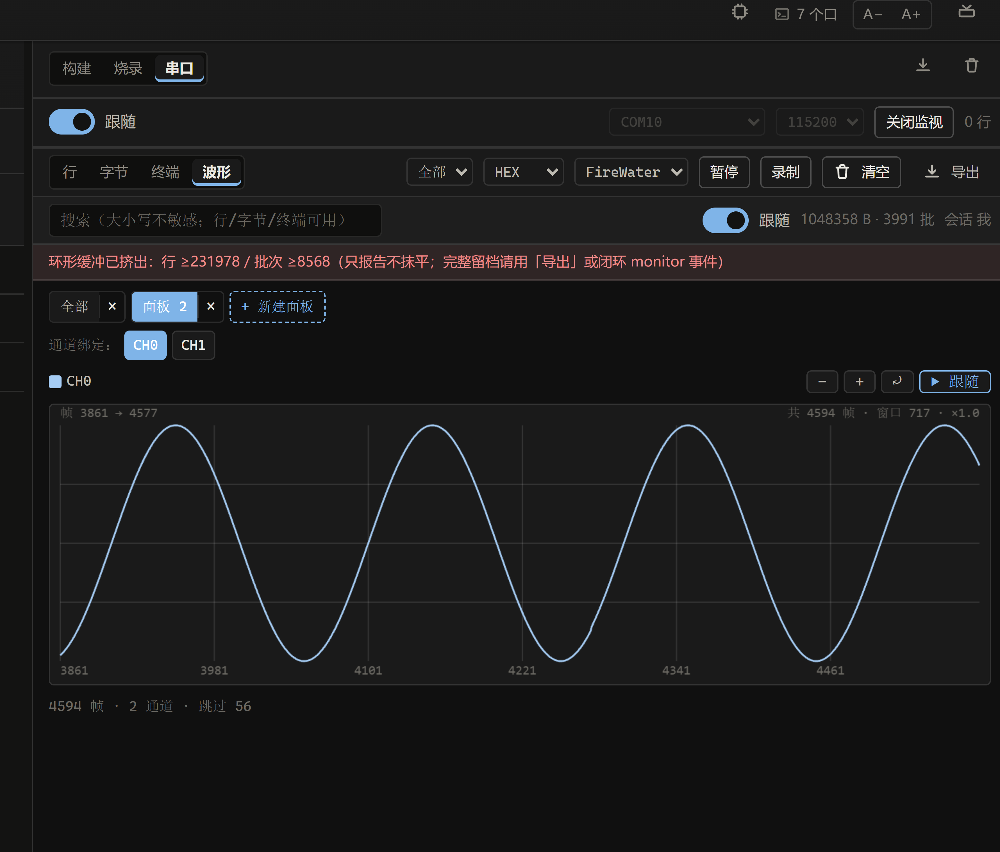
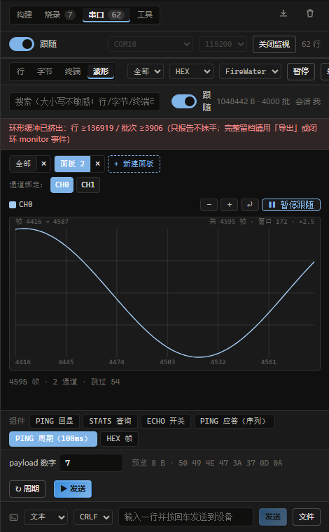
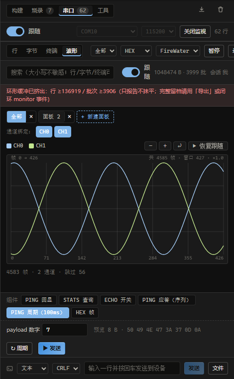
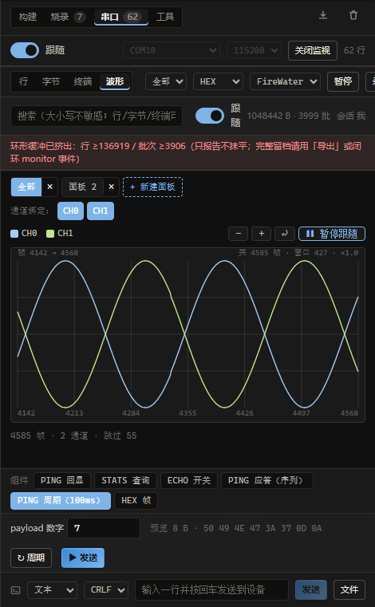
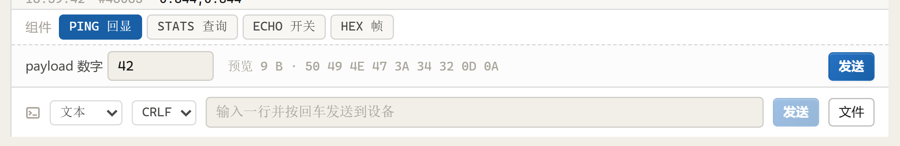
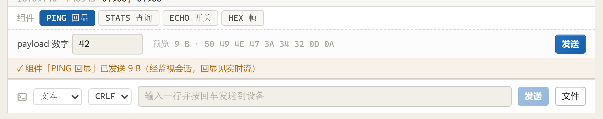
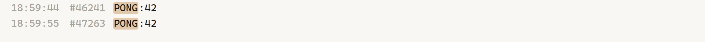

# 串口波形面板使用教程 V3（真机实操版 · 含发送组件 M1/M2/M3）

> 本文界面与截图来自 **2026-11-02 真机**：STM32F411CEU6（`f411` 工程）+ CMSIS-DAP，
> 串口 `COM10 @ 115200`，固件每 10ms 输出一行 FireWater 双通道数据。
> 独立 cockpit WebUI（`http://127.0.0.1:8333`）与 DSH 插件右侧栏 `SerialPane`
> **全部能力都已镜像**：波形（缩放/平移/多面板/定格）和发送组件（单条 / 序列 / 周期 /
> 暂停 / 停止）两边一致。
>
> **V3 最终形态**：
> - **M1**：工程级发送组件（chip + 参数 + 服务端字节预览 + 单条发送）。
> - **M2**：`send → delay → wait` 序列、周期发送（固定节拍、不重叠、错过记 `skipped`）、
>   任务轮询 / 暂停 / 恢复 / 停止。
> - **M3**：DSH 窄栏组件 UI，以及 Agent 工具 `elab_serial_widget`
>   （list / preview / run / status / cancel / pause / resume / save / delete）。
>
> 真机验收（同日）：`ping_ack` 两步 `send + wait ^PONG:` 命中；关掉固件回显后第 2 步
> 超时失败、后续步骤不执行；`ping_loop` 每 100ms 一轮，暂停后轮次冻结、恢复后
> `skipped` 如实增加，停止后 1s 内进入 `cancelled`。

---

## 0. 一句话看懂 V3

| 能力 | 入口 | 状态 |
|---|---|---|
| 缩放 / 平移 / 时间轴 | 画布滚轮、拖拽，或工具栏 `−` `+` `⤾` | ✅ |
| 多面板（分屏） | tab 条右端 `+ 新建面板` | ✅ |
| 通道绑定 | 每个面板下方 `CH0` `CH1` … chip | ✅ |
| 定格 / 恢复跟随 | 画布右上角 `❚❚ 暂停跟随` / `▶ 恢复跟随` | ✅ V3 改为动作文案 + 真冻结 |
| 每个面板独立视图 | 切 tab 不会把缩放/平移/绑定带到别的面板 | ✅ |
| **发送组件（单条）** | 串口区底部 `组件` 行：点 chip → 填参数 → `▶ 发送` | ✅ M1 |
| **序列发送** | 组件内 `send / delay / wait`；`wait` 命中才继续 | ✅ M2 |
| **周期发送** | `↻ 周期`：重复**整个组件**、固定节拍、上轮没跑完则记 `skipped` | ✅ M2 |
| **任务暂停 / 恢复 / 停止** | `❚❚ 暂停任务` / `▶ 继续任务` / `■ 停止任务` | ✅ M2 |
| 组件定义（工程级共享） | `projects/<工程>.widgets.json`（可提交 / 可导入导出） | ✅ V3 |
| DSH 窄栏组件 UI | 右侧栏 `SerialPane`：组件下拉 + 参数 + 运行/暂停/停止 + 进度 | ✅ M3 |
| Agent 全权 | `elab_serial_widget` 工具（受 `allowAgentWrite` 门禁） | ✅ M3 |

---

## 1. 进面板前的三步准备

整页布局见下图：左边是工程树，右边是串口工作区。



**① 选工程**：左侧工程列表点 `f411`（STM32F411CEU6 / CMSIS-DAP）。
**② 进串口**：右侧栏顶部切到 `串口` 工作区。
**③ 开监视**：确认端口 `COM10`、波特率 `115200`，点 `▶ 串口`（或 agent 已用
`elab_serial_monitor` 打开）；标题栏显示 `关闭监视` 就说明会话在跑。

然后才切到 **`波形`** tab——波形不是 RAW 字节流，必须先有串口数据、再选对解码器。

---

## 2. 选解码器，让曲线出来

在波形 tab 右侧的下拉框里选 **FireWater**（固件输出 `a,b\r\n` 文本行就用它；
纯二进制 float 流用 JustFloat）。

选对后立刻出现默认面板 **「全部」**，效果如下：



这张图里每个部件的作用：

| 位置 | 含义 |
|---|---|
| 左上 `全部` / 面板 tab | 当前激活的波形面板；`×` 删除面板（至少保留一个） |
| `通道绑定：CH0 CH1` | 蓝色高亮 = 该面板正在画这个通道；灰框 = 已关闭 |
| `■ CH0 ■ CH1` | 图例，颜色与曲线一致 |
| 右上 `−` `+` `⤾` | 缩小 / 放大 / 重置（全部可见并回到缓冲区开头） |
| 右上 `❚❚ 暂停跟随` / `▶ 恢复跟随` | 跟随中显示「暂停跟随」（蓝框）；点击后画面**定格**；再点「恢复跟随」跳到最新帧 |
| 画布顶部 `帧 3860 → 4576` | 当前视口左右边界对应的帧号 |
| 画布顶部右侧 `共 4593 帧 · 窗口 717 · ×1.0` | 缓冲区总帧数 / 视口帧数 / 缩放倍数 |
| 画布底部数字 | 时间轴刻度：每个数字 = 一根垂直网格线 = 该帧号 |
| 最底部 `4593 帧 · 2 通道 · 跳过 57` | 解码统计；`跳过` 是协议外字节数 |

两条线为什么能同时看清：**每个通道独立归一化**（各自 min→max 映射到画布高度），
所以量纲不同的通道也不会互相压扁。代价是 Y 轴没有绝对值刻度——要读数值回固件
或看「行」视图。

---

## 3. 新建面板 + 绑定通道（分步）

### 第 1 步：点 `+ 新建面板`



预期：tab 条变成 `全部 × | 面板 2 ×`，并且自动切到「面板 2」；新面板默认绑定全部通道。

### 第 2 步：点掉不需要的通道 chip

在「面板 2」的「通道绑定」里点一下 `CH1`：



预期：`CH1` 变为灰框、图例只剩 `CH0`、画布只剩一条线。
**注意：最后一个通道点不掉**——每个面板必须至少保留一条曲线。
「全部」面板不受影响，仍然是两条线。

> 典型用法：把量纲差得远的两路各放一个面板（CH0 一个、CH1 一个），
> 各自独立归一化，互不干扰。

---

## 4. 放大 / 平移 / 暂停

### 第 1 步：放大看局部

在「面板 2」连点 `+` 五次（或者直接在画布上滚轮上滚）：



预期：顶部右侧从 `窗口 717 · ×1.0` 变成 `窗口 288 · ×2.5`，底部帧号间隔从 120 变成 48。
滚轮缩放会**以鼠标位置为锚点**；拖拽画布可以左右平移。手动缩放/拖拽会自动把这个
面板切到暂停态（避免新帧把视口抢走）。

### 第 2 步：定格 + 回到缓冲区开头

点右上角 `❚❚ 暂停跟随`（跟随中才显示这个文案），按钮变成 `▶ 恢复跟随`，再点 `⤾` 重置：



预期：画布顶部变成 `帧 0 → 716`、倍率 `×1.0`，右边的 `共 N 帧` 仍在增长——
数据还在采，只是**画面被定格**了。

V3 起定格是**帧快照**：波形的解码窗口本身一直在滚动（永远只解最近 64 KiB），
旧版本只钉住 `offsetX`，窗一滑同样的帧号就换了数据，曲线看起来还在走；
现在定格时把这一刻的帧数组留下来，恢复跟随时才换回实时帧。

恢复：点 `▶ 恢复跟随`，视口立刻跳回最新帧。

> 顶层 subbar 的「跟随」Switch 是总开关：切换它会把**当前所有面板**的跟随状态同步成同一个值；
> 新增面板不会把你手动定格的旧面板拉回跟随。单个面板里的手动缩放/拖拽只会冻结**这个面板**。
>
> 注意区分两个「暂停」：顶部工具栏的 `暂停` 是**停止入环**（不再收新数据）；
> 画布里的 `❚❚ 暂停跟随` 只是**定格画面**，数据继续接收，恢复时直接到最新。

---

## 5. 切回「全部」：验证面板互相独立

点 tab 条的 `全部`：



预期：`全部` 依旧是 `×1.0`、两条通道、跟随最新帧；「面板 2」则保留自己的
「只画 CH0 + 暂停在帧 0」。四个状态（通道绑定、缩放、平移、跟随）**按面板各自保存**，
来回切换不会串味。

---

## 6. 发送组件（M1/M2/M3 最终形态 · 真机演示）

「组件」是**工程级共享**的发送模板：一个 chip 就是一段可重复的串口动作，
参数可以在面板上现调。定义放在工程目录：

```text
projects/<工程名>.widgets.json     # 本文 = projects/f411.widgets.json
```

选中该工程后，串口区底部会出现 `组件` 行（不开监视也能看到）。
独立 WebUI 与 DSH 右侧栏 `SerialPane` 都已镜像，两边操作语义一致。

### 6.1 界面长这样



> 这张图是 V3 初版（M1）截图；M2/M3 完成后右端按钮升级为 `▶ 发送`，
> 组件配了 `repeat` 时还会多出 `↻ 周期`；任务运行中会出现
> `❚❚ 暂停任务` / `■ 停止任务`，预览右侧显示
> `运行中 · 第 N 轮 · [跳过 X 拍] · Y B`。

| 部件 | 含义 |
|---|---|
| `组件` + chips | 本工程可用的发送组件；蓝底 = 当前选中 |
| `payload 数字` | 选中组件的参数；`PING 回显` 有一个 int 参数 `n`（默认 42） |
| `预览 9 B · 50 49 4E 47 3A 34 32 0D 0A` | **服务端**按当前参数渲染出的最终字节（`PING:42` + CRLF = 9 字节） |
| `▶ 发送`（深蓝） | 执行**一轮**组件；和下方手写发送的「发送」不是同一个 |
| `↻ 周期` | 按组件自带的 `repeat` 重复整轮；无 `repeat` 配置时内核直接拒绝，不会偷偷跑一次 |
| 进度文本 | `运行中 · 第 N 轮 · 跳过 X 拍 · Y B`；暂停 / 停止后变成 `已暂停` / `已停止` |
| `❚❚ 暂停任务` / `▶ 继续任务` | 只挡发送，不杀任务；恢复后继续下一拍 |
| `■ 停止任务` | 1 秒内退出（在等回显 / 延时中也会立即醒来） |
| 底部 `文本 / CRLF / 输入一行…` | 临时手写通道：不保存、不进组件 |

> 预览永远由**后端**计算（内核 `serialwidgets.preview`）：前端不重复实现模板、转义和取值，
> 避免“看到的字节”和“发出去的字节”不一致。

### 6.2 参数类型（参数调试就是靠这个）

| 类型 | 控件 | 说明 |
|---|---|---|
| `int` / `float` | 数字输入 | 支持 `min` / `max`；越界、NaN 直接报错，不会硬发 |
| `bool` | 开关 | 模板用 `true_value` / `false_value`（如 `ECHO_ENABLE {{en}}` → `1` / `0`） |
| `enum` | 下拉 | 固定选项，适合模式 / 档位 |
| `string` | 文本框 | 原样替换 |
| `hex` | HEX 输入 | 可带 `width`（字节数）与 `endian`，用于二进制帧 |

模板语法只有 `{{参数名}}`；要发字面量 `{{` 就写 `\{{`。

### 6.3 发一次，看回显（PING → PONG）

选中 `PING 回显`，`payload 数字` 填 `42`，点组件面板右端的 `▶ 发送`：



出现黄色提示：

```text
✓ 组件「PING 回显」已发送 9 B（经监视会话，回显见实时流）
```

切到 `行` 视图，在搜索框输入 `PONG`：



固件（[freertos.c](../../examples/STM32F411CEU6/Core/Src/freertos.c)）识别 `PING:<payload>`
后回 `PONG:<payload>`，所以这里能看到 `PONG:42` —— 参数 → 模板 → 字节 → 设备 → 回显
整条链路都通了。

### 6.4 有监视 / 无监视都能发

| 场景 | 行为 |
|---|---|
| 监视中（本文） | 直接写穿到正在读的会话；TX 立刻出现在 `字节` 视图，回显在 `行` 视图 |
| 没开监视 | 临时打开工程串口，发完即关（只写不读），不会长期占口 |
| 闭环 run 正在跑 | 串口被闭环独占，组件发送返回 `409`（先停闭环再发） |

每次发送都会在 `.work/.cockpit/serial-console.jsonl` 留档，带 `via:"widget:<id>"` 和当次
参数快照，方便事后查“这条 TX 是谁、用什么参数发的”。

### 6.5 序列：`send → delay → wait`

一个组件可以有最多 20 步，按顺序执行；任一步失败，**整轮立即停止**，后续步骤不再发。
典型写法（本文 `projects/f411.widgets.json` 里的 `ping_ack`）：

```json
{
  "id": "ping_ack",
  "label": "PING 应答（序列）",
  "format": "utf8",
  "eol": "crlf",
  "params": [{ "name": "n", "label": "payload 数字", "type": "int", "default": 42 }],
  "steps": [
    { "kind": "send", "text": "PING:{{n}}" },
    { "kind": "wait", "within_s": 1.5,
      "match": { "kind": "regex", "pattern": "^PONG:" } }
  ]
}
```

| 步骤 | 作用 |
|---|---|
| `send` | 渲染模板 → 写口；`format` / `eol` 与手写发送同一套 |
| `delay` | 纯延时（`ms`），可被暂停 / 停止立即打断 |
| `wait` | 在监视流里等一条 RX 行或一段 RX 字节，命中才继续 |

`wait` 的 `match.kind`：

| kind | 匹配方式 | 例 |
|---|---|---|
| `regex` | 正则（`pattern`） | `^PONG:` / `^OK\b` |
| `contains` | 子串（`value`） | `OK` |
| `exact` | 去首尾空白后全等（`value`） | `DONE` |
| `hex` | 十六进制字节序列（`value`，忽略空格） | `0D 0A 06` |

> `wait` 必须**先打开串口监视**：它靠连续 RX 流判断“轮到哪一行/哪一批字节”。
> 没有监视会话时内核直接返回 400，而不是假装等到。行与字节是两套序号空间，
> 内核分别推进游标，只认**本轮发送之后**的新数据，不会误命中旧回显。

真机验收：`ping_ack` 第 1 步发出 `PING:42\r\n`（9 B），第 2 步 51ms 命中 `PONG:42`；
把固件回显关掉（`ECHO_ENABLE 0`）后，第 2 步 1.5s 超时 → 任务 `failed`，
没有后续发送。

### 6.6 周期发送：固定节拍、不重叠

在组件里加 `repeat` 即可周期发送（`count: 0` = 一直跑到手动停止）：

```json
"repeat": { "interval_ms": 100, "count": 0 }
```

- 重复的是**整个组件**：`send → wait → send` 这种序列按整轮重复。
- **固定节拍**：每轮开始的基准时间按 `interval_ms` 推进；上一轮超时导致错过节拍时，
  只把错过的拍数记进 `skipped`，**不补发、不乱发**。
- 单步组件 = 纯定时发送；多步组件 = 每拍完整跑一遍序列。
- 限制：最小间隔 20ms；非周期任务最长 60s，周期任务最长 10min；
  步骤日志最多 2000 条，超出丢最旧并记 `steps_dropped`。

界面上的 `↻ 周期` **只在组件配了 `repeat` 时出现**。没有配置却请求 `repeat:true`，
内核会明确拒绝（`组件「…」没有配置 repeat，不能周期发送`），不会静默退化成发一次。

真机验收（`ping_loop`，100ms / 无限轮）：
- 运行中轮次和字节持续递增（`第 33 轮 · 264 B`）。
- 暂停 0.8s 后轮次**冻结**；恢复后 `skipped` 增加 7 拍，然后继续发。
- 点 `■ 停止任务` 后 1s 内进入 `cancelled`，不再发后续步骤。

### 6.7 暂停 / 恢复 / 停止：人始终优先

| 动作 | 语义 |
|---|---|
| `❚❚ 暂停任务` | 只挡**发送**；节拍时钟照走，停掉的拍子记 `skipped` |
| `▶ 继续任务` | 回到下一拍；不会补发暂停期间错过的拍子 |
| `■ 停止任务` | 置取消标志，步间 / 延时 / 等回显中都会在 50ms 内醒来 → `cancelled` |

- 暂停/停止**只改标志位，不杀线程**：正在写的字节不会被打断，下一步前退出。
- **人的操作优先于 agent**：agent 起的周期任务，人按暂停后必须人再按继续；
  人按停止则任务直接结束，agent 侧随后拿到 `cancelled`。
- 进度由 **400ms 轮询** `GET /api/serial/widget/job` 得到（不新增 SSE topic）；
  刷新页面会按“当前未结束任务”自动找回在跑的那一个。

### 6.8 组件文件与协作规则

```json
{
  "version": 1,
  "rev": 3,
  "widgets": [
    {
      "id": "ping",
      "label": "PING 回显",
      "group": "echo",
      "format": "utf8",
      "eol": "crlf",
      "params": [
        { "name": "n", "label": "payload 数字", "type": "int", "default": 42, "min": 0, "max": 65535 }
      ],
      "steps": [{ "kind": "send", "text": "PING:{{n}}" }]
    }
  ]
}
```

- 工程级共享、可提交、可导入导出；上限 64 KiB / 64 个组件 / 每个 20 步。
- 保存 / 删除走 `rev` 乐观锁：**人的修改不会被覆盖**（冲突返回 `409`，前端拿最新文件再合并）。
- 渲染、校验、执行全在内核 `services/elab/serialwidgets.py`；前端只展示服务端结果。
- 完整字段：`params`（类型/默认值/范围）+ `steps`（`send` / `delay` / `wait`）+
  `repeat`（`interval_ms` / `count`）；参数模板只有 `{{name}}`。

### 6.9 DSH 窄栏入口（M3）

DSH 右侧栏 `SerialPane` 的串口区里同样有组件控件（宿主没有 CSS 构建管线，全部内联样式）：

| 控件 | 说明 |
|---|---|
| 组件下拉 | 等价于独立 WebUI 的 chips；切换即重置参数 |
| 参数控件 | 按 `int/float/bool/enum/string/hex` 渲染，提交前按声明类型转换 |
| `▶ 发送` / `↻ 周期` | 与宽栏同一套内核端点；`↻` 同样只在有 `repeat` 时出现 |
| `❚❚ 暂停任务` / `▶ 继续任务` / `■ 停止任务` | 任务运行中出现，进度 400ms 轮询 |
| 进度文本 | `运行中 · 第 N 轮 · 跳过 X 拍 · Y B`，终态显示完成 / 失败 / 已停止 |

编辑组件仍推荐在独立 WebUI 做（表单更宽）；Agent 也可以通过工具直接改：

| `elab_serial_widget` action | 是否受 `allowAgentWrite` 门禁 |
|---|---|
| `list` / `preview` / `status` | 否（只读） |
| `run` / `pause` / `resume` / `cancel` | 运行受门禁；暂停/恢复/停止是**人的安全动作**，始终放行 |
| `save` / `delete` | 是（还要带 `rev`，冲突不会覆盖人的修改） |

> 工具层只走 loopback HTTP ICD（白名单在 `routes.ts`），不 import 内核源码；
> 门禁测试 `packages/dsh-elab-cockpit/test/boundary.test.mjs` 会拦越界改动。

---

## 7. 常见问题

### Q: 波形 tab 是空的 / 一直 `等待帧`
1. 串口监视是否在跑（顶部是否显示 `关闭监视`）？
2. 解码器选对了吗（FireWater ↔ JustFloat）？
3. 切到「行」tab 看有没有 RX 行——设备真的在输出吗？
4. 方向过滤是否切到了 TX（波形通常看 RX）？

### Q: 红色条 `环形缓冲已挤出：行 ≥… / 批次 ≥…`
这是**行视图**的环形缓冲满了，不是波形丢数据。波形只解最近 `64 KiB` 字节
（约上万帧）；要完整留档用「导出」或闭环 `monitor` 事件录制。

### Q: 顶部 `跳过 N` 是什么
当前解码窗口里混入了不属于该协议的字节（例如上电时的启动日志）。只要曲线正常，
少量 `跳过` 属正常；持续增大说明协议/解码器不匹配。

### Q: 通道数在 1↔2 之间跳
FireWater 是逐行文本，某些批次刚好只解出 1 列。V2 的初始化逻辑只在“通道总数变大”
时重建默认面板，不会因为抖动把你新建的面板冲掉。

### Q: 点了「暂停跟随」，画面还会有变化吗
不会。V3 起定格是**帧快照**：解码窗口本身在滚动（只解最近 64 KiB），旧版只钉住
`offsetX`，窗一滑同样的帧号就换成了新数据，所以看起来「还在跳」。现在定格时把这一刻
的帧数组留下来，恢复跟随时才换回实时帧；后台采集不受影响。

> 注意：顶部工具栏的 `暂停` 是停止入环（不再收新数据），和画布里的「暂停跟随」不是一回事。

### Q: 底部没有 `组件` 行 / 点了没反应
1. 是否选中了具体工程？组件是**工程级**的，工程为空时不显示。
2. 该工程目录下有没有 `<工程名>.widgets.json`（本文为 `projects/f411.widgets.json`）？
   文件不存在时这一行是空的，不会报错。
3. 文件有语法错误时，行上方会显示解析警告并列出被跳过的组件——按提示修 JSON。
4. 点 `▶ 发送` 出现红色提示时，看提示里的状态码：
   - `409`：串口正被闭环 run 独占（N5），先停闭环；保存组件时 `409` 是 `rev` 冲突，
     拿最新文件再合并（人的修改不会被覆盖）；
   - `400`：参数越界 / 模板渲染失败 / `wait` 没开监视 / 请求了组件没配置的 `repeat`，
     按提示改；
   - `404`：任务 id 不存在或已结束（刷新页面会自动找回当前在跑的任务）。

### Q: 周期发送怎么开 / 为什么没有 `↻ 周期`
`↻ 周期` **只在当前组件的定义里有 `repeat` 时出现**。给组件加：

```json
"repeat": { "interval_ms": 100, "count": 0 }
```

`count: 0` = 一直跑到手动停止；`count: N` = 发完 N 轮自动 `done`。单步组件就是
纯定时发送；多步组件按**整轮**重复（`send → wait → send` 整段重来）。没有 `repeat`
却请求 `repeat:true`，内核返回 400，不会偷偷发一次。

### Q: `wait` 一直超时 / 为什么必须开监视
`wait` 靠**连续 RX 流**推进行 / 字节游标，只认**本轮发送之后**的新数据。没开监视时内核
直接返回 400；开了监视但设备没回（例如固件回显被 `ECHO_ENABLE 0` 关掉），到 `within_s`
就判超时，整轮 `failed`、后续步骤不再执行。排查顺序：行视图搜目标串（如 `PONG:`）确认
真有回显 → 核对 `match.kind`（`regex` / `contains` / `exact` / `hex`）→ 检查大小写与换行。

### Q: 进度里的 `跳过 X 拍` 是什么 / 暂停后为什么还会涨
周期任务用**固定节拍**：每轮基准时间按 `interval_ms` 推进。上一轮（含 `wait`）超时导致
错过节拍时，内核只把错过的拍数记进 `skipped`，**不补发、不乱发**。暂停时发送被挡住，
节拍时钟照走，所以恢复后 `skipped` 会补记暂停期间的拍数——这是如实记账，不是丢数据。

### Q: 组件任务的暂停 / 停止，和顶部「暂停」有什么不同
`❚❚ 暂停任务` / `■ 停止任务` 只作用于**组件任务**，只改标志位、不杀线程：正在写的字节
不被打断，下一步开始前退出。顶部工具栏的 `暂停` 是**停止入环**（不再收新数据），画布里的
`❚❚ 暂停跟随` 是**定格画面**——三个「暂停」互不影响。人的暂停 / 停止**优先于 agent**：
agent 起的任务被人停了，agent 侧随后拿到 `cancelled`。

### Q: 组件发送会不会破坏串口独占
不会。写通道和手写发送共用同一套内核逻辑：有监视时写穿到监视会话，没监视时临时
开一次工程串口；闭环 run 正在跑时统一返回 `409`，两侧都不会抢口。

---

## 8. 代码位置（改功能只看这一处）

| 内容 | 独立 WebUI | DSH 插件 |
|---|---|---|
| WaveChart（缩放/平移/时间轴/跟随） | `cockpit/web/src/serial/SerialWorkspace.tsx` | `packages/dsh-elab-cockpit/src/adapters/dsh-web/SerialPane.tsx` |
| 多面板 + 通道绑定 + 每面板视图状态 | 同上（`waveViewports` / `addWaveViewport` / `setViewportChannels` / `setViewportView`） | 同上（镜像实现） |
| 跟随总开关 `setFollowAll` + 帧快照 `frozen` | 同上（`WaveChart` 内 `const shown = follow ? frames : (frozen ?? frames)`） | 同上 |
| 发送组件 UI（chips / 参数 / 预览 / 发送 / 周期 / 暂停 / 停止） | 同上（`widgetBar` / `widgetPanel` / `doWidgetRun` / `doWidgetPause` / `doWidgetCancel`；400ms 轮询 `serialWidgetJob`） | `SerialPane.tsx`（`widgetDoc` / `doWidgetRun` / `doWidgetPause` / `doWidgetCancel`，同一套 400ms 轮询） |
| 样式 | `SerialWorkspace.module.css`（`.waveVp*` / `.waveChChip*` / `.waveToolBtn` / `.widget*`） | 内联 `style` 对象（宿主无 CSS 构建管线） |
| 组件的**校验 / 渲染 / 预览 / 执行** | 内核 `services/elab/serialwidgets.py`（`_plan` / `_wait_step` / `_run_round` / `_job_main` / `job_status` / `set_paused`） | 同一个内核（不重写） |
| 组件 HTTP 端点 | `cockpit/server.py`：`GET /api/serial/widgets`（读）、`POST /api/serial/widgets`（save/delete，`rev` 乐观锁）、`POST /api/serial/widget/run`（`dry_run=true` 即预览）、`GET /api/serial/widget/job`（无 `id` = 当前未结束任务）、`POST /api/serial/widget/cancel`、`POST /api/serial/widget/pause`（`paused:true/false`） | 走同一套 loopback ICD |
| Agent 工具 | — | `elab_serial_widget`（`src/adapters/dsh-tools/tools.ts`；`run/save/delete` 受 `allowAgentWrite`，`save/delete` 另带 `rev`） |
| 工具层 ICD 白名单 / 客户端 | — | `src/adapters/kernel-http/routes.ts`、`icd-client.ts`、`src/app/ports.ts` |
| 组件定义文件 | `projects/<工程名>.widgets.json` | 同一份（工程级共享） |
| 解码 | 内核 `serial_decode`（HTTP ICD） | 同一个 loopback ICD |

**纪律**：
1. 独立 WebUI 是基准，DSH `SerialPane` 逐条镜像；两边改动必须同步。
2. 组件的模板渲染、参数校验、字节预览**只在服务端**做（唯一事实源）；前端不重复实现，
   否则「看到的字节」和「发出去的字节」会分叉。
3. 串口写通道（含组件发送）与闭环 run 的独占互斥统一由内核
   `_serial_blocker(mgr)` 拦截，不要在某一侧单独加判断。
4. `job_status` 与 `run` 必须返回**同一形状**（内核统一走 `_job_result`），否则前端与
   agent 的解析会分叉。
5. 人的暂停 / 停止是安全动作：内核 `set_paused` / `cancel` 始终放行；只有 agent 的
   `run` / `save` / `delete` 受 `allowAgentWrite` 门禁。
6. 任务进度只做 300–500ms 轮询（本文 400ms），**不新增 SSE topic**；刷新页面靠无 `id` 的
   `GET /api/serial/widget/job` 找回当前未结束任务。

---

## 附录：版本变化

### V1 → V2

| 维度 | V1 | V2 |
|---|---|---|
| 缩放 | ❌ 只能一屏全画 | ✅ ×1 ~ ×20（滚轮 / 按钮） |
| 平移 | ❌ | ✅ 拖拽 + 跟随追尾 |
| 时间轴 | ❌ 仅 `帧 N` | ✅ 帧号刻度 + 网格线 + 顶部范围/窗口/倍率 |
| 多面板 | ❌ 全部通道挤一张图 | ✅ 任意数量，独立通道绑定 |
| 跟随按钮 | ⚠️ 只滚外层容器 | ✅ 画布内独立按钮，手动操作自动暂停 |
| 面板视图 | — | ✅ 每个面板独立保存缩放/平移/绑定/跟随 |

### V2 → V3

| 维度 | V2 | V3 |
|---|---|---|
| 发送组件（M1） | ❌ 只有手写一行一行发 | ✅ 工程级自定义组件：chip + 参数 + 服务端字节预览 |
| 组件定义 | — | ✅ `projects/<工程>.widgets.json`（可提交 / 导入导出 / `rev` 乐观锁） |
| 参数调试 | — | ✅ `int` / `float` / `bool` / `enum` / `string` / `hex`，越界即在服务端拒绝 |
| 序列发送（M2） | — | ✅ `send → delay → wait`；`wait` 支持 `regex` / `contains` / `exact` / `hex`，任一步失败整轮停止 |
| 周期发送（M2） | — | ✅ `repeat`：重复整轮、固定节拍、错过记 `skipped`、不补发 |
| 任务控制（M2） | — | ✅ 暂停 / 继续 / 停止（只改标志位）+ 400ms 轮询 + 刷新找回当前任务 |
| Agent 工具（M3） | — | ✅ `elab_serial_widget`（list / preview / run / status / cancel / pause / resume / save / delete），写操作受 `allowAgentWrite` |
| DSH 窄栏（M3） | — | ✅ `SerialPane` 镜像组件 UI：组件下拉 / 参数 / 运行 / 周期 / 暂停 / 停止 / 进度 |
| 定格语义 | ⚠️ 只钉 `offsetX`，解码窗口滚动 → 曲线还在走 | ✅ 帧快照：定格即冻结当帧数组，恢复跟随才换回实时帧 |
| 跟随按钮文案 | ⚠️ 显示「状态」（跟随中显示 `▶ 跟随`，再点反而开启） | ✅ 显示「动作」：`❚❚ 暂停跟随` / `▶ 恢复跟随` |
| 跟随总开关 | ⚠️ effect 重同步，新增面板会把手动定格的面板拉回跟随 | ✅ 显式 `setFollowAll`，只同步当下已有面板 |
| 内核能力自描述 | `SERIAL_META.features` | 增加 `widget` / `widget_sequence` / `widget_wait` / `widget_repeat` / `widget_pause` |

### V3 真机验收（2026-11-02 · F411 / COM10 @115200）

| 场景 | 结果 |
|---|---|
| `ping_ack`（`send PING:42` + `wait ^PONG:` 1.5s） | ✅ 第 1 步 9 B 发出，第 2 步 51ms 命中 `PONG:42`，`state=done` |
| 关掉固件回显（`ECHO_ENABLE 0`）再跑 `ping_ack` | ✅ 第 1 步 ok、第 2 步 1.5s 超时，整轮 `failed`，无后续发送 |
| `ping_loop`（100ms / 无限轮） | ✅ 2s 后 21 轮 / 168 B；暂停后轮次冻结；恢复后 `skipped=7`；停止后 `state=cancelled` |
| 宽栏 UI（预览 / `▶ 发送` / `↻ 周期` / 暂停 / 继续 / 停止） | ✅ 预览 `9 B · 50 49 4E 47 3A 34 32 0D 0A`，进度与终态文案正确 |
| 内核单测 `tests/test_serialwidgets.py` | ✅ 45/45 |
| DSH 插件 `npm test` / `tsc` / `npm run build` | ✅ 131/131、无类型错误、构建通过 |
| 宽栏 `npx tsc --noEmit` / `npm run build` | ✅ 通过（vite 86 modules） |
