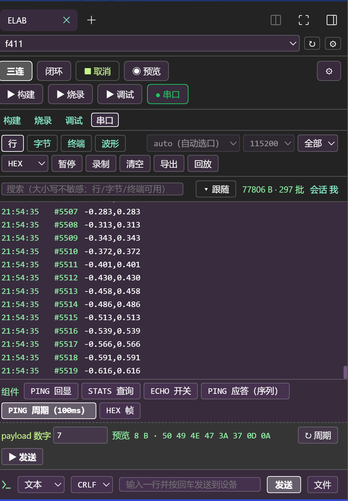
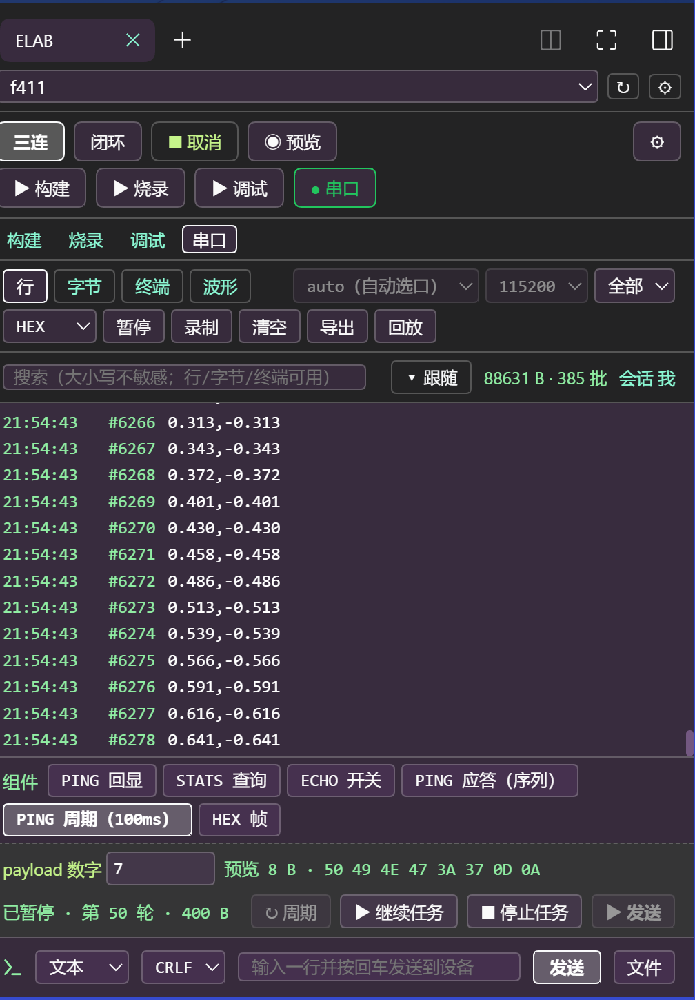
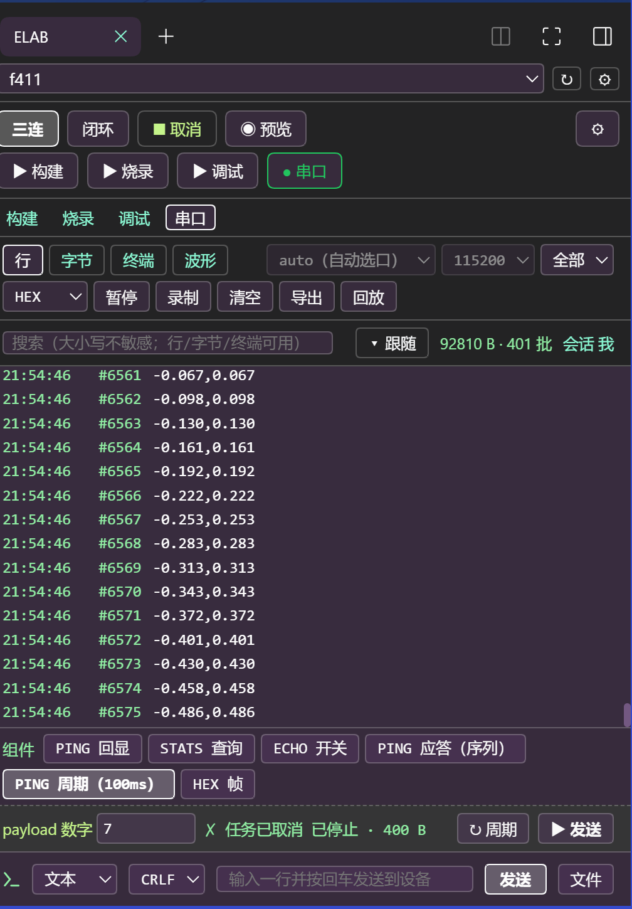

# dsh-elab-cockpit

> 本目录即插件包本体，位于主仓 [`xkk6663/elab-flow`](https://github.com/xkk6663/elab-flow)
> 的 `packages/dsh-elab-cockpit/`。插件市场按该子目录安装，npm 也从该目录发布 ——
> 没有额外的镜像/分发仓。开发、提 issue、跑门禁请到主仓（cwd = 本目录）。

elab-Flow 闭环驾驶舱的 DSH 插件 —— 一块**嵌入式闭环开发**面板，也是一个**给用户看的驾驶舱**。

> agent 在面板里发起「发现 → 适配 → 编译 → 烧录 → 调试校验 → 串口闭环」，用户在同一块窄栏里实时看到
> 阶梯进度、日志尾、RAM/FLASH 占用、串口四视图与波形 —— 不是“agent 闷头跑完再报一句结果”。
> 串口发送组件（参数化命令积木）在 DSH 窄栏与独立 WebUI 右侧栏**是同一组组件**：同一份
> `projects/<name>.widgets.json`、同一条 loopback ICD、同一套预览 / 执行 / 周期 / 暂停语义。

**插件瘦、依赖自动补齐**：插件只含工具层（面板 / 进程托管 / `elab_*` agent 工具），不内置内核源码、
芯片数据或工具二进制。首次打开面板会**自动下载内核归档并安装工具链**，唯一需要事先准备的是主机 Python 3.10+。

## 面板长什么样（真实 DSH 宿主截图）

截图全部取自真实的 DSH Desktop 右侧栏（`sidebar.right` 槽位，宽 440 px），硬件是
STM32F411CEU6 + CMSIS-DAP + COM10，工程 `f411`；同一次运行里串口正在输出 FireWater 两通道正弦。

### 行视图：设备原始数据 + 真流量统计

`[alive] tick=…` 心跳与 `-0.486,0.486` 正弦逐行滚动；右上角 `72 044 B · 275 批` 是真实 RX 流量；
底部是工程接入的发送组件行。**跟随**只由「▾ 跟随 / ↺ 恢复」按钮控制，始终贴最新一行。


### 波形视图：数字变曲线，通道可绑定

FireWater 解码器把 ASCII 行解成 2 通道；「通道绑定」CH0 / CH1 决定当前面板画哪几条，
面板级「❚❚ 暂停跟随」冻结时间窗，「− / ＋ / ⤾」控制缩放与平移。总帧数、通道数与
「帧环挤出」（内核帧环为高流量兜底的滑动窗口）都如实标注。


### 发送组件：参数 → 服务端预览 → 单条 / 周期

点 chip 展开参数（窄栏同一时间只展开一个）；预览字节由**服务端渲染**，与真正发送共用同一条路径，
所以“看到的就是发出去的”。参数类型（`int` / `bool` / `hex`…）先转成 JSON 值，服务端再校验一次。



`↻ 周期` 按 `repeat.interval_ms` 固定节拍重复整个组件（上一轮没跑完就记 `跳过`，不补发）。
本轮实测板子回 `PONG:7`，进度行显示 `运行中 · 第 35 轮 · 280 B`：


暂停只冻结节拍（轮次与字节不再增长），恢复后继续；停止是**人点即 cancelled**，1 s 内退出、不再发后续步骤：




## 与独立 WebUI（右侧栏）的一致性

| 面 | DSH 窄栏 | 独立 WebUI 右侧栏 | 一致性 |
|---|---|---|---|
| 数据通道 | loopback HTTP ICD（`/elab/api/serial/*`） | 同一 ICD | 同一份契约，工具层不 import 内核 |
| 组件来源 | `projects/<name>.widgets.json` | 同一文件 | 同一 `rev` 乐观锁 |
| 参数 / 预览 / 执行 | 服务端渲染预览 + 异步任务轮询 | 同一路径 | 预览字节 = 发送字节 |
| 周期 / 暂停 / 停止 | `↻ 周期` / `❚❚ 暂停任务` / `■ 停止任务` | 同一组语义 | 停止即 `cancelled` |
| 波形 | 多面板 + 通道绑定 + 面板级跟随 | 同一套 `WaveChart` 行为 | 只是宽度与主题令牌不同 |

窄栏只做两件事上的取舍：**布局更紧凑**（组件行贴在发送栏上方、参数行按类型定宽），以及
**跟随口径**——文本视图（行 / 字节 / 终端）跟随最新数据，波形视图不参与文本跟随（它有自己的面板级跟随），
否则窄栏内容溢出时贴底滚动会把「全部 / ＋新建面板 / 通道绑定」整行滚出可视区。

## 前置条件

| 依赖 | 说明 |
|---|---|
| **elab 内核** | 首次打开自动下载（固定版本 `v<ver>` → `~/.dsh/elab/kernels/v<ver>/`）；下载失败自动回落浅克隆；也可在设置页指定已有检出 |
| **Python 3.10+** | **唯一不能自动安装**的依赖：需在 PATH 里，或在设置页把「python 路径」填成绝对路径（缺失时自动准备暂停并给出指引） |
| 可选 `pyserial` | 串口读写；缺失时其它功能不受影响 |
| 工具链 | `arm-none-eabi-gcc` / `cmake` / `ninja` / `openocd`：缺件时**自动安装**到 `~/.dsh/elab/env`（官方上游直链 + sha256，约 400 MB，仅 Windows x64）；已装过自己的则跳过 |
| DSH | `>= 0.2.0-rc.1` |

也可以手动准备内核（三种入口共用同一内核事件流）：

```bash
git clone --depth 1 https://github.com/xkk6663/elab-flow.git D:\elab-flow
```

仓库内的 `elab.cmd`（Windows）或 `python -m elab` 也可单独使用。

## 首次打开：自动准备（零前置）

面板未找到内核时不再是一行错误 + 一堆手动按钮，而是**自动准备**：

1. **环境自检**——只读探测 python / pyserial / git（`GET /elab/env`，不启动内核）；
2. **Python 缺失即暂停**——只显示安装指引（插件**绝不代装** Python）；
3. **内核就绪**——自动下载固定版本归档到 `~/.dsh/elab/kernels/v<ver>/`；下载失败自动回落
   浅克隆（`~/.dsh/elab/kernels/clone`）；两条都失败才显示「重试」；
4. **工具链就绪**——探测缺件（arm-gcc / cmake / ninja / openocd）时自动下载环境包
   （sha256 校验 → 解压 → 版本探测，失败即中断）；已齐全则跳过；
5. **工程接入**——内核就绪后用面板里的「＋适配」接入固件目录。

自动流程幂等（已完成的不重复下载）、同一时间只跑一份、失败/暂停可单独「重试」；
设置页可关闭（`autoProvision=false`），关闭后回到原四步手动向导。
不做自动 `pip install`、不自动 `git pull`（升级内核仍手动 `git -C <elabRoot> pull --ff-only`）。

工具链装好后靠环境变量（`ELAB_ARM_GCC_ROOT` / `ELAB_CMAKE` / `ELAB_NINJA` /
`ELAB_OPENOCD` / `ELAB_OPENOCD_SCRIPTS`）注入内核子进程，**不会改写**你仓库里的
`elab.host.yaml`；你自己已装好的工具链仍然优先生效（清单里装过的目录只是前置进 PATH）。

设置页（DSH 设置 → ELAB 驾驶舱）可改 `elabRoot` / `pythonPath`，保存即热更新并写入
`~/.dsh/dsh-elab-cockpit.config.json`，重启仍生效；同页的「环境」分段复用同一探测结果。

## 面板结构

```
┌ 工程选择（会话 cwd 自动发现；↻ 重载 / ⚙ 设置）
├ 档位：三连（编译+烧录+调试） / 闭环（体检→编译→烧录→调试→串口闭环） / 取消 / 预览
├ 单步：▶ 构建 / ▶ 烧录 / ▶ 调试 / ▶ 串口
├ 通道页签：构建 | 烧录 | 调试 | 串口   （每通道独立日志 / 进度 / 占用）
└ 串口工作区：行 | 字节 | 终端 | 波形     （＋ 组件行 ＋ 发送栏）
```

- **阶梯灯**来自内核自描述（`cockpit/server.py` 的 `STEP_META` / `KERNEL_PLANS`），插件只渲染、不写死步骤。
- **RAM / FLASH 占用**是从 elf 里读出的实数，不是估算。
- 档位不可用的步骤会置灰（例如没有探针时 `onhw` 步骤被剔除），命令视图与面板视图来自同一判定。
- 一键闭环的每一步都走内核编排；SSE 事件原样透传，断线可用 `id:` 游标续传。

## 串口工作区

| 能力 | 说明 |
|---|---|
| 四视图 | **行**（解行后的文本）/ **字节**（原始批次）/ **终端**（ANSI 着色）/ **波形**（解码折线） |
| 选口 | 默认 `auto`（自动选口），也可指定 COMx；波特率默认 115200 |
| 方向 / 编码 | 方向过滤（全部 / RX / TX…）；HEX / ASCII 显示；行尾 CRLF / LF / none |
| 跟随 | 文本视图贴最新：按钮在「▾ 跟随 / ↺ 恢复」间切换，**只**由按钮控制（不反推 scroll 事件） |
| 缓冲上限 | 本地保留 行 2000 / 批 4096 / 字节 1 MB / 解码帧 1024；高流量时内核帧环兜底并标注「帧环挤出」 |
| 录制 / 回放 | `录制` 落盘可回放；`回放` 读录制文件按同一解码路径重画 |
| 导出 / 清空 | 当前视图导出；清空只清面板缓冲，不影响内核任务 |
| 解码器 | JustFloat（`N×4` 小端 float + 尾 `00 00 80 7F`）与 FireWater（ASCII 每行一个采样）等；可会话级共享（agent 选 / 人选） |
| 多面板 / 通道绑定 | `＋新建面板` 独立缩放平移；「通道绑定」CH0…CHn 决定该面板画哪几条；面板级「暂停跟随」冻结时间窗 |

> 波形页若只看到 `0 帧 · 0 通道` 且「半帧」字节数一直涨，多半是解码器没选对（设备发 ASCII 就别选 JustFloat）。

## 发送组件（M1 / M2 / M3）

组件是**参数化命令积木**，声明在 `projects/<name>.widgets.json`（UTF-8、原子写、可提交）：

```json
{
  "version": 1,
  "rev": 0,
  "widgets": [
    {
      "id": "ping_loop",
      "label": "PING 周期（100ms）",
      "format": "utf8",
      "eol": "crlf",
      "params": [{ "name": "n", "label": "payload 数字", "type": "int", "default": 7, "min": 0, "max": 65535 }],
      "steps": [{ "kind": "send", "text": "PING:{{n}}" }],
      "repeat": { "interval_ms": 100, "count": 0 }
    }
  ]
}
```

- **步骤**：`send`（模板渲染）/ `delay`（等待）/ `wait`（等一行匹配，`within_s` 内命中，正则可配）。
- **repeat**：固定节拍重复整个组件；上一轮没跑完就记 `跳过`，不补发；`count: 0` = 直到手动停止。
- **confirm**：标记为危险/写硬件的组件在面板上多点一次确认。
- **边界**：文件 ≤ 64 KB、≤ 64 组件、≤ 20 步、≤ 32 参数、label ≤ 24 字；单次运行 ≤ 60 s、
  周期总时长 ≤ 600 s；写操作带 `rev` 乐观锁，冲突返回 409，客户端重读再存。

里程碑与验收（均已真机跑通）：

| 里程碑 | 内容 |
|---|---|
| **M1** | 数据模型 / 校验 / 服务端渲染 / `dry_run` 预览 / 单条执行 / 任务状态 |
| **M2** | 参数表单、线性序列、周期发送（固定节拍 + `skipped`）、暂停 / 恢复 / 停止、400 ms 轮询 |
| **M3** | DSH 窄栏组件 UI、`elab_serial_widget` Agent 工具、`allowAgentWrite` 门禁、`rev` 乐观锁 |

**agent 与人共用的同一条路**：agent 侧走 `elab_serial_widget`（read / run / pause / cancel / save / delete）；
`allowAgentWrite=false`（默认）时运行与落盘被拒，只有人能点。人点「■ 停止任务」立刻 `cancelled`。

## 实机验证（2026-11-02，STM32F411CEU6 / COM10）

- 硬件：STM32F411CEU6（512 KB Flash / 128 KB RAM）+ CMSIS-DAP 探针 + COM10，工程 `f411`
- 串口：`auto` 选口 @115200；FireWater 两通道正弦 + 每秒 `[alive] tick=…` 心跳
- 波形：`1024 帧（显示）· 共 4773 帧 · 2 通道 · 跳过 58`（「跳过」正是心跳等非数字行）
- 组件：`PING 周期（100ms）` 实测 `运行中 · 第 35 轮 · 280 B`，板子回 `PONG:7`；
  暂停 → `已暂停 · 第 50 轮 · 400 B`；停止 → `已停止 · 400 B`
- 跟随：行缓冲封顶 2000 行后仍持续贴最新行；点「↺ 恢复」立即回底，点「▾ 跟随」后上滚保持位置

## 已知限制

- 不内置内核、不随包分发工具二进制；内核与工具链**首次打开自动下载**，可关闭自动准备。
- **主机 Python 3.10+ 必须事先存在**（插件不打包、不代装）。
- 环境包当前只覆盖 **Windows x64**；其它平台先用本机工具链（探测仍可正常工作）。
- 离线环境需预先准备内核检出与环境包解压目录。
- 环境包清单里的 `sha256` 未核对的条目会按首次下载记录（TOFU）并给出告警。
- 芯片支持来自适配包（`packs/official/**` 与社区市场），插件不承载芯片知识。
- 内核版本低于 `2.1.0` 时只提示，不阻断；步骤标签会退回插件内置默认。
- 串口组件只支持 UTF-8 / HEX 文本模板；二进制大块灌装（OTA 之外的固件下载）不在本组件模型内。

## 故障排查

| 现象 | 处理 |
|---|---|
| 向导第 1 步 python 红 | 装 Python 3.10+ 或在设置页填绝对路径 |
| 第 2 步一直找不到内核 | 确认目录同时有 `cockpit/server.py` 与 `services/elab` |
| 面板能开但编译按钮报错 | 看设置页「环境」红灯项；内核 `elab doctor` 给更准确的结论 |
| 串口打不开 | 装 `pyserial`（`pip install pyserial`），并确认没有被其它进程占用 |
| 波形 `0 帧 · 0 通道` | 解码器与设备输出协议不匹配（ASCII 行请选 FireWater） |
| 组件区空白 / `✗` 提示 | 检查 `projects/<name>.widgets.json` 是否存在、JSON 是否合法、是否超上限 |
| 周期任务不动 | 上一轮未跑完会记「跳过」；`wait` 超时会让整轮失败，检查匹配正则 |
| 面板提示"内核旧" | `git -C <elabRoot> pull --ff-only` 后重开面板 |

## 安装

本目录即插件包本体（`package.json` 自带 `dsh.bundle` / `dsh.client` 声明）。

```bash
# DSH 市场（条目指向主仓子目录）
dsh plugin --profile web add github:xkk6663/elab-flow#path:/packages/dsh-elab-cockpit

# npm
npm install dsh-elab-cockpit
```

本地开发时把本目录链接进 DSH profile 的 `node_modules` 即可，无需拷贝源码。

## 开发与验证（cwd = 主仓的 `packages/dsh-elab-cockpit`）

```bash
npm install          # devDeps：typescript / esbuild / @types/*
npm test             # 单测（含 boundary / style-rules / envpack 门禁）
npm run build        # Host 半 tsc → lib + Client 半打包 + 契约校验
```

分层纪律：工具层不 import 内核源码，只走 loopback HTTP ICD；门禁见 `test/boundary.test.mjs`。
主题纪律：组件只用 `--elab-*` 令牌，`--dsw-*` 只在 `src/adapters/dsh-web/theme/dsw-map.ts`；门禁见 `test/style-rules.test.mjs`。

## License

MIT
