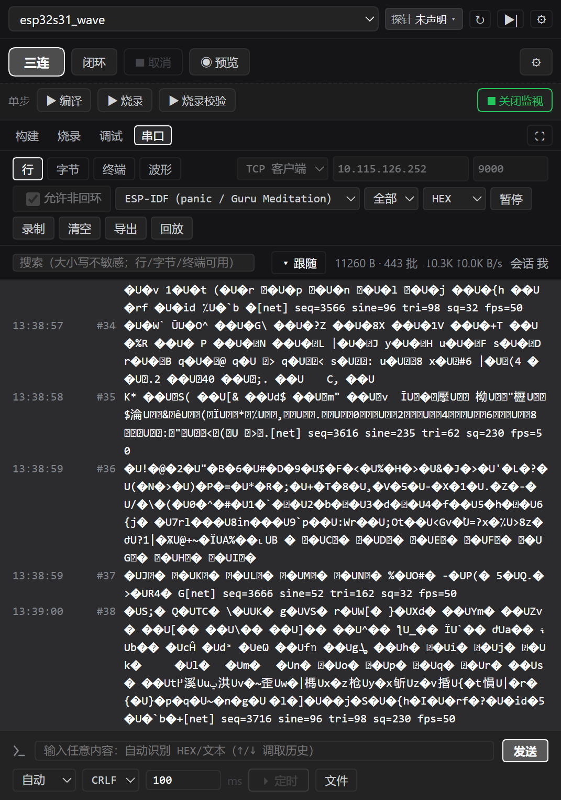

# dsh-elab-cockpit

> 本目录即插件包本体，位于主仓 [`xkk6663/elab-flow`](https://github.com/xkk6663/elab-flow)
> 的 `packages/dsh-elab-cockpit/`。插件市场按该子目录安装，npm 也从该目录发布 ——
> 没有额外的镜像/分发仓。开发、提 issue、跑门禁请到主仓（cwd = 本目录）。

elab-Flow 闭环驾驶舱的 DSH 插件 —— 一块**嵌入式闭环开发**面板，也是一个**给用户看的驾驶舱**。

> agent 在面板里发起「发现 → 适配 → 编译 → 烧录 → 调试校验 → 串口闭环」，用户在同一块窄栏里实时看到
> 阶梯进度、日志尾、RAM/FLASH 占用、串口四视图、波形与**调试工作区**（单步 / 断点 / 变量 / 寄存器）——
> 不是“agent 闷头跑完再报一句结果”。
> 串口发送面板（**自动格式识别 / 发送历史 / 定时发送**）在 DSH 窄栏与独立 WebUI 右侧栏是同一套：
> 同一条 loopback ICD、同一份内核编码入口（`serialterm.resolve_payload`）、同一个预览口径。
> 参数化发送组件仍保留给 **agent**（`elab_serial_widget`，按固定格式发送），面板不再展示组件 UI。

**插件瘦、依赖自动补齐**：插件只含工具层（面板 / 进程托管 / `elab_*` agent 工具），不内置内核源码、
芯片数据或工具二进制。首次打开面板会**自动下载内核归档并安装工具链**，唯一需要事先准备的是主机 Python 3.10+。

## 面板长什么样（真实 DSH 宿主截图）

闭环 / 串口 / 调试截图取自同一台实机、同一次 DSH 会话：STM32F103C8T6 + CMSIS-DAP + COM10@115200，
DSH Desktop 深色主题（2026-11-03）。**全部为绝对地址**，市场页可直接渲染。

### 认清面板：一个右侧栏，三块信息

页签行（`ELAB` + 刷新/设置 + **`▶|` 调试工作区入口**）→ 工程行（下拉 / 归属 / 内核状态 / ↻）→
适配横幅（自动探测结论，只读不落盘）→ 阶段梯（`编译 烧录 调试校验`：状态点 · 用时 · 证据）→
手动条（`三连` `闭环` `取消` `预览` + 单步 `▶ 构建 / 烧录 / 调试 / 串口`）→
通道日志（`构建|烧录|调试|串口` 页签 + 过滤/搜索/导出 + 面板放大/恢复）→ 底部串口工作区（行/字节/终端/波形 + 通用发送框）。


### 闭环三连：每一步落账用时与证据

编译 `RAM 57.58% · FLASH 58.66%`（取自 `.map`）→ 烧录 `Verified OK`（探针回读）→
调试校验停在 `main.c:79`。零改动时显示 `ninja: no work to do.`（构建系统确认无变更，阶段照常继续）；
任何一步失败即中断，失败行以红色语气落在对应通道。**监视开着也能直接点「三连」**：内核在烧录/调试前
自动挂起监视并释放串口，收尾按 `serial.resume_after_run` 恢复；面板通道会跟着当前步骤自动切换
（构建 → 烧录 → 调试），不会出现「编译完停在构建页、以为卡住」。

### 串口心跳：判活两条硬指标

`▶ 串口` 自动选口 @115200：相邻 `[alive]` 间隔 ≈ 1.000 s、每次 `toggles` 严格 +2（与板载 LED 同一时基）。
运行中按钮变 **`■ 关闭监视`**，再点即关闭并释放串口。判定纪律（C36）：agent 只凭串口计数判活，
「LED 均匀闪烁」必须由人肉眼确认。

### 调试工作区（`▶|` 入口）

面板右上角 `▶|` → 「开始调试」：内核起 `openocd` + `arm-none-eabi-gdb`，`monitor reset halt` 后停在 `main`。
窄栏没有源码 gutter，用**函数 / 地址断点**（可加条件）；调用栈、寄存器、变量、内存等子页签按内核
`meta.debug.features` 出现；「关闭」= `monitor reset run`（目标复位并继续跑）。

### 2026-11-05 新增：帧协议 P0/P1（位域 / 变长 / 多 ID / 组帧，STM32F103C8T6 实机）

`projects/<name>.frames.json` 的 profile 扩展了三类切帧/取字段能力：

- **位域**：字段加 `bit_offset` / `bit_length` / `bit_order`（`lsb0` 默认、`msb0` 线性大端位流）；
- **变长**：`frame.length_field` 按帧内长度字段 `total = raw*mul + add` 切帧；
- **多 ID**：`frame.id_field` + `variants`，按 id 分发字段，通道取并集、缺失为 `null`。

驾驶舱 `帧协议` 抽屉提供 4 份只读模板、**未保存草稿预览**和**字段值 → HEX 反向组帧**。
Agent 侧用两个门面：`elab_frame`（list/get/preview/save/delete/encode/templates/import）管 profile，
`elab_frame_learn`（learn/verify/auto/codegen）走自学习闭环。只写声明式 JSON，
写操作需要 `allowAgentWrite` + `rev`。窄栏仍只读选 profile。


完整演示与验收见 [串口面板教程 §5.6](../../docs/tutorials/07-串口面板使用.md)。

### 2026-11-04 新增：三条链路 / 帧协议 / 日志诊断 / 波形测量（ESP32-S31 实机）

新固件 [`examples/ESP32S31_Wave`](../../examples/ESP32S31_Wave) 专为教学做的「一眼能看懂」数据源：
**7 字节帧** `AA 55 | seq | sine | tri | sq | sum8`、50 Hz、三路形状/周期都不同的波形；
文本日志刻意分前缀——USB `[usb]`、TCP `[net]`、UDP `[udp]`，**三条链路是三个独立会话**，不是同一份数据。

> 下列截图均取自 **DSH 右侧栏的 ELAB 面板**（`dsh web` 实机，窄栏原尺寸）。

**① 选链路：串口 / TCP 客户端 / TCP 服务端 / UDP（M4）**

默认只允许回环地址；连板子或跨机时勾「允许非回环」。TCP 客户端 = 连设备/服务器，
TCP 服务端 = 本机监听等设备连入，UDP = 本机监听等设备发包（内核会记住第一个发来的对端）。



**② 帧协议（M5）：工程里定义一次，波形页直接画**

帧协议是工程数据 `projects/<name>.frames.json`。DSH 窄栏是**只读解码器**：选 profile、绑定 CH0/CH1/CH2；
新建/编辑/预览在驾驶舱（避免两套前端漂移）。本例帧 7 字节、`sum8` 校验，字段只有 `seq/sine/tri/sq`。


**③ 日志诊断（M6）：panic / 复位结构化，地址一键符号化**

规则来自工程 YAML 的 `serial.log_profiles`（ESP-IDF 的 `Guru Meditation Error`、`Backtrace:`、`rst:0x`）。
白色文本 → 结构化异常卡片；点「符号化」用工程 ELF 的 `addr2line` 把 `0x400d…` 解回函数/文件:行；
解不出来就如实报错，不编造函数名。


**④ 波形测量（M7）：游标 Δt/ΔY、每通道增益、冻结快照**

点画布放游标 A，`Shift`+点放游标 B，读数卡给出 Δt 与各通道 ΔY；「通道」面板给每条曲线独立增益/偏移；
「暂停跟随」冻结时间窗，滚轮/拖拽看历史。


**⑤ 同一份功能，三种链路的日志互不冒充**

| 链路 | 会话入口 | 文本日志前缀 | 数据 |
|---|---|---|---|
| USB 串口 | 连接方式 `串口` + COMx | `[usb]` | 二进制帧 + `[usb]` 每秒一行 |
| TCP | 连接方式 `TCP 客户端` → 板子 `IP:9000` | `[net]` | 二进制帧 + `[net]` 每秒一行 |
| UDP | 连接方式 `UDP` → 本机 `0.0.0.0:9100` | `[udp]` | 板子主动发的帧 + `[udp]` 每秒一行 |

**⑥ 断线重连（M2）**：对端主动断开/复位时，会话进入「正在重连」并标注已断开时长与最后一次错误；
恢复后同一会话自动续上（游标不跳）。串口真断线需要拔插 USB，网络链路则可能几十秒后自动恢复。


## 与独立 WebUI（右侧栏）的一致性

| 面 | DSH 窄栏 | 独立 WebUI 右侧栏 | 一致性 |
|---|---|---|---|
| 数据通道 | loopback HTTP ICD（`/elab/api/serial/*`） | 同一 ICD | 同一份契约，工具层不 import 内核 |
| 连接方式 | 串口 / TCP 客户端 / TCP 服务端 / UDP + `allow_remote` | 同一份 `netio.normalize` 校验 | 默认只许回环，跨机必须显式允许 |
| 发送编码 | `serialterm.resolve_payload`（`auto/utf8/gbk/hex` + 行尾） | 同一函数 | 预览字节 = 发送字节 |
| 历史 / 定时 | `{text,format,eol}` × 50；`POST /api/serial/loop` | 同一份 UI 核心纯函数 | 同一去重与轮询语义 |
| 帧协议 | 只读镜像：选 profile / 字段表 | 完整编辑器（新建 / 预览 / 保存） | 同一份 `projects/<name>.frames.json`，唯一编辑面在驾驶舱 |
| 日志诊断 | profile 选择 + 异常卡片 + 符号化 | 同一份 `log_profiles` 与 `symbolize` ICD | 规则是工程数据，前端不写死 |
| 断线重连 | 「正在重连 / 恢复」横幅，游标不跳 | 同一份会话状态 | 串口 / 网络同一套 `TransportLost` |
| 波形 | 多面板 + 通道绑定 + 游标 Δt/ΔY + 每通道增益 + 冻结 | 同一套 `WaveChart` 行为 | 只是宽度与主题令牌不同 |

窄栏只做两件事上的取舍：**布局更紧凑**（发送栏与预览行更短），以及
**跟随口径**——文本视图（行 / 字节 / 终端）跟随最新数据，波形视图不参与文本跟随（它有自己的面板级跟随），
否则窄栏内容溢出时贴底滚动会把「全部 / ＋新建面板 / 通道绑定」整行滚出可视区。

## 前置条件

| 依赖 | 说明 |
|---|---|
| **elab 内核** | 首次打开自动下载（固定版本 `v<ver>` → `~/.dsh/elab/kernels/v<ver>/`）；下载失败自动回落浅克隆；也可在设置页指定已有检出 |
| **Python 3.10+** | **唯一不能自动安装**的依赖：需在 PATH 里，或在设置页把「python 路径」填成绝对路径（缺失时自动准备暂停并给出指引） |
| 可选 `pyserial` | 串口读写；缺失时其它功能不受影响 |
| 工具链 | `arm-none-eabi-gcc 13.3.1` / `CMake 3.28.1` / `Ninja 1.11.1` / `OpenOCD 0.12.0-3`：缺件时**自动安装**到 `~/.dsh/elab/env`（xpack / Kitware / ninja-build 官方上游直链 + sha256，约 400 MB，仅 Windows x64）；已装过自己的则跳过。版本清单见 [`envpacks/manifest.json`](envpacks/manifest.json) |
| 探针 | 不绑定品牌：`elab.host.yaml: probes.list` 内置 `atlink` / `dap` / `stlink` / `jlink`，工程接入文件用 `debug.probe` 选择。ST-Link 免装厂商软件；J-Link 需先装 SEGGER 驱动（仍由 OpenOCD 驱动） |
| DSH | `>= 0.2.0-rc.1` |

也可以手动准备内核（三种入口共用同一内核事件流）：

```bash
git clone --depth 1 https://github.com/xkk6663/elab-flow.git D:\elab-flow
```

仓库内的 `elab.cmd`（Windows）或 `python -m elab` 也可单独使用。

## 首次打开：自动准备（零前置）

面板未找到内核时不再是一行错误 + 一堆手动按钮，而是**自动准备**：

1. **环境自检**——只读探测 python / pyserial / git（`GET /elab/env`，不启动内核）；
2. **Python 缺失即暂停**——只显示安装指引（插件**绝不代装** Python）；
3. **内核就绪**——自动下载固定版本归档到 `~/.dsh/elab/kernels/v<ver>/`；下载失败自动回落
   浅克隆（`~/.dsh/elab/kernels/clone`）；两条都失败才显示「重试」；
4. **工具链就绪**——探测缺件（arm-gcc / cmake / ninja / openocd）时自动下载环境包
   （sha256 校验 → 解压 → 版本探测，失败即中断）；已齐全则跳过；
5. **工程接入**——内核就绪后用面板里的「＋适配」接入固件目录。

自动流程幂等（已完成的不重复下载）、同一时间只跑一份、失败/暂停可单独「重试」；
设置页可关闭（`autoProvision=false`），关闭后回到原四步手动向导。
不做自动 `pip install`、不自动 `git pull`（升级内核仍手动 `git -C <elabRoot> pull --ff-only`）。

工具链装好后靠环境变量（`ELAB_ARM_GCC_ROOT` / `ELAB_CMAKE` / `ELAB_NINJA` /
`ELAB_OPENOCD` / `ELAB_OPENOCD_SCRIPTS`）注入内核子进程，**不会改写**你仓库里的
`elab.host.yaml`；你自己已装好的工具链仍然优先生效（清单里装过的目录只是前置进 PATH）。

设置页（DSH 设置 → ELAB 驾驶舱）可改 `elabRoot` / `pythonPath`，保存即热更新并写入
`~/.dsh/dsh-elab-cockpit.config.json`，重启仍生效；同页的「环境」分段复用同一探测结果。

## 面板结构

```
┌ 工程选择（会话 cwd 自动发现；↻ 重载 / ⚙ 设置）
├ 档位：三连（编译+烧录+调试） / 闭环（体检→编译→烧录→调试→串口闭环） / 取消 / 预览
├ 单步：▶ 构建 / ▶ 烧录 / ▶ 调试 / ▶ 串口（监视运行时变 ■ 关闭监视，再点即关闭并释放串口）
├ 通道页签：构建 | 烧录 | 调试 | 串口   （每通道独立日志 / 进度 / 占用）
└ 串口工作区：行 | 字节 | 终端 | 波形     （＋ 组件行 ＋ 发送栏）
```

- **阶梯灯**来自内核自描述（`services/elab/flow.py` 的 `STEP_META` / `KERNEL_PLANS`），插件只渲染、不写死步骤。
- **RAM / FLASH 占用**是从 elf 里读出的实数，不是估算。
- 档位不可用的步骤会置灰（例如没有探针时 `onhw` 步骤被剔除），命令视图与面板视图来自同一判定。
- 一键闭环的每一步都走内核编排；SSE 事件原样透传，断线可用 `id:` 游标续传。

## DSH 界面：agent 调用教程（跨工程生效）

### 上手流程

1. **装**：`dsh plugin --profile web add github:xkk6663/elab-flow#path:/packages/dsh-elab-cockpit`，重载窗口后右栏出现 **ELAB** tab。
2. **开**：点开 ELAB tab，保持与对话同屏。面板按会话 cwd 找 elab 根，工程轨列出 `projects/*.yaml` 与芯片事实。
3. **说**：第一次先让它调 `elab_guide` 自检；之后直接下指令（见下方话术表）。
4. **看**：agent 发起 run 后，面板**自动切到对应工程**，阶梯与四通道实时刷新，发起方标 `agent`，你随时可点「■ 取消」。

装好插件后，**不需要在每个新工程里再写 `AGENTS.md` 或 skill**，agent 就能知道这些工具该怎么用：

| 机制 | 生效范围 | 内容 |
|---|---|---|
| `elab_*` 工具注册 | 进程级（所有会话） | 编译 / 烧录 / 调试 / 串口的结构化工具；`autoExposeTools` 默认开。**混合门面**：6 门面 + 8 细粒度 = 14 个（`toolMode: facade` 默认；`both` 额外注册旧名别名） |
| 常驻系统提示段 | 进程级（所有会话） | 插件挂载时注册 `plugin:elab-cockpit`：工具有哪些、推荐顺序、单飞/互斥/写门控/判活纪律 |
| `elab_guide` 工具 | 按需调用 | **意图树**（每个动作带同义词/前置条件/示例）+ 旧名迁移表 + 规则 + 面板说明；只读、不启动内核，第一次接手工程或不确定用哪个工具时先调它 |
| `.agents/skills` / `AGENTS.md` | 工作区级 | 只留给芯片长尾知识（引脚、坑位、验收清单）与工程约定，不再是必需项 |

> 常驻段依赖宿主挂载 `@deepseek-ai/dsh-system-prompt`；未挂载时插件静默跳过这一层，
> 工具照常可用，agent 可调 `elab_guide` 得到同一份文案。

### 一句话使唤它

```
你：用 elab 跑三连，把 RAM/FLASH 占用和失败日志给我。
agent：elab_status（拿工程名）→ elab_run(action="triple") → elab_log
```

| 你想要 | 让 agent 走的顺序 |
|---|---|
| 只编译 / 看占用 | `elab_status` → `elab_run(action="build")` → `elab_log` |
| 编译 + 烧录 + 调试校验 | `elab_status` → `elab_run(action="triple")` → `elab_log` |
| 完整体检 + 串口闭环 | `elab_status` → `elab_run(action="loop")` → `elab_log` |
| 看运行日志 / 判活 | `elab_serial(action="monitor", op="open")` → `elab_serial_wait`（等 `[alive]`）→ `elab_serial_read` |
| 解协议帧 / 改 profile / 组帧 | `elab_frame(action="list")` → `preview`（可传草稿）→ `encode` → `save`（`rev` + `allowAgentWrite`） |
| 单步 / 断点 / 寄存器 | `elab_debug(action="open")` → `action="control"` → `elab_debug_inspect` → `action="close"` |
| 接新工程 / 换芯片包 | `elab_pkg(action="adapt", write=false)`（先探测）→ `elab_pkg(action="install")` |

### 三条硬纪律（agent 会从提示段与 `elab_guide` 读到）

- **单飞**：同一会话同时最多 1 个 run；`human-busy` 时等结束或请用户点「■ 取消」，不重试刷屏。
- **互斥与门控**：串口监视占用时烧录/调试返回 `serial-busy`；串口写、适配写盘、录制默认被
  `allowAgentWrite` 拒绝（设置页可开），被拒时如实告知用户，不绕路。
- **判活**：agent 只凭串口 `tick` / `toggles` 判活；「LED 均匀闪烁」必须由用户肉眼确认（C36）。

### 可视化与人机同源

agent 发起的 run 会带 `agent` 标落在右栏面板，阶梯自动点亮、四通道日志实时滚动，用户随时可取消；
agent 读的 `elab_status` / `elab_log` / 调试会话与面板显示的是**同一份内核数据**，不存在两套状态。

## 串口工作区

| 能力 | 说明 |
|---|---|
| 四视图 | **行**（解行后的文本）/ **字节**（原始批次）/ **终端**（ANSI 着色）/ **波形**（解码折线） |
| 连接方式 | **串口** / **TCP 客户端** / **TCP 服务端** / **UDP**；非回环地址需显式勾「允许非回环」 |
| 选口 | 默认 `auto`（自动选口），也可指定 COMx；波特率默认 115200（仅串口链路） |
| 方向 / 编码 | 方向过滤（全部 / RX / TX…）；HEX / ASCII 显示；行尾 CRLF / LF / none |
| 跟随 | 文本视图贴最新：按钮在「▾ 跟随 / ↺ 恢复」间切换，**只**由按钮控制（不反推 scroll 事件） |
| 缓冲上限 | 本地保留 行 2000 / 批 4096 / 字节 1 MB / 解码帧 1024；高流量时内核帧环兜底并标注「帧环挤出」 |
| 录制 / 回放 | `录制` 落盘可回放；`回放` 读录制文件按同一解码路径重画 |
| 导出 / 清空 | 当前视图导出；清空只清面板缓冲，不影响内核任务 |
| 解码器 | JustFloat（`N×4` 小端 float + 尾 `00 00 80 7F`）、FireWater（ASCII 每行一个采样），以及**工程帧协议 profile**；可会话级共享（agent 选 / 人选） |
| 帧协议 | 工程 `projects/<name>.frames.json`；窄栏只读选 profile / 看字段表，编辑面在驾驶舱 |
| 日志诊断 | 工程 `serial.log_profiles`：panic / assert / hardfault / 复位 → 结构化异常卡片，`addr2line` 符号化 |
| 波形测量 | 点击放游标 A、`Shift`+点击放 B → Δt / ΔY；「通道」面板每通道增益/偏移；「暂停跟随」冻结时间窗 |
| 断线重连 | `reconnect` 策略见工程 `serial.reconnect`；横幅标注重连中/尝试次数，恢复后游标不跳 |
| 多面板 / 通道绑定 | `＋新建面板` 独立缩放平移；「通道绑定」CH0…CHn 决定该面板画哪几条；面板级「暂停跟随」冻结时间窗 |
| 自动格式 | 发送框默认 `自动`：明确 HEX 写法（`0x`/`\x` 前缀或分隔符 + 全十六进制 + 偶数字节）按字节发，其余按文本 |
| 发送历史 | 记住前 50 条 `{文本, 格式, 行尾}`，同内容去重移尾，点历史即回填并可直接重发 |
| 定时发送 | `⏵ 定时` 按固定间隔重复发送（`POST /api/serial/loop`，内核瞬态任务），`■ 停止定时` 立即取消 |

> 波形页若只看到 `0 帧 · 0 通道` 且「半帧」字节数一直涨，多半是解码器没选对（设备发 ASCII 就别选 JustFloat）。

## 通用发送面板

面板只保留一个入口：**输入内容 → 自动/手动选格式与行尾 → 预览字节 → 单次或定时发送**。
编码与预览都在服务端完成（`serialterm.resolve_payload`），前端不另立一套规则，
因此两个检出、两块面板看到的字节永远一致。

- 格式：`自动 / ascii / utf8 / gbk / hex`；HEX 不追加行尾，文本按选择追加 `none/LF/CR/CRLF/Tab`。
- 历史：见上表；升级前保存的纯字符串历史会被自动迁移成 `{text, format, eol}`。
- 定时：间隔 ≥ 20 ms、总时长 ≤ 600 s，固定节拍，上一轮没跑完记 `跳过`、不补发。

### 参数化组件（仅 agent）

`projects/<name>.widgets.json` 的组件模型（send/delay/wait 序列、`repeat`、`rev` 乐观锁）仍然保留，
但**不在面板展示**：它作为 agent 的「固定格式发送夹具」，通过 `elab_serial_widget`
（list / run / status / cancel / save / delete）使用。`allowAgentWrite=false`（默认）时运行与落盘被拒。

组件边界不变：文件 ≤ 64 KB、≤ 64 组件、≤ 20 步、≤ 32 参数；单次运行 ≤ 60 s、周期总时长 ≤ 600 s。

## 实机验证（2026-11-04，ESP32-S31-Korvo-1 / COM9 + 局域网 WiFi）

- 硬件：ESP32-S31-Korvo-1（16 MB Flash / 16 MB PSRAM）+ 板载 WS2812（GPIO37）+ COM9@115200；
  局域网 `Power`，板子 DHCP `10.115.126.252`，PC `10.115.126.238`
- 新固件：[`examples/ESP32S31_Wave`](../../examples/ESP32S31_Wave) —— 7 字节帧（`AA 55 | seq | sine | tri | sq | sum8`）、
  50 Hz、三路不同形状/周期的波形；USB `[usb]` / TCP `[net]` / UDP `[udp]` 前缀分链路
- 串口链路：COM9 打开 → 行视图同时看到 `[usb] seq=…` 与二进制帧（乱码是正常的，帧靠波形页解）；
  波形页选 `wave3` → 三条不同形状曲线，`50 fps`
- TCP 链路：连接方式 `TCP 客户端` → `10.115.126.252:9000` + 允许非回环 → 行视图人读日志全为 `[net]`（二进制帧为乱码）；
  波形同 `wave3`；发 `boom` → 板子打印 `Guru Meditation Error` + `Backtrace` →
  异常卡片识别，点「符号化」解回 `build_frame @ wave_main.c:…` / `app_main @ wave_main.c:…`
- UDP 链路：连接方式 `UDP` → `0.0.0.0:9100` + 允许非回环 → 行视图人读日志全为 `[udp]`（二进制帧为乱码），波形正常；
  板子主动发、内核记住对端后才允许回写
- 波形测量：游标 A/B → `Δt / ΔY`；「通道」面板每条曲线独立增益/偏移；「暂停跟随」冻结时间窗
- 帧协议：`projects/esp32s31_wave.frames.json`；样本 `AA 55 07 02 10 96 AE` 预览 `✓ 通过（1 帧，4 字段）`
- 断线重连：同一套 UI 的可控断线源演示（串口真断线需拔插 USB），重连横幅与恢复后游标连续
- 监视 ↔ 闭环（回归）：闭环含串口步骤时监视**自动让位**（挂起并释放口），run 收尾按
  `serial.resume_after_run: open` 由内核重开；面板随后点「打开监视」是**接上已有会话**
  （`adopted=true`，epoch 不变），不再报「监视已在运行」把人挡在门外；换口/换工程才拒绝

截图见 [串口面板使用教程](../../docs/tutorials/07-串口面板使用.md) 与
[DSH 插件实机上手 §10](../../docs/tutorials/05-DSH插件上手_STM32F103C8T6.md#10-2026-11-04-更新网络传输--帧协议--日志诊断--波形测量esp32-s31-实机)。

### 既有验证（2026-11-03，STM32F103C8T6 / COM10）

- 硬件：STM32F103C8T6（64 KB Flash / 20 KB RAM）+ CMSIS-DAP 探针 + COM10，工程 `STM32F103C8T6`
- 闭环：`doctor` → `build --clean` → `flash`（Verified OK）→ `monitor` 判 **ok**
- 串口：`auto` 选口 @115200；复位后打印 `[log] HAL init / clock / GPIO / DMA / UART1 / main loop`，
  主循环每秒 `[alive] test tick=…` 心跳；串口日志能直接看出程序跑到哪一步
- 收发：`PING` → `[cmd] PING -> PONG`；`STAT` 返回 `stage=main_loop` / tick / cmds / rx 字节；
  `ECHO hello-elab` 原样回显——TX → 设备 → RX 全链路验证
- 自动格式：`0x0A 0xFF` 预览 `2 B · 0A FF · 识别为 HEX`，与真发字节一致
- 定时发送：`STAT` / 200ms 实测运行态连续回显，`■ 停止定时` 后 1s 内退出
- 历史：`↑` 恢复上一条 `STAT`（含格式与行尾）
- 截图：见 [串口面板使用教程](../../docs/tutorials/07-串口面板使用.md)
- DSH 右侧栏全流程（含**调试工作区**：单步 / 断点 / 变量 / 寄存器 / 关闭恢复）：
  见 [DSH 插件实机上手](../../docs/tutorials/05-DSH插件上手_STM32F103C8T6.md)

### 既有验证（2026-11-02，STM32F411CEU6 波形）

- 硬件：STM32F411CEU6（512 KB Flash / 128 KB RAM）+ CMSIS-DAP 探针 + COM10，工程 `f411`
- 串口：`auto` 选口 @115200；FireWater 两通道正弦 + 每秒 `[alive] tick=…` 心跳
- 波形：`1024 帧（显示）· 共 4773 帧 · 2 通道 · 跳过 58`（「跳过」正是心跳等非数字行）
- 组件（历史，M2 时期的面板 UI）：`PING 周期（100ms）` 实测 `运行中 · 第 35 轮 · 280 B`，板子回 `PONG:7`；
  暂停 → `已暂停 · 第 50 轮 · 400 B`；停止 → `已停止 · 400 B`
- 跟随：行缓冲封顶 2000 行后仍持续贴最新行；点「↺ 恢复」立即回底，点「▾ 跟随」后上滚保持位置

## 已知限制

- 不内置内核、不随包分发工具二进制；内核与工具链**首次打开自动下载**，可关闭自动准备。
- **主机 Python 3.10+ 必须事先存在**（插件不打包、不代装）。
- 环境包当前只覆盖 **Windows x64**；其它平台先用本机工具链（探测仍可正常工作）。
- 离线环境需预先准备内核检出与环境包解压目录。
- 环境包清单里的 `sha256` 未核对的条目会按首次下载记录（TOFU）并给出告警。
- 芯片支持来自适配包（`packs/official/**` 与社区市场），插件不承载芯片知识。
- 内核版本低于 `2.1.0` 时只提示，不阻断；步骤标签会退回插件内置默认。
- 常驻系统提示段依赖宿主挂载 `@deepseek-ai/dsh-system-prompt`；缺失时只剩工具 schema 与 `elab_guide`，agent 不一定主动想起这些工具。
- 串口组件（仅 agent）只支持 UTF-8 / HEX 文本模板；二进制大块灌装（OTA 之外的固件下载）不在组件模型内。
- 自动格式是**保守识别**：裸十六进制字符串（如 `1234`）按文本发送，要发字节请写 `0x12 0x34` 或 `12,34`。

## 故障排查

| 现象 | 处理 |
|---|---|
| 向导第 1 步 python 红 | 装 Python 3.10+ 或在设置页填绝对路径 |
| 第 2 步一直找不到内核 | 确认目录同时有 `cockpit/server.py` 与 `services/elab` |
| 面板能开但编译按钮报错 | 看设置页「环境」红灯项；内核 `elab doctor` 给更准确的结论 |
| 串口打不开 | 装 `pyserial`（`pip install pyserial`），并确认没有被其它进程占用 |
| 波形 `0 帧 · 0 通道` | 解码器与设备输出协议不匹配（ASCII 行请选 FireWater） |
| 定时发送不动 | 上一轮未发完会记「跳过」；检查间隔 ≥ 20 ms、闭环/组件任务是否占用串口 |
| 自动识别成了文本 | 裸十六进制按文本处理；改写 `0xNN` 或 `NN,NN` 后看预览行确认 |
| 面板提示"内核旧" | `git -C <elabRoot> pull --ff-only` 后重开面板 |
| agent 不会用 elab，只回 "Install or manage DSH plugins" | 插件未启用 / `autoExposeTools` 被关 / 宿主未挂 `dsh-system-prompt` | 启用插件并让 agent 调 `elab_guide` 验证工具面；仍不行则整体重启 DSH Desktop |

## 安装

本目录即插件包本体（`package.json` 自带 `dsh.bundle` / `dsh.client` 声明）。

```bash
# DSH 市场（条目指向主仓子目录）
dsh plugin --profile web add github:xkk6663/elab-flow#path:/packages/dsh-elab-cockpit

# npm
npm install dsh-elab-cockpit
```

本地开发时把本目录链接进 DSH profile 的 `node_modules` 即可，无需拷贝源码。

## 开发与验证（cwd = 主仓的 `packages/dsh-elab-cockpit`）

```bash
npm install          # devDeps：typescript / esbuild / @types/*
npm test             # 单测（含 boundary / style-rules / envpack 门禁）
npm run build        # Host 半 tsc → lib + Client 半打包 + 契约校验
```

分层纪律：工具层不 import 内核源码，只走 loopback HTTP ICD；门禁见 `test/boundary.test.mjs`。
主题纪律：组件只用 `--elab-*` 令牌，`--dsw-*` 只在 `src/adapters/dsh-web/theme/dsw-map.ts`；门禁见 `test/style-rules.test.mjs`。

## License

MIT
