# dsh-elab-cockpit

> **只读镜像**：本仓源码的唯一事实源在主仓
> [`xkk6663/elab-flow`](https://github.com/xkk6663/elab-flow) 的 `packages/dsh-elab-cockpit/`。
> 这里的提交由 CI 用 `git subtree split` 自动推送，**请勿在本仓改代码**——改动会随下次镜像被覆盖。
> 开发、提 issue、跑门禁请到主仓（`npm test` / `npm run build` 的 cwd 为 `packages/dsh-elab-cockpit`）。

elab-Flow 闭环驾驶舱的 DSH 插件 —— 一块**嵌入式闭环开发**面板，也是一个**给用户看的驾驶舱**。

> **agent 闭环开发 STM32，开发过程对用户全程可视化**：agent 在面板里发起
> 「发现 → 适配 → 编译 → 烧录 → 调试校验 → 串口闭环」，用户在右栏实时看到每一步的阶梯灯、
> 进度、日志尾、RAM/FLASH 占用和串口曲线 —— 不是"agent 闷头跑完再报一句结果"。
> 想先看效果：直接跳到[上手流程](#上手流程从芯片的正弦波看到波形可视化实机)，
> 那里有从芯片正弦波到波形可视化的五步实机截图。

**插件瘦、依赖自动补齐**：插件只含工具层（面板 / 进程托管 / `elab_*` agent 工具），
不内置内核源码、芯片数据或工具二进制。首次打开面板会**自动下载内核归档并安装工具链**，
唯一需要事先准备的是主机 Python 3.10+。

## 前置条件

| 依赖 | 说明 |
|---|---|
| **elab 内核** | 首次打开自动下载（固定版本 `v<ver>` → `~/.dsh/elab/kernels/v<ver>/`）；下载失败自动回落浅克隆；也可在设置页指定已有检出 |
| **Python 3.10+** | **唯一不能自动安装**的依赖：需在 PATH 里，或在设置页把「python 路径」填成绝对路径（缺失时自动准备暂停并给出指引） |
| 可选 `pyserial` | 串口读写；缺失时其它功能不受影响 |
| 工具链 | `arm-none-eabi-gcc` / `cmake` / `ninja` / `openocd`：缺件时**自动安装**到 `~/.dsh/elab/env`（官方上游直链 + sha256，约 400 MB，仅 Windows x64）；已装过自己的则跳过 |
| DSH | `>= 0.2.0-rc.1` |

也可以手动准备内核（三种入口共用同一内核事件流）：

```bash
git clone --depth 1 https://github.com/xkk6663/elab-flow.git D:\elab-flow
```

仓库内的 `elab.cmd`（Windows）或 `python -m elab` 也可单独使用。

## 首次打开：自动准备（零前置）

面板未找到内核时不再是一行错误 + 一堆手动按钮，而是**自动准备**：

1. **环境自检**——只读探测 python / pyserial / git（`GET /elab/env`，不启动内核）；
2. **Python 缺失即暂停**——只显示安装指引（插件**绝不代装** Python）；
3. **内核就绪**——自动下载固定版本归档到 `~/.dsh/elab/kernels/v<ver>/`；下载失败自动回落
   浅克隆（`~/.dsh/elab/kernels/clone`）；两条都失败才显示「重试」；
4. **工具链就绪**——探测缺件（arm-gcc / cmake / ninja / openocd）时自动下载环境包
   （sha256 校验 → 解压 → 版本探测，失败即中断）；已齐全则跳过；
5. **工程接入**——内核就绪后用面板里的「＋适配」接入固件目录。

自动流程幂等（已完成的不重复下载）、同一时间只跑一份、失败/暂停可单独「重试」；
设置页可关闭（`autoProvision=false`），关闭后回到原四步手动向导。
不做自动 `pip install`、不自动 `git pull`（升级内核仍手动 `git -C <elabRoot> pull --ff-only`）。

工具链装好后靠环境变量（`ELAB_ARM_GCC_ROOT` / `ELAB_CMAKE` / `ELAB_NINJA` /
`ELAB_OPENOCD` / `ELAB_OPENOCD_SCRIPTS`）注入内核子进程，**不会改写**你仓库里的
`elab.host.yaml`；你自己已装好的工具链仍然优先生效（清单里装过的目录只是前置进 PATH）。

设置页（DSH 设置 → ELAB 驾驶舱）可改 `elabRoot` / `pythonPath`，保存即热更新并写入
`~/.dsh/dsh-elab-cockpit.config.json`，重启仍生效；同页的「环境」分段复用同一探测结果。

## 实机上机验证（STM32F411CEU6，2026-11-01）

面板用真实 `CockpitPane` 渲染、经 loopback ICD 驱动内核，下列截图是**同一次真机运行**的原始界面
（未做任何摆拍或改数）。

- 硬件：STM32F411CEU6（512 KB Flash / 128 KB RAM）+ CMSIS-DAP 探针（`atlink`）+ COM10
- 工程：`f411` —— OTA 双槽 `boot@0x08000000` + `app@0x08010000`；内核 2.1.0 / 适配包 `st/stm32`

### 单步功能

| 步骤 | 实机结果 |
|---|---|
| 编译 | 成功 7.07 s；RAM 16.28% / FLASH 8.49%（`411.elf` = 38956 B，APP 区 448 KB） |
| 烧录 | 成功 7.16 s；双镜像 `f411_boot.bin`→`0x08000000`、`411.bin`→`0x08010000`，两段 Programming + Verified OK，device id `0x10006431` |
| 调试校验 | 成功 5.86 s；GDB 命中断点 `main ()`（`main.c:84`），`ELAB_STOP` / `PC 0x8017214` |
| 串口 | COM10 自动选口 @115200；`[alive] tick=…` 连续输出（471 B · 23 批），行/字节/终端/波形四视图 + 发送 |

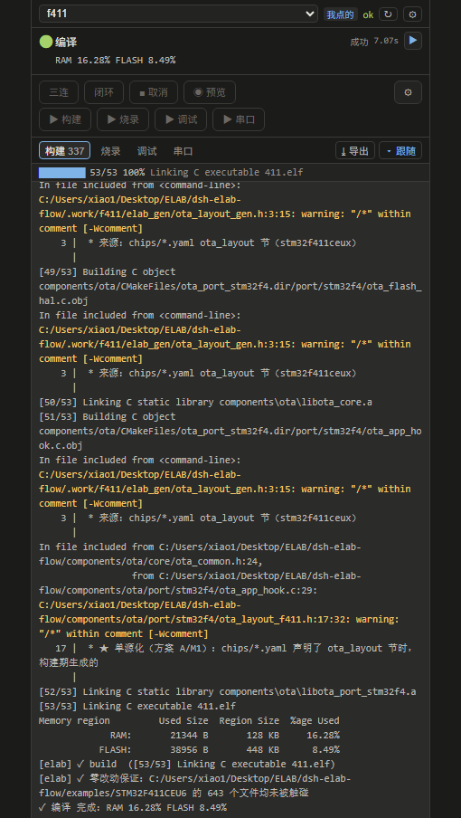
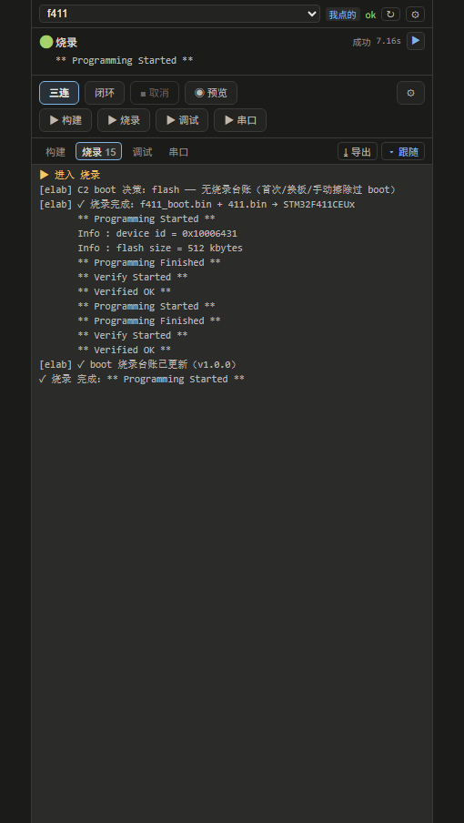
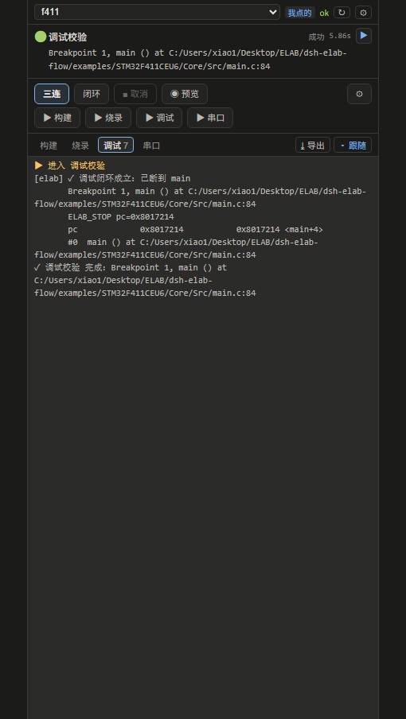
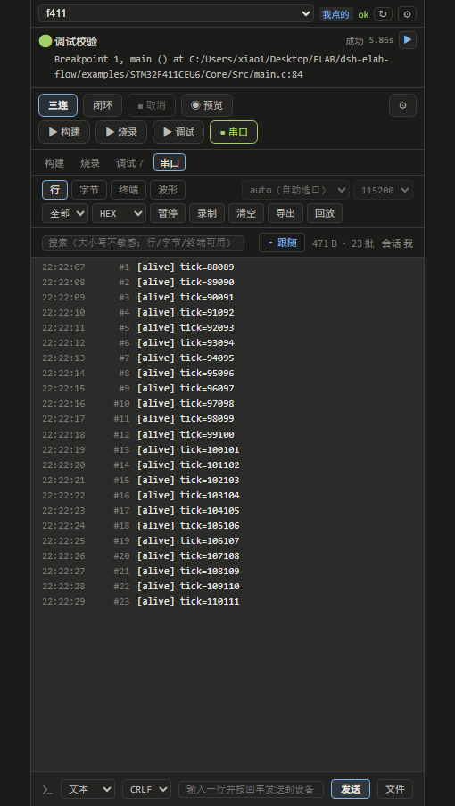

### 一键闭环（体检 → 编译 → 烧录 → 调试校验 → 串口闭环）

| 步骤 | 实机结果 |
|---|---|
| 体检 | 成功 0.20 s（`全绿`：工具链 / ninja / cmake / openocd / 探针 / 适配包） |
| 编译 | 成功 10.43 s |
| 烧录 | 成功 3.57 s |
| 调试校验 | 成功 4.04 s |
| 串口闭环 | 成功 3.61 s —— 命中 `close_on: regex ^\[(boot|alive)\] within_s=10` |

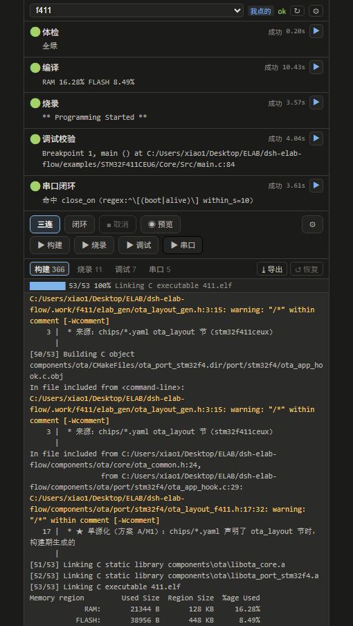
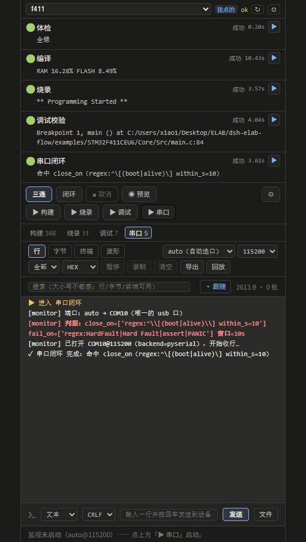

> 本次实测还修掉一处面板缺陷：`run/end` 到达时主动断流后 `EventStream` 不再回调 `onClosed`，
> `busy` 未复位会让「▶ 构建 / 烧录 / 调试 / 串口」在**跑完一次后永久变灰**（现在收尾即复位，
> 单测 `cockpit-service.test.mjs` 已加断言）。

## 上手流程：从芯片的正弦波看到波形可视化（实机）

一条**最短实机路线**：让芯片自己生成一段正弦波 → 用面板把编译/烧录/调试跑通 →
在「串口」里先看到数字、再切成「波形」直接看到曲线。

下列截图全部来自**同一次真机运行**：STM32F411CEU6（512 KB Flash / 128 KB RAM）+
CMSIS-DAP 探针 + COM10，工程 `f411`，适配包 `st/stm32`，内核 2.1.0。

### 第 0 步：给芯片装一个"信号源"

示例固件 [`freertos.c`](https://github.com/xkk6663/elab-flow/blob/main/examples/STM32F411CEU6/Core/Src/freertos.c)
里，`StartTask02` 每 **10 ms** 采一个 **0.5 Hz** 正弦（`sinf`，相位每拍自增 `2π·0.5/100`），按
**FireWater** 协议打成一行 ASCII（`0.707\r\n`）；`defaultTask` 每秒再打一条
`[alive] tick=…` 心跳 —— 心跳既证明"芯片还活着"，也是闭环串口判据要匹配的行。

> 两个实机踩出来的坑，已经写在示例里：
> ① `myUSART` 任务栈只有 512 B，newlib 的 `printf` 会把栈压爆（实测 100 Hz 输出几秒后
>   HardFault）—— 改成 16 B 小缓冲 + `fputc` 逐字节发，`fputc` 自带互斥，与心跳行安全交错；
> ② newlib-nano 没开 `-u _printf_float`，`%f` 打不出小数 —— 按毫值拼字符串
>   （`-1.000` … `1.000`，3 位小数）。

### 第 1 步：编译

面板点「▶ 构建」。九秒左右拿到体积结论，`RAM / FLASH` 都是**从 elf 里读出来的实数**
（不是估算）：

| 项 | 本次结果 |
|---|---|
| 状态 | 成功 9.85 s |
| 链接 | `[53/53] Linking C executable 411.elf` |
| RAM | 21 352 B / 128 KB = **16.29%** |
| FLASH | 43 064 B / 448 KB（APP 区）= **9.39%** |

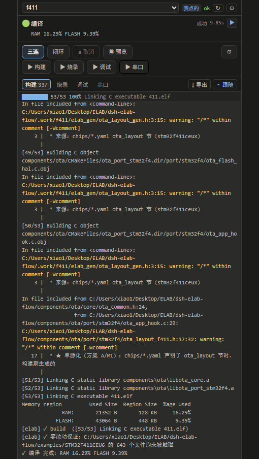

### 第 2 步：烧录

点「▶ 烧录」。日志按顺序给出**这次到底往哪写了什么**：boot 是否冻结（指纹一致就
`skip`，字节级零触碰）、`411.bin → STM32F411CEU6`、`device id`、`Programming finished`、
`verified OK`：

| 项 | 本次结果 |
|---|---|
| 状态 | 成功 3.54 s |
| boot 决策 | `skip` —— boot 冻结（`v1.0.0` 指纹一致） |
| 写入 | `411.bin → STM32F411CEU6`（`0x08010000` 槽 A） |
| 校验 | `device id = 0x10006431`、`flash size = 512 kbytes`、`verified OK` |

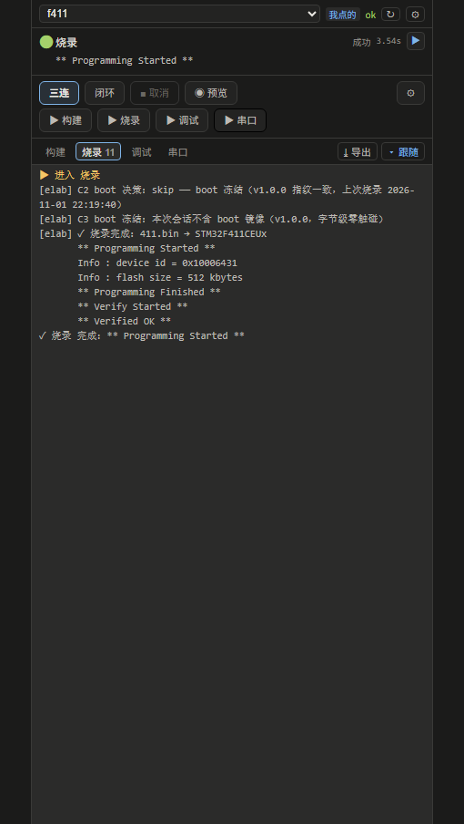

### 第 3 步：调试校验（证明"断得住"）

点「▶ 调试」。内核会起 openocd + gdb、`monitor reset halt`、`break main`、`continue`，
**命中断点才算通过**（只连上不复位不算）：

| 项 | 本次结果 |
|---|---|
| 状态 | 成功 4.82 s |
| 判据 | `✓ 调试闭环成立：已断到 main` |
| 现场 | `Breakpoint 1, main () at …/main.c:84`、`ELAB_STOP pc=0x8017214`、`#0 main ()` |

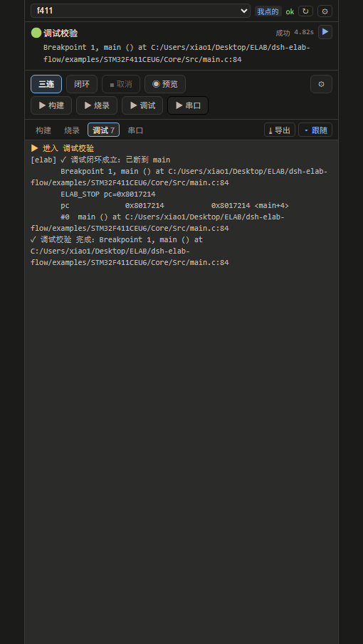

### 第 4 步：串口监视（先看见数字）

点「▶ 串口」开监视（自动选口、默认 115200），「行」视图里就是芯片吐出来的原始数据：
`0.031 / 0.062 / … / 1.000 / …` 的正弦，中间夹着每秒一条 `[alive] tick=`。
右上角的 **字节数 / 批次** 是真流量统计（本图 20 536 B · 132 批）。

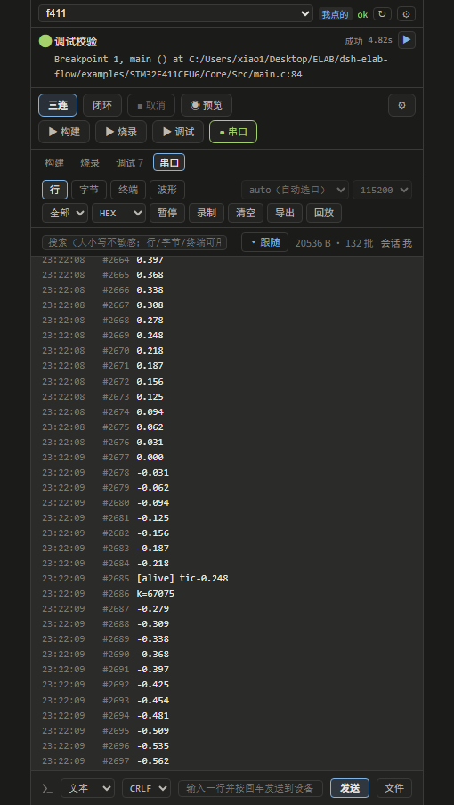

### 第 5 步：波形视图（把数字变成曲线）

切到「波形」，把解码器从默认的 `JustFloat` 换成 **FireWater**（设备发的是 ASCII 一行，
JustFloat 只认 `N×4 小端 float + 00 00 80 7F` 尾，解不出来）：

- 曲线：CH0 的 0.5 Hz 正弦（每通道独立 min/max 归一化，所以不需要关心量纲）
- 徽标：`1024 帧（显示）· 共 1702 帧 · 1 通道 · 跳过 19` —— 「跳过」正是那些
  `[alive]` 心跳行（非数字行不计入波形，也不污染通道）
- `半帧 5 B（下一批续解）`：跨批次的半截数据留到下一批再解，不丢、不裂缝

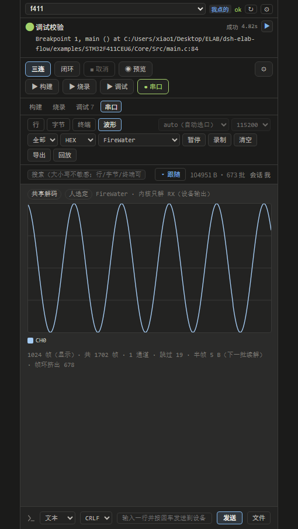

> 波形页的解码器是**会话级共享**的：agent 侧用 `serialMonitorToggle`
> （`{"action":"decoder","decoder":"firewater"}`）切换，面板下拉会跟着变、渲染同一张图 ——
> 图里那行「共享解码 · 人选定 FireWater」就是这条链路在显示"谁定的"。
> 若切到「波形」只看到 `0 帧 · 0 通道` 且「半帧」字节数一直涨，多半就是解码器没选对。

### 全流程一键跑

上面四步也可以一次点「闭环」交给内核编排（`体检 → 编译 → 烧录 → 调试校验 → 串口闭环`），
留意每步的阶梯灯：


## 已知限制

- 不内置内核、不随包分发工具二进制；内核与工具链**首次打开自动下载**，可关闭自动准备。
- **主机 Python 3.10+ 必须事先存在**（插件不打包、不代装）。
- 环境包当前只覆盖 **Windows x64**；其它平台先用本机工具链（探测仍可正常工作）。
- 离线环境需预先准备内核检出与环境包解压目录。
- 环境包清单里的 `sha256` 未核对的条目会按首次下载记录（TOFU）并给出告警。
- 芯片支持来自适配包（`packs/official/**` 与社区市场），插件不承载芯片知识。
- 内核版本低于 `2.1.0` 时只提示，不阻断；步骤标签会退回插件内置默认。

## 故障排查

| 现象 | 处理 |
|---|---|
| 向导第 1 步 python 红 | 装 Python 3.10+ 或在设置页填绝对路径 |
| 第 2 步一直找不到内核 | 确认目录同时有 `cockpit/server.py` 与 `services/elab` |
| 面板能开但编译按钮报错 | 看设置页「环境」红灯项；内核 `elab doctor` 给更准确的结论 |
| 串口打不开 | 装 `pyserial`（`pip install pyserial`），并确认没有被其它进程占用 |
| 面板提示"内核旧" | `git -C <elabRoot> pull --ff-only` 后重开面板 |

## 安装

本仓即插件包本体（`package.json` 自带 `dsh.bundle` / `dsh.client` 声明），仓库已打
GitHub topic `dsh-plugin` 供 DSH 市场发现。本地开发时把本仓链接进 DSH profile 的
`node_modules` 即可，无需拷贝源码。

> 本仓是**只读镜像**：改代码请到主仓 `xkk6663/elab-flow` 的
> `packages/dsh-elab-cockpit/`，打 `plugin-v*` tag（或手动触发 `publish-plugin`）
> 后由 CI 强推到这里。

## 开发与验证（cwd = 主仓的 `packages/dsh-elab-cockpit`）

```bash
npm install          # devDeps：typescript / esbuild / @types/*
npm test             # 单测（含 boundary / style-rules / envpack 门禁）
npm run build        # Host 半 tsc → lib + Client 半打包 + 契约校验
```

分层纪律：工具层不 import 内核源码，只走 loopback HTTP ICD；门禁见 `test/boundary.test.mjs`。

## License

MIT
